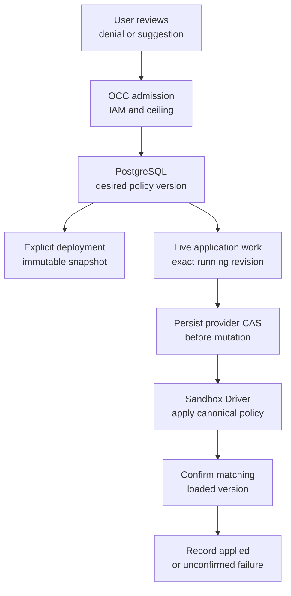

# Agent sandbox policy flow

## Overview

OCC persists governed network additions for one Agent, freezes them at deployment,
and optionally applies a later version through its Sandbox Driver. Denial logs
and provider recommendations supply independent context for a user review.
This trace describes the implemented source; runtime proof has separate limits.

## Entry Points

- Trigger: the console Policy denials tab or `occ agent policy` commands.
- Source: `apps/controller/src/http/sandbox-policy.ts:sandboxPolicyHandlers` and
  `packages/occ/src/index.ts:updateAgentSandboxPolicy` / `applyAgentSandboxPolicy`.
- Assumptions: a ready Namespace, active Agent, exact grants, enabled editing for
  mutations, and an Installation ceiling shared by API and worker.

## Flow

The solid arrows trace source paths, not a claim that all providers are verified.

## Execution Trace

### 1. Admit and persist desired additions

`packages/occ/src/index.ts:updateAgentSandboxPolicy` independently authorizes
Agent `manage_policy` and SandboxPolicy `update`, locks the Namespace and Agent,
and checks editing, expected version, pending work, complete ceiling coverage,
and Driver admission. `apps/controller/src/http/sandbox-policy.ts` records the
nonsecret approved additions with their version in the same transaction.
The required facet argument currently admits `networking` only. Other facets
fail before network policy access. The temporary
`TEMPORARY_API_WILL_BREAK_IN_FUTURE_setAgentSandboxPolicyEditing` requires
Installation and Agent administration; Guardrails will replace this switch.

Both state adapters return `sandboxPolicyEditing: false` at Agent creation,
matching the PostgreSQL column default and subsequent reads. The separately
authorized editing operation changes this flag.

`packages/occ/src/state/postgres-state.ts` performs versioned updates. Agent
creation creates its one policy through a database trigger. Constraints enforce
ownership, document shape, immutable application identity, version transitions,
and application revision ownership. Agent deletion cascades policy removal and
cleans its exact IAM access.

### 2. Freeze deployment or enqueue live application

`packages/occ/src/index.ts:deployAgent` freezes the Driver's defaults and additions
into `AgentRevision.sandboxPolicy`. The OpenShell Driver provisions from this
snapshot rather than re-reading changed defaults.

`applyAgentSandboxPolicy` requires the exact active revision and supporting
Driver. It persists a pending application and durable Agent-target work in one
transaction. Neither saving nor enqueueing establishes enforcement.

### 3. Reconcile provider effects

`apps/controller/src/worker/sandbox-policy.ts:reconcileSandboxPolicy` locks the
same lifecycle owners and rechecks current authority, ceiling, Driver identity,
and Compute placement. One pass records the provider CAS version; a later pass
can mutate with that fixed version and operation ID. Provider reads and effects
are bounded by the claim lease. Database and audit failures roll back the pass.

`apps/controller/src/drivers/sandbox/openshell.ts` verifies exact provider
ownership, preserves the Sandbox's static policy and generated access, and uses
native status/UpdateConfig RPCs. A full candidate match plus loaded active version
is required for `applied`. Transient or unknown outcomes retry within limits;
terminal stale work becomes an unconfirmed failure. The worker calls
`failAbandonedSandboxPolicies` inside the same `transactWithQueue` that recovers
exhausted work, so queue failure, application failure, and audit either all commit
or remain recoverable after interruption. A failed live request does
not deploy another revision. Last confirmed live evidence is retained separately.

### 4. Read contextual evidence

`openshell-log-decisions.ts:openShellLogDecision` decorates recognized provider
records. `packages/occ/src/runtime-logs/sandbox.ts` validates them;
`runtime-logs/sanitize.ts` redacts metadata and raw text through the existing
bounded log path. See [runtime logs](agent-runtime-logs.md).

`readAgentSandboxRecommendations` independently checks exact Agent/policy read
and revision ownership before its audited, limited provider read. The OpenShell
Driver projects representable native chunks into untrusted suggestions. The
console editor submits canonical additions through the same mutation path;
native draft approval cannot bypass OCC admission.

`console/agents/sandbox-policy.mjs:renderPolicy` keeps proposed rules local until
review and save. The combined save-and-apply action waits for a successful save,
then sends that returned policy version and the exact selected running revision
to the apply route. Save alone leaves running enforcement unchanged. Applying a
previously saved policy is disabled while local edits are unsaved. If application
fails after saving, the alert identifies the saved version rather than implying
that the entire operation was rejected.

`console/agents/sandbox-policy.mjs:mutate` displays rejected saves as focused
alerts and scrolls the reason into view after rendering. Ceiling rejection
preserves the attempted additions for correction without changing saved state.
`console/navigation.mjs:createNavigation` admits the `policy` tab in login
destinations, preserving an Agent's Policy denials link after sign-in.

## Debugging and Verification

- Inspect the desired policy and application with `occ agent policy get`.
  `pending` or `failed` never establishes a successful retry.
- Compare the application revision with the active Agent revision and inspect
  attributable audit evidence before retrying a stale or unconfirmed request.
- [PostgreSQL admission integration](../../tests/integration/postgres-agent-sandbox-policy.test.mjs)
  exercises HTTP/IAM/storage; the [OpenShell runtime lane](../../tests/integration/sandbox-driver-openshell-k3d-real.test.mjs)
  owns real enforcement proof. Storybook proves simulated presentation only.

## Related docs

- [Policy reference](../reference/sandbox-policies.md)
- [Operator workflow](../guides/topics/agent-sandbox-policy.md)
- [OpenShell provisioning](openshell-sandbox-provisioning.md)
- [Implementation plan](../../specs/plans/0045-python-sandbox-policy-denials.md)

## Manual Notes

## Changelog

- 2026-10-19 14:18: Align Agent creation and reload defaults for policy editing in both state adapters. (authoring-run/a9906404-d12d-4f05-ba24-16be225b527c - 7e677523ba1ad953707b14f6b6c2f041e5ccd6b7)

- 2026-10-19 09:23: Require a policy facet, mark temporary editing admission, and commit exhausted application recovery atomically. (authoring-run/545665b0-3aef-44dc-beb8-492b753b1a13 - bc3ba215dd9927692bc2882ffaf06a35c27fed4a)

- 2026-10-15 17:42: Distinguish local proposals, saved policy, and explicit live application in the console. (authoring-run/11c6d771-178c-4ac7-ae8b-310ebe644daa - a28596ab8)

- 2026-10-15 17:12: Bring rejected policy saves into view and preserve the attempted edit. (authoring-run/b37638d5-3a21-4fe8-99ab-3b9600cfe107 - a28596ab8)

- 2026-10-15 16:14: Trace governed Agent network additions and separate decision evidence. (authoring-run/43cb74b9-e1fe-4fc2-adde-9d932b061d7c - a28596ab8)
