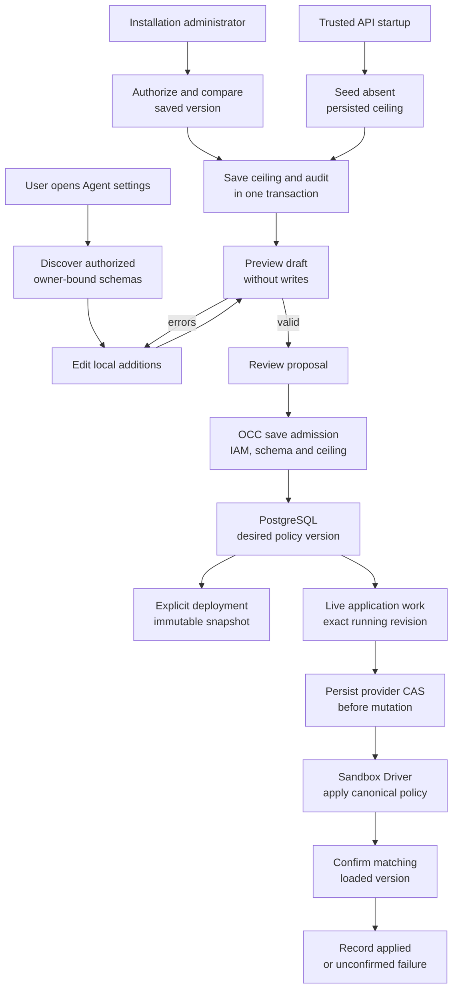

# Agent sandbox policy flow

## Overview

OCC saves governed network additions per Agent, freezes them at deployment,
and can apply a later version through its Sandbox Driver. Operators review denial
logs and provider recommendations.

## Entry Points

- Trigger: API startup, the Console Settings ceiling editor, the Agent Policy denials tab, or `occ agent policy` commands.
- Source: `apps/controller/src/http/sandbox-policy.ts:sandboxPolicyHandlers` and
  `packages/occ/src/index.ts:updateAgentSandboxPolicy` / `applyAgentSandboxPolicy`.
- Assumptions: Settings needs Installation `administer`. Agent mutations need a
  ready Namespace, active Agent, exact grants and enabled editing.

## Flow

Arrows trace source paths; provider verification has separate limits.

## Execution Trace

### 0. Initialize and manage the Installation ceiling

API composition calls
`packages/occ/src/index.ts:initializeSandboxNetworkPolicyCeiling` before exposing
routes. It takes the exclusive ceiling lock and creates absent state with audit
attributed to the bootstrap identity. Concurrent starts serialize the seed; an
existing record, including empty rules, is unchanged. No startup fingerprint or
dedicated ownership session survives initialization. Workers never seed state.

`apps/controller/src/console/network-policy-ceiling.mts:renderNetworkPolicyCeiling`
retains drafts and requires server preview before an explicit save.

`apps/controller/src/http/sandbox-policy.ts:sandboxPolicyHandlers` dispatches the
Installation endpoints under exact-Installation `administer`.
`updateInstallationSandboxNetworkPolicyCeiling` fences authority, validates grants,
locks exclusively, rechecks the version, and commits rules with audit.
Preview uses the same checks without writes or reconciliation.

Admission and worker application explicitly use Read Committed, taking the shared
ceiling lock before Namespace and Agent locks. They read committed updates;
unrelated Stop and credential operations avoid this lock. Missing or invalid
state fails explicitly. See the
[ceiling contract](../reference/sandbox-policies.md#installation-ceiling).

### 1. Admit and persist desired additions

`internal/occcli/agent_policy.go:agentPolicyCommand` uses the shared structured
output path. See the [CLI reference](../reference/cli.md).

`OpenClawController.discoverConfigurations` filters registry contributions by the
server-selected Driver, scope, and resource-owner read authority. Installation
inspection exposes [Driver-projected startup values](driver-plugin-loading.md#4-load-current-policy-and-hand-off-lifecycle-ownership).
Agent discovery and policy GET
use the same descriptor with owner-generated facet action URLs and current
availability. The registry never selects a Driver from submitted additions.

`validateAgentSandboxPolicy` authorizes the exact Agent and policy and checks
editing, version, pending work, schemas and narrowing Driver contributions.
`packages/contracts/src/deployment-policy.ts:networkGrantAdmissionDetails` checks
executables, hosts and ports against the persisted Installation ceiling read in
the current transaction, plus Sandbox support for wildcards, ranges and complete
network request matches. Preview writes nothing; save and deploy repeat admission.
Validation errors identify failed fields and checks. Ceiling refusal names
Installation delegation; unsupported rules name the Driver limit. Stale and
unauthorized requests retain resource errors.
`internal/occclient/transport.go:APIError.Error` prints up to 32 escaped details,
omitting records with Unicode control characters.

Staged `validateDeploymentPolicy(policy, context)` checks source approval, reviewed requests and
projections using trusted binding, source and consumer authority. Only proposed proxy configuration
receives a source-bound resolver. The proxy qualifies bindings and requests. Static approvals match
method, host, port and path (`null` permits any method). The Sandbox qualifies HTTP rules and exact
MCP paths. Discovery can be credentialless; providers enforce OAuth scopes.

`packages/occ/src/index.ts:updateAgentSandboxPolicy` independently authorizes
Agent `manage_policy` and SandboxPolicy `update`, holds the shared ceiling lock,
then locks the Namespace and Agent,
and checks editing, expected version, pending work, complete ceiling coverage,
and registry-resolved Driver admission. The saved additions come from the
admitted snapshot. While the active or next revision runs under protected
execution (the Installation selects the Credential Proxy), additions are refused
with `409 SANDBOX_POLICY_PROTECTED_EXECUTION`, as are live application to a
protected revision and a protected deploy carrying them; protected
revisions admit no ordinary Agent policy snapshot. Protected, dedicated Codex
repository admission can carry the Sandbox Driver's explicitly acknowledged
[artifact subset](../reference/drivers/openshell-sandbox.md#protected-codex-artifact-rules).
`checkedProtectedCodexArtifactPolicy` verifies its purpose, declared keys, Driver
identity, version and empty additions before runtime credential provisioning.
That immutable snapshot remains ineligible for live apply. The policy view reports
`protectedExecution`.

Protected Codex repository preparation compiles the revision's qualified artifact
snapshot through `openshell-codex-artifacts.ts`; it never merges ambient defaults.
Both paired compilers validate the complete map. The Sandbox separately compares
the final workspace enrollment rule with its validated Agent-owned setup binding,
then returns the full immutable policy in `SandboxResourceRef.proxyWiring`.
The proxy checks the complete artifact map and bounded auxiliary rule before
comparing the complete loaded policy.
For an Agent with repository bindings (or a Git-bound active revision), Driver
admission gets `repositoryCredentials`: the OpenShell Driver with its Git route
refuses a grant or default reaching `github.com` or a name under it, or naming an
IP address, with a `409` naming it. Adding a binding beside such a saved grant, deploy, and provisioning refuse it too.
With saved additions, deploy and an Agent update that leaves repository bindings
authorize SandboxPolicy `read` first, so only a caller who may read the grant
sees it named (findings 2151, 2881).
`apps/controller/src/http/sandbox-policy.ts` records the
nonsecret approved additions with their version in the same transaction.
The required facet argument currently admits `networking` only. Other facets
fail before network policy access. The temporary
`TEMPORARY_API_WILL_BREAK_IN_FUTURE_setAgentSandboxPolicyEditing` requires
Installation and Agent administration; Guardrails will replace this switch.

Both state adapters return `sandboxPolicyEditing: false` at Agent creation,
matching the PostgreSQL column default and subsequent reads. The separately
authorized editing operation changes this flag.

`packages/occ/src/state/postgres-state.ts` performs versioned updates. Agent
creation creates its one policy through a database trigger. Constraints enforce
ownership, document shape, immutable application identity, version transitions,
and application revision ownership. The in-memory adapter and the PostgreSQL
update trigger reject saves that remove a pending application, including saves
that keep the current policy version. The worker can record the expected provider
resource version and set the same application to `applied` or `failed`.
Agent deletion cascades policy removal and
cleans its exact IAM access.

### 2. Freeze deployment or enqueue live application

`packages/occ/src/index.ts:deployAgent` freezes the Driver's defaults and additions
into `AgentRevision.sandboxPolicy`. The OpenShell Driver provisions from this
snapshot rather than re-reading changed defaults.

`applyAgentSandboxPolicy` authorizes Agent `manage_policy` and SandboxPolicy
`update` and `read` before any refusal that names saved additions, then requires
the exact active revision and supporting Driver. When the caller supplies reviewed additions, the same transaction saves the new
policy version, records its pending application and enqueues Agent-target work.
Omitting additions retains the saved policy version. Neither saving nor enqueueing establishes enforcement.

### 3. Reconcile provider effects

`apps/controller/src/worker/sandbox-policy.ts:reconcileSandboxPolicy` locks the
same lifecycle owners and rechecks current authority, ceiling, Driver identity,
and Compute placement. Shared definition and provider admission are rerun before
provider effects. One pass records the provider CAS version; a later pass
can mutate with that fixed version and operation ID. Provider reads and effects
are bounded by the claim lease. Database and audit failures roll back the pass.

`apps/controller/src/drivers/sandbox/openshell.ts` verifies exact provider
ownership, preserves the Sandbox's static policy and generated access, and uses
native status/UpdateConfig RPCs. A full candidate match plus loaded active version
is required for `applied`. If the current resource version already differs from the
pinned version and the policy does not match, the worker fails before it sends a write.
After a refused write, the worker reads the provider again and confirms its lease.
A matching policy still loading is deferred within the deadline, `applied` is recorded
only for a loaded active match, and a changed resource version with a nonmatch fails as
`SANDBOX_POLICY_PROVIDER_FAILED` (the pinned version cannot succeed). Worker shutdown during
that read rolls back so the next worker recovers the claim; other outcomes retry within limits;
exhausted abandoned claims become unconfirmed failures. The worker calls
`failAbandonedSandboxPolicies` inside the same `transactWithQueue` that recovers
exhausted work, so queue failure, application failure, and audit either all commit
or remain recoverable after interruption. A failed live request does
not deploy another revision. Last confirmed live evidence is retained separately.

### 4. Read contextual evidence

`openshell-log-decisions.ts:openShellLogDecision` decorates recognized provider
records. `packages/occ/src/runtime-logs/sandbox.ts` validates them;
`runtime-logs/sanitize.ts` redacts metadata and raw text through the existing
bounded log path. See [runtime logs](agent-runtime-logs.md).

`readAgentSandboxRecommendations` independently checks exact Agent/policy read
and revision ownership before its audited, limited provider read. The OpenShell
Driver projects representable native chunks into untrusted suggestions. The
console editor submits canonical additions through the same mutation path;
native draft approval cannot bypass OCC admission.

`console/driver-configurations.mts:renderAgentDriverConfigurations` discovers
sections and selects resource-owner controls. `console/configuration-fields.mts`
renders schema fields and JSON fallback, with safe field/root diagnostics.
String controls retain the complete draft. Length validation stays with the
policy owner: JSON Schema counts Unicode code points, while HTML length
attributes count UTF-16 code units and can truncate a valid executable path.
`console/agents/sandbox-policy.mts:renderLogs` snapshots the displayed log window,
filters it, and renders five denials per page initially. Selection spans pages;
Select page changes only eligible visible rows. Follow retains up to 1,000 new
log records without replacing inspected rows. Show newest accepts the retained
window and removes selections for records no longer retained.

`stageGrants` deduplicates executable/host/port candidates against saved and
proposed grants, retaining the complete additions array. Missing metadata disables
prefilling; incomplete drafts prevent further staging. `ruleList` edits local additions.

`console/agents/sandbox-policy.mts:renderPolicy` shows status, suggestions, and
read recovery above the log, independently of mutation authority.
`openNetworkLimits` displays the persisted ceiling in a read-only dialog.
A separately authorized operation changes Agent policy editing. Mutation feedback
and policy-read failures remain visible while the editor is closed. See the
[Console workflow](../guides/topics/agent-sandbox-policy.md) for its controls.
`renderEditor` keeps proposed rules local until preview. Review compares the
controller-validated draft with saved additions. Save sends the complete validated
array with the reviewed version; confirmation closes the dialog and clears its
selection. Superseded preview and read responses
cannot overwrite a newer draft. Policy reads use a separate sequence: an earlier response
cannot invalidate a newer request. A pending application re-arms polling after
the latest read, including a response discarded after a draft edit.
An unreadable preview retains the draft for another review. The combined request
must return the reviewed rules, the next version of this Agent’s policy and a
fresh pending application for the selected running revision. Starting a write
invalidates earlier policy reads and pauses polling. If the combined response is
lost or does not match, the Console reads the policy again. An unsuccessful
read leaves **Refresh policy** available in the open editor. A refused request
keeps the edit local. After admission, the provider outcome remains pending
until confirmed. **Save for later** only saves. **Apply saved rules** requires
a clean draft and targets the existing saved version. `loadPolicy(true)` records explicit
inspection of a failed application. Refresh issues only the policy GET; a separate
Retry application action invokes the existing apply descriptor after inspection.
The action remains subject to current permissions, lifecycle, and draft guards.

`console/agents/sandbox-policy.mts:mutate` displays rejected saves as focused
alerts and scrolls the reason into view after rendering. Ceiling rejection
preserves the attempted additions for correction without changing saved state.
`console/navigation.mts:createNavigation` admits the `policy` tab in login
destinations, preserving an Agent's Policy denials link after sign-in.

The console reads the policy owner even when discovery returns no descriptor. This
read establishes an unsupported capability or a permission refusal before log and
suggestion reads continue under their own permissions. It cannot leave those reads
waiting for a policy request that never starts. When the caller's permission answer
reports `sandboxPolicyRead` as `false`, the console skips the policy and suggestion
reads and says so; an unknown answer keeps the reads. A tab opened after the answer
settled rereads it first, so a later grant applies. A version snapshot without
`sandboxDriverId` runs without a Sandbox, so the tab skips its log and suggestion reads
and says no denials are recorded. A `RUNTIME_LOGS_SOURCE_UNAVAILABLE` answer shows the same.
Then, and on the draft, which reads no log, the denial count, refresh, follow and filter
controls and the empty denial rows are hidden. When the permission answer refuses
the policy read, only the network policy card states it; the suggestions card is hidden.

## Debugging and Verification

- Inspect the desired policy and application with `occ agent policy get`.
  `pending` or `failed` never establishes a successful retry.
- Compare the application revision with the active Agent revision and inspect
  attributable audit evidence before retrying a stale or unconfirmed request.
- [PostgreSQL admission integration](../../tests/integration/postgres-agent-sandbox-policy.test.mjs)
  exercises HTTP/IAM/storage, application-role refusal of pending application
  removal, and worker settlement; the [OpenShell runtime lane](../../tests/helpers/openshell-sandbox-workflows.mjs)
  owns real enforcement proof. Storybook proves simulated presentation only.
- [Console batch browser tests](../../tests/browser/console-policy-denials.test.ts)
  cover selection across pages, stable Follow, deduplication, preservation of saved
  rules, and ceiling rejection through real controller routes. They use in-memory
  storage and test Drivers with simulated log input. A simulated failed-application
  view covers explicit inspection and retry against the real API refusal; neither
  case proves provider enforcement.

## Related docs

- [Policy reference](../reference/sandbox-policies.md)
- [Operator workflow](../guides/topics/agent-sandbox-policy.md)
- [OpenShell provisioning](openshell-sandbox-provisioning.md)
- [Implementation plan](../../specs/plans/0045-python-sandbox-policy-denials.md)

## Manual Notes

## Changelog

- 2026-11-19 07:54: Separate credential acquisition. (authoring-run/a7f97564-0c7b-4c61-b72f-0b866891ade8 - 1eb271262)

- 2026-11-19 09:03: Separate policy and validation context. (authoring-run/2ca60020-2ed8-48c5-943c-ba2890e5bb12 - 9dd2694f3cdbbed2c2e26222d503a2253af93ee9)

[Agent sandbox policy documentation history](agent-sandbox-policy/history.md) preserves all dated entries.
