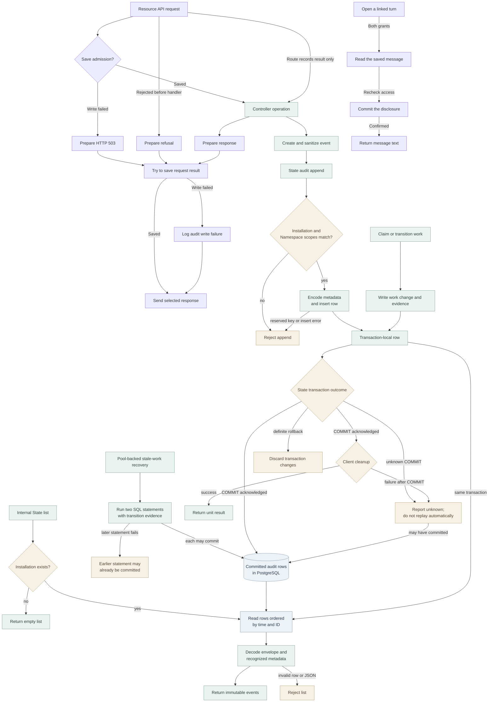

# Audit ledger flow

## Overview

OpenClaw Control Plane (OCC) records audit evidence as controller requests and
reconciliation work run. This flow follows PostgreSQL event append, commit,
the internal State repository's list operation, and the Agent audit API. See the
[audit guide](../guides/topics/audit-log.md) for the operator boundary.

## Entry Points

- Trigger: the API admits or answers a resource request, a controller operation
  appends an event, or internal code lists events in a State unit of work.
- Source: `apps/controller/src/index.ts:appendRequestAudit`
- Source: `packages/occ/src/state/postgres-state.ts:PostgresPlatformState`
- Source: `packages/occ/src/state/postgres-work-queue.ts:INSERT_EVIDENCE_CTE_SQL`
- Assumptions: PostgreSQL State has a server-owned Installation; request
  admission and authorization are handled by the calling operation. Repository
  list is an internal operation, not an authorization or public serving boundary.

## Flow

The diagram describes source behavior, not proof of an installed deployment.

## Execution Trace

### 1. The API records admission and the result

`apps/controller/src/index.ts:requestAuditHooks` and
`apps/controller/src/http/agents.ts:getAgent`

When Control Plane audit is enabled and the Installation exists, the API saves
admission in PostgreSQL before running a covered handler.
The event action is
`openclaw.api.request.admitted`. If the write fails, the API prepares HTTP
`503` without starting the handler. A route hook then tries to save
`openclaw.api.request.result` before sending the selected HTTP response.
This includes rejections from request validation and authentication before the
handler starts.

The result hook also covers the registered account, service-key, sign-in,
recovery, and native administration routes. Routes can record only a result
when they use a separate check or recorder for the operation. A resource API
request that returns `405` records a `methodNotAllowed` result. Google
and OIDC sign-in callbacks use their own authentication recorder. Runtime
log views and downloads use their own disclosure recorder.

Both records carry the API-generated request ID, registered operation,
HTTP method, and Installation ID. The result adds the HTTP status. The hook
uses the authenticated actor when identity resolution succeeded. A result
describes the response OCC prepared. If its append fails, the hook logs
`http.audit_append_failed` and sends the selected response. The resource
handler still owns its own permission checks and any audit record for a change.
If a separate authorization-denial record fails to save on a covered route,
the API logs the write failure and usually sends the selected refusal.
A [device login scope denial](credential-source-refresh.md) requires its own
record and returns HTTP `503` if that write fails. A permission denial that
uses HTTP `404` to conceal a resource still records outcome `denied`.

For example, the `getAgent` handler checks read permission and loads the Agent
from its Namespace. For an HTTP `200` result from `GET` or `HEAD`, the hook uses
the IDs from the loaded Agent. State saves its ID in `resource_id`, its
Namespace ID in `namespace_id`, and `agent` in `resource_kind`. The
[audit guide](../guides/topics/audit-log.md#api-requests) lists the other
exact-resource reads. Admission and unsuccessful results identify the Installation.

### 2. A caller constructs resource evidence

`apps/controller/src/index.ts:event` and `packages/audit/src/index.ts:AuditEventFactory.create`

For example, the controller creates an event for a Namespace mutation and
appends it in the mutation's transaction. The factory supplies an ID, timestamp,
kind and outcome defaults, validates required fields and matching Namespace
scope, sanitizes details and actor fields, and freezes the event. The PostgreSQL
repository does not invoke the factory or sanitize an event passed directly to
append; callers of that repository must supply appropriate evidence.

### 3. State appends a row in the caller's transaction

`packages/occ/src/state/postgres-state.ts:PostgresPlatformState`,
`packages/occ/src/state/postgres-state.ts:auditDetails`, and
`apps/controller/src/worker.ts:ControllerWorker`

Append requires the event's Installation to match the initialized server-owned
Installation and its resource Namespace to equal its event Namespace. It rejects
the reserved `__occAuditMetadata` key in caller details. It copies ordinary
details and stores nine optional fields under that key: `schemaVersion`,
`source`, `requestId`, `admissionDecisionId`, `actor`, `iamDriverId`,
`authorization`, `decisionReason`, and `reasonCode`. It inserts the envelope
columns and JSON details into `occ.audit_events`. Database constraints and query
errors can also reject the insert. If the event ID already exists, State checks
the stored values. An identical append succeeds without adding a row. A
different event with that ID fails.

The caller can append alongside resource changes in one unit of work. The
standalone PostgreSQL audit sink opens its own transaction. With Control Plane
audit enabled, PostgreSQL limits each statement and lock wait in the API's
standalone audit write to two seconds.

For service API keys, `apps/controller/src/auth/service-keys.ts` commits the
key change and audit record together. Issuance uses the Better Auth adapter on
State's PostgreSQL connection. Revocation deletes the current key in State.

Separately, the work queue commits queue
and claim events with the corresponding change. The queue event records the API
request ID when a request started the work. The claim event carries a distinct
attempt ID. That ID also identifies later evidence for the same claim. A claim
insert failure leaves the job available.
Repository cleanup and maintenance recovery save a queue record when they create
or reopen follow-up work. The queue change and its audit record belong to the
same SQL statement.

The worker uses `transactWithQueue` for some transitions. It also calls pool-backed
stale-work recovery, which issues two separate SQL statements. Each statement is
atomic, but a later failure does not undo an earlier committed statement. A queue
using a caller-supplied client follows that client's transaction boundary. The
queue's `reasonCode`, `attemptCount` and `final` (set only when the transition leaves the
work `failed_permanent`) are ordinary details, not reserved metadata.

### 4. The transaction owner finishes or fails

`packages/occ/src/state/postgres-state.ts:PostgresPlatformState` and
`packages/occ/src/ports/transaction.ts:RepositoryTransactionLifetime`

After the callback returns, State closes admission to repository operations and
waits for already admitted operations to settle before committing. On failure it
attempts rollback if the transaction remains marked started, COMMIT is not
uncertain, and no client error has been observed. It closes the lifetime and
releases or discards the client.
An acknowledged COMMIT persists the transaction, but the unit returns only
after client cleanup. A lost or ambiguous COMMIT response can leave the outcome
unknown: the transaction may have committed or rolled back. A cleanup failure
after acknowledged COMMIT is also reported as unknown, not proof of rollback.
Neither case authorizes an automatic replay. An append or list result within a
unit does not by itself prove that the transaction committed.
For a covered API operation, OCC logs `http.commit_outcome_unknown` and attempts
to save the response with reason code `COMMIT_OUTCOME_UNKNOWN`.

When the checked-out client reports a transport error before callback admission,
State refuses to start the callback. It refuses further repository queries and
their results after an observed error, and requests client discard when that
error is known before release. A transaction that fails on an observed client
error reports the persistence dependency as unavailable, whatever code the error
carries. If an error is observed during cleanup after an
acknowledged COMMIT, State reports an unknown outcome. A caller that catches a
repository error can still perform its own external effects; this guard does not
control those effects or establish the outcome of an unobserved transport failure.

### 5. Internal list decodes the ledger

`packages/occ/src/state/postgres-state.ts:auditFromRow`

List returns an empty frozen array when no Installation exists. Otherwise it
reads all visible rows ordered by `occurred_at, id`, attaches the current
server-owned Installation ID, and decodes each row. A list on the same unit can
include its own uncommitted append. The table has no Installation ID column.
The decoder validates resource kind, outcome, kind, timestamp and object-shaped
JSON; invalid persisted data rejects the list. It removes the reserved metadata
object from details, copies only the nine recognized metadata keys, and leaves
other ordinary details in place. Unknown reserved keys cannot replace or extend
the top-level row envelope. Recognized metadata values are copied without
individual type or semantic validation or authentication, and decoding does not
re-sanitize them. The returned event
copies and array are immutable.

### 6. The Agent audit API saves a disclosure for each page

`apps/controller/src/http/agent-audit.ts:createAgentAuditReader` and
`packages/occ/src/index.ts:OpenClawController.listAgentAuditEvents`, and
`apps/controller/src/composition/control-plane-audit.ts:postgresAgentAuditState`

The PostgreSQL audit reader requires enabled audit and a Native IAM Driver
that shares State with OCC. OCC holds the caller's session in a transaction.
Native IAM requires a direct `read_audit` binding for the human Principal,
Agent, and Namespace. It applies the same rule to an account or service-key
manager. The reader locks the active Agent, its ready Namespace, and policy
tables through commit. It checks the grant again under lock. It selects
approved events for the Agent and limits the time window and page size.

State selects named fields and derives a public work ID from the stored key.
Lifecycle records show the saved action. Each included revision ID belongs to
the Agent. The transaction appends `openclaw.audit.agent.read` with the actor,
Agent, request ID, time window, projection version, and record count. The API
releases the page after commit. The encrypted cursor requires the same session,
Agent, and window.

### 7. A Gateway reports work for one revision

`apps/controller/src/drivers/compute/kubernetes/index.ts:ensureGatewayRuntimeAudit`
and `apps/controller/src/http/runtime-audit.ts`

With audit and managed Gateway routing, Helm creates a private HTTPS listener.
Compute mounts the revision token and CA certificate, permits the connection,
and stores the token hash in PostgreSQL. Compute revokes the grant after stop
and deletes the Secret at retirement.

`PostgresWorkQueue.scheduleGatewayAuditMaintenance` compares the setting with
grants for running revisions. Each check queues up to eight updates.
Maintenance checks the original deployer’s authority. Compute updates the
Gateway Deployment. With audit off, Compute removes the grant after replacement.

Compute requires `oce-runtime-audit` through `OPENCLAW_REQUIRED_TURN_ADMISSION_PLUGIN`.
The launcher checks `build.json` for session and admission support before
starting an audited Gateway. Before dispatch, the Gateway supplies both IDs.
`deploy/runtime/managed-runtime-audit/sink.mjs:admitTurn` sends
`openclaw.runtime.turn.admitted` to OCC. OCC validates the revision grant and
appends the event in one transaction. After PostgreSQL commits, OCC sends
HTTP 204. Dispatch requires this response within two seconds.

When the Gateway saves a new session ID, the plugin queues its creation record.
It keeps up to 256 [observations](../guides/topics/audit-log.md#agent-runtime-activity)
in `/home/node/.openclaw/pending-runtime-audit/observations.sqlite` until OCC confirms delivery.
It warns and discards records on overflow or permanent refusal. After a restart,
it checks the credential fingerprint, source, and destination before retrying.
OCC accepts identical copies once and rejects conflicting IDs. Kubernetes deletes
the queue with the Pod.

### 8. An analyst opens the user message for a turn

`deploy/runtime/managed-runtime-audit/index.mjs:recordInput`,
`apps/controller/src/http/agent-audit.ts:getAgentAuditEventMessage` and
`apps/controller/src/gateway/audit-message-client.ts:readAgentAuditMessage`

The plugin sets `details.messageId` for [supported inputs](../guides/topics/audit-log.md#open-the-message-for-a-turn).
It matches OpenClaw HTTP inputs by the `openai-http` channel and `<turn ID>:user` key.
The plugin and reader use `runtimeAuditReference` to match turn IDs that need
a hash. The link requires the original session and message IDs.

1. The analyst supplies the audit event ID. In a PostgreSQL transaction,
   `packages/occ/src/index.ts:selectAgentAuditMessage` checks the human
   session and direct `read_audit` and `read_audit_content` grants on
   this Agent. State selects a linked turn event from the preceding 24 hours.
   Its revision must match `activeRevisionId`, and the Agent's desired state
   must be `running`.
2. After this transaction, OCC opens the [private path for the revision](../reference/gateway-routing.md#endpoint-and-route).
   Envoy checks the OCC service key and sets the scope to `operator.sessions.read`.
   OCC checks that the Gateway grants exactly this scope. OCC calls `sessions.resolve`
   with the stored session ID, then calls `chat.message.get` with the
   returned session key and the stored session and message IDs. OCC checks
   the message ID, user role and turn ID. OCC accepts up to 64 KiB of
   text from the visible message. Each API process allows four concurrent
   lookups. The Gateway has five seconds to respond. Exceeding either limit
   returns HTTP `503`.
3. OCC repeats the first check in a new transaction. It records
   `openclaw.audit.agent.message.read` with the analyst and event ID.
   After PostgreSQL confirms the commit, OCC sends the event and the text
   with `Cache-Control: no-store`.

## Debugging and Verification

- The [audit guide](../guides/topics/audit-log.md#read-an-agents-audit-events)
  describes access and pagination for one Agent. The internal repository list
  serves State callers.
- `ScopeViolationError` on append can indicate an Installation mismatch, a
  Namespace mismatch, or reserved persistence metadata. Invalid persisted event
  values or JSON can make the entire internal list fail.
- The `postgres-platform` test lane checks request records, Agent result scope,
  failed admission writes, and refusals during an audit outage in
  `tests/integration/postgres-api-request-audit.test.ts`. It checks
  worker claim writes in `tests/integration/postgres-worker-audit.test.ts`.
- `tests/integration/postgres-agent-audit-read.test.ts` exercises the Agent
  route with real PostgreSQL, grant revocation, a refused disclosure insert,
  and a lost commit acknowledgement.
- `tests/integration/postgres-repository-transactions.test.ts` contains
  PostgreSQL append, metadata decoding, rejection, and rollback cases. Those
  cases require the [PostgreSQL test setup](../testing/postgresql.md); their
  presence and this source trace do not prove a test or deployed system passed.

## Related docs

- [Audit log](../guides/topics/audit-log.md)
- [Namespace IAM policy flow](namespace-iam-policy.md)
- [Controller worker and durable reconciliation](controller-worker.md)
- [Logging flow](common-logging.md)

## Manual Notes

[keep this for the user to add notes. do not change between edits]

## Changelog

- 2026-11-20 16:35: Trace audit setting changes for running Gateways. (authoring-run/2fce19b6-c5f9-489d-862a-df3396f922c2 - fb0f4dc39a9b736919375069d258bab9c7d98b75)

- 2026-11-20 15:15: Trace session creation and the required turn admission write. (authoring-run/2fce19b6-c5f9-489d-862a-df3396f922c2 - e2d6da28746ecc1cc756a226c91bd0e360da2211)

- 2026-11-20 14:01: Trace the saved HTTP message ID from OpenClaw to the turn event. (authoring-run/2fce19b6-c5f9-489d-862a-df3396f922c2 - 097f01174caa0d1db9a7e412efd2558b352a59d2)

- 2026-11-19 17:16: Trace how OCC links a turn to a saved chat message and authorizes the text read. (authoring-run/bccca424-a66f-4ab2-ad5a-e639f845a228 - 04dbfef7e367b86ee5b5275fb510c21798b759b5)

- 2026-11-19 14:28: Record runtime observations through the OCE Gateway plugin. (authoring-run/4dfd652a-6550-45c4-b86a-ce9b35ec4705 - f637b353b485f8610c0f58df801eb5feb577f291)

- 2026-11-19 10:04: Trace runtime enrollment, event delivery, and reads. (authoring-run/fe4ad3ff-b579-4d9b-a15e-622a822cd15f - d517d45f0ffdce32b9b7663efe062fc3e8a997bb)

- 2026-11-18 17:35: Trace Agent lifecycle reads and additional control-plane audit sources. (authoring-run/d9552e4e-b5ce-4d02-aa1f-b9e2666a360d - 86265b4ed8e8b22ae3882889d4febccdef1b5f65)
- 2026-11-12 16:19: Explain how Native IAM counts Agent audit grants for account and key management. (authoring-run/09158870-8481-4ef1-9ff0-f1e2d5ae4df9 - 9912bddae4ac3d94e9f4d22c6283d957a4cf1e9a)
- 2026-11-12 16:19: Trace how composition supplies the Agent audit reader and verifies its IAM Driver. (authoring-run/0262148b-40f3-48c2-a3e1-546feb2e265b - 9912bddae4ac3d94e9f4d22c6283d957a4cf1e9a)
- 2026-11-12 15:31: Trace how a successful Agent read saves the verified Agent and Namespace IDs. (authoring-run/bb7f16b1-d73b-4957-b5bb-212692e7ada9 - 8658496ea654b960bebabca40d18c7d71994db50)
- 2026-11-12 14:30: Document the covered request rejection path and audit-write failure response. (authoring-run/184ad244-ddb9-4dc2-b9ff-1d35f57fb8e0 - 8658496ea654b960bebabca40d18c7d71994db50)
- 2026-11-12 14:04: Document request admission and results and the atomic queue claim audit. (authoring-run/2e85d711-50c8-4e66-aa55-842b05f80ba9 - 8658496ea654b960bebabca40d18c7d71994db50)
- 2026-09-28 11:15: Document observed client errors in the transaction owner alongside the accompanying source correction. (authoring-run/48243369-59ed-41da-bc9e-21f627f7e6a2 - eb25ab1e4105defd4b6bbb19ef28570863d8df63)
- 2026-09-26 02:55: Clarify that the initial flow inspection included the uncommitted audit decoder fix from 7966519007124bdf77be78324b3c705cf6980199. (authoring-run/48c2199e-221b-4f32-9f69-2d21e68712ba - a501f64abbd1a5821b6c8f0da7f9466195f7dc6d)
- 2026-09-26 02:38: Prepare the public audit ledger flow from the reviewed source and local draft. (authoring-run/b9f3fb59-fdac-4727-9071-61a19b7d940a - 3b58323f762f5742e8b44be3e269af0696ed7cde)
