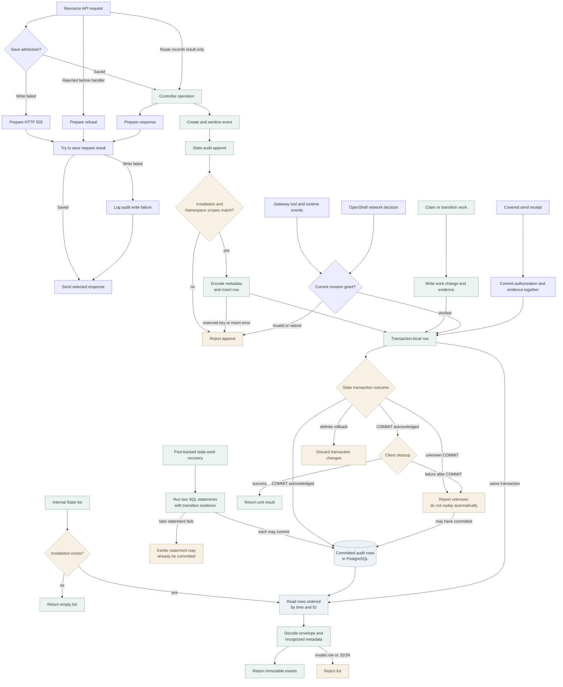

# Audit ledger flow

## Overview

OpenClaw Control Plane (OCC) records audit evidence from controller requests,
reconciliation, and managed Agent execution. This flow follows PostgreSQL append
and commit, the internal State list operation, and the Agent audit API. See the
[audit guide](../guides/topics/audit-log.md) for the operator boundary.

## Entry Points

- Trigger: a controller operation or managed runtime reports audit evidence,
  or internal code lists events in a State unit of work.
- Source: `apps/controller/src/index.ts:appendRequestAudit`
- Source: `packages/occ/src/state/postgres-state.ts:PostgresPlatformState`
- Source: `packages/occ/src/state/postgres-work-queue.ts:INSERT_EVIDENCE_CTE_SQL`
- Assumptions: PostgreSQL State has a server-owned Installation; request
  admission and authorization are handled by the calling operation. Repository
  list is an internal operation, not an authorization or public serving boundary.

## Flow

The diagram describes source behavior, not proof of an installed deployment.

## Execution Trace

### 1. The API records admission and the result

`apps/controller/src/index.ts:requestAuditHooks` and
`apps/controller/src/http/agents.ts:getAgent`

When Control Plane audit is enabled and the Installation exists, the API saves
admission in PostgreSQL before running a covered handler.
The event action is
`openclaw.api.request.admitted`. If the write fails, the API prepares HTTP
`503` without starting the handler. A route hook then tries to save
`openclaw.api.request.result` before sending the selected HTTP response.
This includes rejections from request validation and authentication before the
handler starts.

Registered account, service-key, sign-in, recovery, and native administration
routes also record results. Routes with a separate admission check can record
just results. HTTP `405` records `methodNotAllowed`. Google and OIDC callbacks
use their authentication recorder. Runtime log access uses its disclosure recorder.

The request ID, operation, method, Installation ID, and resolved actor
identify both records. The result adds the HTTP status. A failed result append
logs `http.audit_append_failed` and sends the prepared response. The handler
owns permission checks and mutation evidence. Failed authorization-denial
appends typically log the failure and send the refusal. A
[device login scope denial](credential-source-refresh.md) requires its evidence
and returns HTTP `503` if the append fails. HTTP `404` can record `denied`.

After a permitted `GET` or `HEAD` returns `200`, `getAgent` uses the loaded
Agent's ID, Namespace ID, and kind. The
[audit guide](../guides/topics/audit-log.md#api-requests) lists other
exact-resource reads. Admission and unsuccessful results identify the Installation.

### 2. A caller constructs resource evidence

`apps/controller/src/index.ts:event` and `packages/audit/src/index.ts:AuditEventFactory.create`

The controller appends a Namespace mutation event in the mutation transaction.
The factory sets ID, timestamp, kind, and outcome defaults. It validates required
fields and Namespace scope, sanitizes details and actor fields, and freezes the
event. Direct PostgreSQL append callers own evidence construction and sanitization.

### 3. State appends a row in the caller's transaction

`packages/occ/src/state/postgres-state.ts:PostgresPlatformState`,
`packages/occ/src/state/postgres-state.ts:auditDetails`, and
`apps/controller/src/worker.ts:ControllerWorker`

Append requires the event's Installation to match the initialized server-owned
Installation and its resource Namespace to equal its event Namespace. It rejects
the reserved `__occAuditMetadata` key in caller details. It copies ordinary
details and stores nine optional fields under that key: `schemaVersion`,
`source`, `requestId`, `admissionDecisionId`, `actor`, `iamDriverId`,
`authorization`, `decisionReason`, and `reasonCode`. It inserts the envelope
columns and JSON details into `occ.audit_events`. Database constraints and query
errors can also reject the insert. If the event ID already exists, State checks
the stored values. An identical append succeeds without adding a row. A
different event with that ID fails.

The caller can append alongside resource changes in one unit of work. The
standalone PostgreSQL audit sink opens its own transaction. With Control Plane
audit enabled, PostgreSQL limits each statement and lock wait in the API's
standalone audit write to two seconds.

For service API keys, `apps/controller/src/auth/service-keys.ts` commits the
key change and audit record together. Issuance uses the Better Auth adapter on
State's PostgreSQL connection. Revocation deletes the current key in State.

The work queue commits queue and claim records with the change. Queue records
include the originating API request ID when present. Claims carry an attempt ID
shared with later evidence. A failed claim append leaves the job available.
Repository cleanup and maintenance recovery create or reopen follow-up work and
record evidence in the same SQL statement.

The worker uses `transactWithQueue` for some transitions. A caller-supplied
client owns its transaction. Pool-backed stale-work recovery uses two atomic
statements. The first may commit before the second fails. Queue details include
`reasonCode`, `attemptCount`, and `final` for `failed_permanent` transitions.

### 4. The transaction owner finishes or fails

`packages/occ/src/state/postgres-state.ts:PostgresPlatformState` and
`packages/occ/src/ports/transaction.ts:RepositoryTransactionLifetime`

State closes admission when the callback returns and waits for admitted queries
before it commits. On failure, it attempts rollback while the transaction is
marked started, the commit outcome is certain, and the client has reported no
error. State closes the lifetime and releases or discards the client.

An acknowledged COMMIT persists the transaction. The unit returns after client
cleanup. A lost COMMIT response or cleanup failure reports an unknown outcome.
An append or list result inside the unit precedes commit evidence. OCC logs
`http.commit_outcome_unknown` for covered API operations and attempts to record
`COMMIT_OUTCOME_UNKNOWN`. Inspect the owning operation's evidence before replay.

An observed transport error before admission prevents callback start. State
refuses later queries and results, discards a client if it knows of the error
before release, and reports the persistence dependency as unavailable. The
callback owner controls external effects after a caught repository error.

### 5. Internal list decodes the ledger

`packages/occ/src/state/postgres-state.ts:auditFromRow`

List returns an empty frozen array when no Installation exists. Otherwise it
reads all visible rows ordered by `occurred_at, id`, attaches the current
server-owned Installation ID, and decodes each row. A list on the same unit can
include its own uncommitted append. The table has no Installation ID column.
The decoder validates resource kind, outcome, kind, timestamp and object-shaped
JSON; invalid persisted data rejects the list. It removes the reserved metadata
object from details, copies only the nine recognized metadata keys, and leaves
other ordinary details in place. Unknown reserved keys cannot replace or extend
the top-level row envelope. Recognized metadata values are copied without
individual type or semantic validation or authentication, and decoding does not
re-sanitize them. The returned event
copies and array are immutable.

### 6. The Agent audit API saves a disclosure for each page

`apps/controller/src/http/agent-audit.ts:createAgentAuditReader` and
`packages/occ/src/index.ts:OpenClawController.listAgentAuditEvents`, and
`apps/controller/src/composition/control-plane-audit.ts:postgresAgentAuditState`

When audit is enabled, composition supplies the PostgreSQL audit reader. The
reader checks that the selected Native IAM Driver uses the same State as the
controller. OCC then opens a transaction and holds the caller's session.
Native IAM checks for a direct `read_audit` binding for the human Principal, the
Agent, and its Namespace. The same rule applies when Native IAM checks which
grants an account or service-key manager must hold. The reader locks the active
Agent, its ready Namespace, and the policy tables through commit. It checks the
grant again under these locks. The query selects approved event types for that
Agent and limits the time window and page size.

State builds the page from named fields. It derives a public work ID from the
stored key. Agent lifecycle records show the saved action. State includes a
revision ID only when the revision belongs to the requested Agent. The same
transaction appends
`openclaw.audit.agent.read` with the actor, Agent, request ID, time window,
projection version, and number of returned records. The API releases the
page after it confirms commit. The next-page cursor is encrypted and bound
to the same session, Agent, and window.

### 7. A Gateway reports work for one revision

`apps/controller/src/drivers/compute/kubernetes/index.ts:ensureGatewayRuntimeAudit`
and `apps/controller/src/http/runtime-audit.ts`

With audit and Helm-managed Gateway routing enabled, the chart creates a
private HTTPS service. The OCC worker creates a Kubernetes Secret for the
revision and saves the hash of its token in PostgreSQL. The Gateway mounts
the Secret and the service's public CA certificate. A NetworkPolicy permits
the Gateway to reach the audit listener. Compute withdraws the grant after
the revision stops and removes the Secret when the revision retires.

The Gateway sends session, turn, model-call, tool, and approval records to the
listener. A dedicated OpenClaw worker reports tool activity over its authenticated
turn connection. The Gateway checks the current turn and its admitted tool
surface before it attaches the turn IDs. A worker disconnect can prevent a late
result from reaching the Gateway. The bundled dedicated Codex App Server uses
its own connection to the Gateway for native execution evidence.
OCC checks the token and obtains the revision scope from the grant in the
transaction that appends the event. A retry with the same event ID and values
returns success and keeps one row. A retry with different values fails.
The Agent audit API returns the approved runtime fields with the same grant
and disclosure check as other Agent events.

The managed Gateway writes replayable observations to
`$OPENCLAW_STATE_DIR/pending-runtime-audit/observations.sqlite` before sending.
Tool results, policy denials, and approval results that grant no permission
can be replayed. Positive admission and approval checks belong to the waiting
execution. When OCC confirms a replayable write, the Gateway removes the local
copy. A Gateway process restart in the same Pod can send the same event ID
again. The Gateway checks the credential fingerprint, source, and destination
before each recovery. The file holds at most 256 pending observations. It
contains no credential. Kubernetes removes it when it deletes the Pod.

The Gateway must receive confirmation for a required admission before
work starts. Sending a saved observation never starts or resumes a turn.

### 8. The tool owner admits an attempt and observes its result

`deploy/runtime/openclaw-runtime-audit.patch:withOpenClawRuntimeToolAudit` and
`deploy/runtime/openclaw-codex-runtime-audit.patch`

The invocation owns one ID across its admission and approval path. OpenClaw
checks the actual tool gate. A workspace guard records its decision before
filesystem access. The Gateway records managed MCP approval through the approval
manager and admits the attempt before node dispatch. The bundled Codex App
Server waits for the Gateway to confirm native attempt admission before it
executes covered native tools. A native sandbox retry receives a new attempt ID.
The Gateway saves admission at final argument validation for Codex host tools.

An approval request and verdict share an approval ID. The executor awaits
the admission write before dispatch. It rechecks live execution authority
after the wait. Once the attempt runs, completion reports the observed result.
A denied request can have policy and approval evidence without an admitted
attempt. A dropped reply can leave an unknown result. These records contain
execution metadata only. See [tool audit](../guides/topics/audit-log.md#tools-approvals-and-policy)
for the Agent audit fields.

### 9. OpenShell enrolls a Sandbox for network observations

`apps/controller/src/drivers/sandbox/openshell.ts:OpenShellSandboxDriver` and
`apps/controller/src/http/openshell-runtime-audit.ts:registerOpenShellRuntimeAudit`

When the optional exporter is configured, the Sandbox Driver binds the owned
Sandbox ID to the revision's audit grant. Cleanup revokes the binding. The
supervisor exports its supported network decisions after enforcement. The
private HTTPS listener authenticates the exporter, checks the reported Sandbox
identity, and derives Agent and revision scope from the enrollment. OCC
acknowledges the batch after its ledger write. The record keeps the Sandbox ID,
decision, and source time. The exporter can miss decisions during an outage.
See [OpenShell audit setup](../guides/topics/openshell-audit.md).

### 10. A receipt owner authorizes a covered send

`packages/occ/src/state/postgres-state.ts:appendReceiptAuthorization` and
`apps/controller/src/drivers/repo/github/access/prepared-repository-git.ts`

OCC appends `repository_send` or `egress_send` authorization in the transaction
that prepares the existing send receipt. A failed append prevents issuance of
the send permission. The event refers to the receipt and the verified revision.
The receipt owner retains authority over dispatch and outcome. An upstream
response establishes only the facts that the receipt owner observed.

## Debugging and Verification

- The [audit guide](../guides/topics/audit-log.md#read-an-agents-audit-events)
  describes access and pagination for one Agent. The internal repository list
  serves State callers.
- `ScopeViolationError` on append can indicate an Installation mismatch, a
  Namespace mismatch, or reserved persistence metadata. Invalid persisted event
  values or JSON can make the entire internal list fail.
- The `postgres-platform` test lane checks request records, Agent result scope,
  failed admission writes, and refusals during an audit outage in
  `tests/integration/postgres-api-request-audit.test.ts`. It checks
  worker claim writes in `tests/integration/postgres-worker-audit.test.ts`.
- `tests/integration/postgres-agent-audit-read.test.ts` exercises the Agent
  route with real PostgreSQL, grant revocation, a refused disclosure insert,
  and a lost commit acknowledgement.
- The [First Agent Smoke checks](../testing/ci/first-agent-smoke.md) look for
  a linked tool result and a containment denial after a real installed turn.
  The pinned runtime tests also check refusal before mutation and approval
  before dispatch.
- `tests/integration/postgres-repository-transactions.test.ts` contains
  PostgreSQL append, metadata decoding, rejection, and rollback cases. Those
  cases require the [PostgreSQL test setup](../testing/postgresql.md); their
  presence and this source trace do not prove a test or deployed system passed.

## Related docs

- [Audit log](../guides/topics/audit-log.md)
- [Namespace IAM policy flow](namespace-iam-policy.md)
- [Controller worker and durable reconciliation](controller-worker.md)
- [Logging flow](common-logging.md)

## Manual Notes

[keep this for the user to add notes. do not change between edits]

## Changelog

- 2026-11-19 13:59: Trace managed tool dispatch, network observations, and send receipt authorization. (authoring-run/b27b9b49-3582-4508-b240-99f8b49e047d - 0a07df5f47c4f46422e79d3bf1a7127e6c20cc9a)

- 2026-11-19 10:04: Trace runtime enrollment, event delivery, and reads. (authoring-run/fe4ad3ff-b579-4d9b-a15e-622a822cd15f - d517d45f0ffdce32b9b7663efe062fc3e8a997bb)

- 2026-11-18 17:35: Trace Agent lifecycle reads and additional control-plane audit sources. (authoring-run/d9552e4e-b5ce-4d02-aa1f-b9e2666a360d - 86265b4ed8e8b22ae3882889d4febccdef1b5f65)
- 2026-11-12 16:19: Explain how Native IAM counts Agent audit grants for account and key management. (authoring-run/09158870-8481-4ef1-9ff0-f1e2d5ae4df9 - 9912bddae4ac3d94e9f4d22c6283d957a4cf1e9a)
- 2026-11-12 16:19: Trace how composition supplies the Agent audit reader and verifies its IAM Driver. (authoring-run/0262148b-40f3-48c2-a3e1-546feb2e265b - 9912bddae4ac3d94e9f4d22c6283d957a4cf1e9a)
- 2026-11-12 15:31: Trace how a successful Agent read saves the verified Agent and Namespace IDs. (authoring-run/bb7f16b1-d73b-4957-b5bb-212692e7ada9 - 8658496ea654b960bebabca40d18c7d71994db50)
- 2026-11-12 14:30: Document the covered request rejection path and audit-write failure response. (authoring-run/184ad244-ddb9-4dc2-b9ff-1d35f57fb8e0 - 8658496ea654b960bebabca40d18c7d71994db50)
- 2026-11-12 14:04: Document request admission and results and the atomic queue claim audit. (authoring-run/2e85d711-50c8-4e66-aa55-842b05f80ba9 - 8658496ea654b960bebabca40d18c7d71994db50)
- 2026-09-28 11:15: Document observed client errors in the transaction owner alongside the accompanying source correction. (authoring-run/48243369-59ed-41da-bc9e-21f627f7e6a2 - eb25ab1e4105defd4b6bbb19ef28570863d8df63)
- 2026-09-26 02:55: Clarify that the initial flow inspection included the uncommitted audit decoder fix from 7966519007124bdf77be78324b3c705cf6980199. (authoring-run/48c2199e-221b-4f32-9f69-2d21e68712ba - a501f64abbd1a5821b6c8f0da7f9466195f7dc6d)
- 2026-09-26 02:38: Prepare the public audit ledger flow from the reviewed source and local draft. (authoring-run/b9f3fb59-fdac-4727-9071-61a19b7d940a - 3b58323f762f5742e8b44be3e269af0696ed7cde)
