# Audit ledger flow

## Overview

OpenClaw Control Plane (OCC) records audit evidence as controller requests and
reconciliation work run. This flow follows PostgreSQL event append, commit,
the internal State repository's list operation, and the Agent audit API. See the
[audit guide](../guides/topics/audit-log.md) for the operator boundary.

## Entry Points

- Trigger: the API admits or answers a resource request, a controller operation
  appends an event, or internal code lists events in a State unit of work.
- Source: `apps/controller/src/index.ts:appendRequestAudit`
- Source: `packages/occ/src/state/postgres-state.ts:PostgresPlatformState`
- Source: `packages/occ/src/state/postgres-work-queue.ts:INSERT_EVIDENCE_CTE_SQL`
- Assumptions: PostgreSQL State has a server-owned Installation; request
  admission and authorization are handled by the calling operation. Repository
  list is an internal operation, not an authorization or public serving boundary.

## Flow

The diagram describes source behavior, not proof of an installed deployment.

```mermaid
graph TD
  HTTP["Resource API request"] --> Admission{"Save admission?"}
  Admission -->|Saved| Request
  Admission -->|Write failed| Refused["Prepare HTTP 503"]
  HTTP -->|Rejected before handler| RefusedEarly["Prepare refusal"]
  Request --> HTTPResult["Prepare response"]
  Refused --> ResultEvent["Try to save request result"]
  RefusedEarly --> ResultEvent
  HTTPResult --> ResultEvent
  ResultEvent -->|Saved| Send["Send selected response"]
  ResultEvent -->|Write failed| Diagnostic["Log audit write failure"]
  Diagnostic --> Send
  Request["Controller operation"] --> Factory["Create and sanitize event"]
  Factory --> Append["State audit append"]
  Append --> Scope{"Installation and<br/>Namespace scopes match?"}
  Scope -->|yes| Encode["Encode metadata<br/>and insert row"]
  Scope -->|no| Reject["Reject append"]
  Encode --> Pending["Transaction-local row"]
  Encode -->|reserved key or insert error| Reject
  Queue["Claim or transition work"] --> QueueSQL["Write work change and evidence"]
  QueueSQL --> Pending
  DirectQueue["Pool-backed stale-work recovery"] --> DirectSQL["Run two SQL statements<br/>with transition evidence"]
  DirectSQL -->|each may commit| Ledger
  DirectSQL -->|later statement fails| Partial["Earlier statement may<br/>already be committed"]
  Pending --> Commit{"State transaction outcome"}
  Commit -->|COMMIT acknowledged| Ledger[("Committed audit rows<br/>in PostgreSQL")]
  Commit -->|COMMIT acknowledged| Cleanup{"Client cleanup"}
  Commit -->|definite rollback| RolledBack["Discard transaction changes"]
  Commit -->|unknown COMMIT| Unknown["Report unknown;<br/>do not replay automatically"]
  Unknown -->|may have committed| Ledger
  Cleanup -->|success| Returned["Return unit result"]
  Cleanup -->|failure after COMMIT| Unknown
  Reader["Internal State list"] --> Installation{"Installation exists?"}
  Installation -->|no| Empty["Return empty list"]
  Installation -->|yes| Rows["Read rows ordered<br/>by time and ID"]
  Ledger --> Rows
  Pending -->|same transaction| Rows
  Rows --> Decode["Decode envelope and<br/>recognized metadata"]
  Decode --> Result["Return immutable events"]
  Decode -->|invalid row or JSON| Error["Reject list"]

  classDef storage fill:#EDF2F7,stroke:#879AB0,color:#25364A,stroke-width:1px
  classDef operation fill:#EBF3F0,stroke:#7F9D93,color:#2B4038,stroke-width:1px
  classDef gate fill:#F7F1E5,stroke:#B3A078,color:#514532,stroke-width:1px
  class Ledger,Rows storage
  class Request,Factory,Append,Encode,Queue,QueueSQL,DirectQueue,DirectSQL,Pending,Reader,Decode,Result,Empty,Returned operation
  class Scope,Reject,Commit,RolledBack,Unknown,Cleanup,Installation,Error,Partial gate
```

## Execution Trace

### 1. The API records admission and the result

`apps/controller/src/index.ts:appendRequestAudit` and
`apps/controller/src/http/agents.ts:getAgent`

When Control Plane audit is enabled and the Installation exists, the API saves
admission in PostgreSQL before running a covered handler.
The event action is
`openclaw.api.request.admitted`. If the write fails, the API prepares HTTP
`503` without starting the handler. A route hook then tries to save
`openclaw.api.request.result` before sending the selected HTTP response.
This includes rejections from request validation and authentication before the
handler starts.

Both records carry the API-generated request ID, registered operation,
HTTP method, and Installation ID. The result adds the HTTP status. The hook
uses the authenticated actor when identity resolution succeeded. A result
describes the response OCC prepared. If its append fails, the hook logs
`http.audit_append_failed` and sends the selected response. The resource
handler still owns its own permission checks and any audit record for a change.
If a separate authorization-denial record fails to save on a covered route,
the API logs the write failure and usually sends the selected refusal.
A [device login scope denial](credential-source-refresh.md) requires its own
record and returns HTTP `503` if that write fails. A permission denial that
uses HTTP `404` to conceal a resource still records outcome `denied`.

For example, the `getAgent` handler checks read permission and loads the Agent
from its Namespace. For an HTTP `200` result from `GET` or `HEAD`, the hook uses
the IDs from the loaded Agent. State saves its ID in `resource_id`, its
Namespace ID in `namespace_id`, and `agent` in `resource_kind`. The
[audit guide](../guides/topics/audit-log.md#api-requests) lists the other
exact-resource reads. Admission and unsuccessful results identify the Installation.

### 2. A caller constructs resource evidence

`apps/controller/src/index.ts:event` and `packages/audit/src/index.ts:AuditEventFactory.create`

For example, the controller creates an event for a Namespace mutation and
appends it in the mutation's transaction. The factory supplies an ID, timestamp,
kind and outcome defaults, validates required fields and matching Namespace
scope, sanitizes details and actor fields, and freezes the event. The PostgreSQL
repository does not invoke the factory or sanitize an event passed directly to
append; callers of that repository must supply appropriate evidence.

### 3. State appends a row in the caller's transaction

`packages/occ/src/state/postgres-state.ts:PostgresPlatformState`,
`packages/occ/src/state/postgres-state.ts:auditDetails`, and
`apps/controller/src/worker.ts:ControllerWorker`

Append requires the event's Installation to match the initialized server-owned
Installation and its resource Namespace to equal its event Namespace. It rejects
the reserved `__occAuditMetadata` key in caller details. It copies ordinary
details and stores nine optional fields under that key: `schemaVersion`,
`source`, `requestId`, `admissionDecisionId`, `actor`, `iamDriverId`,
`authorization`, `decisionReason`, and `reasonCode`. It inserts the envelope
columns and JSON details into `occ.audit_events`. Database constraints and query
errors can also reject the insert. If the event ID already exists, State checks
the stored values. An identical append succeeds without adding a row. A
different event with that ID fails.

The caller can append alongside resource changes in one unit of work. The
standalone PostgreSQL audit sink opens its own transaction. With Control Plane
audit enabled, PostgreSQL limits each statement and lock wait in the API's
standalone audit write to two seconds. Separately, the work queue commits queue
and claim events with the corresponding change. The queue event records the API
request ID when a request started the work. The claim event carries a distinct
attempt ID. That ID also identifies later evidence for the same claim. A claim
insert failure leaves the job available.

The worker uses `transactWithQueue` for some transitions. It also calls pool-backed
stale-work recovery, which issues two separate SQL statements. Each statement is
atomic, but a later failure does not undo an earlier committed statement. A queue
using a caller-supplied client follows that client's transaction boundary. The
queue's `reasonCode`, `attemptCount` and `final` (set only when the transition leaves the
work `failed_permanent`) are ordinary details, not reserved metadata.

### 4. The transaction owner finishes or fails

`packages/occ/src/state/postgres-state.ts:PostgresPlatformState` and
`packages/occ/src/ports/transaction.ts:RepositoryTransactionLifetime`

After the callback returns, State closes admission to repository operations and
waits for already admitted operations to settle before committing. On failure it
attempts rollback if the transaction remains marked started, COMMIT is not
uncertain, and no client error has been observed. It closes the lifetime and
releases or discards the client.
An acknowledged COMMIT persists the transaction, but the unit returns only
after client cleanup. A lost or ambiguous COMMIT response can leave the outcome
unknown: the transaction may have committed or rolled back. A cleanup failure
after acknowledged COMMIT is also reported as unknown, not proof of rollback.
Neither case authorizes an automatic replay. An append or list result within a
unit does not by itself prove that the transaction committed.
For a covered API operation, OCC logs `http.commit_outcome_unknown` and attempts
to save the response with reason code `COMMIT_OUTCOME_UNKNOWN`.

When the checked-out client reports a transport error before callback admission,
State refuses to start the callback. It refuses further repository queries and
their results after an observed error, and requests client discard when that
error is known before release. A transaction that fails on an observed client
error reports the persistence dependency as unavailable, whatever code the error
carries. If an error is observed during cleanup after an
acknowledged COMMIT, State reports an unknown outcome. A caller that catches a
repository error can still perform its own external effects; this guard does not
control those effects or establish the outcome of an unobserved transport failure.

### 5. Internal list decodes the ledger

`packages/occ/src/state/postgres-state.ts:auditFromRow`

List returns an empty frozen array when no Installation exists. Otherwise it
reads all visible rows ordered by `occurred_at, id`, attaches the current
server-owned Installation ID, and decodes each row. A list on the same unit can
include its own uncommitted append. The table has no Installation ID column.
The decoder validates resource kind, outcome, kind, timestamp and object-shaped
JSON; invalid persisted data rejects the list. It removes the reserved metadata
object from details, copies only the nine recognized metadata keys, and leaves
other ordinary details in place. Unknown reserved keys cannot replace or extend
the top-level row envelope. Recognized metadata values are copied without
individual type or semantic validation or authentication, and decoding does not
re-sanitize them. The returned event
copies and array are immutable.

### 6. The Agent audit API saves a disclosure for each page

`apps/controller/src/http/agent-audit.ts:createAgentAuditReader` and
`packages/occ/src/index.ts:OpenClawController.listAgentAuditEvents`, and
`apps/controller/src/composition/control-plane-audit.ts:postgresAgentAuditState`

When audit is enabled, composition supplies the PostgreSQL audit reader. The
reader checks that the selected Native IAM Driver uses the same State as the
controller. OCC then opens a transaction and holds the caller's session.
Native IAM checks for a direct `read_audit` binding for the human Principal, the
Agent, and its Namespace. The same rule applies when Native IAM checks which
grants an account or service-key manager must hold. The reader locks the active
Agent, its ready Namespace, and the policy tables through commit. It checks the
grant again under these locks. The query selects approved event types for that
Agent and limits the time window and page size.

State builds the page from named fields. It derives a public work ID from the
stored key and omits revision IDs. The same transaction appends
`openclaw.audit.agent.read` with the actor, Agent, request ID, time window,
projection version, and number of returned records. The API releases the
page after it confirms commit. The next-page cursor is encrypted and bound
to the same session, Agent, and window.

## Debugging and Verification

- The [audit guide](../guides/topics/audit-log.md#read-an-agents-audit-events)
  describes access and pagination for one Agent. The internal repository list
  serves State callers.
- `ScopeViolationError` on append can indicate an Installation mismatch, a
  Namespace mismatch, or reserved persistence metadata. Invalid persisted event
  values or JSON can make the entire internal list fail.
- The `postgres-platform` test lane checks request records, Agent result scope,
  failed admission writes, and refusals during an audit outage in
  `tests/integration/postgres-api-request-audit.test.ts`. It checks
  worker claim writes in `tests/integration/postgres-worker-audit.test.ts`.
- `tests/integration/postgres-agent-audit-read.test.ts` exercises the Agent
  route with real PostgreSQL, grant revocation, a refused disclosure insert,
  and a lost commit acknowledgement.
- `tests/integration/postgres-repository-transactions.test.mjs` contains
  PostgreSQL append, metadata decoding, rejection, and rollback cases. Those
  cases require the [PostgreSQL test setup](../testing/postgresql.md); their
  presence and this source trace do not prove a test or deployed system passed.

## Related docs

- [Audit log](../guides/topics/audit-log.md)
- [Namespace IAM policy flow](namespace-iam-policy.md)
- [Controller worker and durable reconciliation](controller-worker.md)
- [Logging flow](common-logging.md)

## Manual Notes

[keep this for the user to add notes. do not change between edits]

## Changelog

- 2026-11-12 16:19: Explain how Native IAM counts Agent audit grants for account and key management. (authoring-run/09158870-8481-4ef1-9ff0-f1e2d5ae4df9 - 9912bddae4ac3d94e9f4d22c6283d957a4cf1e9a)
- 2026-11-12 16:19: Trace how composition supplies the Agent audit reader and verifies its IAM Driver. (authoring-run/0262148b-40f3-48c2-a3e1-546feb2e265b - 9912bddae4ac3d94e9f4d22c6283d957a4cf1e9a)
- 2026-11-12 15:31: Trace how a successful Agent read saves the verified Agent and Namespace IDs. (authoring-run/bb7f16b1-d73b-4957-b5bb-212692e7ada9 - 8658496ea654b960bebabca40d18c7d71994db50)
- 2026-11-12 14:30: Document the covered request rejection path and audit-write failure response. (authoring-run/184ad244-ddb9-4dc2-b9ff-1d35f57fb8e0 - 8658496ea654b960bebabca40d18c7d71994db50)
- 2026-11-12 14:04: Document request admission and results and the atomic queue claim audit. (authoring-run/2e85d711-50c8-4e66-aa55-842b05f80ba9 - 8658496ea654b960bebabca40d18c7d71994db50)
- 2026-09-28 11:15: Document observed client errors in the transaction owner alongside the accompanying source correction. (authoring-run/48243369-59ed-41da-bc9e-21f627f7e6a2 - eb25ab1e4105defd4b6bbb19ef28570863d8df63)
- 2026-09-26 02:55: Clarify that the initial flow inspection included the uncommitted audit decoder fix from 7966519007124bdf77be78324b3c705cf6980199. (authoring-run/48c2199e-221b-4f32-9f69-2d21e68712ba - a501f64abbd1a5821b6c8f0da7f9466195f7dc6d)
- 2026-09-26 02:38: Prepare the public audit ledger flow from the reviewed source and local draft. (authoring-run/b9f3fb59-fdac-4727-9071-61a19b7d940a - 3b58323f762f5742e8b44be3e269af0696ed7cde)
