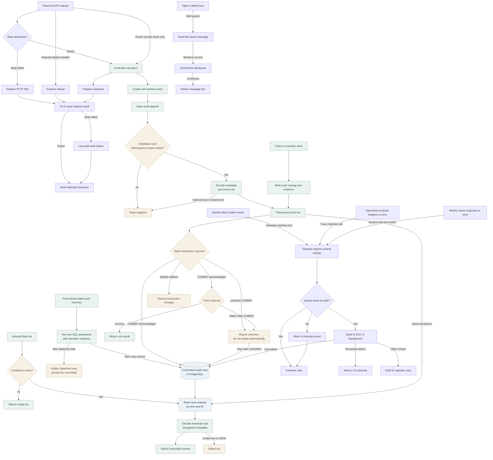

# Audit ledger flow

## Overview

OpenClaw Control Plane (OCC) records API requests, worker jobs and Gateway
observations in PostgreSQL. The [audit guide](../guides/topics/audit-log.md)
explains which records an analyst can read.

## Entry Points

- Trigger: an API request, a controller operation or an internal audit query.
- Source: `apps/controller/src/index.ts:appendRequestAudit`
- Source: `packages/occ/src/state/postgres-state.ts:PostgresPlatformState`
- Source: `packages/occ/src/state/postgres-work-queue.ts:INSERT_EVIDENCE_CTE_SQL`
- Assumptions: PostgreSQL State owns the Installation. Each caller checks
  admission and permission. The repository list is internal.

## Flow

The diagram shows the current code.

## Execution Trace

### 1. The API records admission and the result

`apps/controller/src/index.ts:requestAuditHooks` and
`apps/controller/src/http/agents.ts:getAgent`

After bootstrap, Control Plane audit saves `openclaw.api.request.admitted`
before the handler starts. Failure returns `503`. [HTTP chat](agent-http-chat.md)
also records `openclaw.api.request.received` before authentication.
The API queues these chat records and results on its persistent volume.
A route hook records `openclaw.api.request.result`
before sending a standard API response, including validation and authentication
errors. Relayed chat responses use separate result records.

The result hook also covers the registered account, service-key, sign-in,
recovery, and native administration routes. Routes can record only a result
when they use a separate check or recorder for the operation. A resource API
request that returns `405` records a `methodNotAllowed` result. Google
and OIDC sign-in callbacks use their own authentication recorder. Runtime
log views and downloads use their own disclosure recorder.

Request records contain the server's request ID, operation, method, Installation
ID and verified actor, if known. The result reports the selected HTTP status.
If a result write fails, OCC logs `http.audit_append_failed` and sends the
selected response. Handlers check permissions and record changes.

A failed denial write usually preserves the refusal. A
[device login scope denial](credential-source-lifecycle.md#device-authorization-and-configuration) requires a record
or OCC returns `503`. A `404` that conceals a resource still records `denied`.

After a successful `getAgent` read, the result identifies the stored Agent
and Namespace. [Other reads](../guides/topics/audit-log.md#api-requests) also
identify the returned resource. Admission and unsuccessful results identify
the Installation.

### 2. A caller constructs resource evidence

`apps/controller/src/index.ts:event` and `packages/audit/src/index.ts:AuditEventFactory.create`

The controller appends Namespace mutation evidence in the mutation's transaction.
The factory supplies ID, time, kind and outcome defaults. It checks required
fields and Namespace scope, sanitizes details and actors, and freezes the event.
Direct repository callers must sanitize their own evidence.

### 3. State appends a row in the caller's transaction

`packages/occ/src/state/postgres-state.ts:PostgresPlatformState`,
`packages/occ/src/state/postgres-state.ts:auditDetails`, and
`apps/controller/src/worker.ts:ControllerWorker`

Append requires the event's Installation to match the initialized server-owned
Installation and its resource Namespace to equal its event Namespace. It rejects
the reserved `__occAuditMetadata` key in caller details. It copies ordinary
details and stores nine optional fields under that key: `schemaVersion`,
`source`, `requestId`, `admissionDecisionId`, `actor`, `iamDriverId`,
`authorization`, `decisionReason`, and `reasonCode`. It inserts the envelope
columns and JSON details into `occ.audit_events`. Database constraints and query
errors can also reject the insert. If the event ID already exists, State checks
the stored values. An identical append succeeds without adding a row. A
different event with that ID fails.

The caller can append alongside resource changes in one unit of work. The
standalone PostgreSQL audit sink opens its own transaction. With Control Plane
audit enabled, PostgreSQL limits each statement and lock wait in the API's
standalone audit write to two seconds.

For service API keys, `apps/controller/src/auth/service-keys.ts` commits the
key change and audit record together. Issuance uses the Better Auth adapter on
State's PostgreSQL connection. Revocation deletes the current key in State.

The work queue commits each change with its event.
`packages/occ/src/controller-work-recorder.ts:record` includes the API request
ID if available. The claim and its results share an attempt ID. If the claim
event fails, the job remains available. Maintenance and repository cleanup
record new or reopened work atomically. Audit scheduling failures do not stop
credential cleanup.

The worker uses `transactWithQueue` for some transitions. It also calls pool-backed
stale-work recovery, which issues two separate SQL statements. Each statement is
atomic, but a later failure does not undo an earlier committed statement. A queue
using a caller-supplied client follows that client's transaction boundary. The
queue's `reasonCode`, `attemptCount` and `final` (set only when the transition leaves the
work `failed_permanent`) are ordinary details, not reserved metadata.

### 4. The transaction owner finishes or fails

`packages/occ/src/controller-transactions.ts:createControllerTransactions`,
`packages/occ/src/state/postgres-state.ts:PostgresPlatformState`, and
`packages/occ/src/ports/transaction.ts:RepositoryTransactionLifetime`

Nested controller mutations use the current unit of work. The transaction scope
keeps any registered compensation callbacks with that unit. Definite failures
run compensation. OCC propagates an unknown commit before invoking these callbacks.

PostgreSQL binds the read projection directly to the transaction lifetime.
A write binds the unit of work and registers it for audit and Native IAM
operations on the same client.

After the callback, State stops admitting repository operations and waits for
admitted work before COMMIT. It attempts rollback only if the transaction
started, COMMIT is not uncertain, and no client error occurred. State then
closes the lifetime and releases or discards the client. A lost COMMIT reply or
failed cleanup after acknowledged COMMIT reports an unknown outcome. Neither
permits automatic replay. An append or list result does not prove commit.
OCC logs `http.commit_outcome_unknown` and attempts to record reason code
`COMMIT_OUTCOME_UNKNOWN` for covered API operations.

An observed client transport error prevents callback admission or further
repository results. State discards the client when possible and reports
persistence unavailable, except for uncertain cleanup after COMMIT. These guards
cannot stop external effects by callers or establish unobserved failures.

### 5. Internal list decodes the ledger

`packages/occ/src/state/postgres-state.ts:auditFromRow`

State returns an empty list without an Installation. Otherwise it reads
visible rows in `occurred_at, id` order, including the transaction's
uncommitted rows. State supplies the Installation ID because the table
omits it. State rejects the list for invalid resource kinds, outcomes,
event kinds, timestamps or JSON objects. It removes reserved metadata from details
and copies only the nine recognized keys into the event. It does not
validate, authenticate or sanitize their values. Events and lists are immutable.

### 6. The Agent audit API saves a disclosure for each page

`apps/controller/src/http/agent-audit.ts:createAgentAuditReader`,
`packages/occ/src/agent-audit-reader.ts:listAgentAuditEvents`, and
`apps/controller/src/composition/control-plane-audit.ts:postgresAgentAuditState`

Audit must be on. Native IAM and OCC share PostgreSQL State. A human reader
needs `read_audit` directly on the Agent. OCC rechecks access under lock.

State selects [approved records](../guides/topics/audit-log.md#read-an-agents-audit-events)
within the requested 24-hour window and derives public work IDs. It projects HTTP
chat records and matches a completion ID hash to a saved turn from the same Agent
and revision. Before releasing each page, OCC commits
`openclaw.audit.agent.read` with the actor, Agent, request ID, window,
projection version and count. The encrypted cursor binds the session,
Agent and window and expires 15 minutes after issue.

### 7. A Gateway reports work for one revision

`apps/controller/src/drivers/compute/kubernetes/index.ts:ensureGatewayRuntimeAudit`
and `apps/controller/src/http/runtime-audit.ts`

With audit and managed routing, Helm creates a private HTTPS listener.
Compute mounts the revision token and CA certificate, permits the connection,
and registers the token hash and public replay verifier. It revokes the grant
at stop and deletes the Secret at retirement.

`PostgresWorkQueue.scheduleGatewayAuditMaintenance` queues up to eight
updates per check when grants differ from the setting. Maintenance checks
the original deployer's authority and can restart the Gateway and Codex
worker. With audit off, Compute revokes
the grant after Gateway replacement.

The plugin records new sessions on `session_start`.
`deploy/runtime/managed-runtime-audit/index.mjs:recordLifecycle` records
turn starts and results with session and run IDs. It needs no prior
session record or OCC confirmation.

For embedded OpenClaw, `model_call_started` supplies a trace, model API and call ID.
`deploy/runtime/managed-runtime-audit/openclaw.mjs:subscribeOpenClawAttempts`
observes Undici POST requests to `/responses`, `/chat/completions` or `/messages`,
as selected by the model API. The
`traceparent` header must match one active model call.
The plugin numbers requests at creation. It queues the HTTP status or
`TRANSPORT_ERROR` if the request fails before headers. It retains no URL or body.

`deploy/runtime/managed-runtime-audit/dedicated.mjs:recordDedicatedModel` accepts a saved assistant row with a worker
commit key and matching session and turn. It reports the response ID hash or
error code, without the text. The saved message ID provides a stable event ID.

In a managed dedicated Codex Pod on the control cluster,
`deploy/runtime/managed-runtime-audit/codex-worker.mjs:startAttemptAudit`
receives traces on loopback. It extracts HTTP attempts for the selected
model and discards the traces. The worker keeps the latest 512 attempts
in memory. `deploy/runtime/managed-runtime-audit/codex.mjs:subscribeCodexAttempts`
polls the worker's private status port.
`codex-transport.mjs` authenticates and encrypts the exchange with a key
derived from the App Server token and revision ID. The OCC token stays
on the Gateway. The Gateway holds up to 512 pending attempts in memory.
It queues an attempt only when a saved prompt uniquely links the Codex
turn ID to a Gateway session and run. The native endpoint span supplies the
start time and call ID. For a request without headers, the decoder checks that
Codex reported an error and keeps only `TRANSPORT_ERROR`.

`deploy/runtime/managed-runtime-audit/sink.mjs:createAuditSink` keeps queued
events in `/home/node/.openclaw/state/pending-runtime-audit/observations.sqlite`
across Pod replacements. The original Gateway signs each event. A later Gateway
can relay it with its own credential to the same endpoint. OCC checks both Agent
scopes and the original public verifier, then commits the original revision and
event ID. HTTP 204 confirms commit. [Retries](../guides/topics/audit-log.md#recover-delayed-runtime-events)
preserve the record. Retirement revokes the old credential; its public verifier
cannot authorize new events. OCC rejects modified or conflicting records.

The plugin warns of queue failure or overflow. Agent deletion removes the queue.

### 8. An analyst opens the user message for a turn

`deploy/runtime/managed-runtime-audit/index.mjs:recordInput`,
`apps/controller/src/http/agent-audit.ts:getAgentAuditEventMessage` and
`apps/controller/src/gateway/audit-message-client.ts:readAgentAuditMessage`

The plugin sets `messageLink` and includes `messageId` only for a confirmed input.
It matches OpenClaw HTTP inputs by the `openai-http` channel and `<turn ID>:user` key.
`runtimeAuditReference` can hash turn IDs. Links need original session and message IDs.

1. In a PostgreSQL transaction, `packages/occ/src/agent-audit-reader.ts:selectAgentAuditMessage`
   requires a human session and direct `read_audit` and `read_audit_content`
   grants on this Agent. The requested event must identify a linked turn
   and match `activeRevisionId`. The desired state must be `running`; otherwise
   the authorized lookup returns `revision_unavailable`.
2. Afterward, Envoy checks the OCC service key on the [private route](../reference/gateway-routing.md#endpoint-and-route).
   OCC requires exactly the `operator.sessions.read` scope. It resolves
   the session ID with `sessions.resolve` and calls `chat.message.get`
   with the returned key, session ID and message ID. It checks message ID, user role,
   turn ID and visible text (maximum 64 KiB). Unavailable text returns
   `message_unavailable`. Exceeding four concurrent
   lookups per API process or five seconds per lookup returns HTTP `503`.
3. OCC repeats step 1 and records `openclaw.audit.agent.message.read`
   with the analyst and event ID. After confirmed commit, OCC returns
   the event and text with `Cache-Control: no-store`.

## Debugging and Verification

- The [audit guide](../guides/topics/audit-log.md#read-an-agents-audit-events)
  describes access and pagination for one Agent. The internal repository list
  serves State callers.
- `ScopeViolationError` on append can indicate an Installation mismatch, a
  Namespace mismatch, or reserved persistence metadata. Invalid persisted event
  values or JSON can make the entire internal list fail.
- `postgres-platform` checks API admission, result scope and outage refusals in
  `tests/integration/postgres-api-request-audit.test.ts`, and worker claims in
  `tests/integration/postgres-worker-audit.test.ts`.
- `tests/integration/postgres-agent-audit-read.test.ts` exercises the Agent
  route with real PostgreSQL, grant revocation, a refused disclosure insert,
  and a lost commit acknowledgement.
- `tests/integration/postgres-repository-transactions.test.ts` contains
  PostgreSQL append, metadata decoding, rejection, and rollback cases. Those
  cases require the [PostgreSQL test setup](../testing/postgresql.md); their
  presence and this source trace do not prove a test or deployed system passed.

## Related docs

- [Audit log](../guides/topics/audit-log.md)
- [Namespace IAM policy flow](namespace-iam-policy.md)
- [Controller worker and durable reconciliation](controller-worker.md)
- [Logging flow](common-logging.md)

## Manual Notes

[keep this for the user to add notes. do not change between edits]

## Changelog

- 2026-11-24 19:56: Trace independent worker maintenance. (authoring-run/c14b7752-dc1d-449e-9cee-f248859972e8 - 08f6125c8a49d2d17d7bc75cfe0016eb78704215)

- 2026-11-24 19:07: Trace HTTP chat projection and confirmed message-link reasons. (authoring-run/c14b7752-dc1d-449e-9cee-f248859972e8 - c2c2c657d183f6a7beec125d1e9b05aab877c161)

- 2026-11-24 17:38: Trace signed replay after revision retirement. (authoring-run/5f4255c4-b1d1-4890-b127-2882657adce0 - 61b5d467d3ed00c9f955ab0d09c73420f332ce78)

- 2026-11-24 17:02: Trace worker responses and model transport failures. (authoring-run/5f4255c4-b1d1-4890-b127-2882657adce0 - 47b6265e9ecbc11ec4d13b4309166836af2bba1d)

- 2026-11-24 16:32: Trace embedded OpenClaw HTTP attempts. (authoring-run/952e24f7-42a2-4586-9b70-95b040806b9e - f3feee183fc2ab1b78e398371df27c41d77d6a3b)

- 2026-11-24 16:06: Trace Codex HTTP attempts through the worker and Gateway. (authoring-run/7db9d106-49fe-478e-be1d-69a8a1709b11 - 3d5608cc7f1cf05a79b460fa3b208ab2560fc567)

- 2026-11-24 15:07: Trace turn records independent of session starts. (authoring-run/03d51d83-3016-48c4-8ca8-f10d451e24eb - 338c8a4102dfd13457c5714ff78f7af3ae5c9ac1)

- 2026-11-24 11:55: Identify the modules that check message access and record queued work. (authoring-run/398ebd74-9254-4f53-9416-263c57eca6f2 - bf3d0ed3a444c0c70768c713d66efee717152b7a)

- 2026-11-24 11:24: Identify the separate API volume for pending HTTP chat records. (authoring-run/b6bdb7b2-6bd6-4074-9551-f936deb0ad23 - 24f84269c9fa2ae3dc49461b071931b1b27a27fa)

- 2026-11-24 10:21: Identify queued HTTP chat records. (authoring-run/e84c6230-3e81-429a-93ee-4459af104384 - de7a98fdbb33b5ed3ac59b2a8ca004b2aeb5f705)

- 2026-11-24 09:37: Trace background delivery of Gateway turn records. (authoring-run/d108b4d9-d114-4611-befc-6fb2787baee3 - 3e0ed219b6022212dbe331dfe48c940e3d24a94e)

- 2026-11-22 10:38: Trace how PostgreSQL binds repository methods for read and write transactions. (authoring-run/11295583-8a4b-4157-9cd9-4c7a768ae999 - b766b8ed991110ad86ce9e44adb59215ddb91293)

- 2026-11-20 16:35: Trace audit setting changes for running Gateways. (authoring-run/2fce19b6-c5f9-489d-862a-df3396f922c2 - fb0f4dc39a9b736919375069d258bab9c7d98b75)

- 2026-11-20 15:15: Trace session creation and the required turn admission write. (authoring-run/2fce19b6-c5f9-489d-862a-df3396f922c2 - e2d6da28746ecc1cc756a226c91bd0e360da2211)

- 2026-11-20 14:01: Trace the saved HTTP message ID from OpenClaw to the turn event. (authoring-run/2fce19b6-c5f9-489d-862a-df3396f922c2 - 097f01174caa0d1db9a7e412efd2558b352a59d2)

- 2026-11-19 17:16: Trace how OCC links a turn to a saved chat message and authorizes the text read. (authoring-run/bccca424-a66f-4ab2-ad5a-e639f845a228 - 04dbfef7e367b86ee5b5275fb510c21798b759b5)

- 2026-11-19 14:28: Record runtime observations through the OCE Gateway plugin. (authoring-run/4dfd652a-6550-45c4-b86a-ce9b35ec4705 - f637b353b485f8610c0f58df801eb5feb577f291)

- 2026-11-19 10:04: Trace runtime enrollment, event delivery, and reads. (authoring-run/fe4ad3ff-b579-4d9b-a15e-622a822cd15f - d517d45f0ffdce32b9b7663efe062fc3e8a997bb)

- 2026-11-18 17:35: Trace Agent lifecycle reads and additional control-plane audit sources. (authoring-run/d9552e4e-b5ce-4d02-aa1f-b9e2666a360d - 86265b4ed8e8b22ae3882889d4febccdef1b5f65)
- 2026-11-12 16:19: Explain how Native IAM counts Agent audit grants for account and key management. (authoring-run/09158870-8481-4ef1-9ff0-f1e2d5ae4df9 - 9912bddae4ac3d94e9f4d22c6283d957a4cf1e9a)
- 2026-11-12 16:19: Trace how composition supplies the Agent audit reader and verifies its IAM Driver. (authoring-run/0262148b-40f3-48c2-a3e1-546feb2e265b - 9912bddae4ac3d94e9f4d22c6283d957a4cf1e9a)
- 2026-11-12 15:31: Trace how a successful Agent read saves the verified Agent and Namespace IDs. (authoring-run/bb7f16b1-d73b-4957-b5bb-212692e7ada9 - 8658496ea654b960bebabca40d18c7d71994db50)
- 2026-11-12 14:30: Document the covered request rejection path and audit-write failure response. (authoring-run/184ad244-ddb9-4dc2-b9ff-1d35f57fb8e0 - 8658496ea654b960bebabca40d18c7d71994db50)
- 2026-11-12 14:04: Document request admission and results and the atomic queue claim audit. (authoring-run/2e85d711-50c8-4e66-aa55-842b05f80ba9 - 8658496ea654b960bebabca40d18c7d71994db50)
- 2026-09-28 11:15: Document observed client errors in the transaction owner alongside the accompanying source correction. (authoring-run/48243369-59ed-41da-bc9e-21f627f7e6a2 - eb25ab1e4105defd4b6bbb19ef28570863d8df63)
- 2026-09-26 02:55: Clarify that the initial flow inspection included the uncommitted audit decoder fix from 7966519007124bdf77be78324b3c705cf6980199. (authoring-run/48c2199e-221b-4f32-9f69-2d21e68712ba - a501f64abbd1a5821b6c8f0da7f9466195f7dc6d)
- 2026-09-26 02:38: Prepare the public audit ledger flow from the reviewed source and local draft. (authoring-run/b9f3fb59-fdac-4727-9071-61a19b7d940a - 3b58323f762f5742e8b44be3e269af0696ed7cde)
