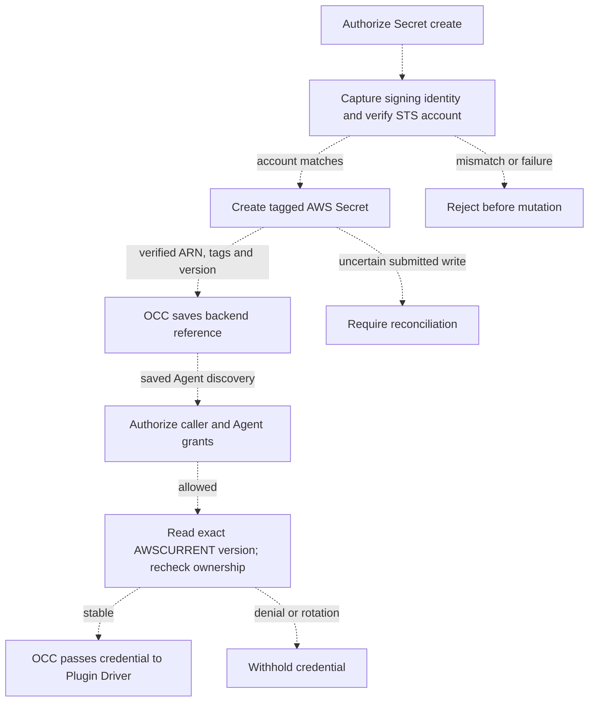

# AWS Secret storage and saved-Agent discovery flow

## Overview

This draft path stores Namespace Secrets in AWS Secrets Manager and reads them for
trusted server-side Agent operations. It stops when OCC passes a credential to
the Plugin Driver. The selector and configuration still require an RFC and human
review; this source path does not establish installed or live AWS proof.

## Entry Points

- A ready Namespace and an authorized Secret-create request:
  `packages/occ/src/index.ts:OpenClawController.createSecret`.
- A saved Agent with a Secret-backed credential and exact caller and Agent grants:
  `packages/occ/src/index.ts:OpenClawController.discoverSavedAgentPlugins`.
- Trusted Installation selection:
  `apps/controller/src/composition/installation-config.ts:composeInstallationConfiguration`.

## Flow

The dashed path is the draft implementation under review.

## Execution Trace

### 1. Select and create storage

`apps/controller/src/drivers/secret/aws-secrets-manager/index.ts:AwsSecretsManagerSecretDriver.create`

Composition selects the proposed Driver from trusted Installation configuration.
OCC allocates the Secret identity. The Driver captures one signing identity for
STS and creation, checks the account, creates the tagged Secret, and verifies
the complete ARN. If AWS has not yet exposed the object, tags, or current version,
it retries only Describe against that ARN within the original deadline. OCC then saves the
backend reference without the value. Requests observe the API mutation deadline.
A failure after submission can require reconciliation; the Driver does not adopt
a resource by name.

### 2. Read for a saved Agent

`apps/controller/src/drivers/secret/aws-secrets-manager/index.ts:AwsSecretsManagerSecretDriver.withValue`

OCC checks the caller's and Agent's authority on the bound Secret. The Driver
verifies the exact resource, reads the observed version with `AWSCURRENT`, and
checks ownership and version again. OCC rechecks the binding and grants before
passing the value to the Plugin Driver. Denial, cancellation, or a changed
version withholds the credential. Protected reads check their absolute deadline
before dispatch and before returning material. OCC refuses AWS workload projections
during admission, before it saves a revision or queues deployment.

## Debugging and Verification

- Run `node --test tests/integration/aws-secrets-manager.test.ts`. The suite
  exercises OCC and saved-Agent discovery with simulated AWS service responses;
  SDK signing uses a simulated HTTP transport.
- A submitted write with an uncertain outcome requires operator reconciliation.
  Inspect authorized AWS audit and resource records without printing values.
- Installed discovery against live AWS remains unverified.

## Related docs

- [AWS Secret Driver proposal](../reference/drivers/aws-secrets-manager.md)
- [Secret storage and gateway delivery](secret-storage-and-delivery.md)
- [Secret Driver contract](../reference/drivers/secret.md)

## Manual Notes

[keep this for the user to add notes. do not change between edits]

## Changelog

- 2026-11-18 22:46: Trace the draft AWS storage and discovery path. (authoring-run/1c41665a-15f0-4ee5-a222-01c2d2d74c32 - de3817de1de2c010d87cbd1b7f2747753f5ce973)

- 2026-11-18 22:58: Document create verification retries, protected-read deadlines, and projection admission. (authoring-run/cfae1295-1506-4b46-b6d6-63204f46b76a - 08b5147bc72a7ec6680f9a42ef8f3feaceac7c67)
