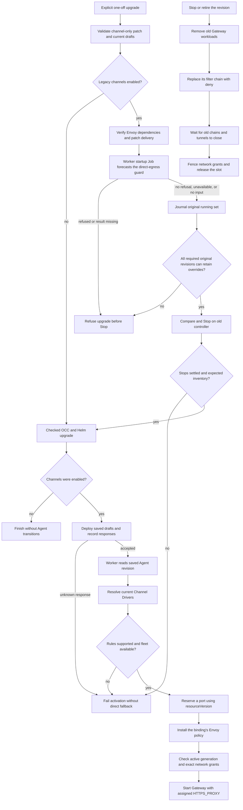
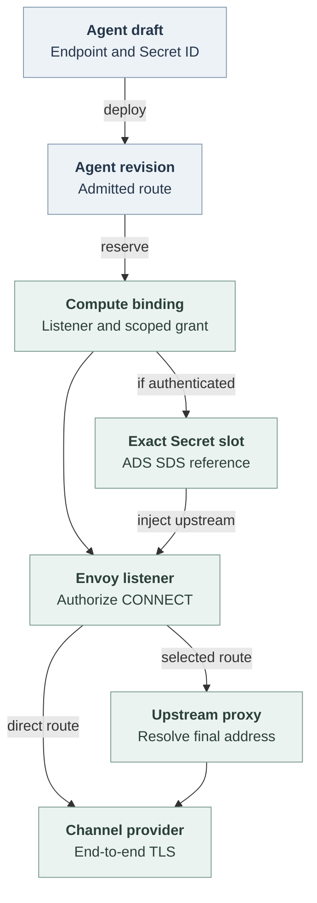

# Channel egress flow

## Overview

Kubernetes Compute prepares and retires channel access during the normal Agent
revision workflow. Channel Drivers declare destinations. Compute reserves a
listener, verifies Envoy's installed policy and grants access only to the
Gateway that carries the matching revision and binding labels. This flow ends
when the Gateway can start, or when revoked access is closed and its slot can
be reused. Source implementation alone does not establish live acceptance.

Managed profiles and the chart default the fleet on. Explicit false remains off.
Local Kubernetes setup discovers Pod, Service and node exclusions and writes
matching Helm and Installation settings. Independent production inputs require
explicit exclusions. Dependency setup checks the pinned controller and actual
patch delivery before channel resources. Existing Slack-proxy installations use
[the one-off upgrade flow](coordinated-production-upgrade.md); subsequent image
upgrades do not replay it.

## Entry Points

- Trigger: installation setup, the explicit `scripts/upgrade-channel-egress run`, or an authorized Agent deployment, retry, stop or deletion.
- `apps/controller/src/composition/installation-config.ts:composeInstallationConfiguration`
- `apps/controller/src/drivers/compute/kubernetes/index.ts:KubernetesComputeDriver.prepareRevision`
- `apps/controller/src/drivers/compute/kubernetes/channel-egress.ts:KubernetesChannelEgress.prepare`

The worker holds its live PostgreSQL work claim and reauthorizes the original
actor before Compute effects. The managed fleet and enforcing NetworkPolicies
must be installed. See [controller work](controller-worker.md).

## Flow

The proxy path below describes implemented source behavior. It does not by
itself establish live Agent acceptance.

## Execution Trace

### 0. Install or upgrade channel routing

`scripts/render-installation-profile.ts:renderInstallationProfile` writes matching channel
settings into Helm and the external Installation. Explicit false remains off.
`internal/occdev/channel_egress.go:prepareDevelopmentChannelEgress` uses chart
defaults and discovered cluster exclusions for local Kubernetes installations.
`scripts/setup-channel-egress:main` checks the pinned controller, CRDs and
GatewayClass. Its probe verifies actual patch delivery and deletes only its
acknowledged resources with UID preconditions. Existing dependencies retain
ownership; incompatible configuration requires the owner's repair.

`scripts/upgrade-channel-egress:prepare` patches actual legacy input files.
Before `prepare` writes candidates or `validate` compares inputs, `helm_values`
reads a private regular file once and checks the first physical line for
`USER-SUPPLIED VALUES:` or `COMPUTED VALUES:` with optional trailing whitespace.
For that line shape, it checks the first entry as YAML regardless of the
filename. An implicit null at that entry or a failure of that YAML check
triggers recapture guidance. For accepted inputs, `yq` selects the values parser
by filename and reads the same bytes through standard input.
`validate` requires the supported source, matching target channel fields and
an unchanged normalized remainder. It permits the existing validated immutable
Secret reference switch. The shared `scripts/upgrade-production-images` binds
this operation mode and helper hashes to recovery evidence and retains its
live-input, identity, Secret, startup, migration, quiescence and Helm checks.

The candidate Worker startup Job receives a compact list of dedicated channel
targets and resolves each Agent's tenant namespace. In a single cluster it uses
the tenant namespace for the Gateway. In a two-cluster installation it checks
the control-plane Gateway namespace after resolving the execution namespace.
If tenant labels yield no execution namespace, the Worker reads the expected
name before switching clusters. A foreign or inactive namespace stops the upgrade
before Agent Stop. Provisioning handles absent namespaces.

`KubernetesComputeDriver.verifyUpgradeChannelDirectEgressGuard` uses saved drafts
to identify affected Gateways. It applies the same source-label selector and
direct-egress predicate as activation. Selectors that depend on generated
revision or binding values are deferred to activation. The forecast reports
when the Worker would refuse a rule with unspecified destinations or an IP
block outside the allowed ranges. The diagnostic includes the Kubernetes
namespace and a validated policy UID when available. After Agent Stop,
activation still checks Envoy inspection, ingress, and the actual assigned
listener, including conflicts.

The preflight Secret reserves space for the API Job's complete drafts when they
fit beside the candidate Installation. The Worker receives channel targets if
they fit in the remaining space, even when the drafts exceed the limit. The upgrade
warns when targets do not fit or the candidate image reports that the check is
unavailable. With targets mounted, a successful Job must report a direct-egress
guard result or explicit unavailability before Stop.

For enabled channels, `scripts/upgrade-channel-egress:lifecycle` saves the
complete original running set in a private journal. Before any new Stop, it
refuses an uncertain Stop submission anywhere in that set. It then checks every
original revision still needed by Deploy, including those whose Stop completed,
through `occ --output json --namespace NAMESPACE_ID agent revision AGENT_ID REVISION_ID --check-retain-harness-overrides`.
The hidden JSON mode in `internal/occcli/cli.go:agentCommand` invokes
`readRetainedHarnessOverrides`, the same reader as Deploy. It accepts a readable overrides object, including
`{}`. For unreadable settings, the exact revision's listed Harness summary must
record an overrides object or certify that none were recorded. Missing or invalid
evidence, denied reads, an unsupported CLI, or a receipt with different Namespace,
Agent or revision IDs refuses the pass before another Stop. The receipt contains
those IDs and `canRetainHarnessOverrides: true`, without override values.

Each Stop still compares the original active revision. Completion requires the
Agent to be stopped with no active revision. `stopped_inventory` checks the
expected selection changes before OCC writer shutdown. While both writers are
quiesced, resume verifies the recorded inventory offline. After access to the
same Installation and channel fleet recovers, Deploy repeats that check for each
Agent before recording `sending`, so a failed read leaves that Deploy unsent and a
later run resumes it. Deploy then rereads each original
revision through `--retain-harness-overrides` and submits its requested overrides
with the current saved draft. An empty object uses current Installation defaults.
The script waits for each accepted deployment and checks the recorded new
revision. An uncertain submission requires manual inspection and is not replayed.
Disabled channels skip Agent transitions. Follow [One Off
Upgrades](../guides/deploy/one-off-upgrades.md) for commands and recovery.

### 1. Resolve one coherent set of requirements

`apps/controller/src/drivers/channel/routing.ts:resolveChannelRouting`

Trusted composition binds each provider ID to a Driver. Compute reads enabled
providers from the saved revision and resolves each to exactly one instance.
The shared validator rejects malformed rules and normalizes DNS names and ports.
Compute rejects unqualified IPv6 rules. Each attempt retains the resulting
requirements; a retry derives them again. Destination policies are not a
separate PostgreSQL snapshot.

`packages/occ/src/agent-deployment-admission.ts:createAgentDeploymentAdmission`

Core saves the Agent's proxy selection and private Compute admission in the
revision. The worker rechecks the caller and Agent principal on the exact
Secret and passes Compute only its backend identity. No enabled channels means
Compute creates no listener binding or proxy grant.

### 2. Reserve and configure a listener

`apps/controller/src/drivers/compute/kubernetes/channel-egress.ts:KubernetesChannelEgress.reserve`

Compute checks the Gateway owner, dedicated Service ports and ready Envoy Pods.
It recovers an exact existing binding or reserves an idle port through the
stable EnvoyPatchPolicy's Kubernetes resource version. The initial policy denies
all targets. A conflicting reservation is read again; exhaustion rejects
activation. A different rules hash gets a different binding.
For a proxy selection, the hash also binds the admitted endpoint, scoped
addresses, trust, and source Secret UID/resource version. Compute fills only
the assigned preallocated Secret slot and waits for its fixed deny-only route
to be accepted before activating the listener. A changed credential version
on retry requires a new deployment.

`apps/controller/src/drivers/compute/kubernetes/channel-egress-policy.ts:channelEgressFilterChain`

The direct allow chain checks CONNECT authority and port, resolves a strict-DNS
subcluster, and checks the selected upstream address. The proxy chain applies
the same authority and port rules, checks the selected proxy address and port,
then injects the slot's SDS credential in the router's upstream filter chain.
The proxy owns final address resolution. Provider TLS stays end-to-end.

### 3. Verify enforcement before workload start

`apps/controller/src/drivers/compute/kubernetes/channel-egress.ts:KubernetesChannelEgress.waitInstalled`

The worker reads every serving Pod's configuration through exact listener and
cluster inspection queries. Names-only SDS inspection excludes
credential-derived delta versions. It requires the assigned actual TCP port, one matching listener, the intended
active filter chain, no alternate or older draining chain, and a stable Pod set. It installs the exact Gateway
source and Envoy ingress grants, then checks the complete additive policy sets.
For a proxy binding, it also verifies the exact cluster, SDS name, and scoped
fleet egress grant before Gateway startup.

`apps/controller/src/drivers/compute/kubernetes/index.ts:KubernetesComputeDriver.deployment`

Only the Gateway receives the assigned proxy URL and binding label. Harness
transport remains direct and its model credential placement is unchanged.

### 4. Revoke before reuse

`apps/controller/src/drivers/compute/kubernetes/channel-egress.ts:KubernetesChannelEgress.retire`

Cleanup selects only the revision's bindings. It marks each record revoking,
replaces its filter chain with deny, and checks the active generation plus the
fleet-wide `listener_manager.total_filter_chains_draining` gauge on every serving
Pod. Envoy omits in-place filter-chain drains from `config_dump`; a zero gauge
confirms that all workers removed those chains and their connections. It replaces
grants with empty policies. Before marking the slot idle, it requires the old
Gateway Pods to be absent and their Deployments and ReplicaSets to have no
desired replicas. The stop and retirement callers remove the Gateway first;
NetworkPolicy readback alone does not confirm CNI revocation. Stable resource versions fence late writes by old workers. Missing
inspection or uncertain ownership leaves the reservation for retry.
For an authenticated proxy, Compute empties the exact Secret slot, waits for
the controller to reject its empty route and for the old SDS name to disappear,
marks the slot idle, and only then releases the listener port.

### 5. Keep OCC requests separate

`apps/controller/src/composition/installation-config.ts:composeInstallationConfiguration`

OCC derives its reserved provider endpoint from the same validated installation
settings. Its Slack Driver uses that listener for credential validation and
directory requests. Helm generates the OCC policy from the Driver declaration;
API-only grants do not expose an Agent listener. Envoy receives no Slack token.
See [directory lookup](agent-channel-directory.md) for Secret authorization.

## Debugging and Verification

Inspect the managed Gateway, EnvoyPatchPolicy bindings and network grants when
activation fails. Translation status alone is insufficient; the active listener
generation must match. Retained revoking records indicate incomplete cleanup.
Do not delete them to reclaim a port.

If preparation detects an additive NetworkPolicy that lets the Gateway reach
unrestricted or public destinations directly, check the worker's
`worker.compute-prepare-failed` event. If the event includes a NetworkPolicy UID,
find the policy in the Gateway's Kubernetes namespace before correcting it.
When the forecast identifies a direct-egress guard refusal, `preflight-worker.log`
reports the unsupported peer type and the validated policy UID when available.
Run `kubectl get networkpolicy -n <gateway-namespace> -o custom-columns=NAME:.metadata.name,UID:.metadata.uid`.

[The Kubernetes and Slack procedures](../testing/slack.md) select the real
runtime tests. Controlled endpoint probes prove transport, not another channel
provider's integration. The implementation plan records qualification results
and remaining acceptance evidence.

## Related docs

- [Managed channel egress](../reference/drivers/kubernetes-compute/channel-egress.md)
- [Channel Driver](../reference/drivers/channel.md)
- [RFC implementation plan](../../specs/plans/0043-channel-egress.md)

## Manual Notes

## Changelog

- 2026-11-23 16:55: Check the original revision again before recording each one-off Deploy as sending.

- 2026-11-21 04:39: Trace Agent proxy admission, exact Secret slots, scoped Envoy enforcement, safe inspection, and drain-fenced retirement (authoring-run/01a1fbf1-03d5-7d21-af95-cdba37f77298 - 1e1803913)

- 2026-11-21 04:15: Check every required original revision before a new one-off Stop (authoring-run/b9e0b8fc-0057-44bd-b184-c3de7be3267b - 67ecfd947c8969dec25777d7caebf77459ac978f)

- 2026-11-20 18:02: Forecast the Worker's direct-egress guard before Stop and verify execution and Gateway namespace ownership (authoring-run/bf16e7c9-029c-4a8c-8fba-00d9249599e2 - 499592f85223d2a36369d6e230915c549ff09864)

- 2026-11-20 14:26: Check Helm display headings and parse values from one file read (authoring-run/1298084c-0ccd-44f1-84ab-4170b4c56d21 - d2c019d17f3c4471b6a10579b1e8c9876240689f)

- 2026-11-20 11:37: Retain requested Harness overrides during the one-off deployment (authoring-run/450eca24-b9e6-4940-9ee5-9ec1200643b0 - d215c0d95c2336244519eca4968df04ec4376ae2)

- 2026-11-20 11:06: Reject either Helm display heading in one-off upgrade values (authoring-run/6cc6b66e-34c0-474e-98fb-7b1a6de5c987 - c86f69daac0044e7a4f770e43aead2121b05f8bd)
- 2026-11-20 10:51: Preserve valid Helm values mappings that share the display heading (authoring-run/ee570ea2-5d17-4170-a37b-0f46c4fbd8ea - d26c1eb9420d4ec22662f390534a73653325d42f)
- 2026-11-20 10:26: Reject Helm display output in one-off upgrade values (authoring-run/73549c13-fca6-4842-813d-62fa224637ec - 9092839d0c3b9598e85300451f425ac6d3084fe5)
- 2026-11-20 09:53: Documented the worker diagnostic for additive public egress policies (authoring-run/7734097f-2ed2-4eb1-afc9-b87345676072 - 9092839d0c3b9598e85300451f425ac6d3084fe5)

- 2026-11-19 20:41: Verify recorded Agent state before one-off completion and on resume (authoring-run/3d885bbf-20eb-48f1-9e9e-975b986c82ab - 87d5c0d63f6765816d0e4a6dee9cb20f8be1d5c1)

- 2026-11-19 19:30: Linked installation defaults and the explicit one-off upgrade in accompanying changes (authoring-run/3d885bbf-20eb-48f1-9e9e-975b986c82ab - ebcbd2f60535c36b3a9b63847a2d052363cd29a6)

- 2026-11-19 05:02: Require Envoy drain acknowledgement and stopped source workloads before port reuse. (authoring-run/64d7828e-4701-4e9c-8c92-0b3617945c7a - fc683cdfe9b73215d0503cdfaf7917f54be7f17e)

- 2026-11-19 00:02: Documented channel declaration, listener ownership and revocation in the accompanying implementation (authoring-run/64d7828e-4701-4e9c-8c92-0b3617945c7a - e05a54b4b3daf86249c89aaeb2a8491dd52c80cc).
