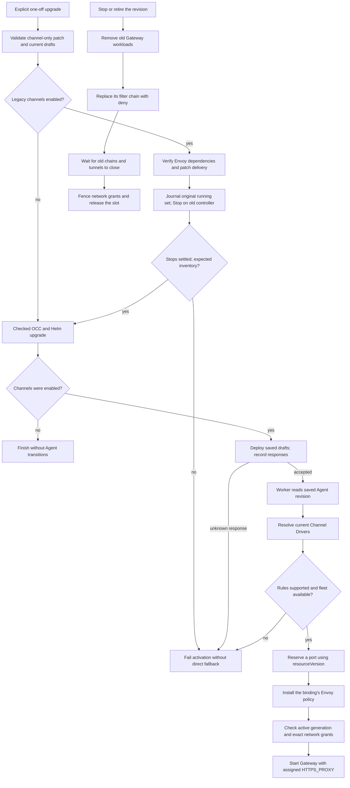

# Channel egress flow

## Overview

Kubernetes Compute prepares and retires channel access during the normal Agent
revision workflow. Channel Drivers declare destinations. Compute reserves a
listener, verifies Envoy's installed policy and grants access only to the
Gateway that carries the matching revision and binding labels. This flow ends
when the Gateway can start, or when revoked access is closed and its slot can
be reused. Source implementation alone does not establish live acceptance.

Managed profiles and the chart default the fleet on. Explicit false remains off.
Local Kubernetes setup discovers Pod, Service and node exclusions and writes
matching Helm and Installation settings. Independent production inputs require
explicit exclusions. Dependency setup checks the pinned controller and actual
patch delivery before channel resources. Existing Slack-proxy installations use
[the one-off upgrade flow](coordinated-production-upgrade.md); subsequent image
upgrades do not replay it.

## Entry Points

- Trigger: installation setup, the explicit `scripts/upgrade-channel-egress run`, or an authorized Agent deployment, retry, stop or deletion.
- `apps/controller/src/composition/installation-config.ts:composeInstallationConfiguration`
- `apps/controller/src/drivers/compute/kubernetes/index.ts:KubernetesComputeDriver.prepareRevision`
- `apps/controller/src/drivers/compute/kubernetes/channel-egress.ts:KubernetesChannelEgress.prepare`

The worker holds its live PostgreSQL work claim and reauthorizes the original
actor before Compute effects. The managed fleet and enforcing NetworkPolicies
must be installed. See [controller work](controller-worker.md).

## Flow

## Execution Trace

### 0. Install or upgrade channel routing

`scripts/render-installation-profile.ts:renderInstallationProfile` writes matching channel
settings into Helm and the external Installation. Explicit false remains off.
`internal/occdev/channel_egress.go:prepareDevelopmentChannelEgress` uses chart
defaults and discovered cluster exclusions for local Kubernetes installations.
`scripts/setup-channel-egress:main` checks the pinned controller, CRDs and
GatewayClass. Its probe verifies actual patch delivery and deletes only its
acknowledged resources with UID preconditions. Existing dependencies retain
ownership; incompatible configuration requires the owner's repair.

`scripts/upgrade-channel-egress:prepare` patches actual legacy input files.
`validate` requires the supported source, matching target channel fields and an
unchanged normalized remainder. It permits the existing validated immutable
Secret reference switch. The shared `scripts/upgrade-production-images` binds
this operation mode and helper hashes to recovery evidence and retains its
live-input, identity, Secret, startup, migration, quiescence and Helm checks.

For enabled channels, `lifecycle` flushes the complete original running set to
its private journal before Stop. It records request intent and returned IDs.
Guarded Stop requires the original revision; completion requires the Agent to
be stopped with no active revision. Pending Stops and deletions must settle
under the old controller. `stopped_inventory` checks only the expected selection
changes before OCC writer shutdown. After both writers are quiesced, resume
validates the recorded stopped inventory without calling the offline API. Shared
Deployment identity, generation and Pod-absence checks still apply.

After authenticated access to the same Installation and channel fleet readiness
recover, plain Deploy
creates revisions from current saved drafts. Requests are sequential. Accepted
requests are observed to completion; an uncertain `sending` state refuses
resubmission until manual inspection resolves it. Completion and resume also check
that each Agent still selects the recorded new revision. Disabled channels skip both
Envoy preparation and Agent transitions. Ordinary upgrades do not select this
mode. Follow [One Off Upgrades](../guides/deploy/one-off-upgrades.md) for commands
and recovery; then the normal revision path below owns policy preparation.

### 1. Resolve one coherent set of requirements

`apps/controller/src/drivers/channel/routing.ts:resolveChannelRouting`

Trusted composition binds each provider ID to a Driver. Compute reads enabled
providers from the saved revision and resolves each to exactly one instance.
The shared validator rejects malformed rules and normalizes DNS names and ports.
Compute rejects unqualified IPv6 rules. Each attempt retains the resulting
requirements; a retry derives them again. Destination policies are not a
separate PostgreSQL snapshot.

### 2. Reserve and configure a listener

`apps/controller/src/drivers/compute/kubernetes/channel-egress.ts:KubernetesChannelEgress.reserve`

Compute checks the Gateway owner, dedicated Service ports and ready Envoy Pods.
It recovers an exact existing binding or reserves an idle port through the
stable EnvoyPatchPolicy's Kubernetes resource version. The initial policy denies
all targets. A conflicting reservation is read again; exhaustion rejects
activation. A different rules hash gets a different binding.

`apps/controller/src/drivers/compute/kubernetes/channel-egress-policy.ts:channelEgressFilterChain`

The allow chain checks CONNECT authority and port, resolves a strict-DNS
subcluster, and checks the selected upstream address before connecting. IPv4
special-use and installation exclusions remain mandatory. TLS stays end-to-end.

### 3. Verify enforcement before workload start

`apps/controller/src/drivers/compute/kubernetes/channel-egress.ts:KubernetesChannelEgress.waitInstalled`

The worker reads every serving Pod's configuration through the read-only
inspection listener. It requires the assigned actual TCP port, one matching listener, the intended
active filter chain, no alternate or older draining chain, and a stable Pod set. It installs the exact Gateway
source and Envoy ingress grants, then checks the complete additive policy sets.
When it checks source egress, Compute uses the Gateway Pod template's fixed
`openshell.ai/boundary-role=channel-gateway` label. The label is part of the
binding's policy hash. A Gateway created before this label was introduced
gets a separate binding on reconciliation, and its old binding retires after
the previous Pod stops. A policy that selects
OpenShell supervisors by role cannot select the channel Gateway. Selectors
that depend on unknown labels can still match and undergo the same checks.

`apps/controller/src/drivers/compute/kubernetes/index.ts:KubernetesComputeDriver.deployment`

Only the Gateway receives the assigned proxy URL and binding label. Harness
transport remains direct and its model credential placement is unchanged.

### 4. Revoke before reuse

`apps/controller/src/drivers/compute/kubernetes/channel-egress.ts:KubernetesChannelEgress.retire`

Cleanup selects only the revision's bindings. It marks each record revoking,
replaces its filter chain with deny, and checks the active generation plus the
fleet-wide `listener_manager.total_filter_chains_draining` gauge on every serving
Pod. Envoy omits in-place filter-chain drains from `config_dump`; a zero gauge
confirms that all workers removed those chains and their connections. It replaces
grants with empty policies. Before marking the slot idle, it requires the old
Gateway Pods to be absent and their Deployments and ReplicaSets to have no
desired replicas. The stop and retirement callers remove the Gateway first;
NetworkPolicy readback alone does not confirm CNI revocation. Stable resource versions fence late writes by old workers. Missing
inspection or uncertain ownership leaves the reservation for retry.

### 5. Keep OCC requests separate

`apps/controller/src/composition/installation-config.ts:composeInstallationConfiguration`

OCC derives its reserved provider endpoint from the same validated installation
settings. Its Slack Driver uses that listener for credential validation and
directory requests. Helm generates the OCC policy from the Driver declaration;
API-only grants do not expose an Agent listener. Envoy receives no Slack token.
See [directory lookup](agent-channel-directory.md) for Secret authorization.

## Debugging and Verification

Inspect the managed Gateway, EnvoyPatchPolicy bindings and network grants when
activation fails. Translation status alone is insufficient; the active listener
generation must match. Retained revoking records indicate incomplete cleanup.
Do not delete them to reclaim a port.

[The Kubernetes and Slack procedures](../testing/slack.md) select the real
runtime tests. Controlled endpoint probes prove transport, not another channel
provider's integration. The implementation plan records qualification results
and remaining acceptance evidence.

## Related docs

- [Managed channel egress](../reference/drivers/kubernetes-compute/channel-egress.md)
- [Channel Driver](../reference/drivers/channel.md)
- [RFC implementation plan](../../specs/plans/0043-channel-egress.md)

## Manual Notes

## Changelog

- 2026-11-20 09:03: Use the channel Gateway Pod role to check overlap with additive egress policies (authoring-run/d9b054e0-9ff3-484d-915b-0bf5faaf83fd - 79fb7a03cd06ec3201951d97026814a3de2d6835)

- 2026-11-19 20:41: Verify recorded Agent state before one-off completion and on resume (authoring-run/3d885bbf-20eb-48f1-9e9e-975b986c82ab - 87d5c0d63f6765816d0e4a6dee9cb20f8be1d5c1)

- 2026-11-19 19:30: Linked installation defaults and the explicit one-off upgrade in accompanying changes (authoring-run/3d885bbf-20eb-48f1-9e9e-975b986c82ab - ebcbd2f60535c36b3a9b63847a2d052363cd29a6)

- 2026-11-19 05:02: Require Envoy drain acknowledgement and stopped source workloads before port reuse. (authoring-run/64d7828e-4701-4e9c-8c92-0b3617945c7a - fc683cdfe9b73215d0503cdfaf7917f54be7f17e)

- 2026-11-19 00:02: Documented channel declaration, listener ownership and revocation in the accompanying implementation (authoring-run/64d7828e-4701-4e9c-8c92-0b3617945c7a - e05a54b4b3daf86249c89aaeb2a8491dd52c80cc).
