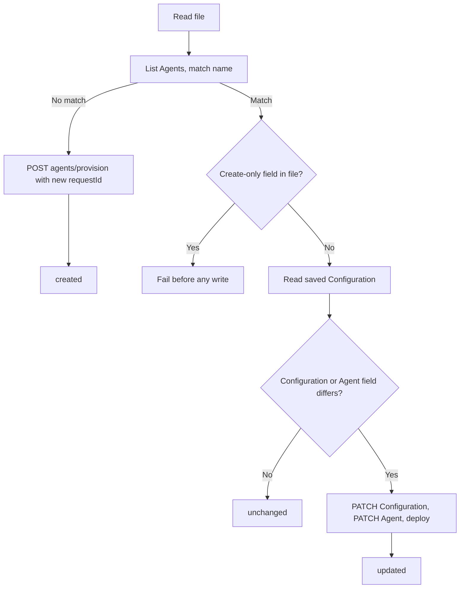

# CLI Agent apply flow

## Overview

`occ agent apply --file FILE` makes one Agent match a file. It finds the Agent
by `name`. With no match, it queues first-time provisioning. With a match, it
updates the saved Configuration and Agent fields that differ, then deploys once.
The flow ends when the command prints `created`, `updated` or `unchanged`. It
does not wait for provisioning or show runtime health. Fields and limits are in
the [apply guide](../guides/topics/agent-apply.md).

## Entry Points

- `internal/occcli/agent_apply.go:agentApplyCommand`: reads the file and prints the result.
- `internal/occcli/agent_apply.go:applyAgent`: finds the Agent and chooses the path.
- Assumptions: the caller has the grants that `refusals.go` lists for `agent apply`.

## Flow

## Execution Trace

### 1. Choose the path

`internal/occcli/agent_apply.go:applyAgent`

The CLI refuses a file that has a `requestId`, no `name`, an unknown field, or
no `configuration.values` object. It lists the
Namespace's Agents and compares `name`. OCC keeps names unique in a Namespace.

### 2. Create

`internal/occcli/agent_apply.go:provisionAgent`

The CLI adds a `requestId` derived from the file and sends the file to
`POST /namespaces/{id}/agents/provision`. OCC answers 202 with the provisioning
record. The same file gives the same `requestId`, so a repeat while creation is
pending, or after a lost response, replays the request.

### 3. Update

`internal/occcli/agent_apply.go:updateAgent`

The CLI compares decoded JSON, and counts an empty object as an omitted value,
except `pluginApprovers`: an explicit empty list differs from an omitted one.
It compares only the fields in the file. Before each write it rereads the Agent
and stops if another Configuration is bound. The server has no Configuration
precondition on an Agent patch or deploy, so a rebind between that reread and the
write is not caught. The saved Configuration is patched with
its read `generation`, so a concurrent edit gets a conflict. The Agent patch
carries only changed fields. Deployment runs once after the saves.

Each call is a separate request. If the Agent patch or deploy fails, the earlier
saves stay. The error names the next command. A deploy failure leaves the saved
Configuration unchanged on the next `apply`, so the error asks for
`occ agent deploy ID`. A 4xx reply is a refusal. If the reply is lost or is a 5xx,
the result is unknown, and the error says to check `occ agent revisions ID`
before deploying again.

## Debugging and Verification

- `tests/integration/occ-api.test.mjs` runs the built CLI against the real
  controller for the `unchanged`, `updated`, deploy-failure and refusal paths.
- The create path needs durable PostgreSQL state. The in-memory controller
  answers `DEPENDENCY_UNAVAILABLE`. `internal/occcli/agent_apply_test.go`
  checks the request the CLI sends.

## Related docs

- [Apply an Agent from a file](../guides/topics/agent-apply.md)
- [Agent provisioning flow](agent-provisioning.md)
- [CLI Agent browsing flow](cli-agent-browsing.md)

## Manual Notes

[keep this for the user to add notes. do not change between edits]

## Changelog

- 2026-11-15 00:00: Added the apply flow (opencode/agent-apply - a42a5f120)
- 2026-11-16 00:00: Addressed review: file validation, request ID reuse, approver list, rebind check (opencode/agent-apply)
