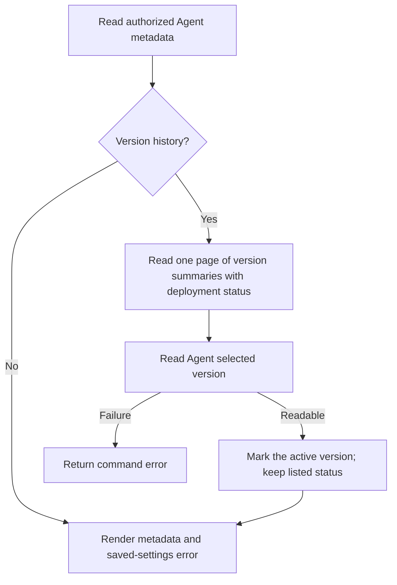

# CLI Agent metadata browsing flow

## Overview

An operator runs `occ agent get`, `occ agent list`, or `occ agent revisions`
to inspect saved Agent identity and history. The CLI reads the authorized OCC
HTTP API and prints metadata, including a scoped error when saved settings
cannot be decoded. Browsing ends at terminal output; it does not repair saved
settings, admit a deployment, or establish runtime health.

This flow covers the API's existing metadata-plus-error response. A retired
saved setting can remain in PostgreSQL after its application contract changes.
OCC keeps the affected record browsable, omits unreadable settings without
substituting defaults, and identifies the affected field. Database outages and
strict operational failures retain their own error semantics.

## Entry Points

- `internal/occcli/cli.go:agentCommand`: the `get`, `list`, and `revisions` commands.
- `internal/occcli/cli.go:describeAgentRevisions`: marks the selected version in
  authorized version summaries.
- `internal/occcli/output.go:printBrowsingItems`: conditional error columns for
  table output, with the API's typed fields preserved in JSON and YAML.

The caller supplies an OCC origin, a service-key response file, and a Namespace
ID. Exact Agent/version reads and list filtering remain the API's responsibility;
CLI presentation does not grant access or make unreadable fields usable.

## Flow

## Execution Trace

### 1. Admit command options and fetch the browsing response

`internal/occcli/cli.go:namespaceClient` checks the Namespace ID and creates an
`occclient.Client`. `internal/occclient/client.go:GetAgent`, `ListAgents`, and
`ListAgentRevisions` select the appropriate GET route. The transport decodes
successful envelopes into resource data and returns a command error for HTTP
failures or invalid envelopes. `internal/occclient/transport.go:apiError`
reports a redirect without following it. It compares host letter case
insensitively when choosing the remedy: a same-origin redirect needs a direct
API endpoint, while another origin can require changing `OCC_URL`. The target
is still displayed without userinfo, query, or fragment.

`packages/occ/src/state/postgres-state.ts:browseSavedConfiguration` is the
persistence boundary for the special successful response. It catches saved
payload decoding failures and returns identity/lifecycle metadata with
`configurationReadError`, whose code is `SAVED_CONFIGURATION_UNREADABLE` and
whose field identifies the unreadable setting. Query failures and strict reads
remain outside this recovery boundary. The CLI consumes that contract rather
than attempting to decode omitted settings or retrieve them through operational
endpoints.

### 2. Mark the active version in version history

Version history pages hold summaries, newest first (`--limit`, `--cursor`).
They carry no saved settings and so no `configurationReadError`.
`packages/occ/src/index.ts:listRevisions` adds each version's
`deploymentStatus` and `deploymentErrorCode` from its deployment work record in
the same read, so a version or Agent with unreadable saved settings keeps its
status. A version without a deployment work record has `null` for both.

`internal/occcli/cli.go:describeAgentRevisions` reads the Agent to determine its
selected version, clones each summary, and sets its `active` marker. It keeps
the listed status and sends no read for each version. A failed Agent read
ends the command. When a page is full,
a notice prints the next command with the resolved `--namespace`, the retained
`--limit` when supplied, and the new `--cursor`. Explicit scope keeps that
command on the selected Namespace even when `OCC_NAMESPACE` is unset or differs.

Neither branch treats missing settings as empty settings. The command retains
the API error object in structured output. Explicit deployment, editing, and
runtime commands continue to use their existing strict contracts.

### 3. Render the preserved metadata and error

`internal/occcli/output.go:printAgent` uses `printBrowsingItems` for individual
Agents and Agent collections. `printAgentRevisionList` first renders the active
marker for tables and then uses the same helper; version summaries have no
error column. Tables add `CONFIGURATION
ERROR` when at least one row has `configurationReadError`; the cell contains
the formal code and field. Healthy rows in a mixed collection have no error
value, and all-healthy tables retain their existing columns.

For one Agent in table output, `cli.go:agentCommand` then reads
`occclient.Client.GetAgentHarnessStatus`, and
`internal/occcli/agent_runtime_output.go:printAgentHarness` prints the [Harness
Sandbox status](../reference/drivers/sandbox.md#harness-sandbox-status) under
the table as a `Harness Sandbox:` line, as `occ agent runtime` does. It reads
only a running Agent with an active revision, and names that revision in the
Sandbox logs hint. A `lost` line tells the operator to deploy the Agent again.
An `unobserved` answer prints nothing, and a failed read prints `unknown`, never
`lost`. `agent list` reads no Sandbox, so a list costs no Sandbox Driver call
per Agent. JSON and YAML print the Agent resource only.

The helper clones rows before formatting the error so table presentation cannot
alter the response used elsewhere. JSON and YAML bypass this projection and
retain the typed `configurationReadError` object, together with version active
markers and available deployment status. Stderr notices remain separate from
structured stdout, allowing scripts to parse it normally.

The next owner is the operator. Unreadable saved settings need separate repair
before strict operations can succeed; browsing itself neither repairs the
record nor retries deployment work.

## Debugging and Verification

Run `occ agent get AGENT_ID`, `occ agent list`, and `occ agent revisions AGENT_ID`
with the same Namespace. A saved-settings problem appears as
`SAVED_CONFIGURATION_UNREADABLE (field)` in tables and as the typed object with
`--output json` or `--output yaml`. Version history shows the same
`deploymentStatus` as the API list. Null status alone does not prove a
deployment failed or succeeded.

The PostgreSQL browsing case in
`tests/integration/postgres-platform-state.test.mjs` creates healthy saved state,
introduces a retired plugin enum using the same legacy-state fixture as the API
contract, and exercises the compiled CLI through the shipped API listener. It
checks list/detail/history output, structured errors, listed deployment status
beside an unreadable historical version, strict mutation refusal, and unchanged
stored legacy settings. It does not run Gateway workloads or model turns. The
focused Go command tests additionally check that history sends no status read
for each version, and that `--cursor` continues the history. See the PostgreSQL testing guide for owned database setup.

## Related docs

- [CLI command reference](../reference/cli.md)
- [Unreadable Agent saved settings](../reference/agents.md#unreadable-saved-settings)
- [PostgreSQL testing](../testing/postgresql.md)
- [Console Agent editing](platform-console/agent-editing.md)
- [CLI publication](cli-publication.md)

## Manual Notes

[keep this for the user to add notes. do not change between edits]

## Changelog

- 2026-10-31: Version history keeps the deployment status of each OCC list summary instead of reading each version's status again. (bughunt-1031m)

- 2026-10-22 02:40: `occ agent get` adds the Harness Sandbox line of a running dedicated Agent (finding 2152). (fix-2152a - 912a25bb9879)

- 2026-10-20 02:20: Keep same-origin CLI redirect guidance when host letter case differs. (authoring-run/b4678129-6e54-4f19-a084-b62c9396cf77 - d331d24fdddc269c12900327733be0ae1ffc441e)

- 2026-10-18 15:11: Preserve the selected Namespace in version-history continuation commands. (authoring-run/b64e89ba-6b5d-4d22-854f-ebea78dfe94f - bcf4fbcf0f082367910d262b1f06732b0bdd80c8)

- 2026-10-14: Version history lists summaries a page at a time; an unreadable historical version reports its status read on stderr. (fix-1323-lists)
- 2026-10-10 00:17: Trace CLI metadata browsing and the accompanying saved-settings error consumption fix. (authoring-run/9acffaba-7af3-4c0f-a2ab-f1ac1e7a7afc - bc09216080e8699976a75b778abf256a20388b5d)
