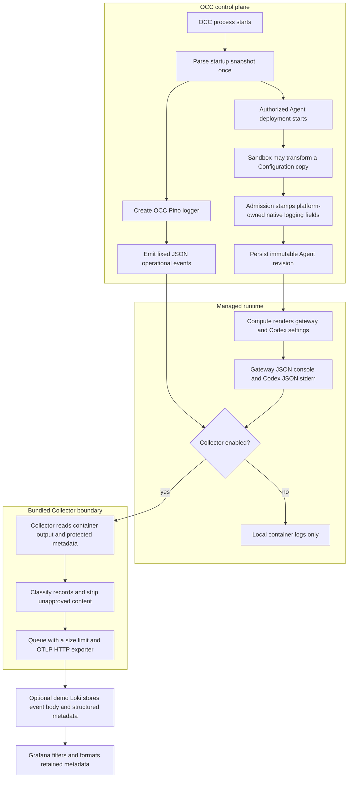

# Common Operational Logging Flow

## Overview

Trusted startup configuration selects the OCC logging level. Authorized Agent
deployment freezes runtime logging in an immutable Agent revision. Optional
Collectors export reviewed operational records; PostgreSQL audit remains separate
durable evidence.

## Entry Points

- Trigger: start the API, worker, migration, or bootstrap process; deploy an
  Agent; enable the optional Docker Compose or Helm logging Collector.
- Source: `apps/controller/src/composition/installation-config.ts:loadStartupConfigurationSnapshot`
- Source: `packages/occ/src/index.ts:OpenClawController.deployAgent`
- Source: `deploy/helm/openclaw-enterprise/templates/collector.yaml:logging.collector.enabled`
- Assumptions: trusted startup YAML, an authorized deployment request, selected
  Compute Driver support, and operator-owned Collector configuration when remote
  export is enabled.

## Flow

## Execution Trace

### 1. Startup parses one configuration snapshot

`apps/controller/src/composition/installation-config.ts:loadStartupConfigurationSnapshot`

API and worker parse trusted YAML once and pass `startupConfiguration.logging`
to driver composition. Invalid settings fail startup before requests or work.
Bootstrap, maintenance, and the worker's fallback read only the logging section
through `apps/controller/src/composition/startup-file.ts:loadOperationalLoggingConfiguration`,
which shares the snapshot's file reader and checks. The migration command imports
that module directly, so it never loads Drivers.
See the [settings reference](../reference/settings.md) for YAML shape and values.

### 2. Processes log fixed sanitized events

`apps/controller/src/api-startup.mjs:startApi`

Worker (`apps/controller/src/worker.mjs`), bootstrap
(`scripts/bootstrap-installation.mjs`), and migration (`scripts/migrate-production.mjs`)
also create Pino loggers at the selected level. The API disables Fastify request
logging. Bootstrap and migration separate success protocol output from structured
failure diagnostics. Before Pino writes, `apps/controller/src/logging.ts:emitOccLogEvent`
keeps reviewed scalar fields and drops unapproved fields, credentials, provider
payloads, request/reply objects, and unsafe strings. This source boundary precedes
the separate Collector filter in step 7. For worker records, the Collector retains
allowlisted `work.operation` values and allowed `work.id` formats. Agent stop keys
include the operation UUID. Credential withdrawal keys end in the operation UUID or
`activation` (the attempt a candidate's activation queues), optionally followed by
`:recovery:<n>` for a later attempt series. Deletion keys have no operation suffix.
Provisioning keys use `agent-provisioning:` and exactly 32 lowercase hexadecimal
characters, matching the work ID the API and worker share.
Unsupported values and key shapes are excluded.
The local worker emitter also retains `stopYields` from throttled drain-yield and
completion records as a nonnegative safe integer; the Collector does not export this count.
For any process, the sanitizer keeps `check`, `failure`, `reasonCode` and `harnessState`
only as short identifier codes, never free text, and `fence` only as a nonnegative safe
integer. The worker and the OpenShell Git runtime use them for expiry steps, failure
classes, the reason code an Agent is shown, Harness state and route generations.
`hintCode` (named refusal guidance) is a code too, and so is `command` on
`auth:maintain` events. `installationId` and `orphanedConfigurationId` are kept only as
OCC-assigned `ins_` and `cfg_` UUIDs.

Compute preparation failures may include a Driver-reviewed stage, classification,
status, and a message of at most 256 characters. The worker never serializes the raw exception, and
the sanitizer drops secret-shaped messages before local output.

### 3. Admission freezes runtime logging

`packages/occ/src/index.ts:OpenClawController.deployAgent`

If the trusted ComputeDriver declares `runtimeLogging: "driver"`, admission
validates and freezes the native document without rewriting logging fields. The
[Compute contract](../reference/drivers/compute.md#runtime-logging-ownership)
owns that pipeline; OCC logging and audit remain unchanged.

Otherwise, the SandboxDriver may transform a frozen copy of the Namespace-owned
Configuration. Deployment stamps native fields before validation: matching
`logging.level` and `logging.consoleLevel`, JSON console style, and
`diagnostics.otel.logs=false`. It drops the retired `logging.redactSensitive` key.
Runtime code owns console and tool redaction. The source Configuration is unchanged;
the immutable Agent revision retains the admitted policy across restarts and later edits.

### 4. Compute renders settings from the version

`apps/controller/src/drivers/compute/docker/index.ts:DockerComputeDriver.prepareRevision`

Kubernetes uses
`apps/controller/src/drivers/compute/kubernetes/index.ts:KubernetesComputeDriver.deployment`.
Both Drivers require consistent admitted logging fields. Kubernetes mounts the
document read-only at `/etc/openclaw/openclaw.json`. Gateway logs JSON to console;
dedicated Codex app-servers use JSON stderr and host-owned arguments that disable
OTLP export and prompt logging. Lifecycle hooks and SecretBindings cannot override
those destinations.

### 5. Docker collection is an explicit development override

`apps/controller/src/drivers/compute/docker/index.ts:DockerComputeDriver.prepareRevision`

The optional `compose.logging.yaml` routes OCC, gateway, and Codex containers
through Docker's nonblocking `fluentd` driver to a pinned Collector. Docker
Compute sets runtime `LogConfig` from `OCC_DOCKER_LOGGING_ADDRESS`, which must be
reachable from the Engine. See the [Docker procedure](../guides/observability.md#docker-compose).

### 6. Kubernetes collection is bundled or equivalent

`deploy/helm/openclaw-enterprise/templates/collector.yaml:logging.collector.enabled`

The Helm Collector DaemonSet reads node CRI files and uses Pod metadata to
associate records with managed workloads. See the
[Kubernetes observability procedure](../guides/observability.md#kubernetes-and-helm)
for enablement and existing-Collector reuse, and the
[security reference](../reference/security.md#operational-log-collection-boundary)
for isolation limits.

`k8sattributes` maps identity before `transform/kubernetes-resource` removes
internal Pod labels; removing shared labels per record would lose identity for
later records in the batch. It also blocks pipeline start until its Pod cache
syncs: `filelog` reads existing CRI files immediately, and a record processed
without Pod identity is filtered out while its offset is still committed, so
startup events such as `worker.started` would otherwise be lost for good.

Before emitting the DaemonSet,
`deploy/helm/openclaw-enterprise/templates/_helpers.tpl:openclaw.quantity`
checks the Collector resource and volume quantities for obvious syntax errors.
Malformed values stop rendering with the setting name; absent optional limits
pass through. Kubernetes performs complete validation after rendering. See the
[production settings](../reference/settings/production.md#production-operational-logging-collection)
for the supported scope.

The chart validates one exporter destination: an IPv4 `/32` or paired namespace/Pod
selectors, with a decimal TCP port from 1 to 65535. Leading zeros fail rendering:
Kubernetes YAML would read them as octal and grant a different port. It renders
exporter egress alongside DNS/API
access. Empty Collector metrics selectors grant no ingress; paired selectors admit
port 8888. Policies are additive. The demo can export privately to Loki using
the bundled Collector or an external Collector with its own filtering policy.
Driver-owned pipelines also have separate guarantees.

### 7. Collector exports only operational classes

`deploy/logging/collector.yaml:transform/operational`

The bundled Collector keeps transport-derived identity before parsing untrusted
JSON. It classifies fixed OCC event names, `gateway` subsystem records, Codex
stderr records from `codex_app_server` plus Codex warnings and errors (not
`codex_otel`), `codex.turn` and `codex.tool_call`, and the Gateway and Harness wrappers'
stderr diagnostics: `runtime.startup_phase` keeps `occ.startup.phase` (and a
failed phase's cause as `occ.code`, such as `PLUGIN_NOT_IN_CATALOG`), and
`runtime.workspace_node` and the model probes keep `occ.code`. A failed phase or
non-`READY` probe is WARN, so a startup failure's cause reaches the backend.
`runtime.gateway_settings_overridden` is WARN with no attributes: the names of
the replaced owner settings stay in `occ agent logs`.
Kubernetes resources drop the `latest` image tag that metadata extraction reports
for a digest-only image. For retained records it keeps allowlisted
attributes and replaces the body with the event name, stripping arbitrary content;
Codex turn and tool-call bodies are fixed text, and a `codex.operational` body
keeps a short plain-text Codex message only from `codex_app_server` or the fixed
`codex_core::responses_retry` retry messages; a Codex warning without such a
message is dropped (as are span lifecycle records).
OCC `compute.preflight-warning` records retain WARN severity and `occ.code` values of at most 64 allowed characters;
the local diagnostic message is excluded from remote export.
`authentication.sign-in-limit-warning` and `authentication.forwarded-refused-warning` keep
`occ.code`, and
`authentication.sign-in-limited` keeps only `occ.sign_in.lane`; its local key
hash is not exported. `authentication.provider-unavailable-warning` keeps
`occ.sign_in.provider`, `.step` (`authorization`, `token`, `jwks`, `profile` or
`membership`), `.cause` and `.status`, plus a transport code as `occ.code`; the provider
instance ID stays local.
`worker.repository-cleanup-warning` keeps `occ.code` and its cause code of at most 64 allowed characters as
`occ.worker.cause`.
Every exported OCC event keeps the sanitizer's codes under the same checks (a
letter, then at most 63 letters, digits, `_` or `-`, and no key or token shape):
`check`, `failure`, `harnessState`, `hintCode` and `reasonCode` as `occ.check`,
`occ.failure` (a device login keeps its own, below), `occ.harness_state`,
`occ.hint_code` and `occ.reason_code`, and `fence`, a nonnegative safe integer, as
`occ.fence`. So `worker.openshell-git-expiry` names the OpenShell Git expiry step
and why it is pending, with `work.outcome` `pending`, `withdrawn` or
`retire-runtime`, and `worker.repository-delivery-pending` shows that protected Git
delivery is retrying. The reconcile retries every second, but that line is written when
delivery starts failing (the first failed pass after the worker starts or after a completed
pass), then at most once a minute. Its Sandbox Driver ID stays local, as do Installation and
Configuration IDs.
`worker.compute-prepare-failed` (a Compute Driver could not prepare a version) is
ERROR and keeps `occ.code` plus the Namespace, Agent and Agent revision IDs and work identity
other worker events keep; the stage, error class, status and message stay local.
API lifecycle and dependency warnings are exported too. `shutdown.started`,
`shutdown.completed` and `shutdown.failed` (ERROR, `occ.code`) carry the drain's
`duration_ms` once it ends; the signal stays local. `database.idle-client-error`
keeps its SQLSTATE or transport code as `occ.code`. `device_authorization.start_failed`
keeps `request.id`, `occ.device_authorization.reason` (`unreachable` or `unavailable`)
and its failure class of at most 64 allowed characters (such as `TimeoutError`) as `occ.device_authorization.failure`.
`agent_runtime_credentials.cluster_denied` keeps only `request.id`; the denied verb,
resource and Kubernetes namespace stay local. `agent_provisioning.compute_refused` (the
Compute Driver refused a provisioning plan for a reason the caller cannot fix) keeps only
`request.id`; the Driver's reason stays local. `http.dependency_unavailable` (the cause
of an API `503 DEPENDENCY_UNAVAILABLE`, whose response keeps generic text) keeps only
`request.id`; its route, error class, message and causes stay in the API's local log.
`native_admin.websocket_audit_failed`
keeps the Namespace, Agent and Agent revision IDs, and `native_admin.websocket_denial_audit_failed`
carries none. `native_admin.compute_owner_mismatch` (native admin refused because the selected version belongs to another Compute Driver) keeps the same three IDs; the Driver IDs and
implementations stay local. `authentication.activation-warning`, `authentication.password-sign-in-warning`
and `authentication.recovery-seed-warning` keep at most `occ.code`; account IDs and
messages stay local.
`presets.default-refresh-skipped` (a default Preset copy kept because policy refused
its refresh) is WARN and keeps `occ.namespace.id` and `occ.preset.id`; the Preset
name, refusal text and Restriction IDs stay local. `presets.default-create-skipped`
(a missing default left uncreated because a deny Restriction refused it) is WARN and
keeps only `occ.namespace.id`. `presets.bundled-default-shadowed` (a bundled
default replaced by a same-named `presets.files` entry) is WARN and carries no IDs;
the Preset name and file path stay local. These three Preset events come only from
`occ-api`: the worker never applies default Presets. The Collector drops malformed,
oversized, unclassified, unspecified-severity, and Codex protocol stdout records.
OpenClaw's Gateway startup failure (an `error` record with no subsystem whose
message starts `Gateway failed to start:`) is exported as
`gateway.startup_failed`, so a crash-looping Gateway's cause reaches the backend;
its body keeps the message under the same plain-text rules as `codex.operational`.
Those rules also reject a message with an argv credential flag (`-u`, `--password`)
or a `user:password` pair.
Collector-only configuration holds exporter credentials and TLS settings. Finite
queues and retries make logs best-effort; outage or overflow cannot block API
service, worker reconciliation, or PostgreSQL audit persistence.

### 8. The demo dashboard presents existing metadata

`deploy/helm/openclaw-observability-demo/templates/grafana.yaml:logs.json`

`deploy/helm/openclaw-observability-demo/templates/_helpers.tpl:demo.serviceName`
preserves short DNS-label Service names. For dotted, leading-digit or overlong
release names, it prefixes the component and a normalized release name,
then appends the original release hash. Ending with the hash separates these
names from unchanged component-suffixed Service names. `templates/deployments.yaml` creates those Services;
`templates/grafana.yaml` uses the same names in both datasource URLs.
Deployment names, Pod selectors and discovery identity keep the full release.
Before rendering, `demo.validate` refuses an uppercase image repository path
that kubelet cannot pull. Registry hosts and tags may retain uppercase spelling.
The separately configured Collector endpoint remains in its exporter Secret.
If an upgrade renames Loki, the operator updates that endpoint and refreshes
the Collector Pods before new records can reach Loki; the
[recovery procedure](../guides/observability/demo-cleanup.md#refresh-a-renamed-loki-address)
covers managed and external exporters.

For the bundled Collector path, Loki retains event names and normalizes attributes
as structured metadata. Grafana formats metadata at query time without changing
records. External and Driver-owned pipelines require separate operator review.
See the [demo guide](../guides/observability/demo.md#read-and-narrow-operational-logs)
for panels, correlation, and authorization limits.

## Debugging and Verification

- For unexpected process levels, check the startup snapshot; for runtime levels,
  compare the saved version with rendered container settings.
- Use the [observability guide](../guides/observability.md#tests) for delivery,
  Collector metrics, and deployment troubleshooting.
- Packaging and Collector tests prove configuration, filtering, queue size limits,
  and startup boundaries. Select real runtime suites separately for gateway,
  Codex, model-turn, or OpenShell deployment proof.
- If a runtime Pod enters `CrashLoopBackOff` before a model turn with a config
  lock failure under `/etc/openclaw`, inspect the admitted Configuration for
  retired fields before treating the run as a completed case.

## Related docs

- [Settings reference](../reference/settings.md)
- [Security controls](../reference/security.md)
- [Observability guide](../guides/observability.md)
- [Deployment guide](../guides/deploy.md)
- [Common OpenTelemetry logging spec](../../specs/plans/20-common-otel-logging/index.md)

## Manual Notes

[keep this for the user to add notes. do not change between edits]

## Changelog

- 2026-10-23 21:00: Log `worker.repository-delivery-pending` when delivery starts failing, then at most once a minute, not on every one-second retry. (fix-2251)

- 2026-10-23 20:00: Preserve current logging documentation and both histories while retaining demo repository-casing validation. (authoring-run/01a10a81-070c-7aa3-97d0-fbce8f285d4d - e1788c775)

- 2026-10-23 13:00: Export `worker.openshell-git-expiry` and `worker.repository-delivery-pending`, and keep the sanitizer's codes and route fence, so the bundled Collector shows why Git expiry or delivery is stuck. (collector-export-1023 - #3305)

- 2026-10-23 12:30: Keep `work.id` for credential withdrawal keys that end in `activation` or `:recovery:<n>`; the Collector dropped them. (fix-2249 - #3302)

- 2026-10-23 10:45: Keep the auth:maintain command, refusal guidance codes, OCC-assigned Installation and orphaned Configuration IDs, and the delivery-pending Sandbox Driver ID through the local logging sanitizer. (fix-2245)

- 2026-10-23 09:45: Keep the OpenShell Git expiry check, failure, reason code and route fence, and the worker's Harness state, through the local logging sanitizer. (fix-2244 - #3289)

- 2026-10-20 02:25: Refuse uppercase demo image repository paths before rendering. (authoring-run/01a10a81-070c-7aa3-97d0-fbce8f285d4d - d331d24fd)

- 2026-10-16 00:17: Reject negative and nonnumeric stop-yield counts at the local logging boundary. (authoring-run/d2f628d3-43ac-470f-907d-2a17c299f7c2 - f916021bf235e9f8e91630484948eb6fc88ccfa7)

- 2026-10-15 23:23: Preserve worker stop-yield counts through the local logging sanitizer. (authoring-run/74e7fe0c-15bc-4a73-ba8a-9ec426a17d06 - 04514330688378316bd0641b8d5560da56aeff85)

- 2026-10-14 01:40: Export `native_admin.compute_owner_mismatch` with the Agent's IDs; the Compute Driver names stay local. (fix-1287)

- 2026-10-10 05:47: Retain admitted Agent provisioning work IDs in Collector correlation metadata. (authoring-run/93444a45-23c4-4b1c-9d53-391d9014d93f - cd30d20a297fdb0f2b712122b705aa4c168564ff)

- 2026-10-10 00:44: Refuse noncanonical Collector exporter ports before Kubernetes YAML can change their meaning. (authoring-run/e72ad138-e0b2-498e-885b-f8fa56caaeb0 - 3e34cc0f4b469d29fc79d2c10a33f87a0921ee47)

- 2026-10-09 23:11: Document renamed Loki exporter addresses and Collector refresh after demo upgrades. (authoring-run/8adc169e-fc08-40ad-823f-a80486252608 - 6668e2fc8477ca780b15e25a7320589a7612284f)

- 2026-10-09 21:42: Bound demo Service names and keep Grafana datasource URLs aligned. (authoring-run/8adc169e-fc08-40ad-823f-a80486252608 - 49d1562335120b125d3f149a5a6a64a5c51577a9)

- 2026-10-09 14:00: Export `http.dependency_unavailable`, the API warning that names the cause of a `503 DEPENDENCY_UNAVAILABLE` by request ID; the cause stays local. (fix-529-938)
- 2026-10-08 10:17: Document Collector quantity syntax checks in the accompanying chart change. (authoring-run/95ed7983-818c-4af2-8875-1330333f5e41 - 1fce0eef361dd584212cc3f2ac4d75ab92eb8ff7)

- 2026-10-06 13:30: Export `agent_provisioning.compute_refused`, the API warning that names a Compute provisioning refusal by request ID.
- 2026-10-06 06:30: Export the API shutdown, idle database connection, device login, cluster credential denial, native admin audit failure and authentication startup warnings that other pages tell operators to look for.
- 2026-10-05 05:30: Note that the Preset startup warnings come only from the API.
- 2026-10-05 03:30: Export `presets.bundled-default-shadowed` as WARN with only its event name.
- 2026-10-05 02:30: Export `presets.default-create-skipped` as WARN with only the Namespace ID.
- 2026-10-04 23:10: Export `presets.default-refresh-skipped` as WARN with only the Namespace and Preset IDs. (bh13-fu2-collector - e54a08048)

[Common logging documentation history](common-logging/history.md) preserves the earlier dated entries.
