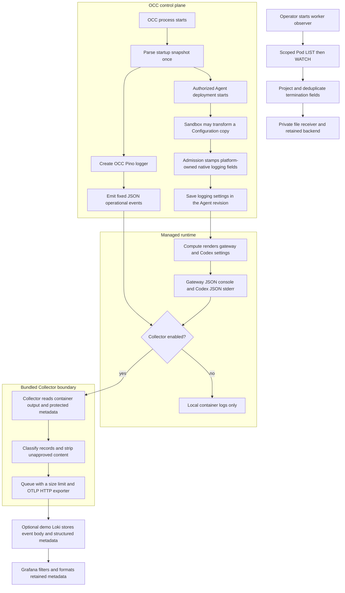

# Common Operational Logging Flow

## Overview

Startup sets the OCC log level. Deployment saves runtime logging in the Agent
revision. Optional Collectors export reviewed operational records. PostgreSQL
retains separate, durable audit evidence.

## Entry Points

- Trigger: API, worker, migration, or bootstrap startup, Agent deployment, or
  optional Docker Compose or Helm Collector enablement.
- Source: `apps/controller/src/composition/installation-config.ts:loadStartupConfigurationSnapshot`
- Source: `packages/occ/src/index.ts:OpenClawController.deployAgent`
- Source: `deploy/helm/openclaw-enterprise/templates/collector.yaml:logging.collector.enabled`
- Assumptions: trusted startup YAML, authorized deployment, Compute Driver
  support, and operator-owned Collector configuration for remote export.

## Flow

## Execution Trace

### 1. Startup parses one configuration snapshot

`apps/controller/src/composition/installation-config.ts:loadStartupConfigurationSnapshot`

The API and worker parse trusted YAML once and pass `startupConfiguration.logging`
to Driver composition. Invalid settings stop startup before requests or work.
Bootstrap, maintenance, and worker fallback read only the logging section via
`apps/controller/src/composition/startup-file.ts:loadOperationalLoggingConfiguration`,
using the same reader and checks. Migration imports this module directly and
skips Driver loading.
See the [settings reference](../reference/settings.md) for YAML shape and values.

### 2. Processes log fixed sanitized events

`apps/controller/src/api-startup.mjs:startApi`

Worker (`apps/controller/src/worker.mjs`), bootstrap
(`scripts/bootstrap-installation.mjs`), and migration (`scripts/migrate-production.mjs`)
use Pino at the selected level. The API disables Fastify request logging.
Bootstrap and migration separate protocol success output from structured
failures. Before Pino writes, `apps/controller/src/logging.ts:emitOccLogEvent`
keeps reviewed scalars and drops credentials, provider payloads, request and
reply objects, and unsafe strings. The emitter applies URL and
connection-string credential checks to approved strings. Step 7 covers
Collector filtering.

The Collector keeps allowed worker `work.operation` values and `work.id` formats.
Agent stop keys include the operation UUID. Credential withdrawal keys end in
the operation UUID or `activation` (queued by candidate activation), optionally
followed by `:recovery:<n>` for later attempt series. Deletion keys omit an
operation suffix. Provisioning keys start with `agent-provisioning:` followed by
exactly 32 lowercase hexadecimal characters. The local emitter keeps
nonnegative safe-integer `stopYields` from throttled drain-yield and completion
records. The Collector drops it.

The sanitizer keeps `check`, `failure`, `reasonCode`, `harnessState`, `hintCode`,
and the `auth:maintain` event's `command` only as identifier codes. It keeps
`fence` only as a nonnegative safe integer and `installationId` and
`orphanedConfigurationId` only as OCC-assigned `ins_` and `cfg_` UUIDs.

`apps/controller/src/worker.ts:finalizeActiveRevision` normalizes the runtime
failure code through the shared vocabulary and adds only that code to active
maintenance's `worker.completed.failure`. Unknown codes become `UNRECOGNIZED`.
Missing or malformed evidence leaves the field unset and health unproven.
Pending outcomes and scheduling are unchanged.

Compute preparation failures may carry a Driver-reviewed stage, classification,
status, and message (up to 256 characters). The worker excludes raw exceptions.
The sanitizer drops secret-shaped messages before output.

### 3. Admission freezes runtime logging

`packages/occ/src/index.ts:OpenClawController.deployAgent`

When the trusted ComputeDriver declares `runtimeLogging: "driver"`, admission
validates and freezes the native document with its logging fields intact. The
[Compute contract](../reference/drivers/compute.md#runtime-logging-ownership)
defines that runtime pipeline. OCC logging and audit remain unchanged.

Otherwise, the SandboxDriver may transform a frozen copy of the Namespace-owned
Configuration. Before validation, deployment sets matching `logging.level` and
`logging.consoleLevel`, JSON console style, and `diagnostics.otel.logs=false`. It
drops the retired `logging.redactSensitive` key. Runtime code owns console and
tool redaction. Deployment leaves the source Configuration intact. The Agent
revision retains the admitted policy across restarts and Configuration edits.

### 4. Compute renders settings from the version

`apps/controller/src/drivers/compute/docker/index.ts:DockerComputeDriver.prepareRevision`

Kubernetes uses
`apps/controller/src/drivers/compute/kubernetes/index.ts:KubernetesComputeDriver.deployment`.
Both Drivers require consistent admitted logging fields. Kubernetes mounts the
document read-only at `/etc/openclaw/openclaw.json`. Gateway logs JSON to console;
dedicated Codex app-servers use JSON stderr and host-owned arguments that disable
OTLP export and prompt logging. Lifecycle hooks and SecretBindings cannot override
those destinations.

### 5. Docker collection is an explicit development override

`apps/controller/src/drivers/compute/docker/index.ts:DockerComputeDriver.prepareRevision`

The optional `compose.logging.yaml` routes OCC, gateway, and Codex containers
through Docker's nonblocking `fluentd` driver to a pinned Collector. Docker
Compute sets runtime `LogConfig` from `OCC_DOCKER_LOGGING_ADDRESS`, which must be
reachable from the Engine. See the [Docker procedure](../guides/observability.md#docker-compose).

### 6. Kubernetes collection is bundled or equivalent

`deploy/helm/openclaw-enterprise/templates/collector.yaml:logging.collector.enabled`

The Helm Collector DaemonSet reads node CRI files and identifies managed
workloads from Pod metadata. The
[Kubernetes observability procedure](../guides/observability.md#kubernetes-and-helm)
covers enablement and Collector reuse. The
[security reference](../reference/security.md#operational-log-collection-boundary)
defines isolation limits.

`k8sattributes` preserves identity across the batch by mapping it before
`transform/kubernetes-resource` drops shared Pod labels. It waits for Pod cache
sync at startup to prevent the downstream filter from dropping records without
Pod identity while `filelog` commits their offsets.

`deploy/helm/openclaw-enterprise/templates/_helpers.tpl:openclaw.quantity`
checks basic Collector resource and volume quantity syntax.
`openclaw.nonNegativeQuantity` and `openclaw.resourceRequirements` reject
negative values and unknown resource names. Malformed values stop rendering and
name the setting. Omitted optional limits pass through. Kubernetes completes
validation after rendering. See the
[production settings](../reference/settings/production.md#production-operational-logging-collection)
for supported settings.

The chart validates one exporter destination, an IPv4 `/32` or paired
namespace and Pod selectors, with a decimal TCP port from 1 to 65535. It refuses
leading zeros because Kubernetes YAML reads them as octal and would grant a
different port. The chart renders exporter egress alongside DNS and API access.
Empty Collector metrics selectors grant no ingress. Paired selectors admit port 8888. Policies are additive. The demo can export privately to Loki with the
bundled Collector or an external Collector with its own filtering policy.

### 7. Collector exports only operational classes

`deploy/logging/collector.yaml:transform/operational`

The bundled Collector keeps transport-derived identity before parsing untrusted
JSON. It classifies fixed OCC event names, `gateway` subsystem records,
`codex_app_server` stderr, Codex warnings and errors except `codex_otel`,
`codex.turn`, `codex.tool_call`, and Gateway and Harness wrapper stderr
diagnostics.

`runtime.startup_phase` keeps `occ.startup.phase` and the cause of a failed
phase as `occ.code` (for example, `PLUGIN_NOT_IN_CATALOG`). `runtime.workspace_node` and
model probes keep `occ.code`. Failed phases and non-`READY` probes are WARN.
`runtime.gateway_settings_overridden` is WARN with no attributes. Replaced
owner setting names stay in `occ agent logs`. `runtime.protected_startup` is
INFO and keeps its SHA-256 identity as `occ.startup.hash`.
`worker.openshell-git-continuity-refused` keeps `occ.check`, a SHA-256
`occ.continuity.key_hash`, and `occ.continuity.result`: a boolean, a count from
0 to 2,147,483,647, or the fixed value `invalid`. Other values are discarded.
`worker.openshell-git-probe-failed` keeps `occ.git_probe.reason` only for
`probe_process_failed` or `probe_response_invalid`. For a process failure, it
keeps an integer `code` from 1 to 99 as `occ.git_probe.exit_code`. It drops
other reasons, invalid exit codes, process output, response bodies, URLs, and
proofs.

The Collector drops Kubernetes metadata's inferred `latest` tag for
digest-only images. It keeps allowlisted attributes and replaces arbitrary
bodies with event names. Codex turn and tool-call bodies use fixed text.
`codex.operational` keeps short plain-text messages only from `codex_app_server`
or fixed `codex_core::responses_retry` retries. The Collector drops Codex warnings
without such a message and span lifecycle records.

OCC `compute.preflight-warning` retains WARN severity and `occ.code` values of at
most 64 allowed characters. Diagnostic messages stay local.
`authentication.sign-in-limit-warning` and `authentication.forwarded-refused-warning` keep
`occ.code`, and
`authentication.sign-in-limited` keeps only `occ.sign_in.lane`; its local key
hash is not exported. `authentication.provider-unavailable-warning` keeps
`occ.sign_in.provider`, `.step` (`authorization`, `token`, `jwks`, `profile`,
`membership` or `email`), `.cause` and `.status`, plus a transport code as `occ.code`; the provider
instance ID stays local.
`worker.repository-cleanup-warning` keeps `occ.code` and its cause code of at most 64 allowed characters as
`occ.worker.cause`. These codes and runtime wrapper codes reject the same recognized
key and token shapes as the other code fields. SQLSTATE values remain supported.
Every exported OCC event keeps the sanitizer's codes under the same checks (a
letter, then at most 63 letters, digits, `_` or `-`, and no key or token shape):
`check`, `failure`, `harnessState`, `hintCode` and `reasonCode` as `occ.check`,
`occ.failure` (a device login keeps its own, below), `occ.harness_state`,
`occ.hint_code` and `occ.reason_code`, and `fence`, a nonnegative safe integer, as
`occ.fence`. `worker.openshell-git-expiry` keeps `work.outcome` (`pending`,
`withdrawn` or `retire-runtime`).
`apps/controller/src/drivers/egress-proxy/openshell-expired-git.ts:subtractExpiredOpenShellGit`
adds `failure` and `grpcStatus`, never supplier text.
`worker.repository-delivery-pending` reports Git delivery failure on the first
failure and then at most once a minute. Reconciliation retries each second.
Sandbox Driver, Installation, and Configuration IDs stay local.
`worker.compute-prepare-failed` is ERROR when a Compute Driver cannot prepare a version.
It keeps `occ.code`, Namespace, Agent and Agent revision IDs, and work
identity. Stage, error class, status, and message stay local.

`shutdown.started`, `shutdown.completed`, and `shutdown.failed` (ERROR,
`occ.code`) carry the drain's `duration_ms` once it ends. The signal stays local. `database.idle-client-error`
keeps its SQLSTATE or transport code as `occ.code`. `device_authorization.start_failed`
keeps `request.id`, `occ.device_authorization.reason` (`unreachable` or `unavailable`)
and its failure class of at most 64 allowed characters (such as `TimeoutError`) as `occ.device_authorization.failure`.
`agent_runtime_credentials.cluster_denied` keeps only `request.id`; the denied verb,
resource and Kubernetes namespace stay local. `agent_provisioning.compute_refused` (the
Compute Driver refused a provisioning plan for a reason the caller cannot fix) keeps only
`request.id`. The Driver's reason stays local. `http.dependency_unavailable`
keeps only `request.id`. The API returns generic `503 DEPENDENCY_UNAVAILABLE`
text. Its route, error class, message, and causes stay local.
`native_admin.websocket_audit_failed`
keeps the Namespace, Agent and Agent revision IDs. `native_admin.http_denial_audit_failed`
and `native_admin.websocket_denial_audit_failed` carry no request, user, error or payload
fields. `native_admin.pending_work_unresolved` keeps only its nonnegative safe-integer
count as `occ.native_admin.pending`; invalid counts are omitted.
`native_admin.compute_owner_mismatch` reports native admin refusal when another
Compute Driver owns the selected version. Namespace, Agent, and Agent
revision IDs are exported. Driver IDs and implementations stay local.
`authentication.activation-warning`, `authentication.password-sign-in-warning`,
and `authentication.recovery-seed-warning` keep at most `occ.code`. Account
IDs and messages stay local.

Only `occ-api` emits the three Preset WARN events. The worker never applies
default Presets.
`presets.default-refresh-skipped` keeps `occ.namespace.id` and `occ.preset.id`
when policy prevents refreshing an existing copy. The Preset name, refusal
text, and Restriction IDs stay local. `presets.default-create-skipped` keeps
only `occ.namespace.id` when a deny Restriction prevents creating a missing
default. `presets.bundled-default-shadowed` carries no IDs when a same-named
`presets.files` entry replaces a bundled default. The Preset name and file
path stay local. The Collector drops malformed, oversized, unclassified,
unspecified-severity, and Codex protocol stdout records.
OpenClaw's Gateway startup failure (an `error` record with no subsystem whose
message starts `Gateway failed to start:`) is exported as
`gateway.startup_failed`. Its body keeps the message under the
`codex.operational` plain-text rules, which also reject argv credential flags
(`-u`, `--password`) and `user:password` pairs.
Only Collector configuration holds exporter credentials and TLS settings.
Finite queues and retries make export best-effort. Export outage or overflow
cannot block API service, worker reconciliation, or PostgreSQL audit persistence.

### 8. The demo dashboard presents existing metadata

`deploy/helm/openclaw-observability-demo/templates/grafana.yaml:logs.json`

`deploy/helm/openclaw-observability-demo/templates/_helpers.tpl:demo.serviceName`
keeps short DNS-label Service names. For other releases it combines the
component, normalized release, and original release hash to avoid name
collisions. Deployments and Grafana datasource URLs use those Service names.
Deployment names, selectors, and discovery keep the full release.
`demo.validate` permits uppercase in registry hosts and tags and refuses it in
image repository paths. The exporter Secret holds the Collector endpoint. After
a Loki rename, update that endpoint and refresh Collector Pods as described in
[recovery](../guides/observability/demo-cleanup.md#refresh-a-renamed-loki-address).

With the bundled Collector, Loki retains event names and normalizes attributes
as structured metadata. Grafana formats metadata at query time, leaving records
intact. Operators must review external and Driver-owned pipelines separately.
See the [demo guide](../guides/observability/demo.md#read-and-narrow-operational-logs)
for panels, correlation, and authorization limits.

### 9. The optional operator command observes worker exits

`scripts/observe-worker-terminations.ts:main` lists worker Pods in the selected
namespace and watches from the list's resource version. It reads worker
container status per Pod UID, including restartable init containers. During
backoff, the waiting container ID can identify the current exit in
`lastState` before kubelet increments the restart count. The observer syncs each
new exit and count change to the private file. If the watch closes, observation
resumes when the supervisor starts a new list.

`deploy/logging/worker-observer.yaml` projects the file records into a separate
OTLP pipeline. The [operator procedure](../guides/observability/worker-terminations.md)
covers credentials, supervision, queue storage and backend verification.

## Debugging and Verification

- Check the startup snapshot for process levels. For runtime levels, compare
  the settings saved in the Agent revision with rendered container settings.
- Use the [observability guide](../guides/observability.md#tests) for delivery,
  Collector metrics, and deployment troubleshooting.
- Packaging and Collector tests verify configuration, filtering, queue limits,
  and startup boundaries. Use real runtime suites for gateway, Codex, model
  turns, or OpenShell deployment.
- If a runtime Pod enters `CrashLoopBackOff` with a config lock failure under
  `/etc/openclaw` before a model turn, check the admitted Configuration for
  retired fields before counting the case as complete.

## Related docs

- [Settings reference](../reference/settings.md)
- [Security controls](../reference/security.md)
- [Observability guide](../guides/observability.md)
- [Deployment guide](../guides/deploy.md)
- [Common OpenTelemetry logging spec](../../specs/plans/20-common-otel-logging/index.md)

## Manual Notes

[keep this for the user to add notes. do not change between edits]

## Changelog

- 2026-11-13 22:56: Apply the existing credential checks to local scalar strings and Collector diagnostic codes. (authoring-run/ab7d7799-30b2-43fe-8453-86ac8cba698b - afab47b8ff040a1ab6e0fa1c5a211690ab990f32)

- 2026-11-08 16:26: Record bounded Git retirement diagnostics. (authoring-run/b490de13-d3f2-4301-b212-4393219a8625 - 842bea47b86394333aa46a900c962a8a81272580)

- 2026-11-07 09:24: Retain closed-vocabulary runtime failure codes in active maintenance logs. (authoring-run/47c08087-e796-42e1-a716-e321ec52e41e - 5ed0898c6fba9875e075472747b660c27fb74bf6)

- 2026-11-06 15:37: Retain the verified-email lookup stage in provider outage exports. (authoring-run/3cb37e31-4ea8-4dfe-bb12-965884fa83db - 3e29a60b00d2a4c6eb15d4ea2f1f283113592f74)

- 2026-11-05 20:53: Export held Git probe failure categories and bounded curl exit codes through the Collector. (authoring-run/3c7815cf-f818-421f-879b-2b2fe90deac5 - 0a9351b645)

- 2026-11-04 23:10: Trace worker exits during kubelet backoff and watch closure. (authoring-run/07eb6957-9eeb-45ad-9f95-abc240f6e218 - e8ae41a62e9b480db3b67b894611b3d7fe340342)

- 2026-10-31 04:17: Export bounded continuity comparisons and startup hashes. (authoring-run/71d9343b-72da-449a-8e8a-a55be95876c7 - 370dc4d10297a81fbb18f850500dc945bc7925d5)

- 2026-10-26 22:00: Export `native_admin.http_denial_audit_failed` and `native_admin.pending_work_unresolved` (bounded count only); both denial-audit failure events drop caller context. (wf-land-1707 - #1707)

- 2026-10-23 22:59: Add opt-in worker termination observation through scoped Pod LIST/WATCH, a private file and a fixed Collector schema; document coverage limits and operator setup. (worker-termination-observation - 341952eef)

- 2026-10-23 21:00: Log `worker.repository-delivery-pending` when delivery starts failing, then at most once a minute, not on every one-second retry. (fix-2251)

- 2026-10-23 20:00: Preserve current logging documentation and both histories while retaining demo repository-casing validation. (authoring-run/01a10a81-070c-7aa3-97d0-fbce8f285d4d - e1788c775)

- 2026-10-23 13:00: Export `worker.openshell-git-expiry` and `worker.repository-delivery-pending`, and keep the sanitizer's codes and route fence, so the bundled Collector shows why Git expiry or delivery is stuck. (collector-export-1023 - #3305)

- 2026-10-23 12:30: Keep `work.id` for credential withdrawal keys that end in `activation` or `:recovery:<n>`; the Collector dropped them. (fix-2249 - #3302)

- 2026-10-23 10:45: Keep the auth:maintain command, refusal guidance codes, OCC-assigned Installation and orphaned Configuration IDs, and the delivery-pending Sandbox Driver ID through the local logging sanitizer. (fix-2245)

- 2026-10-23 09:45: Keep the OpenShell Git expiry check, failure, reason code and route fence, and the worker's Harness state, through the local logging sanitizer. (fix-2244 - #3289)

- 2026-10-20 02:25: Refuse uppercase demo image repository paths before rendering. (authoring-run/01a10a81-070c-7aa3-97d0-fbce8f285d4d - d331d24fd)

- 2026-10-16 00:17: Reject negative and nonnumeric stop-yield counts at the local logging boundary. (authoring-run/d2f628d3-43ac-470f-907d-2a17c299f7c2 - f916021bf235e9f8e91630484948eb6fc88ccfa7)

- 2026-10-15 23:23: Preserve worker stop-yield counts through the local logging sanitizer. (authoring-run/74e7fe0c-15bc-4a73-ba8a-9ec426a17d06 - 04514330688378316bd0641b8d5560da56aeff85)

- 2026-10-14 01:40: Export `native_admin.compute_owner_mismatch` with the Agent's IDs; the Compute Driver names stay local. (fix-1287)

- 2026-10-10 05:47: Retain admitted Agent provisioning work IDs in Collector correlation metadata. (authoring-run/93444a45-23c4-4b1c-9d53-391d9014d93f - cd30d20a297fdb0f2b712122b705aa4c168564ff)

- 2026-10-10 00:44: Refuse noncanonical Collector exporter ports before Kubernetes YAML can change their meaning. (authoring-run/e72ad138-e0b2-498e-885b-f8fa56caaeb0 - 3e34cc0f4b469d29fc79d2c10a33f87a0921ee47)

[Common logging documentation history](common-logging/history.md) preserves the earlier dated entries.
