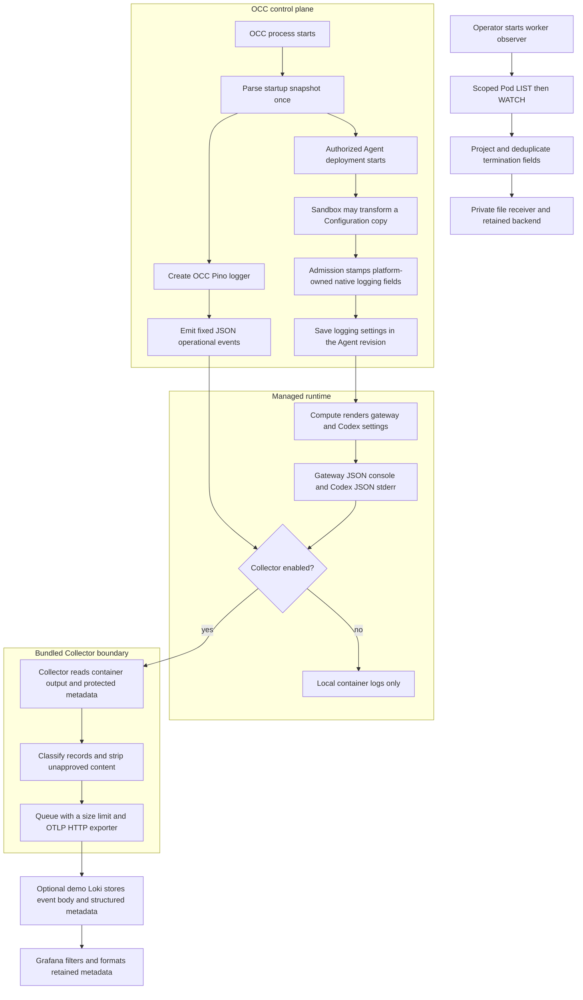

# Common Operational Logging Flow

## Overview

Startup sets the OCC log level; deployment saves runtime logging in the Agent
revision. Optional Collectors export reviewed operational records. PostgreSQL
retains durable audit evidence separately.

## Entry Points

- Trigger: API, worker, migration, or bootstrap startup, Agent deployment, or
  optional Docker Compose or Helm Collector enablement.
- Source: `apps/controller/src/composition/installation-config.ts:loadStartupConfigurationSnapshot`
- Source: `packages/occ/src/agent-harness-topology.ts:agentRuntimeConfiguration`
- Source: `deploy/helm/openclaw-enterprise/templates/collector.yaml:logging.collector.enabled`
- Assumptions: trusted startup YAML, authorized deployment, Compute Driver
  support, and operator-owned Collector configuration for remote export.

## Flow

## Execution Trace

### 1. Startup parses one configuration snapshot

`apps/controller/src/composition/installation-config.ts:loadStartupConfigurationSnapshot`

The API and worker parse trusted YAML once and pass `startupConfiguration.logging`
to Driver composition. Invalid settings stop startup. Bootstrap, maintenance,
and worker fallback use the same checks through
`apps/controller/src/composition/startup-file.ts:loadOperationalLoggingConfiguration`,
which reads only logging settings. Migration imports it without loading Drivers.
See the [settings reference](../reference/settings.md).

### 2. Processes log fixed sanitized events

`apps/controller/src/api-startup.ts:startApi`

Worker (`apps/controller/src/worker.mjs`), bootstrap
(`scripts/bootstrap-installation.mjs`), and migration (`scripts/migrate-production.ts`)
use Pino at the selected level. The API disables Fastify request logging.
Bootstrap and migration separate protocol success output from structured failures.
Before Pino writes, `apps/controller/src/logging.ts:emitOccLogEvent` keeps
reviewed scalars, rejects unsafe strings, and drops credentials, provider
payloads, and request/reply objects. It checks approved strings for credentials
in tokens, URLs, queries, forms, JSON, connection strings, and HTTP headers.
See step 7.

The Collector keeps approved worker `work.operation` and `work.id` values.
Stop keys include the operation UUID; withdrawal keys end in that UUID or
`activation` (candidate activation), optionally followed by `:recovery:<n>`.
Deletion keys omit the operation suffix. Provisioning keys use
`agent-provisioning:` and exactly 32 lowercase hexadecimal characters.
The local emitter keeps nonnegative safe-integer `stopYields` on throttled
drain-yield and completion records; the Collector drops it.

The sanitizer accepts identifier codes for `check`, `failure`, `reasonCode`,
`harnessState`, `hintCode`, and `auth:maintain`'s `command`; a nonnegative
safe integer for `fence`; and OCC-assigned `ins_` and `cfg_` UUIDs for
`installationId` and `orphanedConfigurationId`, respectively.

`apps/controller/src/worker.ts:finalizeActiveRevision` saves the normalized runtime
failure code in active maintenance's `worker.completed.failure`. Unknown codes
become `UNRECOGNIZED`; missing or malformed evidence leaves the field unset and
health unproven. Pending outcomes and scheduling do not change.

Compute preparation failures may carry a Driver-reviewed stage, classification,
status, and message; the worker caps that message at 256 characters and excludes
raw exceptions. The logger keeps it, and a Compute preflight warning's message,
as one line cut at 512 characters, and drops secret-shaped messages before output.

### 3. Admission freezes runtime logging

`packages/occ/src/agent-harness-topology.ts:agentRuntimeConfiguration`

For a trusted ComputeDriver with `runtimeLogging: "driver"`, admission validates
and freezes the native document without changing its logging fields. See the
[Compute contract](../reference/drivers/compute.md#runtime-logging-ownership).
OCC logging and audit do not change.

Otherwise, the SandboxDriver may transform a frozen copy of the Namespace
Configuration. Deployment sets matching `logging.level` and `logging.consoleLevel`,
JSON console style, and `diagnostics.otel.logs=false` before validation, and
drops retired `logging.redactSensitive`. Runtime code owns console and tool
redaction. The source Configuration stays intact; the Agent revision preserves
the policy across restarts and Configuration edits.

### 4. Compute renders settings from the version

`apps/controller/src/drivers/compute/docker/index.ts:DockerComputeDriver.prepareRevision`

Kubernetes uses
`apps/controller/src/drivers/compute/kubernetes/index.ts:KubernetesComputeDriver.deployment`.
Both Drivers require consistent logging fields. Kubernetes mounts the document
read-only at `/etc/openclaw/openclaw.json`. Gateway uses JSON console logs;
dedicated Codex app-servers use JSON stderr and host-owned arguments disabling
OTLP export and prompt logging. Lifecycle hooks and SecretBindings cannot
override those destinations.

### 5. Docker collection is an explicit development override

`apps/controller/src/drivers/compute/docker/index.ts:DockerComputeDriver.prepareRevision`

Optional `compose.logging.yaml` routes OCC, gateway, and Codex output through
Docker's nonblocking `fluentd` driver to a pinned Collector. Docker Compute sets
runtime `LogConfig` from Engine-reachable `OCC_DOCKER_LOGGING_ADDRESS`. See the
[Docker procedure](../guides/observability.md#docker-compose).

### 6. Kubernetes collection is bundled or equivalent

`deploy/helm/openclaw-enterprise/templates/collector.yaml:logging.collector.enabled`

The Helm Collector DaemonSet reads node CRI files and identifies managed workloads
from Pod metadata. See the [Kubernetes procedure](../guides/observability.md#kubernetes-and-helm)
for enablement and reuse, and the
[security reference](../reference/security.md#operational-log-collection-boundary)
for isolation limits.

`deploy/logging/kubernetes.yaml:transform/kubernetes` assigns `occ-api` or
`occ-worker` only when the Pod namespace matches the namespace in the
Collector's projected ServiceAccount namespace file at
`/var/run/secrets/kubernetes.io/serviceaccount/namespace`. The bundled DaemonSet
mounts this file; the native file provider refuses startup without it. Copied
application or component labels cannot create OCC identity across namespaces.
Reuse the shipped receiver only in the OCC control-plane namespace. A Collector
elsewhere needs its own explicitly reviewed identity policy. Gateway and Codex
classification still works across namespaces.

`k8sattributes` maps the real Pod namespace and UID before
`transform/kubernetes-resource` drops shared Pod labels. It waits for Pod cache
sync to prevent the filter from dropping unidentified records while `filelog`
commits their offsets.

`deploy/helm/openclaw-enterprise/templates/_helpers.tpl:openclaw.quantity`
checks Collector resource and volume quantity syntax.
`openclaw.nonNegativeQuantity` and `openclaw.resourceRequirements` reject
negative quantities and unknown resources; rendering stops and names malformed
settings. Optional limits may be omitted.
Kubernetes completes validation after rendering. See
[production settings](../reference/settings/production.md#production-operational-logging-collection).

The chart validates one exporter destination: an IPv4 `/32` or paired namespace
and Pod selectors, with a decimal TCP port from 1 to 65535. Leading zeros are
refused because YAML can interpret them as octal and grant another port.
Chart policies allow exporter, DNS, and API egress. Empty metrics selectors
grant no ingress; paired selectors admit port 8888. Policies are additive.
The demo can export privately to Loki through the bundled Collector or an
external Collector with its own filtering policy.

### 7. Collector exports only operational classes

`deploy/logging/collector.yaml:transform/operational`

The bundled Collector keeps transport-derived identity before parsing untrusted
JSON. It classifies fixed OCC event names, `gateway` subsystem records,
`codex_app_server` stderr, Codex warnings and errors except `codex_otel`,
`codex.turn`, `codex.tool_call`, and Gateway and Harness wrapper stderr
diagnostics.

`runtime.startup_phase` keeps `occ.startup.phase` and the cause of a failed
phase as `occ.code` (for example, `PLUGIN_NOT_IN_CATALOG`). `runtime.workspace_node` and
model probes keep `occ.code`. Failed phases and non-`READY` probes are WARN.
`runtime.gateway_settings_overridden` is WARN with no attributes. Replaced
owner setting names stay in `occ agent logs`. `runtime.protected_startup` is
INFO and keeps its SHA-256 identity as `occ.startup.hash`.
`worker.openshell-git-continuity-refused` keeps `occ.check`, a SHA-256
`occ.continuity.key_hash`, and `occ.continuity.result`: a boolean, a count from
0 to 2,147,483,647, or the fixed value `invalid`. Other values are discarded.
`worker.openshell-git-probe-failed` keeps `occ.git_probe.reason` only for
`probe_process_failed` or `probe_response_invalid`. For a process failure, it
keeps an integer `code` from 1 to 99 as `occ.git_probe.exit_code`. It drops
other reasons, invalid exit codes, process output, response bodies, URLs, and
proofs.

The Collector drops Kubernetes metadata's inferred `latest` tag for
digest-only images. It keeps allowlisted attributes and replaces arbitrary
bodies with event names. Codex turn and tool-call bodies use fixed text.
`codex.operational` keeps short plain-text messages only from `codex_app_server`
or fixed `codex_core::responses_retry` retries. The Collector drops Codex warnings
without such a message and span lifecycle records.

OCC `compute.preflight-warning` retains WARN severity and `occ.code` values of at
most 64 allowed characters. Diagnostic messages stay local.
`authentication.sign-in-limit-warning` and `authentication.forwarded-refused-warning` keep
`occ.code`, and
`authentication.sign-in-limited` keeps only `occ.sign_in.lane`; its local key
hash is not exported. `authentication.provider-unavailable-warning` keeps
`occ.sign_in.provider`, `.step` (`authorization`, `token`, `jwks`, `profile`,
`membership` or `email`), `.cause` and `.status`, plus a transport code as `occ.code`; the provider
instance ID stays local.
`authentication.request-refused` and `authentication.library-error` or `-warning` keep `request.id`
and `occ.reason_code`; the operation, method and route pattern stay local.
`worker.repository-cleanup-warning` keeps `occ.code` and its cause code of at most 64 allowed characters as
`occ.worker.cause`. These codes and runtime wrapper codes reject the same recognized
key and token shapes as the other code fields. SQLSTATE values remain supported.
Every exported OCC event keeps the sanitizer's codes under the same checks (a
letter, then at most 63 letters, digits, `_` or `-`, and no key or token shape):
`check`, `failure`, `harnessState`, `hintCode` and `reasonCode` as `occ.check`,
`occ.failure` (a device login keeps its own, below), `occ.harness_state`,
`occ.hint_code` and `occ.reason_code`, and `fence`, a nonnegative safe integer, as
`occ.fence`. `worker.openshell-git-expiry` keeps `work.outcome` (`pending`,
`withdrawn` or `retire-runtime`).
`apps/controller/src/drivers/egress-proxy/openshell-expired-git.ts:subtractExpiredOpenShellGit`
adds `failure` and `grpcStatus`, never supplier text.
`worker.repository-delivery-pending` reports Git delivery failure on the first
failure and then at most once a minute. Reconciliation retries each second.
Sandbox Driver, Installation, and Configuration IDs stay local.
`worker.compute-prepare-failed` is ERROR when a Compute Driver cannot prepare a version.
It keeps `occ.code`, Namespace, Agent and Agent revision IDs, and work
identity. Stage, error class, status, and message stay local.

`shutdown.started`, `shutdown.completed`, and `shutdown.failed` (ERROR,
`occ.code`) carry the drain's `duration_ms` once it ends. The signal stays local. `database.idle-client-error`
keeps its SQLSTATE or transport code as `occ.code`. `device_authorization.start_failed`
keeps `request.id`, `occ.device_authorization.reason` (`unreachable` or `unavailable`)
and its failure class of at most 64 allowed characters (such as `TimeoutError`) as `occ.device_authorization.failure`.
`agent_runtime_credentials.cluster_denied` keeps only `request.id`; denied verb,
resource and Kubernetes namespace stay local. `agent_provisioning.compute_refused` keeps only `request.id`; the caller cannot fix the Compute refusal, whose reason stays local.
`http.dependency_unavailable` keeps only `request.id`; OCC returns generic `503 DEPENDENCY_UNAVAILABLE`. Route, error class, message, and causes stay local.
`credential.resolution_failed` and `credential.delivery_failed` export WARN, `request.id`, `occ.namespace.id`, `occ.code`, and a `cs_` UUIDv4 as `occ.credential_source.id`.
`native_admin.websocket_audit_failed`
keeps the Namespace, Agent and Agent revision IDs. `native_admin.http_denial_audit_failed`
and `native_admin.websocket_denial_audit_failed` carry no request, user, error or payload
fields. `native_admin.pending_work_unresolved` keeps only its nonnegative safe-integer
count as `occ.native_admin.pending`; invalid counts are omitted.
`native_admin.compute_owner_mismatch` reports native admin refusal when another
Compute Driver owns the selected version. Namespace, Agent, and Agent
revision IDs are exported. Driver IDs and implementations stay local.
`authentication.activation-warning`, `authentication.password-sign-in-warning`,
and `authentication.recovery-seed-warning` keep at most `occ.code`. Account
IDs and messages stay local.

Only `occ-api` emits the three Preset WARN events. The worker never applies
default Presets.
`presets.default-refresh-skipped` keeps `occ.namespace.id` and `occ.preset.id`
when policy prevents refreshing an existing copy. The Preset name, refusal
text, and Restriction IDs stay local. `presets.default-create-skipped` keeps
only `occ.namespace.id` when a deny Restriction prevents creating a missing
default. `presets.bundled-default-shadowed` carries no IDs when a same-named
`presets.files` entry replaces a bundled default. The Preset name and file
path stay local. The Collector drops malformed, oversized, unclassified,
unspecified-severity, and Codex protocol stdout records.
OpenClaw's Gateway startup failure (an `error` record with no subsystem whose
message starts `Gateway failed to start:`) is exported as
`gateway.startup_failed`. Its body keeps the message under the
`codex.operational` plain-text rules, which also reject argv credential flags
(`-u`, `--password`) and `user:password` pairs.
Only Collector configuration holds exporter credentials and TLS settings.
Finite queues and retries make export best-effort. Export outage or overflow
cannot block API service, worker reconciliation, or PostgreSQL audit persistence.

### 8. The demo dashboard presents existing metadata

`deploy/helm/openclaw-observability-demo/templates/grafana.yaml:logs.json`

`deploy/helm/openclaw-observability-demo/templates/_helpers.tpl:demo.serviceName`
keeps short DNS-label Service names; otherwise it combines the component,
normalized release, and original release hash to avoid collisions. Deployments
and Grafana datasource URLs use these names; deployment names, selectors, and
discovery retain the full release. `demo.validate` permits uppercase registry
hosts and tags but rejects uppercase repository paths. After renaming Loki,
update the endpoint in the exporter Secret and
[refresh Collector Pods](../guides/observability/demo-cleanup.md#refresh-a-renamed-loki-address).

Loki retains event names and normalizes bundled Collector attributes as
structured metadata; Grafana formats it without changing records. Review external
and Driver-owned pipelines separately. See the
[demo guide](../guides/observability/demo.md#read-and-narrow-operational-logs)
for panels, correlation, and authorization limits.

### 9. The optional operator command observes worker exits

`scripts/observe-worker-terminations.ts:main` lists worker Pods in the selected
namespace, then watches from that resource version. It reads status by Pod UID,
including restartable init containers. During backoff, the waiting container ID
can identify an exit in `lastState` before kubelet increments the restart count.
The observer syncs exits and count changes to the private file. After watch
closure, the supervisor starts a new list.

`deploy/logging/worker-observer.yaml` projects the file records into a separate
OTLP pipeline. The [operator procedure](../guides/observability/worker-terminations.md)
covers credentials, supervision, queue storage and backend verification.

## Debugging and Verification

- Check process levels in the startup snapshot; compare runtime levels in the
  Agent revision and rendered container settings.
- Use the [observability guide](../guides/observability.md#tests) for delivery,
  Collector metrics, and deployment troubleshooting.
- Packaging and Collector tests cover configuration, filtering, queues, and
  startup boundaries. Use real runtime suites for gateway, Codex, model turns,
  or OpenShell deployment.
- If a runtime Pod enters `CrashLoopBackOff` with a config lock failure under
  `/etc/openclaw` before a model turn, check the admitted Configuration for
  retired fields before counting the case as complete.

## Related docs

- [Settings reference](../reference/settings.md)
- [Security controls](../reference/security.md)
- [Observability guide](../guides/observability.md)
- [Deployment guide](../guides/deploy.md)
- [Common OpenTelemetry logging spec](../../specs/plans/20-common-otel-logging/index.md)

## Manual Notes

[keep this for the user to add notes. do not change between edits]

## Changelog

- 2026-11-23 07:25: Reconcile Collector namespace identity with current logging flow guidance. (authoring-run/52c5a2b7-fda6-445f-8a7d-56d688967f36 - d795b83aa96d21da375895abe036b27d282a408c)

- 2026-11-20 19:04: Refresh sources. (authoring-run/8a8bde8b-71de-4de5-80bf-e32f0e335c34 - 220f62d86ceb3dfc6f66dbee7c6f86cda50e5d05)

- 2026-11-19 05:46: Bind Kubernetes OCC service identity to the Collector namespace and preserve runtime Pod identity. (authoring-run/84dcdda6-a17a-4011-8c57-edfc23b433f6 - 6f67f5745a814fe1d4ac001c01cb3cbb93d2701f)

- 2026-11-18 04:25: Name the exported authentication refusal and library events with their request ID. (authoring-run/427e95c2-8e34-4624-8497-52493b5980f5 - 0fe12954321242e9c0a0619b9f39f7e6d5431328)

- 2026-11-13 22:56: Apply the existing credential checks to local scalar strings and Collector diagnostic codes. (authoring-run/ab7d7799-30b2-43fe-8453-86ac8cba698b - afab47b8ff040a1ab6e0fa1c5a211690ab990f32)

- 2026-11-08 16:26: Record bounded Git retirement diagnostics. (authoring-run/b490de13-d3f2-4301-b212-4393219a8625 - 842bea47b86394333aa46a900c962a8a81272580)

- 2026-11-07 09:24: Retain closed-vocabulary runtime failure codes in active maintenance logs. (authoring-run/47c08087-e796-42e1-a716-e321ec52e41e - 5ed0898c6fba9875e075472747b660c27fb74bf6)

- 2026-11-06 15:37: Retain the verified-email lookup stage in provider outage exports. (authoring-run/3cb37e31-4ea8-4dfe-bb12-965884fa83db - 3e29a60b00d2a4c6eb15d4ea2f1f283113592f74)

- 2026-11-05 20:53: Export held Git probe failure categories and bounded curl exit codes through the Collector. (authoring-run/3c7815cf-f818-421f-879b-2b2fe90deac5 - 0a9351b645)

- 2026-11-04 23:10: Trace worker exits during kubelet backoff and watch closure. (authoring-run/07eb6957-9eeb-45ad-9f95-abc240f6e218 - e8ae41a62e9b480db3b67b894611b3d7fe340342)

- 2026-10-31 04:17: Export bounded continuity comparisons and startup hashes. (authoring-run/71d9343b-72da-449a-8e8a-a55be95876c7 - 370dc4d10297a81fbb18f850500dc945bc7925d5)

- 2026-10-26 22:00: Export `native_admin.http_denial_audit_failed` and `native_admin.pending_work_unresolved` (bounded count only); both denial-audit failure events drop caller context. (wf-land-1707 - #1707)

- 2026-10-23 22:59: Add opt-in worker termination observation through scoped Pod LIST/WATCH, a private file and a fixed Collector schema; document coverage limits and operator setup. (worker-termination-observation - 341952eef)

- 2026-10-23 21:00: Log `worker.repository-delivery-pending` when delivery starts failing, then at most once a minute, not on every one-second retry. (fix-2251)

- 2026-10-23 20:00: Preserve current logging documentation and both histories while retaining demo repository-casing validation. (authoring-run/01a10a81-070c-7aa3-97d0-fbce8f285d4d - e1788c775)

- 2026-10-23 13:00: Export `worker.openshell-git-expiry` and `worker.repository-delivery-pending`, and keep the sanitizer's codes and route fence, so the bundled Collector shows why Git expiry or delivery is stuck. (collector-export-1023 - #3305)

- 2026-10-23 12:30: Keep `work.id` for credential withdrawal keys that end in `activation` or `:recovery:<n>`; the Collector dropped them. (fix-2249 - #3302)

- 2026-10-23 10:45: Keep the auth:maintain command, refusal guidance codes, OCC-assigned Installation and orphaned Configuration IDs, and the delivery-pending Sandbox Driver ID through the local logging sanitizer. (fix-2245)

- 2026-10-23 09:45: Keep the OpenShell Git expiry check, failure, reason code and route fence, and the worker's Harness state, through the local logging sanitizer. (fix-2244 - #3289)

- 2026-10-20 02:25: Refuse uppercase demo image repository paths before rendering. (authoring-run/01a10a81-070c-7aa3-97d0-fbce8f285d4d - d331d24fd)

- 2026-10-16 00:17: Reject negative and nonnumeric stop-yield counts at the local logging boundary. (authoring-run/d2f628d3-43ac-470f-907d-2a17c299f7c2 - f916021bf235e9f8e91630484948eb6fc88ccfa7)

- 2026-10-15 23:23: Preserve worker stop-yield counts through the local logging sanitizer. (authoring-run/74e7fe0c-15bc-4a73-ba8a-9ec426a17d06 - 04514330688378316bd0641b8d5560da56aeff85)

- 2026-10-14 01:40: Export `native_admin.compute_owner_mismatch` with the Agent's IDs; the Compute Driver names stay local. (fix-1287)

- 2026-10-10 05:47: Retain admitted Agent provisioning work IDs in Collector correlation metadata. (authoring-run/93444a45-23c4-4b1c-9d53-391d9014d93f - cd30d20a297fdb0f2b712122b705aa4c168564ff)

- 2026-10-10 00:44: Refuse noncanonical Collector exporter ports before Kubernetes YAML can change their meaning. (authoring-run/e72ad138-e0b2-498e-885b-f8fa56caaeb0 - 3e34cc0f4b469d29fc79d2c10a33f87a0921ee47)

[Common logging documentation history](common-logging/history.md) preserves the earlier dated entries.
