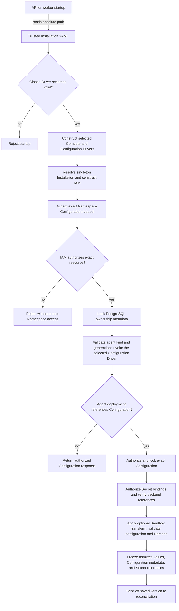

# Configuration Driver and Agent Revision Flow

## Overview

The OCC API and worker load trusted, singleton Installation settings from
startup YAML and validate each selected Driver before construction.
Authenticated API
requests then create, read, replace, or delete exact Namespace-owned native
OpenClaw configuration documents through the selected bundled or installed
Configuration Driver. The bundled Kubernetes implementation persists each
document in a tenant-owned ConfigMap.
Each Configuration requires immutable `kind: "agent"` and a server-managed
generation; documents preserve unresolved inline SecretRefs without interpreting
them. Agent deployment authorizes the separate Secret bindings, applies any
selected Sandbox Driver transformation, and freezes the admitted values into an
immutable Agent revision. Configuration identity, kind, generation, and Secret
references are recorded separately. This flow stops when OCC persists that
version and hands off workload reconciliation; the selected Compute Driver
then owns the Agent gateway, while worker execution and secret resolution remain
outside this flow's scope.

## Entry Points

- Startup: [controller server](../../apps/controller/src/server.mjs) and
  [controller worker](../../apps/controller/src/worker.mjs) read the absolute
  `OCC_CONFIG_PATH`; production requires the file, while development may use
  its explicit development defaults.
- Source: `apps/controller/src/composition/installation-config.ts:loadInstallationConfiguration`
  and `packages/occ/src/index.ts:OpenClawController.createConfiguration`.
- Requests: [Configuration routes](../../packages/contracts/src/api/routes.ts)
  accept `POST /namespaces/:namespaceId/configurations` and
  `GET`, `PATCH`, or `DELETE` of
  `/namespaces/:namespaceId/configurations/:configurationId`.
- Assumptions: one persisted Installation, a selected IAM Driver, exact
  Namespace placement, an authorized principal, available PostgreSQL state,
  and the permissions required by the selected Configuration Driver. The
  bundled Kubernetes Driver requires namespaced ConfigMap CRUD permission.

## Flow



## Execution Trace

### 1. Construct the selected Installation Configuration Driver

`apps/controller/src/composition/installation-config.ts:loadInstallationConfiguration`

The API and worker load trusted Installation selections and validate the chosen
Configuration Driver's schema and implementation-owned rules before
constructing its bundled or installed implementation. OCC receives that exact
capability and identity; invalid settings or a mismatched factory reject
startup. Installation settings never come from a Configuration Driver. The
[Driver package loading flow](driver-plugin-loading.md) owns package identity,
validation, trust boundaries, and IAM construction.

### 2. Resolve singleton state and select Drivers

`apps/controller/src/composition/production.ts:composeProduction`

[Production composition](../../apps/controller/src/composition/production.ts)
loads the sole persisted Installation from
[PostgreSQL platform state](../../packages/occ/src/state/postgres-state.ts).
The API and worker load the same trusted startup document and persisted
Installation identity. The [Driver loading flow](driver-plugin-loading.md)
traces process-local construction and the selected Secret, Sandbox, and
ServiceAccount branches. Existing AgentRevisions retain their selected Compute
identity and immutable admitted configuration; subsequent Configuration edits
apply only to later deployments.

Provisioning's `KubernetesConfigurationDriver.createExact` and `inspectExact`
use the same verified CP namespace as ordinary Configuration CRUD. Recovery checks
the exact identity and document there; an adopted data-plane namespace does not
change canonical Configuration ownership. When a create's outcome is unknown and
`inspectExact` still finds nothing 90 seconds after the provisioning effect began
(database clock), the worker fences again and sends the same create under the
same effect; earlier attempts wait without spending a retry, and a Namespace
deletion keeps waiting meanwhile. The Driver's write deadline is 10 seconds and
the API server's default request timeout 60 seconds, so a late original then
fails `AlreadyExists`. The window covers the first send only: later attempts
resend at once. A failed resend settles the effect only if `inspectExact` finds
the exact Configuration.

### 3. Authorize the exact Namespace Configuration operation

`packages/occ/src/index.ts:OpenClawController.createConfiguration`

[Configuration route contracts](../../packages/contracts/src/api/routes.ts)
are dispatched by the
[controller request handler](../../apps/controller/src/index.ts) to
`OpenClawController.createConfiguration`, `getConfiguration`,
`updateConfiguration`, or `deleteConfiguration` in
[OCC](../../packages/occ/src/index.ts). OCC resolves server-owned Namespace
identity and checks the selected IAM Driver before touching tenant data:
creation targets the exact Namespace-owned Configuration resource; reads,
updates, and deletes target the exact Configuration identifier in that
Namespace. POST and PATCH accept bodies up to 6 x (1 MiB + 32 KiB): the
Kubernetes Driver's 1 MiB of values and the envelope in six-byte JSON escapes.
Their `onRequest` hook runs `authorizeConfigurationWrite` before the body is
read, so a caller without the grant gets `403` before any body error; the
transaction repeats the check. The controller's JSON body parser
(`apps/controller/src/http/json-depth.ts:tooDeepJsonPath`, registered in
`createFastifyApp`) then scans the raw text once and refuses a value more than
24 levels below the body root with `400 INVALID_REQUEST` and a `TOO_DEEP`
detail, before parsing, schema validation, the NUL/surrogate check or
`validateConfiguration`; other bodies go to Fastify's default JSON parser.
Every JSON route shares this parser and limit. Creation requires `kind: "agent"` and a native
root-object JSON document; omitted or unknown kinds and malformed request
shapes fail with `400`. Updates require the complete replacement `values`
document and accept optional `secretBindings` and `expectedGeneration`, refusing
a stale one under the row lock with an `/expectedGeneration` `409` detail.
On the bundled Kubernetes Compute, writes refuse an enabled channel's unbound
credential reference with deployment's rule (`requireChannelSecretBindings`).
`kind`, `generation`, and ownership are server-owned. OCC preserves nested values
and SecretRefs unchanged. Malformed,
generation-mismatched, or ownership-invalid persisted ConfigMaps fail with
`503`.
Authorization denial fails with `403`, a missing exact resource with `404`, an
Agent dependency conflict with `409`, and unavailable IAM or storage with
`503`. OCC separately authorizes `operate` on each Secret
selected by `secretBindings`, including retained bindings when PATCH omits the
field. Omission preserves bindings; `{}` clears them. A submitted binding with a
reserved or invalid destination, or a Secret reference to another Namespace, fails
with `400 INVALID_REQUEST` and a message naming the rule. A reserved destination
is also named, with a `/secretBindings/<key>` detail; a malformed one is not
echoed. A Secret the Namespace does not hold stays `404`. The
[Configuration reference](../reference/configuration/secrets.md#secret-bindings) owns
the binding contract, and the [Secret flow](secret-storage-and-delivery.md)
traces storage and delivery. Secret Broker substitution remains unimplemented.

<a id="45-persist-configuration-and-freeze-its-revision" class="anchor-alias"></a>

### 4–5. Persist Configuration and freeze its version

`apps/controller/src/drivers/configuration/filesystem/index.ts:FilesystemConfigurationDriver.write`

Default Compose development uses the filesystem Driver. Each write exclusively
creates a private temporary file under the exact Namespace directory, writes the
approved document, closes the file, then atomically renames it to the Configuration
path. A finally block removes only that write's temporary file, including after
partial writes such as `ENOSPC` or a failed rename. The prior destination stays
intact until rename succeeds, and other writers' temporary files remain untouched. Storage
and cleanup failures propagate to the caller; this does not add automatic retries
or alter OCC's metadata transaction and compensation boundary.

[Configuration persistence and version snapshots](configuration-driver/persistence-and-revisions.md) traces metadata locking, Driver effects, Agent reference resolution, and snapshot validation after request authorization.

## Debugging and Verification

Run focused Configuration conformance and integration checks:

```bash
node --test tests/conformance/configuration-occ.test.mjs tests/conformance/kubernetes-configuration.test.mjs tests/conformance/filesystem-configuration.test.mjs
node --test tests/integration/configuration-controller.test.mjs tests/integration/postgres-platform-state.test.mjs
node --test tests/integration/postgres-platform-state-kubernetes.test.mjs
```

PostgreSQL integration requires configured database URLs; skipped cases do not
prove live persistence. Live ConfigMap and least-privilege RBAC proof requires
a disposable Kubernetes cluster and tenant credentials; client fixtures do not
replace that evidence. Startup emits structured
`startup-error` or `worker.startup-error` events for invalid YAML and
unavailable dependencies. Verify missing or unknown kinds are rejected,
creation starts at generation `1`, updates advance it once without permitting a
kind change, requests preserve the exact native document and inline references,
and ConfigMaps store exactly one `openclaw.json` entry. Verify denials against
exact Namespace and Configuration identity. Prove snapshot safety by changing
a nested Configuration value after deployment and confirming the prior
Agent revision's native document, Configuration identity, kind, and generation
remain unchanged while a later deployment observes the new generation. Verify
same-Namespace Agents receive separate gateways only when an eligible
development worker prepares their versions. Kubernetes conformance verifies
immutable Agent-owned configuration projection without a live cluster;
dedicated-cluster coverage of the changed projection remains unverified when
its optional integration is skipped.

## Related docs

- [Installation Driver package loading flow](driver-plugin-loading.md)
- [Configuration Driver guide](../reference/configuration.md)
- [Controller and startup configuration](../reference/settings.md)
- [Controller lifecycle](../reference/controller.md)
- [Agent lifecycle](../reference/agents.md)
- [Kubernetes Compute Driver](../reference/drivers/kubernetes-compute.md)
- [Configuration Driver implementation specification](../../specs/.archive/03-configuration-driver.md)
- [OpenClaw-native Configuration specification](../../specs/.archive/05-openclaw-native-configuration.md)
- [Configuration kind and Agent-owned gateway specification](../../specs/.archive/06-configuration-kind.md)

## Manual Notes

[keep this for the user to add notes. do not change between edits]

## Changelog

- 2026-10-25 13:00: Writes, provisioning and the Create Agent preflight refuse an enabled channel's unbound credential reference. (fix-2319, finding 2319)
- 2026-10-23 13:40: Writes and Preset saves refuse an `agents` model without its provider, with deployment's text. (fix-1828, finding 1828)
- 2026-10-14 10:30: Writes refuse literals in the other slots OpenClaw marks sensitive ([rules](configuration-driver/persistence-and-revisions.md)). (fix-1309, finding 1309)
- 2026-10-14 09:30: Writes and deployment require references in the other key and header slots the Gateway sends ([list](../reference/configuration/secrets.md#secret-boundaries)); those header slots and MCP headers refuse invalid header names. Stored documents still read. (fix-1307, finding 1307)
- 2026-10-14 09:00: The Kubernetes model provider rule also checks `agents.*.modelPolicy.allow` entries, which the Dedicated Codex projection qualifies like `models` keys; Dedicated Codex refuses `mediaModels.*` and `voiceModel`. Preset saves run the `agents` shape and roster rules Configuration save runs, checking a templated Agent ID or ownership as far as its written text goes. (fix-1306-1308, findings 1306, 1308)
- 2026-10-14 07:00: Preset saves run the model fallback, model selection and provider `apiKey` rules Configuration save runs, except where the provider waits on a variable, which the launch checks once filled. (fix-1305, finding 1305)
- 2026-10-14 06:00: Configuration and Agent saves on every Compute refuse a model fallback on another provider than its primary's, naming the setting, as deployment now does; Kubernetes Configuration save also runs the model provider and `apiKey` rules deployment applies, and accepts OpenClaw's built-in `default` env provider in an `apiKey` reference. (fix-1298-1299, findings 1298-1299)
- 2026-10-13 23:00: Configuration and Preset saves require references in MCP server credential headers, and read a `GIT_CONFIG_VALUE_<n>` or `GIT_CONFIG_PARAMETERS` value whose key names a git proxy as a proxy URL. (findings 1276, 1278)
- 2026-10-13 18:00: Kubernetes credential header refusals quote the header name, not a word list; a Preset header name waiting on a variable saves on Kubernetes too. (findings 1207-1208)
- 2026-10-13 16:00: The credential header rule matches more credential words and separators and exempts partition, shard, sort and dedup keys; saves refuse a header name that is not an HTTP field name. (findings 1189-1191)
- 2026-10-13 14:00: The credential header rule matches names ending in `key` or `keys` (not idempotency or cache keys) and more credential words; writes refuse a model provider `models` that is not a list. (findings 1185-1186)
- 2026-10-13 10:00: Kubernetes Compute refuses credential headers and non-default `request.auth` on every model provider, and the Configuration Driver requires references in the request credential slots; a stored document that predates these rules still reads and an edit replaces it, while save and deployment refuse it with the Compute message. (#2265, findings 1142-1143)
- 2026-10-11 15:00: Kubernetes deployment admission names the caller's Configuration setting for channel, credential and dedicated OpenClaw catalog refusals; Configuration save, provisioning and Preset save run the topology-independent ones through `validateConfiguration`; Agent create and update run deployment's Agent checks. (fix-1116-1117, findings 1116-1117)
- 2026-10-11 14:30: Every JSON request body nested more than 24 levels deep is refused with `400 TOO_DEEP` before it is parsed, instead of a `500` and hundreds of megabytes of heap on Configuration and Preset writes. (fix-1124, finding 1124)
- 2026-10-11 13:00: Configuration save refuses a Codex approval policy the Gateway refuses and a literal `gateway.auth.password`; Kubernetes deployment admission and provisioning refuse the gateway password, channel topology and workspace-node plugin settings that preparation or the Gateway refused only after predecessors stopped. (fix-1112-1115, findings 1112-1115)
- 2026-10-11 12:00: Configuration POST/PATCH admit every Configuration the Kubernetes Driver stores (6 x (1 MiB + 32 KiB) body) and check the create or update grant before reading the body. (fix-1118, finding 1118)
- 2026-10-10 08:00: Kubernetes renders `gateway.bind: lan` for an omitted or `auto` bind; Kubernetes and Docker Compute refuse other unreachable listeners (other binds, non-`0.0.0.0` custom hosts, Tailscale exposure) before version creation. (fix-996-999, findings 996-998)
- 2026-10-10 11:29: Refuse Kubernetes native listeners that pass local readiness but cannot serve Pod-IP routes before version creation. (authoring-run/f29e292f-76cb-44a1-88b5-e0244f9164fc - f8a837e33b5c03bc0c92065e979485ee06960150)
- 2026-10-09 19:00: Configuration create and update refuse an `agents` roster every deployment refuses, with deployment's text, through the shared `requireDeployableRoster`; an existing row still reads and deploys as before. (q35-roster-save, finding 874)
- 2026-10-09 15:00: A failed Configuration delete or update compensates only while the metadata row is unchanged, so a delete or update another request committed after the lock was released is never undone and leaves no orphan ConfigMap. (fix-944-945)

[Configuration Driver flow documentation history](configuration-driver/history.md) preserves the older dated entries.
