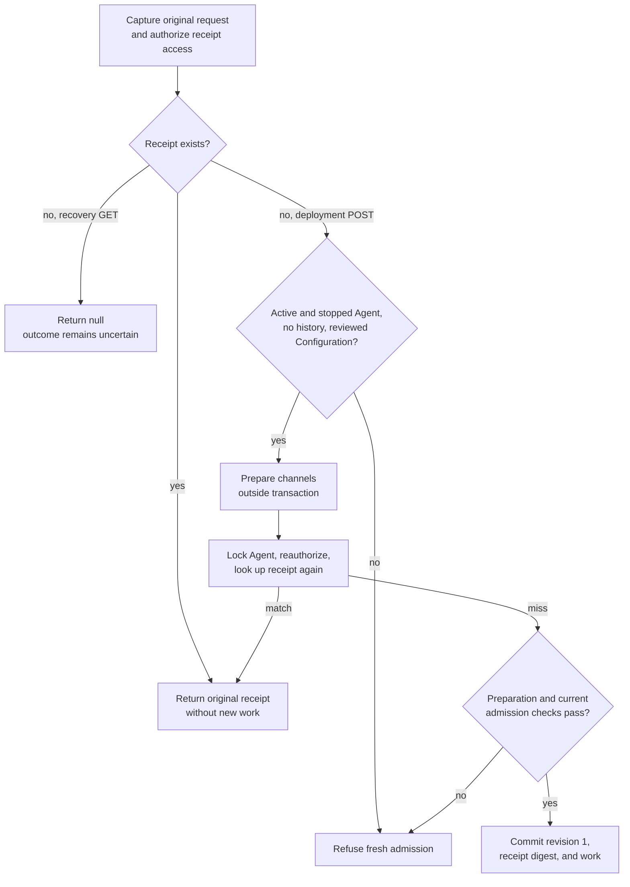

# Configuration persistence and Agent revision snapshots

Trace how OCC reads a Configuration and saves its values in an Agent revision. See the [parent flow](../configuration-driver.md) for its context and overall sequence.

## Execution trace

### 4. Lock metadata and invoke the selected Configuration Driver

`apps/controller/src/drivers/configuration/kubernetes/index.ts:KubernetesConfigurationDriver.create`

Configuration ownership, immutable `kind: "agent"`, generation, creation time,
normalized Secret bindings, and server-generated `cfg_` identity are persisted by
[PostgreSQL platform state](../../../packages/occ/src/state/postgres-state.ts);
the live configuration document is not duplicated into Configuration metadata.
OCC owns API-level native Configuration validation before it calls the selected
bundled or installed Configuration Driver: model provider settings,
`requireDeployableRoster` in
[the roster rules](../../../packages/occ/src/openclaw-roster.ts), which refuses
an `agents` roster, a model or fallback that is not `<provider>/<model>`
(OpenClaw's `openrouter:auto` included), a fallback on another provider than
its primary's, a `models.providers.<id>.models` entry that names no selected
model, or model and runtime settings that conflict (`requireConsistentModelPolicy`,
which runs the deployment resolver itself, in its order, and leaves a draft
without a model or runtime to deployment), all of which every deployment refuses,
with deployment's own text, and [the settings rules](../../../packages/occ/src/configuration-settings.ts).
These rules reject unsupported Codex approval policies, a literal
`gateway.auth.password` or a password SecretRef OpenClaw cannot read
(`gatewayPasswordRequirement`), and retired settings such as `security.preset`.
OCC also calls the selected Compute Driver's optional
[`validateConfiguration`](../../reference/drivers/compute-admission.md). On
Kubernetes, this check refuses unsupported channels, model credentials outside the Harness
authentication binding, and model selections or provider `apiKey`s off the
primary model's provider. Configuration create and update, Agent provisioning and
Preset save run this one set (`validateConfigurationContent` in
[OCC](../../../packages/occ/src/index.ts)); a Preset value that waits on a
variable is checked as far as its written text goes, and in full once filled.
Preset save skips the catalog and runtime checks; its launch's Configuration runs them.
Create, update and provisioning first ask the Driver's optional
[`validateSize`](../../reference/drivers/configuration.md#optional-validation)
to refuse a document too large to store, so no content rule walks it. Its
`ConfigurationSizeError` returns `400 INVALID_REQUEST` naming the limit, not the
generic invalid-configuration text.
A stored row that predates a rule still reads and an edit can replace it: a
bundled Driver checks a stored document only against
the credential-reference rules in force before 2026-10-12, and every write and
deployment against all of them. Those include a `${NAME}` reference or SecretRef
in every slot OpenClaw marks sensitive, channel and plugin secrets included
([list](../../reference/configuration/secrets.md#secret-boundaries)), and in a
plugin secret input also OpenClaw's whole `$NAME` shorthand, checked in
[the credential rules](../../../apps/controller/src/drivers/configuration/model-auth.ts),
which a Preset save runs too. The Driver owns backing document
storage and checks storage-specific identity and ownership. When the bundled
Kubernetes implementation is selected, `KubernetesConfigurationDriver` in
[the Kubernetes Configuration implementation](../../../apps/controller/src/drivers/configuration/kubernetes/index.ts)
validates its storage envelope, discovers its exact tenant-labeled Kubernetes
namespace using the existing cluster-scoped namespace-observer `get`/`list`
grant, and derives its deterministic ConfigMap name. For an externally owned
namespace explicitly selected by `existingNamespace`, the Compute worker first
binds its tenant identity during provisioning; Configuration creation returns
`409` until that explicitly external platform Namespace is `ready`. It then
checks object
ownership labels, kind/generation annotations, and creation time. Each ConfigMap
has exactly one data entry: `openclaw.json`, containing the serialized native
configuration document and its unresolved inline SecretRefs. Kubernetes driver
reads reject malformed stored objects, extra entries, and oversized documents.
Create calls
`createNamespacedConfigMap`, read calls `readNamespacedConfigMap`, replace calls
`replaceNamespacedConfigMap` with the observed `resourceVersion`, and delete
calls `deleteNamespacedConfigMap` with the observed object identity when
available. Creation starts at generation `1`; each successful PATCH replaces
the entire native document and advances the generation exactly once. Metadata
and ConfigMap updates share OCC's existing transactional/compensating boundary;
create, update and delete register their compensation before the write, so a write
that applied but answered an error is undone as well. A failed create deletes only
the exact Configuration `inspectExact` finds, a failed delete recreates the previous
one only when it is gone, and a failed update restores the stored generation. When
that check cannot read the backend, the request fails as a rollback failure (503).
A Driver without `inspectExact`, such as the filesystem development Driver, compensates
only a write it saw succeed. Compensations run after the failed transaction released
its row locks, so delete and update compensations first re-read the metadata row and
act only while it is unchanged: a Configuration another request deleted or updated
in the meantime is left as that request committed it. If that re-read fails, the
compensation proceeds as before. A write still in flight, or
another change that lands between that re-read and the compensation, is not covered.
Each Kubernetes call has its own 10-second limit. A Configuration or Secret create,
update or delete gives all of its Kubernetes calls 12 seconds from the start of its API
handler (`apps/controller/src/admission/mutation-deadline.ts:withMutationDeadline`;
finding 3106). A call gets only the time left. A write is sent only with at least 2 seconds
left, and a read is retried only when its pause and 2 seconds fit. Otherwise nothing more is
sent: the request fails with `503 DEPENDENCY_UNAVAILABLE`, or with the error a sent read
already got. The audit append and the commit run after the budget and are not bounded by
it. Compensations, and the cleanup of a Secret create that was sent, also run after it,
each call with its own 10 seconds.
A referenced Configuration cannot be deleted. Tenant child-data access remains
limited to namespaced ConfigMap `create`, `get`, `update`, and `delete`;
Kubernetes cannot restrict `create` by `resourceNames`, so that verb must use
its own namespaced Role rule. ConfigMap `list`/`watch`, Secrets, Pods, and
cluster-wide tenant-resource access remain unavailable.

Startup validates the bundled Kubernetes Configuration Driver's authentication
configuration but does not probe tenant ConfigMaps or ConfigMap RBAC. Its first
exact CRUD call checks actual tenant namespace existence and authorization; a
driver-managed provisioning Namespace can return `503` until its Kubernetes
namespace and API RoleBinding are ready. Explicitly selected external Namespaces
instead reject Configuration creation with `409` before readiness; after
readiness, a missing API RoleBinding returns `503`. The development filesystem
Driver persists OCC-validated
documents under the configured root and checks only server-generated file
ownership. Installed implementations validate and use their own backing-storage
prerequisites.

### 5. Resolve the Agent reference and save the deployment configuration

`packages/occ/src/index.ts:OpenClawController.deployAgent`

`createAgent` and `updateAgent` in
[OCC](../../../packages/occ/src/index.ts) separately authorize and verify the
Agent's exact same-Namespace `configurationId` and ensure its Configuration kind
is `"agent"`. They also run deployment's checks of the Agent against that
Configuration ([Agent save](../../reference/drivers/compute-admission.md#agent-save)):
the Sandbox execution mode, the Harness and its mode, and the Compute checks.
Agent save and deployment also refuse a stored Configuration that still contains
`security.preset`. The operator can read it and replace the field with
[explicit settings](../../guides/console/configuration-plugins-and-files.md#configuration-tab).
With a Compute Driver and a Harness resolver selected, every Agent save reads
its Configuration once from the Configuration Driver, inside the save's
transaction; a Driver outage then fails the save with `503`. `deployAgent` then locks the Agent, authorizes a read of the
referenced Configuration, and locks its ownership metadata. It authorizes the
caller's selected Secret bindings and the Agent service principal's consumption,
checks topology/model-source compatibility, and asks the selected Secret Driver
to verify each backend reference. This resolves backend identity, not credential
bytes or inline SecretRefs.

Next OCC reads the selected Configuration Driver's stored document. For the
bundled Kubernetes Driver, that document is the `openclaw.json` ConfigMap entry.
When the selected Sandbox Driver exposes `configureAgent`, OCC transforms a
frozen copy before Configuration Driver validation and Harness selection. The
stored reusable Configuration and its generation remain unchanged.
[`admitGatewaySecurityDefaults`](../../../packages/occ/src/gateway-security-defaults.ts)
then fills the [Gateway security defaults](../../reference/configuration.md#agent-references-and-immutable-versions)
on the copy. It preserves explicit settings. OCE refuses an explicit OpenClaw
sandbox mode other than `"off"` or a `tools.exec.host` of `"sandbox"` at save and
deployment because OCE provides the Agent's sandbox. Compute then
checks the Harness authentication binding (Kubernetes Compute also runs the shared
`requireOpenClawRoster`, the dedicated OpenClaw and Codex `main` Agent rules, and
[the rules](../../../apps/controller/src/drivers/compute/kubernetes/configuration-rules.ts)
preparation and the Gateway entrypoint apply after a dedicated deployment stops its
predecessors: enabled channels need a dedicated workload and `runtime.proxy`, a
Gateway hosting a workspace node needs the file-transfer plugin, and a Dedicated Codex
Gateway needs its codex plugin left on) and, through optional
`validateGatewaySettings`, the native gateway settings: Kubernetes and Docker Compute
refuse a setting every preparation would refuse with `409`, naming the setting and never
its value, before an Agent revision exists. Kubernetes and Docker Compute also refuse
listeners that routed traffic cannot reach, which the local readiness check would
pass: a `gateway.bind` other than `auto`, `lan` or `custom`, `custom` unless
`customBindHost` is `0.0.0.0`, and any `gateway.tailscale.mode` but `off`.
Kubernetes renders `lan` for an omitted or `auto` bind; an Agent revision prepared before
that keeps its immutable gateway document, and maintenance accepts exactly that
earlier rendering, until the Agent is deployed again. Every Compute Driver refuses native TLS and
a Codex approval policy outside `never`, `on-request` and `on-failure` this way;
Kubernetes also refuses a `gateway.auth.password` other than the
`OPENCLAW_GATEWAY_PASSWORD` reference. The selected PluginDriver's
optional `validateAgentConfiguration` then checks plugin selections against the
admitted values. OCC then applies
[`withAgentIdentityName`](../../../packages/occ/src/openclaw-roster.ts), which
sets the Agent name as the sole roster entry's `identity.name` unless the
Configuration names it ([rules](../../reference/agents/deployment.md#versions-and-deployment)).
No check above reads that setting. OCC freezes
the result, including any remaining inline unresolved SecretRefs, into
`AgentRevision.configuration`; separate `configurationId`, `configurationKind`,
and `configurationGeneration` fields pin the selected Configuration metadata.
The Agent revision also pins the selected OpenClaw or Codex Harness descriptor,
execution mode, Compute identity, optional Sandbox identity, Agent service
principal, and any selected Secret Driver identity and normalized bindings.
Backend locators and value bytes are not stored in the Agent revision. Subsequent nested
Configuration edits increment its generation but affect only later explicit
deployments; historical Agent revisions and their admitted snapshots remain unchanged.
PostgreSQL enforces the supported kind, positive generation, exact admitted
snapshot shape, ownership, and Agent revision immutability. OCC records an
attributable sanitized admission event and hands the Agent revision to
Compute-owned reconciliation without resolving credential bytes or starting a
gateway during HTTP admission. A development worker can subsequently create or
reuse exactly one gateway for the owning Agent during Agent revision preparation.
When Kubernetes Compute owns that gateway, it creates a distinct immutable,
Agent-owned ConfigMap from the admitted configuration and mounts it
read-only at `OPENCLAW_CONFIG_PATH=/etc/openclaw/openclaw.json`. The gateway
wrapper (`GATEWAY_RUNTIME_ENTRYPOINT` in `kubernetes/runtime-entrypoints.ts`)
starts OpenClaw with `OPENCLAW_CONFIG_READONLY=1` whenever that file's directory
is not writable, so OpenClaw skips its last-known-good backup. It never mounts
the mutable Configuration Driver ConfigMap; each changed admitted generation
selects a new immutable snapshot and rolls the stable Agent gateway. Previous
snapshots remain until Namespace deletion because earlier Pods may still mount
them; safe earlier cleanup is deferred. Production workers also reconcile
embedded OpenClaw and dedicated Codex Agent revisions, connecting each
Agent-owned gateway only to its own active workload.

## Guarded first admission

`apps/controller/src/http/agents.ts:createAgentHandlers` handles `deployAgentFirst` and
`recoverAgentFirstDeployment`. The POST accepts an intent; the GET carries the same
key, reviewed Configuration ID, and generation in path parameters. Both use the
authenticated caller. The [deployment reference](../../reference/agents/deployment.md#guarded-first-deployment)
owns the contract; the [Agent revisions guide](../../guides/topics/agent-revisions.md#guarded-first-deployment-and-receipt-recovery)
owns operator commands.

`packages/occ/src/index.ts:OpenClawController.deployAgentFirst` and
`OpenClawController.recoverAgentFirstDeployment` capture the Namespace, Agent, key, Configuration ID, and
generation on entry. They use those values for the digest and each permission check.
The first admission read checks exact receipt authority through
`authorizeFirstDeploymentReceipt`, then reads
the receipt, matching draft metadata, and history in one snapshot. PostgreSQL uses
REPEATABLE READ. On a receipt miss, an Agent without `active` lifecycle status
returns `409 AGENT_DELETING` before channel preparation. A changed Agent binding
refuses fresh admission without reading or
authorizing a different Configuration. A stale tuple, existing history, or read error
ends the request from that snapshot. Only preparation after a valid fresh tuple can
fall back to locked recovery.

`prepareDeploymentChannels` shares ordinary deployment's Configuration and Channel
validation outside the transaction. It captures the Namespace, Agent, and reviewed
Configuration IDs before asynchronous work. `validateChannelCredentials` enforces
exact Secret scope. Before `withValue` reads the backend and again before its value
callback dispatches to the provider, OCC rechecks exact Agent `deploy`, reviewed
Configuration `read`, and Secret `operate`. Revocation at either boundary prevents
the next credential operation. Ordinary deployment uses the same checks and
credential reader. Concurrent fresh submissions can repeat preparation.

The private `admitAgentDeployment` reuses ordinary admission's Namespace and Agent
locks. Under the Agent lock it rechecks current exact receipt permissions and performs
one receipt lookup, before fresh-only dependencies or a saved preparation error can
refuse the request. A match returns the minimal receipt without decoding the revision
or calling Secrets, providers, models, or work. A contender may already have performed
preparation before this lookup; observing a match adds no fresh work. A different actor
cannot match. A match remains recoverable after Agent deletion starts.

On a locked miss, admission checks `active` lifecycle status before propagating a
saved preparation error; deletion returns `409 AGENT_DELETING`. It then checks stopped desired state, empty history, binding,
generation, and equality with the validated Configuration. It rechecks Secret and
other ordinary admission permissions. `assertPreparedDeploymentDrivers` checks the
actual selected Configuration and Channel instances after locking and immediately
before revision insertion: database locks do not freeze process-local selections.
Any drift refuses admission and queues no work.

`packages/occ/src/state/postgres-state.ts` stores a SHA-256 digest of the versioned operation,
Installation, actor, Namespace, Agent, key, and expected Configuration tuple in
`agent_revisions.first_deployment_digest`. The digest commits with revision 1 and
its reconcile work. It is separate from the admitted snapshot and is never projected
to workers or normal revision responses. The GET reads the original minimal receipt
without consulting the Agent's current Configuration binding or admitting work.
Absence is an observation, not a cancellation or proof of failure. Conflict
responses direct the operator to recover the original receipt after uncertainty,
then inspect current binding, Configuration, or deployment state. Existing history
requires a deliberate later deployment through ordinary `deploy`, not a blind retry.

`internal/occcli/cli.go:application.firstDeploymentRecoveryNotice` preserves the
original POST error and prints a read-only recovery command for an uncertain
transport result, invalid receipt, HTTP `408`, or `5xx`. A typed network dial
failure omits this hint. `internal/occclient/client.go:validateFirstDeploymentReceipt`
validates the receipt's
six fields and matches its Namespace, Agent, Configuration, and generation to the
request for POST and non-null recovery GET replies. A null GET remains a receipt
miss. The command retains the original request and connection options; the
service-key file must still identify the original caller. The helper sends no
request.

## Related

- [Return to the parent flow](../configuration-driver.md).
