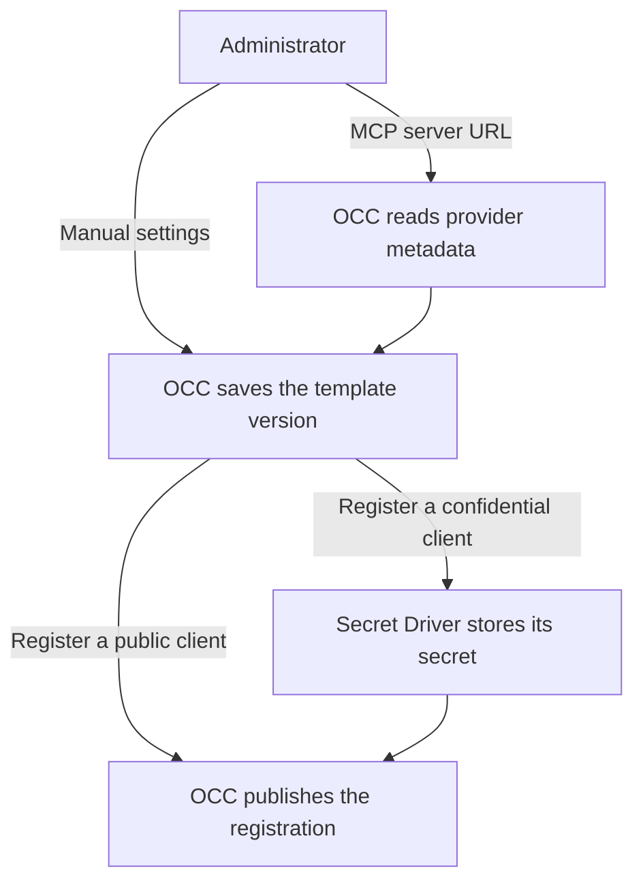
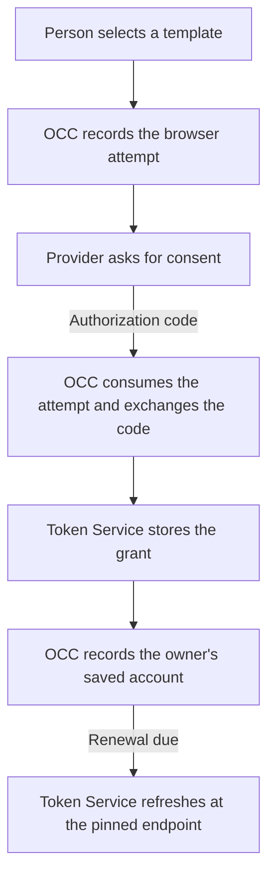

# How OCC saves an OAuth connection template

## Overview

An Installation administrator defines where an account can connect and which OAuth client represents the Installation. A person then selects that template to connect an account in a Namespace. OCC runs the browser authorization flow. The Token Service stores and renews the grant. The person can finish connecting before choosing an Agent.

## Entry Points

- An Installation administrator opens **Credentials → Connection templates** to edit a template, or **OAuth clients** to register a client against a template version. `apps/controller/src/http/connection-templates.ts:connectionTemplateHandlers`
- A signed-in person with permission to create a credential in the destination Namespace starts consent with a template available there. The OAuth provider returns the browser to OCC's shared callback. `packages/occ/src/index.ts:startNamespaceConnection` and `packages/occ/src/index.ts:completeNamespaceConnection`

## Flow

### Template and client setup

### Consent and token custody

## Execution Trace

### 1. Save the template version

`packages/occ/src/index.ts:createConnectionTemplate` and `apps/controller/src/connections/mcp-discovery.ts:discoverMcpAuthorization`

OCC checks Installation administration before it accepts manual settings or starts MCP discovery. For MCP, it reads the protected resource metadata over HTTPS, pins each request to public addresses and contacts the selected advertised authorization server. The version records what OCC discovered, the OAuth resource and the MCP transport destination. An administrator can also edit the installed Google OAuth template and its prefilled Google Workspace destinations. OCC keeps the template ID and commits each new version with its audit record.

### 2. Register and maintain the OAuth client

`packages/occ/src/index.ts:createOAuthClient` and `packages/occ/src/index.ts:cleanupOAuthClients`

A template can exist before its OAuth client. OCC takes the registration's availability and endpoints from the selected version. For a confidential client, it reserves a hidden row and asks the Installation's Secret Driver to store the secret under the registration ID. A public registration supplies a client ID and skips this private write. OCC rechecks the version, publishes the registration and records the audit. If the template lacked a client, that transaction also selects the new one.

Rotation replaces the confidential client's secret at the same private reference. Code exchange and renewal read its current value. A template version that still references the client prevents deletion. On deletion or interrupted creation, the worker uses the hidden registration to retry private cleanup.

### 3. Authorize the account in the browser

`packages/occ/src/index.ts:startNamespaceConnection` and `packages/occ/src/browser-authorization.ts:startBrowserAuthorization`

OCC verifies the person's Namespace permission and pins the selected template version. It reserves a pending credential source and records the state hash, browser session, principal, requested scopes and Proof Key for Code Exchange (PKCE) verifier in a private, expiring attempt. The provider receives the state and the challenge derived from that verifier. OCC includes the OAuth resource for MCP consent and omits the scope parameter when the person requests provider defaults.

### 4. Exchange the code and save the account

`packages/occ/src/index.ts:completeNamespaceConnection` and `apps/controller/src/backends/token-service/oauth-connection.ts:register`

On callback, OCC consumes the matching attempt once and rechecks the person's session and authority. It checks a returned issuer against the pinned issuer. If another issuer has a registered client at consent start or callback, OCC requires the issuer in the response. OCC sends the code and verifier to the pinned token endpoint, includes the MCP resource when applicable, and reads the current client secret if the registration requires one. If the exchange times out, the person starts a new attempt.

At startup, the API and worker each install an `oauth_refresh_token` issuer in their Token Service. After exchange, OCC registers the grant with that kind, naming the pending source, approved template version and selected OAuth client. The service checks that approval against the source and reads the issuer, token endpoint, authentication method and MCP resource from the stored configuration. It stores the access token and refresh grant in a private Secret. OCC records the approved recipient, reported scopes and template version, marks the account ready and grants its owner access. When the provider omits scopes after a provider-default request, the receipt records an empty list.

### 5. Resolve current destinations and renew the grant

`packages/occ/src/index.ts:effectiveConnectionDestinations` and `apps/controller/src/backends/token-service/oauth-connection.ts:renew`

When listing a manual account, OCC returns the current destinations from the same template if its issuer and mode still match. For MCP it returns the original destinations only while the issuer, mode, server URL and protected resource match. A missing or incompatible template yields an empty list. The original consent receipt identifies the registration and token endpoint for renewal.

OCC registers the returned grant under the Namespace and credential source ID. The worker renews due accounts. A trusted consumer resolves the same reference with a deadline and required remaining lifetime. If it needs a fresher token, the Token Service starts or joins renewal for that account. It rechecks that the account is active before releasing the committed token. On renewal, the Token Service checks the saved grant against its registration and reads the current client secret through OCC when required. A conditional write protects against concurrent renewal or disconnect. OCC records the next renewal and any narrower grant.

### 6. Bind a saved account to a plugin

For an unsaved Agent, the Console reads the selected release’s slots through Namespace plugin details. It starts ordinary Namespace consent and checks that the returned credential source is available for the same slot. The draft holds that reference. OCC validates it again and grants the new Agent access in the transaction that creates the Agent. For queued provisioning, the worker performs that transaction. Canceling the draft leaves the user’s account available.

OCC reads the Agent’s Configuration and selects the Plugin Driver for its Harness. That Driver identifies the named accounts in the selected release. Each managed CLI package supplies its own rules for matching destinations and authorizing requests. A CLI without those rules exposes no saved-account slot. OCC lists ready accounts the caller can operate in the Namespace whose issuer the slot accepts. It marks an account for new authorization when the approved protected resource or destination differs. A grant's scopes are available to the provider and the request policy.

Saving a selection checks the exact slot, account and Agent permissions together. Starting OAuth from a saved slot also records the release and current binding. The Console opens consent in a separate tab and severs the opener before visiting the provider. The callback signals the original editor, which rereads the Agent and checks the saved release, slot and source ID before showing an attachment. When the browser returns, OCC checks both before replacing that slot. The account stays with its owner if the binding changed during consent.

For **Load tools**, OCC checks the caller’s permission and the saved MCP server and resource before resolving a token. This request originates in the Console.

OCC records the selected Driver registration and saved source IDs on the Agent revision. The OpenShell Driver installs a mandatory request middleware and a runtime token-grant provider for the selected slot. The worker checks the Driver registration before starting the revision.

1. OpenShell sends the inspected request and its binding ID to OCC. OCC verifies the Gateway-signed supervisor identity, finds the slot in the Agent revision, and checks the grant, current template destinations and operation. For a credentialed request it records a short-lived approval keyed by the Sandbox and request ID. The record holds a digest of the approved recipient and scopes. A public Google discovery request can proceed with the workload's own headers and receives no saved credential.
2. Stock OpenShell uses `cache_ttl: 0s`. It sends the same request ID, binding and a SPIFFE JWT-SVID to the configured token endpoint. OCC verifies the Sandbox identity and consumes the approval once, even when another API replica handled the first call. OCC checks the current policy before and after Token Service resolution, and verifies the token version before releasing the bearer. OpenShell injects it into this request. A request already authorized for send can finish after detach. [OpenShell middleware](../../apps/controller/src/drivers/egress-proxy/openshell-request-credential.ts) · [Token endpoint](../../apps/controller/src/drivers/egress-proxy/openshell-token-grant.ts) · [Credential Proxy contract](../reference/drivers/credential-proxy.md#saved-oauth-accounts)

## Debugging and Verification

- If the callback redirects with `unknown_session`, start consent again in the signed-in browser that opened it. An expired or consumed attempt cannot complete.
- If it redirects with `issuer_required`, check whether another configured issuer has a registered client. Inspect the provider's callback configuration for issuer reporting.
- If refresh reports `client_refused`, check the current OAuth client registration and its secret. If the provider refused the user's refresh grant, reconnect the account. The [connection template reference](../reference/connection-templates.md) describes the recovery actions.

## Related docs

- [Manage credentials in the Console](../guides/console/secrets.md)
- [OAuth connection templates and clients](../reference/connection-templates.md)
- [Secret storage and delivery](secret-storage-and-delivery.md)

## Manual Notes

[keep this for the user to add notes. do not change between edits]

## Changelog

- 2026-11-05 21:47: Traced administrator setup, OCC browser consent and Token Service custody with the accompanying ownership change. (codex/01a1aad6-adec-7fa0-802a-50b5e0486319 - d32f76579)
