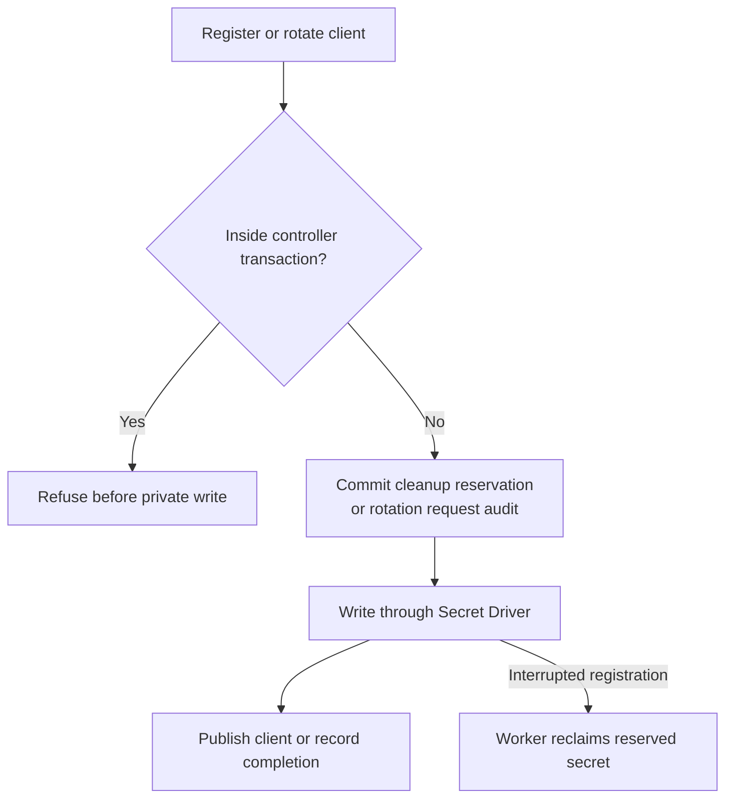

# How OCC saves an OAuth connection template

## Overview

An Installation administrator saves connection templates and registers OAuth clients through the console or HTTP API. OCC stores approved template versions in PostgreSQL and confidential client secrets through the selected Secret Driver. This flow ends at publication or worker cleanup of an unpublished client.

## Entry Points

- `apps/controller/src/http/connection-templates.ts:connectionTemplateHandlers` dispatches template and client requests after HTTP admission.
- `packages/occ/src/index.ts:OpenClawController` owns template publication, client registration, rotation and deletion.
- `apps/controller/src/worker.ts:ControllerWorker` schedules private client cleanup.

## Flow

HTTP registration and rotation of confidential clients follow this write order:

## Execution Trace

### 1. Discover and save the template

`packages/occ/src/index.ts:discoverConnectionTemplate` and `createConnectionTemplate`

The administrator selects manual configuration or supplies an MCP server URL. OCC checks Installation administration before discovery. For MCP, the controller reads protected resource metadata over TLS, resolves each metadata host to public addresses and pins those addresses for the request. It contacts only the selected advertised authorization server. OCC stores the metadata it observed with the approved version.

The Installation starts with a saved Google OAuth template. Its first version contains the default Google Workspace API destinations. The console reads that version through the same list and edit operations as other templates. An administrator's destination edits create a new version with the same template ID. The ID identifies the current manual delivery policy for accounts connected with that issuer. MCP discovery supplies one transport destination and its OAuth resource.

OCC checks scope and the client's allowed destinations before it references an OAuth client. PostgreSQL commits the template version and its audit together. A template can exist without a client. The Agent plugin release determines the local credential placeholder when the account is used.

### 2. Register or rotate the client

`packages/occ/src/index.ts:createOAuthClient` and `rotateOAuthClientSecret`

Both methods reject calls inside `OpenClawController.transact`, including an inherited transaction context, before reading or writing private material. They need independent commits so an enclosing rollback cannot erase a cleanup reservation or the requested-rotation audit. The HTTP handlers call these methods directly.

For registration, OCC reads availability and approved endpoints from the selected template version and checks the version again before publication. OCC commits a hidden client reservation before its selected Secret Driver writes a confidential client's secret. The private reference identifies the owning Driver, Installation and registration. A public registration skips private storage. OCC publishes the client and its creation audit together. If the template had no client, that transaction also publishes a version selecting the registration.

For HTTP rotation, OCC commits the administrator's request audit, locks the client, rechecks the session, and asks the Driver to replace the value at the same reference. Code exchange and token refresh use the current value. OCC records successful completion after the write. If the caller loses the response, repeating the operation with the same value is safe.

### 3. Reclaim private material

`packages/occ/src/index.ts:deleteOAuthClient` and `cleanupOAuthClients`

If registration stops before publication, the worker removes the private material and hidden reservation. Deleting a confidential client checks dependent template versions, hides the client, and records deletion. This method only stages database work and can participate in a controller transaction. The worker retries private cleanup before removing the row.

## Debugging and Verification

An enclosing create or rotate call raises `ResourceConflictError` with `cannot run in a controller transaction`. Call the lifecycle method outside that transaction; do not remove its independent reservation or audit commit.

With the [PostgreSQL fixture](../testing/postgresql.md) prepared, run `node --test tests/integration/postgres-connection-templates.test.ts`. The suite covers template version checks, private client writes, enclosing rollback refusal, uncertain commits and worker cleanup. It uses the Kubernetes Secret Driver with a controlled API transport; it does not prove a live Kubernetes deployment.

## Related docs

- [OAuth connection templates and clients](../reference/connection-templates.md)
- [Platform repository transactions](../reference/platform-repositories.md)

## Manual Notes

## Changelog

- 2026-11-05 23:59: Document independent client mutations and structure the existing flow. (authoring-run/12b5a135-b3b1-4d2e-bd32-259e373e9abe - e9cce241a2776521b745c22cd336cdb112444afb)
