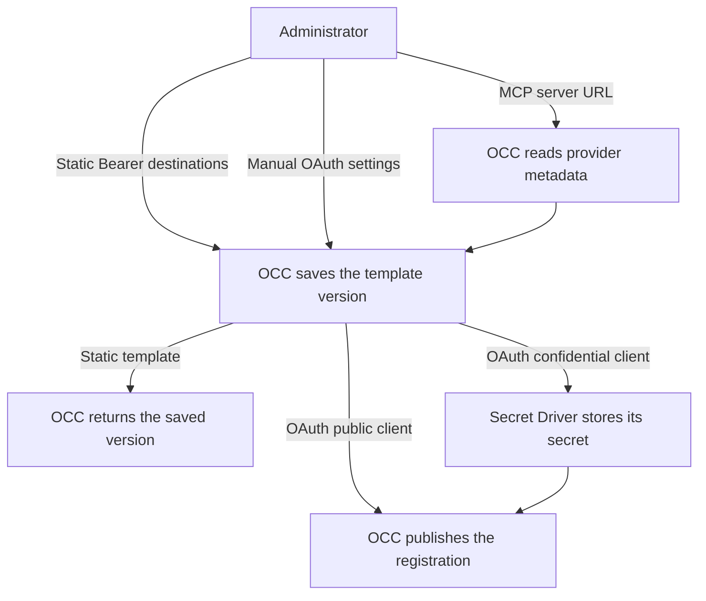
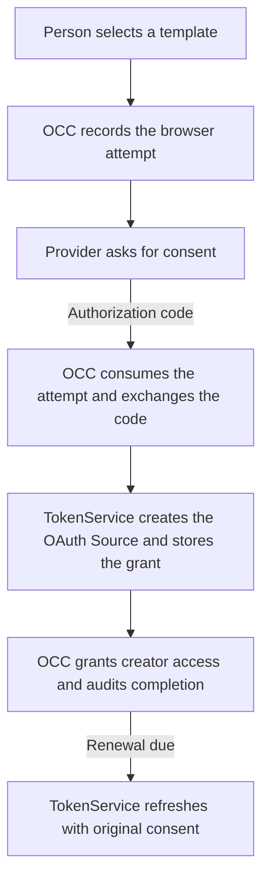

# How OCC saves a connection template

## Overview

An Installation administrator saves allowed destinations in a static Bearer Connection Template or saves OAuth settings in an OAuth template. OCC keeps the template identity and immutable versions in its repository. For OAuth, a person can then select a template to connect an account in a Namespace. OCC runs browser authorization, and the Token Service stores and renews the grant. Static credential enrollment and delivery are outside this flow.

## Entry Points

- An Installation administrator opens **Credentials → Connection templates** or calls the Connection Template API to manage static Bearer and OAuth templates. An administrator opens **OAuth clients** to register a client against an OAuth template version. `apps/controller/src/console/connection-templates.mts:renderConnectionTemplates` and `apps/controller/src/http/connection-templates.ts:connectionTemplateHandlers`
- A signed-in person with permission to create a credential in the destination Namespace starts consent with an OAuth template available there. The OAuth provider returns the browser to OCC's shared callback. `packages/occ/src/oauth-consent.ts:startNamespaceConnection`

## Flow

### Template and client setup

### Consent and token custody

## Execution Trace

### 1. Save the template version

`apps/controller/src/console/connection-templates.mts:openConnectionTemplateEditor`, `packages/occ/src/connection-administration.ts:createConnectionTemplate`, `packages/occ/src/connection-administration.ts:updateConnectionTemplate`, `packages/occ/src/state/postgres-connection-templates.ts:postgresConnectionTemplates`, and `apps/controller/src/connections/mcp-discovery.ts:discoverMcpAuthorization`

The Console lists both static Bearer and OAuth templates. Its editor sends the selected authentication method and settings to the same Template API. The OAuth client registration picker filters out static templates because they do not use a client.

OCC checks Installation administration and the selected Namespace before saving a template. For a static Bearer template, it validates and canonicalizes each complete method, host, port and path row. The path uses the same validator as credential request policy matching (`packages/contracts/src/request-path.ts:validRequestPath`); PostgreSQL enforces the same grammar when it stores a version. No discovery or OAuth client is required. The repository stores version 1 with the template identity. An edit that changes settings adds an immutable version and advances the current version; a rename alone keeps the version. OCC commits each mutation with its audit record.

For manual OAuth, OCC accepts the configured settings and destinations. For MCP, it reads protected resource metadata over HTTPS, pins each request to public addresses and contacts the selected advertised authorization server. The version records what OCC discovered, the OAuth resource and the MCP transport destination. An administrator can also edit the installed Google OAuth template and its prefilled Google Workspace destinations.

### 2. Register and maintain the OAuth client

`packages/occ/src/connection-administration.ts:createOAuthClient` and `packages/occ/src/connection-administration.ts:cleanupOAuthClients`

`createOAuthClient` and `rotateOAuthClientSecret` reject calls inside `OpenClawController.transact`, including an inherited transaction context, before private operations. Their independent commits preserve the cleanup reservation or, when the caller supplies an audit event, the requested-rotation audit if a later operation fails. The HTTP handlers call these methods directly and supply audit events. `deleteOAuthClient` only stages database work for worker cleanup and remains composable.

If the save response lacks a valid version, the Console keeps the editor open and disables another save. Close the editor to refresh the catalog and check whether the change was saved before continuing registration.

A template can exist before its OAuth client. OCC takes the registration's availability and endpoints from the selected version. For a confidential client, it reserves a hidden row and asks the Installation's Secret Driver to store the secret under the registration ID. A public registration supplies a client ID and skips this private write. OCC rechecks the version, publishes the registration and records the audit. If the template lacked a client, that transaction also selects the new one.

Rotation replaces the confidential client's secret at the same private reference. Code exchange and renewal read its current value. A template version that still references the client prevents deletion. On deletion or interrupted creation, the worker uses the hidden registration to retry private cleanup.

### 3. Authorize the account in the browser

`packages/occ/src/oauth-consent.ts:startNamespaceConnection` and `packages/occ/src/browser-authorization.ts:startBrowserAuthorization`

OCC verifies the person's Namespace permission and selected TokenService, then pins the selected Template version in an `oauth_connection` row in `occ.authentication_states`. The immutable version identifies the client. The row contains the state hash, browser session, principal, requested scopes, and Proof Key for Code Exchange (PKCE) verifier. No Source exists yet. The provider receives the state and the challenge derived from the verifier. OCC includes the OAuth resource for MCP consent and omits the scope parameter when the person requests provider defaults. The worker removes expired attempts. Device login uses the same store with a different kind and lifecycle.

### 4. Exchange the code and save the account

`packages/occ/src/oauth-consent.ts:completeNamespaceConnection` and `apps/controller/src/drivers/token-service/occ.ts:createSource`

On callback, OCC consumes the matching attempt once, checks the person's session and authority, and selects the active TokenService before exchanging the code. It checks a returned issuer against the pinned issuer. If another issuer has a registered client at consent start or callback, OCC requires the issuer in the response. OCC sends the code and verifier to the pinned token endpoint, includes the MCP resource when applicable, and reads the current client secret if the registration requires one. If the exchange times out, the person starts a new attempt.

After exchange, OCC calls the selected TokenService's typed Source registration operation with the OAuth grant, Template ID, original consent version, selected client, and requested and granted scopes. TokenService allocates the Source ID, creates the ready OAuth Source, and stores the access token and refresh grant privately. OCC then grants the creator access and records the completion audit against the Source and the authorized Namespace create operation. When the provider omits scopes after a provider-default request, the Source records an empty granted-scope list.

The callback redirects to the same-origin Console with the Namespace and newly created nonsecret Source ID. The redirect contains no authorization code, state, or token. The consent tab publishes that ID on its attempt channel; the original Console confirms success only after an authorized read matches the Namespace, Template and consent version. A provider can sever the tab's opener relationship while it remains open. Console keeps the attempt active until callback, expiry or cancellation and offers a retry. Canceling stops Console from accepting the old callback; it does not invalidate the provider's pending consent. `apps/controller/src/console/connection-consent.mts`

### 5. Renew the grant

`apps/controller/src/backends/token-service/oauth-connection.ts:renew`

The worker renews due OAuth Sources. A trusted consumer obtains a usable credential only through the selected TokenService. Renewal uses the Source's original consent version and client registration, including the registration's current client secret. A Template update changes the version available for a later Agent admission; it does not widen the original OAuth grant or change its refresh endpoint. TokenService records the next renewal and any narrower granted scopes.

## Debugging and Verification

- If registration or rotation raises `ResourceConflictError` with `cannot run in a controller transaction`, call the lifecycle method outside that transaction. Preserve the independent reservation commit and any caller-supplied audit commit.

- If the callback redirects with `unknown_session`, start consent again in the signed-in browser that opened it. An expired or consumed attempt cannot complete.
- If it redirects with `issuer_required`, check whether another configured issuer has a registered client. Inspect the provider's callback configuration for issuer reporting.
- If refresh reports `client_refused`, check the current OAuth client registration and its secret. If the provider refused the user's refresh grant, reconnect the account. The [connection template reference](../reference/connection-templates.md) describes the recovery actions.

## Related docs

- [Manage credentials in the Console](../guides/console/secrets.md)
- [Connection templates and OAuth clients](../reference/connection-templates.md)
- [Secret storage and delivery](secret-storage-and-delivery.md)

## Manual Notes

[keep this for the user to add notes. do not change between edits]

## Changelog

- 2026-11-23 10:33: Trace Console consent isolation, callback verification and retry behavior. (authoring-run/59e60d97-c02d-4f52-b09a-338ab74cebac - c99f355f2)
- 2026-11-23 10:15: Describe the callback's Source handoff to Console. (authoring-run/f79523c1-41c8-4d45-8e08-14669a2afd29 - 223d6347d)
- 2026-11-23 13:30: Replace provisional and saved connections with consent state followed by TokenService-owned OAuth Source registration. (authoring-run/447bea0a-5c7e-477e-9924-ad4cdb7ab35a - d00c725c9c752dee95ffb33bd0395fa5d49e6929)

- 2026-11-22 22:35: Trace static Bearer template management through the generic Console and distinguish OAuth-only client registration. (authoring-run/f81c2ba5-1907-4d22-af81-7eafc3d4e151 - 307773df82de054c2ef7a72be3ede9aaab4080d9)

- 2026-11-21 11:44: Preserve static template validation and OAuth execution pointers after the OCC source split. (authoring-run/34c4b97f-1b59-4420-b3ea-c99b21a248e6 - 39556366f21c4825cdf38ad5b53c03d2ad03eb3a)

- 2026-11-20 16:39: Update saved OAuth connection source pointers. (authoring-run/92b9e71c-fcf2-4b55-a170-1245c26d4e28 - 23055316abb1c680cb1f72ca8a09109db373519e)

- 2026-11-20 16:11: Update source pointers for template and OAuth client administration. (authoring-run/135d41a4-0e5d-46a5-afef-5acb8bab4332 - 492a10a2cd415407677f9abca62da3d415f41fae)

- 2026-11-20 07:01: Trace static Bearer template validation and shared version persistence in the accompanying change. (authoring-run/ff867cfa-69cc-468f-b5a3-e306c1377db2 - 0ac6f863218c79c2c4143d552a0207a24d20f604)

- 2026-11-18 16:20: Trace browser consent and expiry through shared OCC authentication state in the accompanying change. (authoring-run/0e501248-a309-4913-b4df-122e4c3783c2 - 5dfbd6c1db67024917c79790ee7b6155e6f753e1)

- 2026-11-12 05:05: Record the callback audit authorization from the consumed Namespace. (authoring-run/4ce62d56-3932-48c4-8c2e-df863a7979cd - 31a99b1bc02340887cc875094b85ce5fa369cdf5)

- 2026-11-05 23:59: Document independent client mutations and structure the existing flow. (authoring-run/12b5a135-b3b1-4d2e-bd32-259e373e9abe - e9cce241a2776521b745c22cd336cdb112444afb)

- 2026-11-05 21:47: Traced administrator setup, OCC browser consent and Token Service custody with the accompanying ownership change. (codex/01a1aad6-adec-7fa0-802a-50b5e0486319 - d32f76579)
