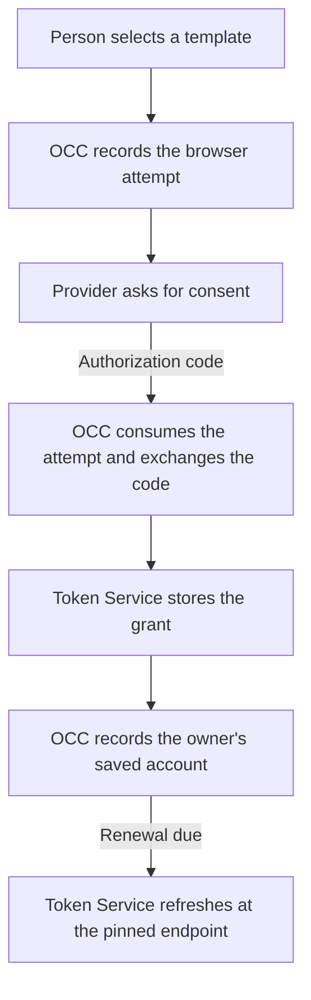

# How OCC saves a connection template

## Overview

An Installation administrator saves approved destinations in a static Bearer Connection Template or saves OAuth settings in an OAuth template. OCC keeps the template identity and immutable versions in its repository. For OAuth, a person can then select a template to connect an account in a Namespace. OCC runs browser authorization, and the Token Service stores and renews the grant. Static credential enrollment and delivery are outside this flow.

## Entry Points

- An Installation administrator calls the Connection Template API to manage a static Bearer template, opens **Credentials → Connection templates** to edit an OAuth template, or opens **OAuth clients** to register a client against an OAuth template version. `apps/controller/src/http/connection-templates.ts:connectionTemplateHandlers`
- A signed-in person with permission to create a credential in the destination Namespace starts consent with an OAuth template available there. The OAuth provider returns the browser to OCC's shared callback. `packages/occ/src/saved-oauth-connections.ts:startNamespaceConnection` and `packages/occ/src/saved-oauth-connections.ts:completeNamespaceConnection`

## Flow

### Template and client setup

### Consent and token custody

## Execution Trace

### 1. Save the template version

`packages/occ/src/connection-administration.ts:createConnectionTemplate`, `packages/occ/src/connection-administration.ts:updateConnectionTemplate`, `packages/occ/src/state/postgres-connection-templates.ts:postgresConnectionTemplates`, and `apps/controller/src/connections/mcp-discovery.ts:discoverMcpAuthorization`

OCC checks Installation administration and the selected Namespace before saving a template. For a static Bearer template, it validates and canonicalizes each complete method, host, port and path row. The path uses the same validator as credential request policy matching (`packages/contracts/src/request-path.ts:validRequestPath`); PostgreSQL enforces the same grammar when it stores a version. No discovery or OAuth client is required. The repository stores version 1 with the template identity. An edit that changes approved settings adds an immutable version and advances the current version; a rename alone keeps the version. OCC commits each mutation with its audit record.

For manual OAuth, OCC accepts the approved settings and destinations. For MCP, it reads protected resource metadata over HTTPS, pins each request to public addresses and contacts the selected advertised authorization server. The version records what OCC discovered, the OAuth resource and the MCP transport destination. An administrator can also edit the installed Google OAuth template and its prefilled Google Workspace destinations.

### 2. Register and maintain the OAuth client

`packages/occ/src/connection-administration.ts:createOAuthClient` and `packages/occ/src/connection-administration.ts:cleanupOAuthClients`

`createOAuthClient` and `rotateOAuthClientSecret` reject calls inside `OpenClawController.transact`, including an inherited transaction context, before private operations. Their independent commits preserve the cleanup reservation or, when the caller supplies an audit event, the requested-rotation audit if a later operation fails. The HTTP handlers call these methods directly and supply audit events. `deleteOAuthClient` only stages database work for worker cleanup and remains composable.

If the save response lacks a valid version, the Console keeps the editor open and disables another save. Close the editor to refresh the catalog and check whether the change was saved before continuing registration.

A template can exist before its OAuth client. OCC takes the registration's availability and endpoints from the selected version. For a confidential client, it reserves a hidden row and asks the Installation's Secret Driver to store the secret under the registration ID. A public registration supplies a client ID and skips this private write. OCC rechecks the version, publishes the registration and records the audit. If the template lacked a client, that transaction also selects the new one.

Rotation replaces the confidential client's secret at the same private reference. Code exchange and renewal read its current value. A template version that still references the client prevents deletion. On deletion or interrupted creation, the worker uses the hidden registration to retry private cleanup.

### 3. Authorize the account in the browser

`packages/occ/src/saved-oauth-connections.ts:startNamespaceConnection` and `packages/occ/src/browser-authorization.ts:startBrowserAuthorization`

OCC verifies the person's Namespace permission and pins the selected template version. It reserves a pending credential source and writes an `oauth_connection` row to `occ.authentication_states`. The row contains the state hash, browser session, principal, requested scopes and Proof Key for Code Exchange (PKCE) verifier. The provider receives the state and the challenge derived from that verifier. OCC includes the OAuth resource for MCP consent and omits the scope parameter when the person requests provider defaults. The worker removes expired attempts and their unfinished credential sources. Device login uses the same OCC store with a different kind and lifecycle; human sign-in attempts remain separate.

### 4. Exchange the code and save the account

`packages/occ/src/saved-oauth-connections.ts:completeNamespaceConnection` and `apps/controller/src/backends/token-service/oauth-connection.ts:register`

On callback, OCC consumes the matching attempt once and rechecks the person's session and authority. It checks a returned issuer against the pinned issuer. If another issuer has a registered client at consent start or callback, OCC requires the issuer in the response. OCC sends the code and verifier to the pinned token endpoint, includes the MCP resource when applicable, and reads the current client secret if the registration requires one. If the exchange times out, the person starts a new attempt.

At startup, the API and worker each install an `oauth_refresh_token` issuer in their Token Service. After exchange, OCC registers the grant with that kind, naming the pending source, approved template version and selected OAuth client. The service checks that approval against the source and reads the issuer, token endpoint, authentication method and MCP resource from the stored configuration. It stores the access token and refresh grant in a private Secret. OCC records the approved recipient, reported scopes and template version, marks the account ready and grants its owner access. The same transaction records the saved credential source as the affected resource and `credential_source:create` on the consumed Namespace as the authorized operation. When the provider omits scopes after a provider-default request, the receipt records an empty list.

### 5. Resolve current destinations and renew the grant

`packages/occ/src/saved-oauth-connections.ts:effectiveConnectionDestinations` and `apps/controller/src/backends/token-service/oauth-connection.ts:renew`

When listing a manual account, OCC returns the current destinations from the same template if its issuer and mode still match. For MCP it returns the original destinations only while the issuer, mode, server URL and protected resource match. A missing or incompatible template yields an empty list. The original consent receipt identifies the registration and token endpoint for renewal.

OCC registers the returned grant under the Namespace and credential source ID. The worker renews due accounts. A trusted consumer resolves the same reference with a deadline and required remaining lifetime. If it needs a fresher token, the Token Service starts or joins renewal for that account. It rechecks that the account is active before releasing the committed token. On renewal, the Token Service checks the saved grant against its registration and reads the current client secret through OCC when required. A conditional write protects against concurrent renewal or disconnect. OCC records the next renewal and any narrower grant.

## Debugging and Verification

- If registration or rotation raises `ResourceConflictError` with `cannot run in a controller transaction`, call the lifecycle method outside that transaction. Preserve the independent reservation commit and any caller-supplied audit commit.

- If the callback redirects with `unknown_session`, start consent again in the signed-in browser that opened it. An expired or consumed attempt cannot complete.
- If it redirects with `issuer_required`, check whether another configured issuer has a registered client. Inspect the provider's callback configuration for issuer reporting.
- If refresh reports `client_refused`, check the current OAuth client registration and its secret. If the provider refused the user's refresh grant, reconnect the account. The [connection template reference](../reference/connection-templates.md) describes the recovery actions.

## Related docs

- [Manage credentials in the Console](../guides/console/secrets.md)
- [Connection templates and OAuth clients](../reference/connection-templates.md)
- [Secret storage and delivery](secret-storage-and-delivery.md)

## Manual Notes

[keep this for the user to add notes. do not change between edits]

## Changelog

- 2026-11-21 11:44: Preserve static template validation and OAuth execution pointers after the OCC source split. (authoring-run/34c4b97f-1b59-4420-b3ea-c99b21a248e6 - 39556366f21c4825cdf38ad5b53c03d2ad03eb3a)

- 2026-11-20 16:39: Update saved OAuth connection source pointers. (authoring-run/92b9e71c-fcf2-4b55-a170-1245c26d4e28 - 23055316abb1c680cb1f72ca8a09109db373519e)

- 2026-11-20 16:11: Update source pointers for template and OAuth client administration. (authoring-run/135d41a4-0e5d-46a5-afef-5acb8bab4332 - 492a10a2cd415407677f9abca62da3d415f41fae)

- 2026-11-20 07:01: Trace static Bearer template validation and shared version persistence in the accompanying change. (authoring-run/ff867cfa-69cc-468f-b5a3-e306c1377db2 - 0ac6f863218c79c2c4143d552a0207a24d20f604)

- 2026-11-18 16:20: Trace browser consent and expiry through shared OCC authentication state in the accompanying change. (authoring-run/0e501248-a309-4913-b4df-122e4c3783c2 - 5dfbd6c1db67024917c79790ee7b6155e6f753e1)

- 2026-11-12 05:05: Record the callback audit authorization from the consumed Namespace. (authoring-run/4ce62d56-3932-48c4-8c2e-df863a7979cd - 31a99b1bc02340887cc875094b85ce5fa369cdf5)

- 2026-11-05 23:59: Document independent client mutations and structure the existing flow. (authoring-run/12b5a135-b3b1-4d2e-bd32-259e373e9abe - e9cce241a2776521b745c22cd336cdb112444afb)

- 2026-11-05 21:47: Traced administrator setup, OCC browser consent and Token Service custody with the accompanying ownership change. (codex/01a1aad6-adec-7fa0-802a-50b5e0486319 - d32f76579)
