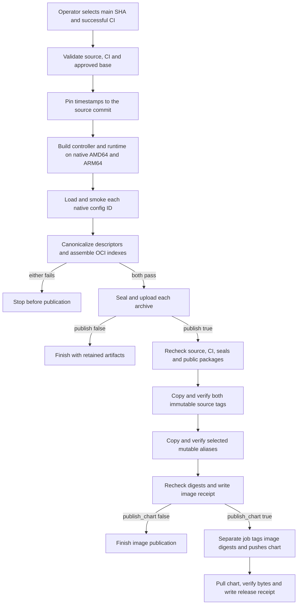

# Container publication flow

## Overview

Manual Enterprise publication builds controller and runtime OCI archives for
Linux amd64 and arm64, checks both variants, and transfers the tested bytes to
public GHCR packages. Each package receives one multi-platform index digest.
With `publish_chart: true`, a separate protected job tags those digests with the
OCE version and publishes a Helm chart. Image-only publication is the default.

## Entry Points

- `.github/workflows/container-publish.yml:jobs.validate`: manual dispatch on
  `main` with its exact source SHA, successful main-push CI run ID, publish flag,
  optional mutable image tag, and opt-in chart flag.
- `scripts/ci/container-release.mjs:main`: validation, smoke, seal, and publication
  commands called by the workflow.
- `scripts/ci/chart-release.mjs:publish`: version-tag and chart publication after
  the image receipt exists.
- Publication requires pre-existing public packages. The manual dispatch
  authorizes publication without a separate environment approval. GitHub grants
  manual dispatch to repository writers, including maintainers.

## Flow

Source review does not prove a hosted build or registry transfer succeeded.

## Execution Trace

### 1. Admit the source and initialize preparation

`scripts/ci/container-release.mjs:validate` verifies the trusted workflow, exact
main source and successful CI identity, approved Node base digest, and the optional
image tag. An empty tag selects `latest`; invalid or reserved tags fail before
preparation. No-push preparation accepts private or public source only when
`PUBLISH` is the exact string `"false"`. Publication and recovery require the
public Enterprise repository and public packages. Publication also checks the
main-only environment branch policy. No-push preparation has no package write
permission or protected-environment credentials.

`.github/workflows/container-publish.yml:jobs.prepare` calls the reusable
`.github/workflows/container-check.yml:jobs.prepare` image/architecture matrix. Controller and runtime each build on native AMD64 and ARM64 Linux runners.
See [shared CI settings](../release/configuration.md#build-settings) for native runner defaults and overrides.
Each job checks its architecture and logs CPU, memory, and available disk.
The reported runner label alone is not evidence of allocated capacity.
`scripts/ci/setup-tools.sh` installs checksum-pinned kubectl, k3d, Helm, and yq
for both native Linux architectures before runtime smoke tests.
The standard AMD64 override requires 36 GiB free and, only below that, runs
guarded toolchain cleanup that checks required roots and skips unsafe paths.
Larger runners do not depend on deleting preinstalled SDKs.

Each Buildx builder runs at most two steps concurrently. The default Blacksmith
runners retain BuildKit layers on a sticky disk scoped by image and architecture,
so builds do not export the large intermediate cache over the network. A custom
non-Blacksmith runner uses the GitHub Actions cache with the same scope.
Maintainers can also dispatch `container-check.yml`, or a manual `CI` run that
calls it, on a branch for native image verification. It has no publication job or
package-write permission. Standalone checks use the source's CI base; publication
and manual `CI` use the approved repository base. Publication verifies it matches
the source. Builds export OCI directories without registry credentials.
Before Buildx runs, the workflow derives `SOURCE_DATE_EPOCH` from the exact
OCE source commit. BuildKit rewrites image and filesystem timestamps to that epoch,
so wall-clock time does not change the image manifests on a cold-cache rebuild.

`scripts/lib/openclaw-source.mjs:readOpenclawSource` resolves the runtime's commit,
archive checksum, and build timestamp from `deploy/runtime/openclaw-source.json`.
The Dockerfile rejects missing, malformed, or conflicting build arguments before
downloading source. Manifest changes invalidate build caches; credential-service
targets remain independent.

`deploy/runtime/Dockerfile:openclaw-source` verifies the OpenClaw source archive
and applies the checksum-verified patches described in the
[runtime recipe](../../deploy/runtime/README.md). Both installs use
frozen lockfiles and upstream's selected-plugin manifests, retaining required
bundled plugins plus Codex and Slack. The standalone Codex command links to the
plugin's installation. Build tools remain in full Bookworm stages; final images
use a separately pinned Node 24 Bookworm slim base. Both bases apply available
Debian package updates when their recipe layers build. The Node digest identifies
the upstream image; it does not freeze Debian package repositories.

The build runs the caller-authority and Gateway recovery tests offline. The final
image records the patch checksums in its provenance.

The runtime disables npm background update checks. See the
[runtime defaults](../../deploy/runtime/README.md).

`scripts/build-runtime-assets.mjs` prunes development/QA files and unreachable
pnpm entries, retaining runtime templates, skills, help, and importer-specific
dependencies. It writes provenance with the manifest's commit and archive
checksum plus patch, lockfile, and inventory hashes. The runtime copies this
tree without gzip or a second Codex installation. After permission normalization,
inventory mode updates `contents.json`, `runtimeContentsSha256`, and Codex
package/binary identity. Upstream import-closure and native-addon checks remain;
see the [runtime recipe](../../deploy/runtime/README.md).
`org.openclaw.image.revision` must match packaged provenance;
`org.opencontainers.image.revision` and receipt `sourceSha` identify OCE.

Final image checks require `@openclaw/proc-safe/reaper` to return true from
`isSupported()`.

### 2. Verify and assemble both platform variants

`scripts/ci/container-release.mjs:smoke` requires a native runner matching the
selected platform. It binds the OCI export to the build output digest, loads it
with Skopeo, checks Docker's config ID and architecture, and runs the existing
startup suite with native deadlines. A success receipt binds the platform digest
to the source, workflow, run/attempt, CI evidence, image, and build base. Failed
smokes cannot upload platform artifacts. The temporary loaded image is removed.

`.github/workflows/container-publish.yml:jobs.assemble` downloads both successful
platform artifacts from this exact run/attempt. `container-release.mjs:assemble`
rejects mismatched receipts, platform configs, blob sizes, or hashes before linking
blobs into one OCI layout. It retains only the manifest media type, digest, size,
and platform in each assembled descriptor, excluding exporter-only annotations
such as the build time and local reference name. It writes the multi-platform
index and archive without rebuilding either variant, then removes the temporary layouts.
`readArchivePlatforms` checks the archive contains exactly one AMD64 and one ARM64
Linux manifest with matching config and content digests. Publication still consumes
this sealed archive; registry access is not needed during assembly.

Before runtime smoke, `scripts/ci/prepare.mjs:prepareRuntimeImageSmoke` imports
the loaded config ID into a disposable k3d cluster. It reuses the Images and
Packaging lane's reviewed Codex seccomp derivation and sandbox probes, then passes
the resulting profile and ownership state to the Docker tests. This preparation
does not rebuild the runtime. Cleanup removes the owned cluster and temporary
image tag on success or failure; a workflow cleanup step also runs after an
interrupted smoke command.

### 3. Seal and enter publication

`scripts/ci/container-release.mjs:seal` rechecks the platform contents and records
the archive hash, multi-platform index digest, platform list, source, workflow,
run attempt, CI identity, and approved base. Both prepared artifacts must exist
before `.github/workflows/container-publish.yml:jobs.publish` can start. The
publish job runs only when the operator selected `publish: true`.

No-push runs end with artifacts. See [operator instructions](../release/containers.md)
for retention and package access.

### 4. Publish and hand off immutable references

`scripts/ci/container-release.mjs:publishPrepared` checks both seals, archive hashes,
index digests, and destinations before copying either image. It repeats source,
CI, environment branch policy, and package checks during transfer. A matching existing source tag is retained;
a conflicting tag or ambiguous registry error fails. An absent tag receives the
entire index and both child manifests through Skopeo `--all --preserve-digests`.
After both source tags verify, ordinary publication copies each sealed archive to
`latest` or the selected custom alias, then checks both source and alias digests.
The custom alias replaces `latest` for that dispatch; recovery does not move an
alias. The two aliases are updated separately, so a failed run can leave them on
different digests. The receipt is written only after both verify.

Package metadata must report the expected name and public visibility. Reported
repository linkage must match the public Enterprise repository. Omitted linkage
is accepted without review-history lookups; package setup owns that connection.

Each remote index digest must match before the receipt is written. Deployment
uses that index digest, letting the container runtime select its architecture.
A partial failure leaves existing published bytes intact. Recovery consumes the
same retained multi-platform archives and original producer identity; it does
not rebuild them. Old amd64-only seals cannot satisfy this platform contract.

The optional `jobs.publish-chart` downloads this run/attempt's image receipt only
after `jobs.publish` succeeds. `scripts/ci/chart-release.mjs` requires
both entries to match the current source, producer run, CI run, package names,
and immutable digests. Root `package.json`, the chart version, and appVersion
must agree before a version tag is written. The staged chart carries the source
SHA and both digest references in annotations; its default controller image is
the verified controller digest. Operator values can override that default.

Both jobs share the protected environment. Workflow-level concurrency retains
the publication lock across preparation and both writes; jobs never reacquire it.
The chart publisher checks image version tags and any existing chart before writing. Existing tags must resolve to the receipt's digests;
an existing chart version must have identical packaged files. It rechecks the trusted
source, CI, environment, and public chart package before each write. After
`helm push`, it pulls the chart, compares its packaged files and new-push archive bytes, inspects the remote
manifest digest, and writes a separate `chart-publication.json`. A partial
failure requires a new full dispatch with identical source; chart-only reruns
lack the new attempt's image receipt. Chart failure leaves image success intact
but fails the combined run. `jobs.summary` reports both outcomes.
The receipt binds the chart manifest digest observed after the pull. This
assumes the protected publication workflows and trusted package administrators
are the only package writers; their workflow concurrency group does not exclude
independent GHCR writers. A tag change between the pull and digest lookup could
make the receipt refer to a different manifest. The operator's
[single-writer requirement](../release/chart-publication.md#choose-one-release-version)
owns package-write access and coordination.

## Debugging and Verification

- For rejected source arguments, [resolve the manifest values](../../deploy/runtime/README.md#resolve-openclaw-build-arguments)
  and rebuild without bypassing checksum verification.
- Run `node --test tests/integration/container-{release,resume,promote}.test.mjs`
  for platform/archive validation and release gate coverage. The archive case uses
  real OCI blobs and tar; recovery uses transport fixtures.
- Run the [registry integration](../testing/docker.md#container-publication-registry-proof)
  to check real Skopeo alias replacement against a disposable local registry.
  This does not prove GHCR access.
- Run `actionlint .github/workflows/container-publish.yml` for workflow syntax.
- In a hosted preparation, require smoke output for both architectures of both
  images. A config mismatch, missing platform, or failed startup blocks upload.
- Repeat publication for the same source and CI evidence to prove that the
  registry index identity is stable; the second run must retain the existing
  source tag. Mutable external package inputs can still produce a legitimate
  conflict, which remains fail-closed.
- Use `docker buildx imagetools inspect` on both the source tag and selected alias.
  Require Linux amd64 and arm64 plus the receipt's index digest. Startup checks
  do not establish native ARM64 performance, cluster behavior, or model turns.

## Related docs

- [Publication and recovery instructions](../release/containers.md)
- [Chart publication and pull](../release/chart-publication.md)
- [Package bootstrap flow](container-package-bootstrap.md)
- [Image startup checks](../testing/docker.md#images-and-helm)

## Manual Notes

## Changelog

- 2026-10-26 10:23: Read OpenClaw source metadata from one manifest; validate build arguments and provenance. (authoring-run/3032d748-8d18-4cef-a903-f9a72ed8cda9 - 37d28e211ed5831dc201433d36bb23eadd834f6b)

- 2026-10-23 16:52: Select the source's CI base for standalone checks and update OpenClaw for Gateway managed mode. (codex/01a1558e-c27f-7bc0-a403-af59e9364ddf)

- 2026-10-16 22:41: Require the native reaper and caller-authority regression checks. (codex/01a13683-3916-7880-b1a6-27175b853600 - fd21b43ce92dbd44f98fce5fef29489b97d6352c)

- 2026-10-10 03:00: Pin stock Codex 0.163.0-alpha.2; alpha.1 sent metadata the backend rejects. (fix-992-pin)

[Container publication documentation history](container-publication/history.md) preserves the older dated entries.
