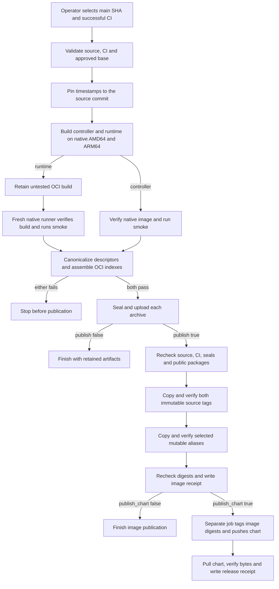

# Container publication flow

## Overview

Manual Enterprise publication builds controller and runtime OCI archives for
Linux amd64 and arm64, checks both variants, and transfers the tested bytes to
public GHCR packages. Each package receives one multi-platform index digest.
With `publish_chart: true`, a separate protected job tags those digests with the
OCE version and publishes a Helm chart. Image-only publication is the default.

## Entry Points

- `.github/workflows/container-publish.yml:jobs.validate`: manual dispatch on
  `main` with its exact source SHA, successful main-push CI run ID, publish flag,
  optional mutable image tag, and opt-in chart flag.
- `scripts/ci/container-release.mjs:main`: validation, smoke, seal, and publication
  commands called by the workflow.
- `scripts/ci/chart-release.mjs:publish`: version-tag and chart publication after
  the image receipt exists.
- Publication requires pre-existing public packages. The manual dispatch
  authorizes publication without a separate environment approval. GitHub grants
  manual dispatch to repository writers, including maintainers.

## Flow



Source review does not prove a hosted build or registry transfer succeeded.

## Execution Trace

### 1. Admit the source and initialize preparation

`scripts/ci/container-release.mjs:validate` verifies the trusted workflow, exact
main source and successful CI identity, approved Node base digest, and the optional
image tag. An empty tag selects `latest`; invalid or reserved tags fail before
preparation. No-push preparation accepts private or public source only when
`PUBLISH` is the exact string `"false"`. Publication and recovery require the
public Enterprise repository and public packages. Publication also checks the
main-only environment branch policy. No-push preparation has no package write
permission or protected-environment credentials.

`.github/workflows/container-publish.yml:jobs.prepare` calls the reusable
`.github/workflows/container-check.yml:jobs.prepare` image/architecture matrix. Controller and runtime each build on native AMD64 and ARM64 Linux runners.
See [shared CI settings](../release/configuration.md#build-settings) for native runner defaults and overrides.

### Runtime source verification

To verify runtime changes locally, first
[resolve the build arguments](../../deploy/runtime/README.md#resolve-openclaw-build-arguments), then run:

```bash
docker build -f deploy/runtime/Dockerfile \
  "${openclaw_build_args[@]}" --target openclaw-bridge-tests .
```

Runtime jobs run bridge suites, CUA tests and source typechecks in `openclaw-bridge-tests`.
Failure blocks assembly, smoke and upload. Assembly uses the same checkout, build arguments,
base and platform. Local assembly can run independently of
[local source verification](../../deploy/runtime/README.md#verify-runtime-source).

The `resources` step checks architecture, CPU, memory and cgroup-v2 ancestor
limits, then logs capacity and Node compiler jobs. ARM runtime can select eight;
unknown or smaller limits retain four. Both build stages consume that output.
See [build settings](../release/configuration.md#build-settings) for the budget.
Before runtime smoke, `scripts/ci/setup-tools.sh` installs checksum-pinned kubectl, k3d,
Helm and yq on either architecture. The standard AMD64 override requires 36 GiB free.
Below that threshold, cleanup checks required roots and skips unsafe paths.
Larger runners need no SDK cleanup.

Buildx runs at most two steps concurrently. Default Blacksmith runners cache BuildKit
layers on local sticky disks scoped by image and architecture. Other runners use the
GitHub Actions cache with the same scope. Maintainers can dispatch `container-check.yml`
directly or through manual `CI` to verify a branch without package-write permission
or publication. Standalone checks use the source's CI base. Manual `CI` and publication
use the approved repository base, which publication verifies against the source.
Builds export OCI directories without registry credentials. BuildKit normalizes image
and filesystem timestamps to `SOURCE_DATE_EPOCH` from the exact OCE commit, including
on cold-cache rebuilds.

`scripts/lib/openclaw-source.mjs:readOpenclawSource` resolves the runtime's commit,
archive checksum, and build timestamp from `deploy/runtime/openclaw-source.json`.
The Dockerfile rejects missing, malformed, or conflicting build arguments before
downloading source. Manifest changes invalidate build caches; credential-service
targets remain independent.

`deploy/runtime/Dockerfile:openclaw-source` verifies the OpenClaw source archive
and applies the checksum-verified patches described in the
[runtime recipe](../../deploy/runtime/README.md). Both installs use
frozen lockfiles and upstream's selected-plugin manifests, retaining required
bundled plugins plus Codex and Slack. The standalone Codex command links to the
plugin's installation. Build stages use full Bookworm; final images use separately
pinned slim bases. The controller requires Node 24.22.1+ within the 24 series.
The runtime requires matching Node 24.22.1 Bookworm bases. Its `node-source` stage checks
the archive and patch digests in `deploy/runtime/node/source.json` before applying the
worker-termination repair. `node-compiled` builds native Node with full ICU and runs
the worker regression and adjacent loader tests. Slim Bookworm repeats the tests
with the copied executable. Missing libraries, ABI changes or regression failures
stop assembly. The repository-credential service retains its original base.
Both bases apply updates from mutable Debian repositories, even with pinned image digests.
Every index refresh uses
`apt-get update --error-on=any` to stop builds on incomplete downloads.

`deploy/runtime/node/build.sh` records the source, patch, ABI and executable digest.
`scripts/build-runtime-assets.mjs:inventory` checks its running executable's digest
before recording `node` in final runtime provenance. Image startup compares that
record with the checkout and installed executable. Native qualification requires
packaged Gateway restart tests.

`deploy/runtime/Dockerfile` and `deploy/runtime/repository-credentials/Dockerfile.client`
retry pinned GitHub CLI archive and manifest downloads up to six times, including partial
transfers and permanent errors. Curl resets partial files. Before extraction or execution,
both recipes check the pinned manifest digest, then its archive checksum.
Exhausted retries or a checksum failure stop the build immediately.

Publication builds use the default package registries. Operators building from
source can [configure a package registry mirror](../guides/deploy/production-installation.md#build-through-a-package-registry-mirror)
for both the pinned pnpm download and dependency installation.

`deploy/runtime/Dockerfile:curl-packages` builds the Bookworm curl backport
from checksum-pinned Debian source and runs its proxy authentication and TLS
tests without external networking. `deploy/runtime/curl/build.sh` inserts the
CVE-2026-86414 fix before Debian's backend patches, so both OpenSSL curl and
Git's GnuTLS library reject origin authentication challenges on CONNECT. The
final runtime installs all three generated Debian packages together and records
their source and package checksums under `/usr/share/doc/curl/oce/`. Debian
package metadata and the changelog retain the base version and the `+oce1`
backport revision; a vulnerability scanner may still report the upstream CVE.
The final install compares fresh APT indexes with the recorded Debian base
version before selecting local packages, so a cached backport cannot silently
replace a newer Debian security update.

The build runs the caller-authority, Gateway recovery and Linux private-store
tests offline. The private-store bridge normalizes inherited setgid only for a
new owner-only directory, so native first use can create private SQLite stores
under the Sandbox workspace. Existing parent permissions and filesystem admission
checks remain unchanged. The final image records the patch checksums in its
provenance.

The [Codex profile patch](../../deploy/runtime/openclaw-codex-full-access-profile.patch)
requires the requested named profile before returning a thread. Non-full-access
refusals report fixed request-source, selector-agreement and response-comparison
categories, omitting profile names and configuration. Missing metadata or a
different returned ID fails. The message asks administrators to check profile
availability and runtime compatibility before retrying. Full-access refusals
classify sandbox or response-shape mismatches; acceptance still requires
`sandbox.type` equal to `dangerFullAccess`.

The runtime disables npm background update checks. See the
[runtime defaults](../../deploy/runtime/README.md).

`scripts/build-runtime-assets.mjs` prunes development/QA files and unreachable
pnpm entries, retaining runtime templates, skills, help, and importer-specific
dependencies. It writes provenance with the manifest's commit and archive
checksum plus patch, lockfile, and inventory hashes. The runtime copies this
tree without gzip or a second Codex installation. After permission normalization,
inventory mode updates `contents.json`, `runtimeContentsSha256`, and Codex
package/binary identity. Upstream import-closure and native-addon checks remain;
see the [runtime recipe](../../deploy/runtime/README.md).
`org.openclaw.image.revision` must match packaged provenance;
`org.opencontainers.image.revision` and receipt `sourceSha` identify OCE.

Final image checks require `@openclaw/proc-safe/reaper` to return true from
`isSupported()`.

### 2. Verify and assemble both platform variants

Fresh native runners execute `.github/workflows/container-check.yml:jobs.runtime-smoke`.
`container-release.mjs:runtimeBuild` binds `build.json` (`native: false`) to source,
workflow, run/attempt, CI, base, platform and digest. Receivers verify that identity
and referenced OCI blobs, rejecting preexisting `platform.json`.
`built-runtime-*` cannot qualify for publication. Controllers retain one-job build/smoke.

`scripts/ci/container-release.mjs:smoke` requires the selected native architecture.
It binds the OCI export to the build digest, loads it with Skopeo, checks the
loaded config and architecture, and runs startup tests by immutable image ID
with native deadlines. For containerd, `scripts/upgrade-image-identity.py` exports
and hash-verifies the manifest/config against the original OCI config, binding
configuration and ordered layer diff IDs. The legacy store compares config IDs
directly. Successful smoke writes `platform.json`, binding source, workflow,
run/attempt, CI, image, base and platform digest. Failed smoke cannot upload
`platform-*` artifacts; recovery requires both runtime smoke jobs to succeed.

`.github/workflows/container-publish.yml:jobs.assemble` downloads both qualified
platform artifacts from this run/attempt. `container-release.mjs:assemble`
rejects receipt, platform, size or hash mismatches before linking blobs into one
OCI layout. Descriptors retain media type, digest, size and platform, excluding
exporter annotations such as timestamps and local names. Assembly writes the
index and archive without rebuilding, then removes temporary layouts.
`readArchivePlatforms` verifies exactly one AMD64 and one ARM64 Linux manifest
with matching configs and digests. Assembly needs no registry access.

`scripts/ci/prepare.mjs:prepareRuntimeImageSmoke` imports the verified image into
disposable k3d. It reuses the Images and Packaging lane's Codex seccomp derivation
and sandbox probes, passing profile and ownership state to Docker tests. Smoke
cleans up on exit. After command interruption, the workflow attempts cleanup if
the runner remains available; runner loss can prevent cleanup.

### 3. Seal and enter publication

`scripts/ci/container-release.mjs:seal` rechecks the platform contents and records
the archive hash, index digest, each platform’s manifest and config digests,
source, workflow run and attempt, CI identity, and approved base. Both prepared artifacts must exist
before `.github/workflows/container-publish.yml:jobs.publish` can start. The
publish job runs only when the operator selected `publish: true`.

No-push runs end with artifacts. See [operator instructions](../release/containers.md)
for retention and package access.

### 4. Publish and hand off immutable references

`scripts/ci/container-release.mjs:publishPrepared` checks both seals, archive hashes,
index digests, and destinations before copying either image. It repeats source,
CI, environment branch policy, and package checks during transfer. A matching existing source tag is retained;
a conflicting tag or ambiguous registry error fails. An absent tag receives the
entire index and both child manifests through Skopeo `--all --preserve-digests`.
After both source tags verify, ordinary publication copies each sealed archive to
`latest` or the selected custom alias, then checks both source and alias digests.
The custom alias replaces `latest` for that dispatch; recovery does not move an
alias. The two aliases are updated separately, so a failed run can leave them on
different digests. The receipt is written only after both verify.

Package metadata must report the expected name and public visibility. Reported
repository linkage must match the public Enterprise repository. Omitted linkage
is accepted without review-history lookups; package setup owns that connection.

Each remote index digest must match before the receipt is written. Deployment
uses that index digest, letting the container runtime select its architecture.
A partial failure leaves existing published bytes intact. Recovery consumes the
same retained multi-platform archives and original producer identity; it does
not rebuild them. Old amd64-only seals cannot satisfy this platform contract.

The optional `jobs.publish-chart` downloads this run/attempt's image receipt only
after `jobs.publish` succeeds. `scripts/ci/chart-release.mjs` requires
both entries to match the current source, producer run, CI run, package names,
and immutable digests. Root `package.json`, the chart version, and appVersion
must agree before a version tag is written. The staged chart carries the source
SHA and both digest references in annotations; its default controller image is
the verified controller digest. Operator values can override that default.

Both jobs share the protected environment. Workflow-level concurrency retains
the publication lock across preparation and both writes; jobs never reacquire it.
The chart publisher checks image version tags and any existing chart before writing. Existing tags must resolve to the receipt's digests;
an existing chart version must have identical packaged files. It rechecks the trusted
source, CI, environment, and public chart package before each write. After
`helm push`, it pulls the chart, compares its packaged files and new-push archive bytes, inspects the remote
manifest digest, and writes a separate `chart-publication.json`. A partial
failure requires a new full dispatch with identical source; chart-only reruns
lack the new attempt's image receipt. Chart failure leaves image success intact
but fails the combined run. `jobs.summary` reports both outcomes.
The receipt binds the chart manifest digest observed after the pull. This
assumes the protected publication workflows and trusted package administrators
are the only package writers; their workflow concurrency group does not exclude
independent GHCR writers. A tag change between the pull and digest lookup could
make the receipt refer to a different manifest. The operator's
[single-writer requirement](../release/chart-publication.md#choose-one-release-version)
owns package-write access and coordination.

## Debugging and Verification

- For rejected source arguments, [resolve the manifest values](../../deploy/runtime/README.md#resolve-openclaw-build-arguments)
  and rebuild without bypassing checksum verification.
- Run `node --test tests/integration/container-{release,resume,promote}.test.mjs`
  for platform/archive validation and release gate coverage. The archive case uses
  real OCI blobs and tar; recovery uses transport fixtures.
- Run the [registry integration](../testing/docker.md#container-publication-registry-proof)
  to check real Skopeo alias replacement against a disposable local registry.
  This does not prove GHCR access.
- Run `actionlint .github/workflows/container-publish.yml` for workflow syntax.
- In a hosted preparation, require smoke output for both architectures of both
  images. A config mismatch, missing platform, or failed startup blocks upload.
- Repeat publication for the same source and CI evidence to prove that the
  registry index identity is stable; the second run must retain the existing
  source tag. Mutable external package inputs can still produce a legitimate
  conflict, which remains fail-closed.
- Use `docker buildx imagetools inspect` on both the source tag and selected alias.
  Require Linux amd64 and arm64 plus the receipt's index digest. Startup checks
  do not establish native ARM64 performance, cluster behavior, or model turns.

## Related docs

- [Publication and recovery instructions](../release/containers.md)
- [Chart publication and pull](../release/chart-publication.md)
- [Package bootstrap flow](container-package-bootstrap.md)
- [Image startup checks](../testing/docker.md#images-and-helm)

## Manual Notes

## Changelog

- 2026-11-10 04:12: Separate runtime OCI construction from native smoke with an unqualified artifact handoff. (authoring-run/72ec367a-a73a-495d-a83b-4cd72345f6d4 - 8719eb3a5ca0adf5016e8123b6f17e51032987c8)

- 2026-11-10 00:50: Select ARM runtime compiler parallelism from observed capacity. (authoring-run/fa776ae0-d057-4981-a158-368024f6a38f - 13f2bf05a5c39bf01c35290583122f08ed7ae5ab)

- 2026-11-09 05:23: Bind native smoke to the original OCI config with either Docker image store. (authoring-run/0cf74a54-fba6-49b1-950c-18d296f43bd9 - 3b898fdc4a27c5cfcc6cbeb7196d96b02368da8b)

- 2026-11-08 11:56: Retry partial GitHub CLI downloads without weakening checksum verification. (authoring-run/47fd7930-a5df-419c-91d9-0d56b7476cc0 - 4566d20b8ef66a3268e27bceac946765ecd5d336)

- 2026-11-08 10:25: Integrate Node termination repair with current source verification and strict package-index refresh. (authoring-run/303c3a8b-1e62-44ed-b31f-e7ab26a94c0f - 0d828be256d49c5cad9f57a25d716e472347ec6b)

- 2026-11-07 00:55: Stop image builds when Debian package indexes cannot refresh. (authoring-run/8cbd0aef-172d-4a4f-baa0-cd6d0d75025c - c8a9a5f66d138afa4ded680080fad0dc821a5af6)

- 2026-11-06 10:40: Separate local runtime assembly from required native CI source verification. (authoring-run/67960fd7-f16d-459d-83ae-8dc02997f0d5 - a239e6df5946cc62367ab7872791e4c0edf358bc)

- 2026-11-05 20:42: Document the source-built Node termination repair, final executable provenance and native full/slim verification. (authoring-run/e800e024-db39-481b-a057-372ef95213de - 0eab6d6c320f8f4e522ccb1b1ebfd3ad7e400e6a)

- 2026-11-05 19:00: Categorize named-profile refusals without exposing profile values. (authoring-run/d159cc84-e825-40d4-a8db-8adc7ca9ce42 - 0ecbe50bfe)

- 2026-11-04 22:30: Document the Debian curl CONNECT-authentication backport and package verification. (authoring-run/2811a56d-1652-4ba4-bb5f-a5be2e647c16 - 80b9e2c5238385ff8a8f52e9ab047b76da4c8fb4)

- 2026-10-30 10:12: Document the private-store bridge and its offline owning tests. (authoring-run/9d2efbc4-c4d4-4678-a191-7b23d350a008 - 319e24a88facddd38a883bdfd5b226652d2a6e26)

- 2026-10-26 10:23: Read OpenClaw source metadata from one manifest; validate build arguments and provenance. (authoring-run/3032d748-8d18-4cef-a903-f9a72ed8cda9 - 37d28e211ed5831dc201433d36bb23eadd834f6b)

- 2026-10-23 15:28: Require patched Node 24.22.1 bases before controller and runtime preparation (authoring-run/9b2870c6-312f-48b7-a654-186ae5ec4668 - 5370e972f8b1d51222d79b64c375e8e13a2bd452)

- 2026-10-23 16:52: Select the source's CI base for standalone checks and update OpenClaw for Gateway managed mode. (codex/01a1558e-c27f-7bc0-a403-af59e9364ddf)

- 2026-10-16 22:41: Require the native reaper and caller-authority regression checks. (codex/01a13683-3916-7880-b1a6-27175b853600 - fd21b43ce92dbd44f98fce5fef29489b97d6352c)

- 2026-10-10 03:00: Pin stock Codex 0.163.0-alpha.2; alpha.1 sent metadata the backend rejects. (fix-992-pin)

[Container publication documentation history](container-publication/history.md) preserves the older dated entries.
