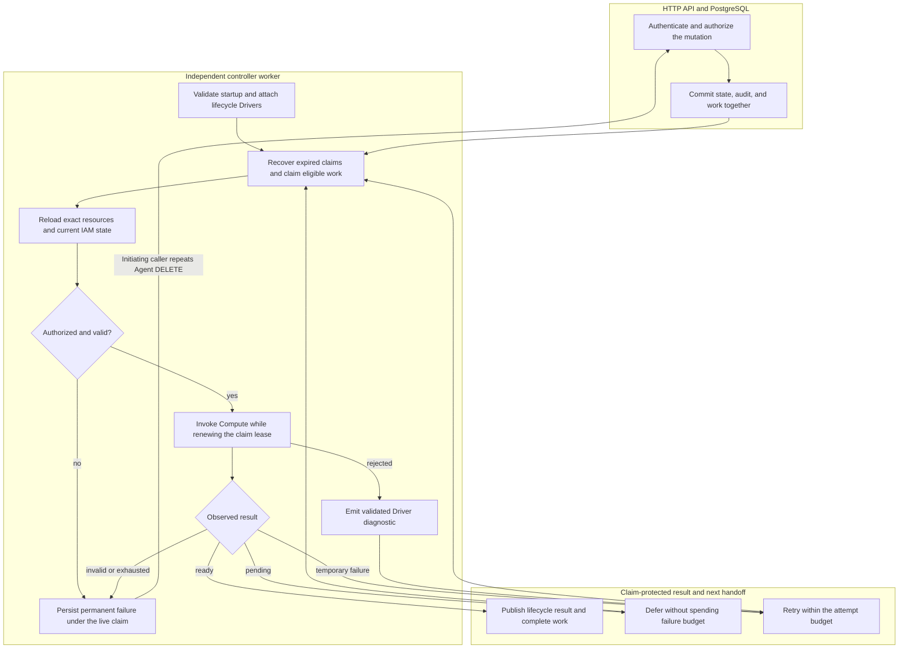

# Controller Worker Flow

## Overview

The worker claims accepted PostgreSQL work, rechecks authorization, calls
Compute, and saves results under its claim for Namespace, Agent
stop/deletion, and Agent revision work. The
[controller reference](../reference/controller.md) owns the contract and the
[deployment guide](../guides/deploy.md) owns process setup.

## Entry Points

- Trigger: Compose or Helm starts `apps/controller/src/worker.mjs`; an
  authenticated API mutation commits Namespace, Agent lifecycle, or Agent revision work.
- Source: `apps/controller/src/worker.mjs:configuration`,
  `apps/controller/src/worker.ts:ControllerWorker.start`, and
  `packages/occ/src/state/postgres-state.ts:operations.append`.
- Assumptions: The initialized database contains the singleton Installation; the
  API and worker share its application role and selected Drivers. Production
  supplies trusted Installation YAML.

## Flow

## Execution Trace

### 1. Initialize the independent worker process

`apps/controller/src/worker.mjs:configuration`,
`apps/controller/src/worker.ts:ControllerWorker.start`

The [entrypoint](../../apps/controller/src/worker.mjs) validates configuration,
removes stale readiness, and constructs `ControllerWorker` with an
application-role pool. Development without `OCC_CONFIG_PATH` preflights Docker;
production requires explicit configuration.

`start()` loads the bootstrapped Installation, validates native IAM, and attaches
selected Configuration, Sandbox, and IAM hooks to Compute. Shared composition
supplies Kubernetes Compute's optional Sandbox Driver. Selected hooks require
`setLifecycleDrivers`; unsupported capabilities stop startup. Every worker runs
available Compute preflight before emitting `worker.started` and entering `run()`.

Metrics scrapes read lifecycle and backlog state through
`packages/occ/src/state/postgres-metrics.ts:PostgresMetricsSnapshot.collect`
without runtime probes; the
[metrics contract](../reference/metrics.md#shared-snapshots-and-outages) owns
connection and outage handling. Transport loss during release rejects the
snapshot; the error listener stays attached until release returns. Metrics
follow finalization independently of logging.

### 2. Save the admission decision and queue the operation

`apps/controller/src/http/agents.ts:createAgentHandlers`,
`packages/occ/src/index.ts:OpenClawController`,
`packages/occ/src/state/postgres-state.ts:operations.append`

Authorized operations call `operations.append`, which verifies exact ownership
and invokes `PostgresWorkQueue.enqueue`. State, admission audit and work commit or roll back
together.

Agent deployment keeps the validated `deploy` request and decision with the
saved version; the API's audit event uses that decision's IAM Driver, principal,
exact Agent target and evidence even if Driver selection changes first, without
reauthorizing or relabeling. Audit
failure rolls back the version, desired runtime state and queued work; an
unknown PostgreSQL commit outcome remains unknown and is not retried.

For work on an Agent revision, the queue records the original actor, Namespace
owner, lifecycle target, Agent ID, and revision ID. Agent lifecycle work identifies its
Agent and `stopped` or `deleted` target without a version. Reusing an idempotency
key with a different actor, owner, or target is rejected. The API returns accepted
state before the worker invokes Compute.

For an already-deleting Agent, `OpenClawController.deleteAgent` leaves active
work unchanged. After terminal failure, `operations.retryFailedAgentDeletion`
checks delete permission and resets only the stopped, deleting Agent's terminal
work, keeping prior audits ([who can retry](../reference/agents.md#deletion)); a
takeover becomes the work's actor, audited as `takeover`, and the worker
reauthorizes normally.
`deleteNamespace` recovers Namespace teardown the same way via
`retryFailedNamespaceDeletion`.

### 3. Recover expired claims and claim one eligible operation

`apps/controller/src/worker.ts:ControllerWorker.run`,
`packages/occ/src/state/postgres-work-queue.ts:PostgresWorkQueue.claim`

Each loop calls `recoverStale()`, one native-exposure sweep step
(`withdrawHarnessExposure` for one listed active-at-start or failed version,
five logged attempts) on idle passes and after every five claimed passes, then
`claim()`. The
[PostgreSQL queue](../../packages/occ/src/state/postgres-work-queue.ts) selects
eligible work with `FOR UPDATE SKIP LOCKED`, assigning claim token, lease
deadline and attempt increment. Another live Agent or Namespace claim
prevents concurrent ownership.

Empty queues wait for the configured delay. After each pass, `health()` queries work,
calls `onHealthy`, and emits `worker.health`; both are required. Serialized
failures emit `HEALTH_UNAVAILABLE`, consuming no retries.

Each pass start and claim renewal calls `onProgress`; the liveness probe
restarts a worker with a stale marker. A client `query_timeout` usually
frees a stuck pass. See
[worker settings](../reference/settings/operations.md#controller-worker-environment).

### 4. Reload ownership and reauthorize before infrastructure effects

`apps/controller/src/worker.ts:ControllerWorker.process`,
`apps/controller/src/worker.ts:ControllerWorker.processRevision`,
`apps/controller/src/worker.ts:ControllerWorker.authorizeRevision`

Namespace work reloads its exact resource and expected `provisioning` or
`deleting` status. Work whose target has already changed completes as
`SUPERSEDED_TARGET`. Otherwise `authorize()` reloads IAM state and checks the
original actor. Provisioning also checks restrictions on the exact Namespace;
placement into an existing Kubernetes namespace requires Installation
administration permission again.

Version work reloads its Namespace, Agent, saved version, and selected version.
`processRevision()` rejects mismatched owners, an unready Namespace, an invalid
Agent Principal, a changed Harness descriptor, or a different Compute Driver.
`authorizeRevision()` rechecks current `deploy` and, for a ServiceAccount
snapshot, `read` on that exact ServiceAccount. Before Compute effects, the worker
rechecks each managed credential's frozen Backend binding without a Backend
client or admin key; the
[Backend-managed credential delivery flow](service-account-driver-credential-delivery.md#5-recheck-metadata-and-project-the-account-secret)
owns these checks.

Revocation and denial fail permanently before the pass prepares a runtime. Older versions
complete as superseded; selected versions enter finalization or maintenance.
When Compute requires stopped predecessors, a newer admission supersedes older
active maintenance before Compute effects, even after candidate failure.
Recovery uses a new version.

Agent-stop work rechecks current exact-Agent `operate`; superseded desired state
completes without shutdown.

Agent-deletion work requires the Agent to remain `deleting` and stopped, then
rechecks the original actor's exact-Agent `delete`. It loads every owned version
and rejects ownership or Compute-Driver mismatches before teardown.

### 5. Invoke Compute while renewing the live claim

`apps/controller/src/worker.ts:ControllerWorker.observe`,
`apps/controller/src/worker.ts:ControllerWorker.observeRevision`,
`apps/controller/src/worker.ts:ControllerWorker.withClaimHeartbeat`

Namespace dispatch calls `ensureNamespace` or `deleteNamespace`. Version
dispatch optionally binds the exact Agent, then calls `prepareRevision` with its
immutable snapshot. A wrong owner or invalid observation fails permanently;
a pending observation defers convergence.

When Compute's `requiresStoppedPredecessors` capability is set,
`apps/controller/src/worker.ts:ControllerWorker.prepareRevision` performs
[exclusive replacement](../reference/drivers/compute.md#production-revision-stages):
it loads earlier snapshots, including failed candidates, closes their credential
sessions, and stops them before preparing the candidate; a release failure
prevents preparation. Their drains yield like a stopped Agent's
(`PREDECESSOR_STOP_YIELDED`); failing, superseded or stopped work first finishes that stop. The
dispatch guard keeps maintenance from recreating a predecessor.

The worker validates Compute's startup plugin warning codes and selection keys
against the immutable version; the
[plugin startup warnings contract](../reference/drivers/compute.md#plugin-startup-warnings)
defines when warnings permit deployment.

Agent-stop dispatch captures and validates the Agent's versions on the current
Compute. It stops the selected version first, then the rest, even without an
active pointer, including terminal candidates and predecessors whose retirement
failed. Other Computes' versions are excluded, but an active one fails closed.
Before each shutdown, the worker rechecks the Agent owner and stopped desired state;
later admissions are not added. Partial failure retries idempotent shutdowns,
keeping the active pointer and retained workspace data. Before the convergence
deadline, a stopped Agent's Gateway drain, here or in version work, yields to due
work (`withYieldingGatewayDrain`) as `AGENT_STOP_YIELDED`, refunding the attempt.
A drain ignores yielded stops; other waits, only stopped Agents'.

Before shutdown or retirement, including stopped-version recovery, the worker
binds the server-owned Namespace and Agent after IAM and exact-resource checks.
Preparation and maintenance recheck `desiredRuntimeState`; a candidate that
overlaps stop is shut down instead of activated.

Agent-deletion dispatch binds the same way, rebuilding Driver-local ownership
after restart, retires every owned version, then invokes the optional Agent
credential-deletion capability. A Driver that can provision
runtime credentials but cannot delete them fails permanently before binding or
retirement. Compute retirement owns workload termination and Sandbox cleanup;
the worker invokes neither independently.

`withClaimHeartbeat()` renews before each effect and every third of the lease
duration, so sequences of short effects cannot starve renewal. Lease loss,
heartbeat failure, or shutdown aborts Compute and raises `WorkClaimLostError`;
expired or replaced claim tokens cannot publish results. An unanswered renewal
(such as on a silent database connection) cannot extend the claim: Compute aborts
when the last confirmed lease, measured from that renewal's send time, runs out,
before another worker could recover the claim; an in-flight request can still
complete. Successful renewals
request throttled health updates without delaying effects or renewal; health
failure does not imply lease loss.

The [Kubernetes implementation](../../apps/controller/src/drivers/compute/kubernetes/index.ts)
and [Docker execution flow](docker-compose-development.md) own infrastructure and
Sandbox dispatch.

When `prepareRevision` rejects, the worker asks Compute for an optional validated
failure description (Kubernetes names the stage and maps only reviewed
classifications, status codes, and messages), emits
`worker.compute-prepare-failed`, and keeps the retry behavior. An unreachable
Sandbox gateway here or in a predecessor stop defers the pass as
`SANDBOX_GATEWAY_UNAVAILABLE`, refunding the attempt, until the deadline fails it
with that code; other work keeps its attempt budget.

### 6. Persist the result and finish version activation

`apps/controller/src/worker.ts:ControllerWorker.finalize`,
`apps/controller/src/worker.ts:ControllerWorker.finalizeRevision`,
`apps/controller/src/worker.ts:ControllerWorker.completeActivatedRevision`

`transactWithQueue()` renews the exact claim before atomically publishing
Namespace readiness or completed deletion, lifecycle evidence and queue completion.
Failed provisioning can transition to failed; incomplete deletion cannot publish
successful deletion.

After preparation, `activationOrder: beforeCommit` activates before the database
pointer changes; otherwise an implemented activation stage runs, in development
and production, after the claim-protected compare-and-set of
`Agent.activeRevisionId`, and the first dedicated version stays inactive until
commit. A changed pointer causes `ACTIVE_REVISION_CHANGED` and retry.

After the pointer commit, the worker finishes activation and retires the
predecessor. In a second transaction, `completeActivatedRevision()` rechecks the
selected version and claim, appends evidence, and completes work. Infrastructure
effects and database state are not atomic. Retried finalization rechecks the
active candidate before effects, so a retained plugin failure cannot become
success after claim loss.

Stop finalization rechecks the live claim, Agent owner, and stopped desired state.
After captured cleanup, it clears `activeRevisionId` only if it still identifies
the stopped version, appends lifecycle-stop evidence, and completes the work
without deleting version rows or persistent runtime state. A later deployment
supersedes the stop even if it retains that pointer while preparing.

After commit, `completeActivatedRevision()` and `finalizeAgentStop()` record
[operation durations](../reference/metrics.md#shared-snapshots-and-outages)
through `apps/controller/src/metrics/index.ts:createOccMetrics`.

Deletion finalization uses a restricted database function instead of generic
queue completion. In one transaction it validates the live claim, records
lifecycle-delete success, and removes the Agent with the records the
[Agent lifecycle reference](../reference/controller/reconciliation.md#agent-lifecycle)
lists. An expired or replaced claim removes nothing; `occ_app` has no direct
table-level delete privilege for these records.
`finalizeAgentDeletion()` records committed `agent_delete` outcomes for the
same metrics contract.

### 7. Defer, retry, or stop and hand off the next iteration

`apps/controller/src/worker.ts:ControllerWorker.finalizeActiveRevision`,
`packages/occ/src/state/postgres-work-queue.ts:PostgresWorkQueue.defer`,
`packages/occ/src/state/postgres-work-queue.ts:PostgresWorkQueue.retry`

Pending convergence refunds the attempt and requeues unready versions on the
cadence in
[pending deployment progress](../reference/agents/deployment.md#pending-deployment-progress),
others with backoff. Compute's `pendingReason` selects the pending code.
`PostgresWorkQueue.defer` appends `reconcile` evidence only when its outcome and
code differ from that work item's latest evidence. `retry` outcomes consume attempts; permanent failure, exhaustion, deadline, or `AUTHENTICATION_FAILED`
terminates work. See [outcomes](../reference/controller.md) and
[timing controls](../reference/settings/operations.md#controller-worker-environment).

Before publishing a permanent refusal (not a held runtime failure, the deadline
or exhausted retries), `ControllerWorker.stopRefusedCandidate` stops, under the
claim heartbeat, an inactive candidate that is exclusive or was prepared with no
selected version, so a rejected deployment never serves. Kubernetes
deletes the Harness before awaiting Gateway Pods; Pod waits yield to due work
(`withYieldingComputeStop`).

An unfinished stop publishes nothing: the work defers as
`REFUSED_CANDIDATE_STOP_PENDING` until the stop succeeds, past the attempt
budget, deadline, in-lease shutdowns and, once recorded, lost claims. The
recheck doubles the readiness cadence per failed (not `stopYielded`) stop in
evidence, up to 5 minutes, but is at least four times the stop's duration.
Each deferral records the refusal (`repeatEvidence`) for deployment status and
`worker.completed`. Later passes retry only that stop, and outages keep waiting,
unless superseded or an authorization or backend refusal lifted (past the
deadline, the stop then publishes `CONVERGENCE_DEADLINE_EXCEEDED`).

`ControllerWorker.processRepositoryCleanup` defers every incomplete pass at the
Driver interval, including closing sessions and failed runtime retirement,
releasing the claim without consuming retries. Obligations survive; lease loss
aborts the pass.

Terminal rows store `reason_code` and optional `result_data`, shaped as the
[terminal results reference](../reference/controller/reconciliation.md#terminal-results)
and [deployment status](../reference/agents.md#deployment-status) define. For
`runtimeFailure`, Compute reads cached startup results from its private status
path, including unready Harnesses without plugins, and verifies runtime
incarnation without repeating the model probe. Missing or invalid evidence
leaves the cause unspecified.

`packages/occ/src/state/controller-work.ts:validateFailureData` validates reads
and writes and rejects data for other failure reasons; the PostgreSQL constraint
enforces the persisted shape.
`PostgresWorkQueue.complete` and `PostgresWorkQueue.fail` publish only under the
live claim; [deployment status](../reference/agents.md#deployment-status) derives
`error` and `warnings` from that result. Completion needs no acknowledgment or
post-commit cleanup; maintenance cannot rewrite deployment warnings.

Indexed `workId` scopes progress to work; maintenance and unbound history cannot
supply it. `getDeploymentStatus` reads
`findWorkAttempt` with the work row in one State snapshot and projects fixed
public explanations. Memory State has no attempt.

Legacy terminal rows derive `reason_code` from matching activation or terminal
reconcile audit evidence, otherwise `LEGACY_OUTCOME_UNKNOWN`, with `NULL` `result_data`.

If Compute declares maintenance, activation schedules observations for this version.
Incomplete observations, Compute bindings, and dependency retries or expired claims
exhausting attempts close the item and schedule another while the version stays
selected and running within its credential deadline; outages never retire it. Each
claim reauthorizes its actor. Successor keys use strictly later time buckets despite clock skew.

`worker.completed` reports the target, outcome, and code; polling continues.
A Namespace pass that observes the same pending state this worker last audited,
such as a terminating namespace, writes no new lifecycle audit or `reconcile` row;
a changed pending state or the terminal pass does.
Lease loss reports `worker.error` `CLAIM_LOST` instead of stale lifecycle state.
On `SIGTERM` or `SIGINT`, shutdown removes readiness, aborts in-flight work,
waits for the loop, closes PostgreSQL, and emits `worker.stopped`.

Each `PostgresWorkQueue.recoverStale()` statement atomically publishes exhausted
work, failure of a still-provisioning Namespace targeted for `ready`, and audit
evidence, so final-attempt crashes cannot strand provisioning. At the limit, one more attempt
goes to a deployment that published its version (`ACTIVE_REVISION_RECOVERY`;
a failed retry keeps the active runtime) or whose predecessor stop yielded
(`PREDECESSOR_STOP_RECOVERY`).

## Debugging and Verification

- `worker.started` names `computeDriverId` and optional `sandboxDriverId`.
  Ready `worker.health` confirms a pending-work query; neither proves a model turn.
- `worker.startup-error` reports invalid mode, database, Installation, Driver
  selection, or preflight before processing. Probes inspect a private readiness
  marker; the worker has no HTTP endpoint.
- For queued operations, compare API and worker database and Installation
  configuration, then inspect `worker.completed` and `worker.error`. Check
  current IAM state for `ACTOR_REVOKED` or `AUTHORIZATION_DENIED`; `DEPENDENCY_UNAVAILABLE`
  retries within `OCC_WORKER_MAX_ATTEMPTS`; `CLAIM_LOST` ends publication ownership. A
  version pass [deferred](../reference/controller/reconciliation.md#deferred-namespace-and-agent-convergence)
  on a dependency logs `dependency` and `cause` (`unreachable`, `timeout` or `unavailable`); other failures log their error class in
  `cause` and, for HTTP errors, `status`.
- `worker.compute-prepare-failed` names the failed Driver stage without the raw
  exception; match its `workId` or `revisionId` to the next `worker.completed`.
- [Version](../../tests/integration/postgres-worker-agent-revision.test.mjs),
  [credential-sources](../../tests/integration/postgres-worker-agent-revision-credential-sources.test.mjs),
  [health](../../tests/integration/postgres-worker-agent-revision-health.test.mjs),
  [replacement](../../tests/integration/postgres-worker-agent-revision-replacement.test.mjs),
  [refused-stop](../../tests/integration/postgres-worker-agent-revision-refused-stop.test.mjs),
  [refused-wait](../../tests/integration/postgres-worker-agent-revision-refused-wait.test.mjs),
  [yielded-redeploy](../../tests/integration/postgres-worker-agent-revision-yielded-redeploy.test.mjs),
  [teardown](../../tests/integration/postgres-worker-agent-revision-teardown.test.mjs),
  [stop](../../tests/integration/postgres-worker-agent-revision-stop.test.mjs) and
  [stale-claim](../../tests/integration/postgres-worker-stale-claim.test.mjs)
  require PostgreSQL; none proves model execution.
- [OCC API](../../tests/integration/occ-api.test.mjs) checks deploy audit attribution
  and append-failure rollback after an IAM Driver change.
- [Sandbox startup](../../tests/integration/sandbox-driver-startup.test.mjs) and
  [k3d](../../tests/integration/sandbox-driver-openshell-k3d-real.test.mjs) tests
  verify composition and infrastructure.

## Related docs

- [Agent repository session preparation and durable cleanup](agent-repository-credentials.md)
- [Backend-managed credential delivery](service-account-driver-credential-delivery.md)
- [Controller settings](../reference/settings.md)
- [IAM authorization](../reference/authorization.md)
- [Production startup flow](production-startup.md)
- [Harness execution topology](harness-execution-topology.md)
- [Compute Driver contract](../reference/drivers/compute.md)
- [Sandbox Driver contract](../reference/drivers/sandbox.md)

## Manual Notes

[keep this for the user to add notes. do not change between edits]

## Changelog

- 2026-10-11 11:30: Predecessor stops yield their Gateway drain. (fix-1090)

[Controller worker documentation history](controller-worker/history.md) preserves the older dated entries.
