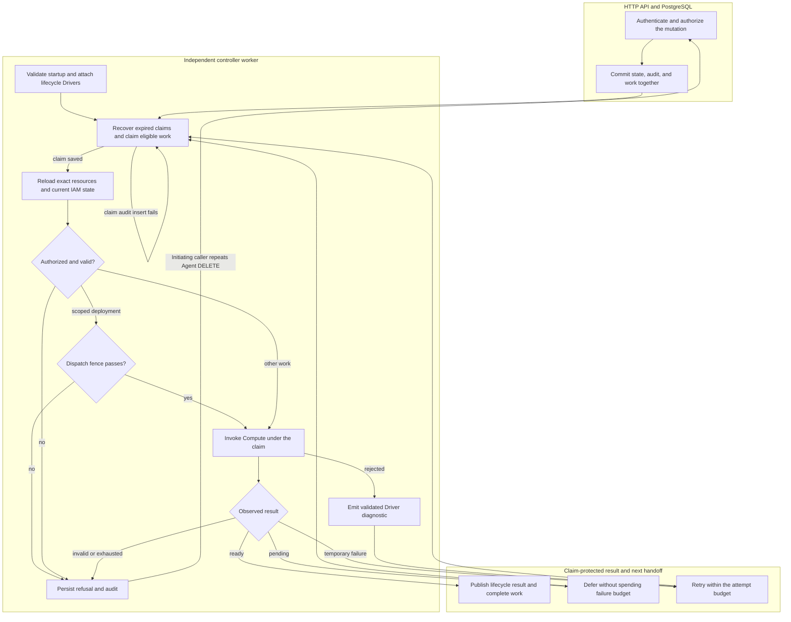

# Controller Worker Flow

## Overview

The worker claims PostgreSQL work, rechecks authorization, calls Compute, and
saves Namespace, Agent stop/deletion, and revision results under its claim.
See the [controller reference](../reference/controller.md) and
[deployment guide](../guides/deploy.md).

## Entry Points

- Trigger: Compose or Helm starts `apps/controller/src/worker.mjs`; an
  authenticated API mutation commits Namespace, Agent lifecycle, or Agent revision work.
- Source: `apps/controller/src/worker.mjs:configuration`,
  `apps/controller/src/worker.ts:ControllerWorker.start`, and
  `packages/occ/src/state/postgres-state.ts:operations.append`.
- Assumptions: The initialized database contains the singleton Installation; the
  API and worker share its application role and selected Drivers. Production
  supplies trusted Installation YAML.

## Flow

## Execution Trace

### 1. Initialize the independent worker process

`apps/controller/src/worker.mjs:configuration`,
`apps/controller/src/worker.ts:ControllerWorker.start`

The [entrypoint](../../apps/controller/src/worker.mjs) validates configuration,
removes stale readiness, and constructs `ControllerWorker` with an
application-role pool. Development without `OCC_CONFIG_PATH` preflights Docker;
production requires explicit configuration.

`start()` loads the Installation, validates IAM, attaches lifecycle hooks, and
preflights Compute before `worker.started`. Unsupported selections stop startup.

`packages/occ/src/state/postgres-metrics.ts:PostgresMetricsSnapshot.collect`
reads lifecycle and backlog metrics without runtime probes. The
[metrics contract](../reference/metrics.md#shared-snapshots-and-outages) defines
connection and outage handling.

### 2. Save the admission decision and queue the operation

`apps/controller/src/http/agents.ts:createAgentHandlers`,
`packages/occ/src/agent-deployment-admission.ts:admitAgentDeployment`,
`packages/occ/src/state/postgres-state.ts:operations.append`

`operations.append` checks ownership, then calls `PostgresWorkQueue.enqueue`.
With audit enabled, the resource change, work, and `controller_work.queued`
commit together. The event links request and work IDs.

Agent deployment keeps the validated `deploy` request and decision with the
saved version; the API's audit event uses that decision's IAM Driver, principal,
exact Agent target and evidence even if Driver selection changes first, without
reauthorizing or relabeling. Audit
failure rolls back the version, desired runtime state and queued work; an
unknown PostgreSQL commit outcome remains unknown and is not retried.

The queue records the actor, owner and target. Revision work also records the
Agent and revision IDs; lifecycle work records the Agent and `stopped` or
`deleted` target. An idempotency key cannot change actor, owner or target. The API
returns before Compute dispatch.

For an already-deleting Agent, `packages/occ/src/agent-termination.ts:deleteAgent` leaves active
work unchanged. After terminal failure, `operations.retryFailedAgentDeletion`
checks delete permission and resets only the stopped, deleting Agent's terminal
work, keeping prior audits ([who can retry](../reference/agents.md#deletion)); a
takeover becomes the work's actor, audited as `takeover`, and the worker
reauthorizes normally.
`deleteNamespace` recovers Namespace teardown the same way via
`retryFailedNamespaceDeletion`.

### 3. Recover expired claims and claim one eligible operation

`apps/controller/src/worker.ts:ControllerWorker.run`,
`packages/occ/src/state/postgres-work-queue.ts:PostgresWorkQueue.claim`

Each pass calls `recoverStale()`. When idle and every five claims,
`withdrawHarnessExposure` sweeps one active-at-start or failed version with
five logged attempts. On shutdown, interrupted claims follow lease recovery.

`FOR UPDATE SKIP LOCKED` protects each claim. With audit enabled, PostgreSQL
saves the claim and `controller_work.claimed` record together. The worker starts
after commit. An insert failure leaves work queued. Each attempt has a new ID,
even when the count repeats. The lease token stays in the queue.

`health()` queries work and emits `worker.health`; `HEALTH_UNAVAILABLE` consumes
no retries. Progress probes track passes and renewals; see
[worker settings](../reference/settings/operations.md#controller-worker-environment).

### 4. Reload ownership and reauthorize before infrastructure effects

`apps/controller/src/worker.ts:ControllerWorker.process`,
`apps/controller/src/worker.ts:ControllerWorker.processRevision`,
`apps/controller/src/worker.ts:ControllerWorker.authorizeRevision`

Namespace work verifies the target is still `provisioning` or `deleting`.
A changed target completes as `SUPERSEDED_TARGET`. Otherwise `authorizeNamespace()`
rechecks the original actor. Provisioning enforces Namespace restrictions.
Placement into an existing Kubernetes namespace requires Installation administration.

Version work reloads its Namespace, Agent, saved version, and selected version.
`processRevision()` rejects mismatched owners, an unready Namespace, an invalid
Agent Principal, a changed Harness descriptor, or a different Compute Driver.
`authorizeRevision()` rechecks current `deploy` and, for a ServiceAccount
snapshot, `read` on that exact ServiceAccount. Before Compute effects, the worker
rechecks each managed credential's frozen Backend binding; the
[Backend-managed credential delivery flow](service-account-driver-credential-delivery.md#5-recheck-metadata-and-project-the-account-secret)
owns these checks.

For a deployment with an explicit [repository network policy](../reference/sandbox-policies.md#repository-network-policy),
including `[]`, the worker also rechecks the original actor’s `read` and `update`
on the exact SandboxPolicy and `manage_policy` on the Agent. It validates stored
execution admission through Compute. A recovered candidate with any unscoped
revision in its history fails as `REPOSITORY_POLICY_HISTORY_INCOMPATIBLE` before
this pass calls the runtime or stops a predecessor. Stop and credential withdrawal retain their
own paths.

Revocation and denial fail permanently. Selected versions enter maintenance or
finalization; older versions become superseded. During
[exclusive replacement](../reference/drivers/compute.md#production-revision-stages),
the [stop boundary](../reference/agents/planned-replacement.md) governs native access
and maintenance. Neither redeploy after explicit Stop nor a new replacement mode
reopens a stopped predecessor. Retargeting refunds the old claim. Superseded inactive
versions stop with `SUPERSEDED_STOP_YIELDED`; deploy again to recover.

Agent-stop work rechecks current exact-Agent `operate`; superseded desired state
completes without shutdown.

Agent-deletion work requires the Agent to remain `deleting` and stopped, then
rechecks the original actor's exact-Agent `delete`. It loads every owned version
and rejects ownership or Compute-Driver mismatches before teardown.

### 5. Invoke Compute while renewing the live claim

`apps/controller/src/worker.ts:ControllerWorker.observeNamespace`,
`apps/controller/src/worker.ts:ControllerWorker.observeRevision`,
`apps/controller/src/worker.ts:ControllerWorker.withClaimHeartbeat`

Namespace dispatch uses `OpenClawController.observeNamespaceLifecycle` and
`packages/occ/src/namespace-lifecycle.ts:reconcileNamespaceLifecycle` for
[ordered, claim-cancelled setup and cleanup](../reference/drivers/namespace-lifecycle.md).
Results join claim-protected audit evidence. Version dispatch can bind the Agent
before passing its snapshot to `prepareRevision`. Invalid observations fail.
Pending observations defer convergence.

`ControllerWorker.withRevisionDispatch` locks IAM configuration, the Namespace
and Agent for scoped binding, preparation and activation. PostgreSQL Read
Committed lets the worker see IAM changes committed during the lock wait. It
rechecks authority and running state, renews the claim, and starts the Driver
call. It awaits the call after releasing the locks. The Driver owns effects the
transaction cannot roll back.

For [exclusive replacement](../reference/drivers/compute.md#production-revision-stages)
(`requiresStoppedPredecessors`), `apps/controller/src/worker.ts:ControllerWorker.prepareRevision`
checks scoped authority under Read Committed before recording the stop under the
live claim. It closes credentials and stops earlier revisions, including failed
candidates, before preparation. `PREDECESSOR_STOP_YIELDED` defers stops. Failing,
superseded and stopped Work must finish them. Maintenance cannot recreate stopped
predecessors.

The worker validates Compute's startup plugin warning codes and selection keys
against the immutable version; the
[plugin startup warnings contract](../reference/drivers/compute.md#plugin-startup-warnings)
defines when warnings permit deployment.

Agent-stop dispatch validates captured versions on the current Compute and stops
the selected version first, then terminal candidates and predecessors. An active
version on another Compute fails closed. Each shutdown rechecks ownership and
stopped desired state. Partial failures retry idempotently, retaining the pointer
and workspace. Before the deadline, Gateway drains yield to due work as
`AGENT_STOP_YIELDED`, refunding the attempt.

Before shutdown or retirement, including stopped-version recovery, the worker
binds the server-owned Namespace and Agent after IAM and exact-resource checks.
Preparation and maintenance recheck `desiredRuntimeState`; a candidate that
overlaps stop is shut down instead of activated.

Agent-deletion dispatch binds the same way, rebuilding Driver-local ownership
after restart, retires every owned version, then invokes the optional Agent
credential-deletion capability. A Driver that can provision
runtime credentials but cannot delete them fails permanently before binding or
retirement. Compute retirement owns workload termination and Sandbox cleanup;
the worker invokes neither independently.

`withClaimHeartbeat()` renews before effects and every third of the lease. Lease
loss, heartbeat failure or shutdown aborts Compute; stale tokens cannot publish.
An unanswered renewal does not extend the lease, although an in-flight request
can still complete. Health updates do not delay renewal; health failure alone
does not mean lease loss.

The [Kubernetes implementation](../../apps/controller/src/drivers/compute/kubernetes/index.ts)
and [Docker execution flow](docker-compose-development.md) own infrastructure and
Sandbox dispatch. Namespace deletion checks Compute eligibility before provider
hooks; an unclaimed external namespace skips those hooks and is retained by Compute.

When `prepareRevision` rejects, the worker asks Compute for an optional validated
failure description (Kubernetes names the stage and maps only reviewed
classifications, status codes, and messages), emits
`worker.compute-prepare-failed`, and keeps the retry behavior. An unreachable
Sandbox gateway here or in a predecessor stop defers the pass as
`SANDBOX_GATEWAY_UNAVAILABLE`, refunding the attempt, until the deadline fails it
with that code; other work keeps its attempt budget.

### 6. Persist the result and finish version activation

`apps/controller/src/worker.ts:ControllerWorker.finalizeNamespace`,
`apps/controller/src/worker.ts:ControllerWorker.finalizeRevision`,
`apps/controller/src/worker.ts:ControllerWorker.completeActivatedRevision`

`transactWithQueue()` renews the exact claim before atomically publishing
Namespace readiness or completed deletion, lifecycle evidence and queue completion.
Failed provisioning can transition to failed; incomplete deletion cannot publish
successful deletion.

After preparation, `activationOrder: beforeCommit` activates before the database
pointer changes; otherwise an implemented activation stage runs, in development
and production, after the claim-protected compare-and-set of
`Agent.activeRevisionId`, and the first dedicated version stays inactive until
commit. A changed pointer causes `ACTIVE_REVISION_CHANGED` and retry.

Committing `Agent.activeRevisionId` records selection. A v5 `online-request` or
v6 `request-hook-observed` hold for Git material leaves the original work queued
until that revision reports ready. The worker then activates it and retires its
predecessor. In a separate transaction, `completeActivatedRevision()` rechecks
selection and claim, appends evidence, and completes work. Retries recheck the
active candidate before effects; claim loss cannot turn plugin failure into success.

`finalizeAgentStop()` checks the claim, Agent owner, and desired state.
It clears `activeRevisionId` only if it points to the stopped version.
A later deployment supersedes the stop even with that pointer. Version
rows and runtime state remain. After commit, successful stops that were
not superseded and successful activations record
[operation durations](../reference/metrics.md#shared-snapshots-and-outages).

`finalizeAgentDeletion()` calls a restricted database function. It validates
the live claim, records success, and removes the Agent and its
[lifecycle records](../reference/controller/reconciliation.md#agent-lifecycle)
in one transaction. The application role cannot delete those records directly.

`settleAgentTeardownAttempt()` writes IAM denials and lifecycle evidence
before it settles Stop outcomes and Delete failures. A Stop that yields
defers without an attempt record.

### 7. Defer, retry, or stop and hand off the next iteration

`apps/controller/src/worker.ts:ControllerWorker.finalizeActiveRevision`,
`packages/occ/src/state/postgres-work-queue.ts:PostgresWorkQueue.defer`,
`packages/occ/src/state/postgres-work-queue.ts:PostgresWorkQueue.retry`

Pending convergence refunds the attempt and requeues unready versions on the
cadence in
[pending deployment progress](../reference/agents/deployment.md#pending-deployment-progress),
others with backoff. Compute's `pendingReason` selects the pending code.
`PostgresWorkQueue.defer` appends `reconcile` evidence only when its outcome or
code changes. `retry` outcomes consume attempts; permanent failure, exhaustion, deadline, or `AUTHENTICATION_FAILED`
terminates work. See [outcomes](../reference/controller.md) and
[timing controls](../reference/settings/operations.md#controller-worker-environment).

`ControllerWorker.readRefusalWait` can mark a scoped candidate untouched only on
its original first claim, with no earlier attempt evidence and no rescheduling.
The worker clears that state before a potential effect. An explicit permanent
admission refusal then records `candidateNotStarted` with the matching terminal
code; a deferred, recovered or already-dispatched claim cannot supply it.

Otherwise, before publishing a permanent refusal (except a held runtime failure,
deadline or exhausted retries), `ControllerWorker.stopRefusedCandidate` stops an
inactive exclusive candidate or one prepared without a selected version. Pod
waits yield to due work.

An unfinished stop defers as `REFUSED_CANDIDATE_STOP_PENDING`, preserving the
refusal across retries, deadlines and recovered claims. Rechecks back off to five
minutes and at least four times the stop duration. Later passes retry the stop
unless superseded or the refusal lifts. If it lifts after the deadline, the stop
then publishes `CONVERGENCE_DEADLINE_EXCEEDED`.

`ControllerWorker.processRepositoryCleanup` defers every incomplete pass at the
Driver interval, including closing sessions and failed runtime retirement,
releasing the claim without consuming retries. Obligations survive; lease loss
aborts the pass.

Terminal rows store `reason_code` and optional `result_data`, shaped as the
[terminal results reference](../reference/controller/reconciliation.md#terminal-results)
and [deployment status](../reference/agents.md#deployment-status) define. For
`runtimeFailure`, Compute reads cached startup results from its private status
path, including unready Harnesses without plugins, and verifies runtime
incarnation without repeating the model probe. Missing or invalid evidence
leaves the cause unspecified.

`packages/occ/src/controller-work-result.ts:validateFailureData` validates reads
and writes and rejects data for other failure reasons; the PostgreSQL constraint
enforces the persisted shape.
`PostgresWorkQueue.complete` and `PostgresWorkQueue.fail` publish only under the
live claim; [deployment status](../reference/agents.md#deployment-status) derives
`error` and `warnings` from that result. Completion needs no acknowledgment or
post-commit cleanup; maintenance cannot rewrite deployment warnings.

`getDeploymentStatus` reads the revision, Agent and work in one authorized snapshot.
Only exact-work attempts supply progress (none in memory). Cleanup checks the
revision’s retirement and session keys, not Git expiry or finite removal.

Legacy terminal rows derive `reason_code` from matching activation or terminal
reconcile audit evidence, otherwise `LEGACY_OUTCOME_UNKNOWN`, with `NULL` `result_data`.

Activation schedules maintenance at the shortest applicable Driver interval.
Each claim reauthorizes its actor. `ControllerWorker.runtimeSuccessor` blocks
repair of a serving predecessor as `SUCCESSOR_EXECUTION_ADMISSION_UNAVAILABLE`
when a scoped successor could have changed execution. A matching terminal
`candidateNotStarted` receipt permits repair unless predecessor stopping has
already begun. Without that proof, the worker does not infer that a failed
successor is harmless. Outages do not retire the serving version.

`worker.completed` reports the target, outcome, and code. On `namespace.ensure`
and `namespace.delete`, it can report a [Kubernetes access hint](../reference/drivers/kubernetes-compute.md#failure-conditions)
from the current pass, outside the Driver observation.
A result links to its claim attempt; repeated pending state can use
`controller_work.deferred` instead of another `reconcile` event. Scoped IAM
refusals append a claim-protected `authorization_denial` event for Agent deploy;
its authorization metadata names the denied action and exact resource, and its
decision reason comes from IAM.
Lease loss reports `worker.error` `CLAIM_LOST` instead of stale lifecycle state.
On `SIGTERM` or `SIGINT`, shutdown aborts in-flight work, waits for the loop,
removes readiness, closes the other parts and then PostgreSQL, and emits `worker.stopped`.

Each `PostgresWorkQueue.recoverStale()` statement atomically publishes exhausted
work, failure of a still-provisioning Namespace targeted for `ready`, and audit
evidence, so final-attempt crashes cannot strand provisioning. At the limit, one more attempt
goes to a deployment that published its version (`ACTIVE_REVISION_RECOVERY`;
a failed retry keeps the active runtime) or whose predecessor stop yielded
(`PREDECESSOR_STOP_RECOVERY`).

## Debugging and Verification

- `worker.started` names the Drivers. Ready `worker.health` confirms a work query.
- `worker.startup-error` reports startup failures. The
  [worker exec probe](../../scripts/production-healthcheck.ts) checks the
  readiness and progress markers.
- For queued work, compare API and worker database and Installation settings.
  Check `worker.completed` and `worker.error`. Check IAM for `ACTOR_REVOKED` or
  `AUTHORIZATION_DENIED`. `DEPENDENCY_UNAVAILABLE` retries within
  `OCC_WORKER_MAX_ATTEMPTS`. `CLAIM_LOST` ends publication rights.
  A [dependency deferral](../reference/controller/reconciliation.md#deferred-namespace-and-agent-convergence)
  logs `dependency` and `cause` (`unreachable`, `timeout` or `unavailable`).
  Other failures log the error class in `cause` and the HTTP `status` when present.
- `worker.compute-prepare-failed` names the failed Driver stage without the raw
  exception; match its `workId` or `revisionId` to the next `worker.completed`.
- [Version](../../tests/integration/postgres-worker-agent-revision.test.mjs),
  [revision lifecycle](../../tests/integration/postgres-worker-agent-revision-lifecycle.test.ts),
  [convergence](../../tests/integration/postgres-worker-agent-revision-convergence.test.ts),
  [credential-sources](../../tests/integration/postgres-worker-agent-revision-credential-sources.test.ts),
  [health](../../tests/integration/postgres-worker-agent-revision-health.test.mjs),
  [replacement](../../tests/integration/postgres-worker-agent-revision-replacement.test.ts),
  [refused-stop](../../tests/integration/postgres-worker-agent-revision-refused-stop.test.ts),
  [refused-wait](../../tests/integration/postgres-worker-agent-revision-refused-wait.test.ts),
  [yielded-redeploy](../../tests/integration/postgres-worker-agent-revision-yielded-redeploy.test.ts),
  [teardown](../../tests/integration/postgres-worker-agent-revision-teardown.test.ts),
  [stop](../../tests/integration/postgres-worker-agent-revision-stop.test.ts),
  [scoped dispatch](../../tests/integration/postgres-worker-agent-revision-dispatch-cases.ts),
  [claim audit](../../tests/integration/postgres-worker-audit.test.ts) and
  [stale-claim](../../tests/integration/postgres-worker-stale-claim.test.ts)
  require PostgreSQL; none proves model execution.
- [OCC API](../../tests/integration/occ-api.test.mjs) checks deploy audit attribution
  and append-failure rollback after an IAM Driver change.
- [Sandbox startup](../../tests/integration/sandbox-driver-startup.test.ts),
  [Installation configuration](../../tests/integration/sandbox-driver-installation-configuration.test.ts)
  and [IPv6 endpoints](../../tests/integration/sandbox-driver-ipv6-endpoints.test.ts)
  check startup. [k3d tests](../../tests/helpers/openshell-sandbox-workflows.mjs)
  check infrastructure.

## Related docs

- [Agent repository session preparation and durable cleanup](agent-repository-credentials.md)
- [Backend-managed credential delivery](service-account-driver-credential-delivery.md)
- [Controller settings](../reference/settings.md)
- [IAM authorization](../reference/authorization.md)
- [Production startup flow](production-startup.md)
- [Harness execution topology](harness-execution-topology.md)
- [Compute Driver contract](../reference/drivers/compute.md)
- [Sandbox Driver contract](../reference/drivers/sandbox.md)

## Manual Notes

[keep this for the user to add notes. do not change between edits]

## Changelog

- 2026-11-22 10:30: Trace shared Agent Stop and Delete settlement. (authoring-run/e04921d4-0e64-4748-963f-ea2bdbee1215 - ac82af3d6e61946fc2a6874eeb39363c9ba8c3f5)
- 2026-11-22 09:29: Trace Read Committed for scoped deployment. (authoring-run/a23751cb-afdb-4ffa-88ca-2294ad51d576 - db0227da135c6bf5e437038ec1fdbbfcc46ba548)
- 2026-11-21 10:28: Trace scoped dispatch admission and recovery in the accompanying change. (authoring-run/3f3abf26-0aec-43e5-aa36-3aa72b38cf4a - a450dc92242a9d2e9f87da7e4fe8f8ea9dcd5e30)
- 2026-11-20 19:04: Refresh sources. (authoring-run/8a8bde8b-71de-4de5-80bf-e32f0e335c34 - 220f62d86ceb3dfc6f66dbee7c6f86cda50e5d05)
- 2026-11-19 14:03: Trace stopped revision cleanup in the accompanying change. (authoring-run/49c681f2-4814-4313-b061-284d2b23891c - 4bfefb4bf60b43dfb2e6fcc010be60270474e726)
- 2026-11-14 12:25: Document the TypeScript worker probe. (authoring-run/1be06605-515e-4261-8b21-d0d796809916 - f0bfd8b1834a7a07fc008fa822fed9035f12ffbe)
- 2026-11-14 10:00: Hint tenant access on delete. (fix-4929)
- 2026-11-12 14:03: Save development claim evidence. (authoring-run/b3f389f0-d5ed-434d-930a-11b1f97eef2d - 8658496ea654b960bebabca40d18c7d71994db50)
- 2026-11-11 01:50: Share the predecessor stop boundary. (authoring-run/01a17edc-73a7-74a3-86e5-aa8c53bfb1b9)

[Controller worker documentation history](controller-worker/history.md) preserves the older dated entries.
