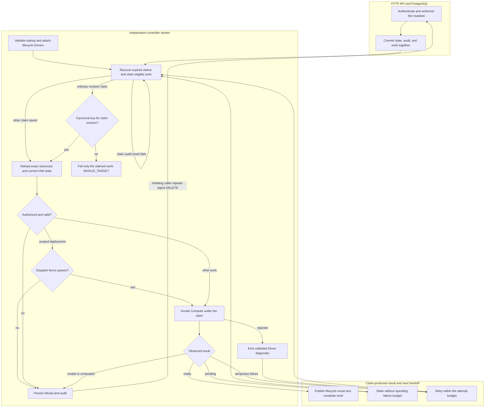

# Controller Worker Flow

## Overview

The worker claims PostgreSQL work, reauthorizes, calls Compute, and saves
claim-protected lifecycle results. See the [controller reference](../reference/controller.md) and [deployment guide](../guides/deploy.md).

## Entry Points

- Trigger: Compose or Helm starts `apps/controller/src/worker.mjs`; an
  authenticated API mutation commits Namespace, Agent lifecycle, or Agent revision work.
- Source: `apps/controller/src/worker.mjs:configuration`,
  `apps/controller/src/worker.ts:ControllerWorker.start`, and
  `packages/occ/src/state/postgres-state.ts:operations.append`.
- Assumptions: The initialized database contains the singleton Installation; the
  API and worker share its application role and selected Drivers. Production
  supplies trusted Installation YAML.

## Flow

## Execution Trace

### 1. Initialize the independent worker process

`apps/controller/src/worker.mjs:configuration`,
`apps/controller/src/worker.ts:ControllerWorker.start`

[The entrypoint](../../apps/controller/src/worker.mjs) validates configuration, clears
readiness, and creates `ControllerWorker` with an application-role pool. Development
without `OCC_CONFIG_PATH` preflights Docker; production requires explicit configuration.

`start()` loads the Installation, validates IAM, attaches lifecycle hooks, and
preflights Compute before `worker.started`. Unsupported selections halt.

`packages/occ/src/state/postgres-metrics.ts:PostgresMetricsSnapshot.collect` reads
lifecycle and backlog metrics without runtime probes. See the [metrics
contract](../reference/metrics.md#shared-snapshots-and-outages) for connection and
outage handling.

### 2. Save the admission decision and queue the operation

`apps/controller/src/http/agents.ts:createAgentHandlers`,
`packages/occ/src/agent-deployment-admission.ts:admitAgentDeployment`,
`packages/occ/src/state/postgres-state.ts:operations.append`

`operations.append` checks ownership and enqueues work through
`PostgresWorkQueue.enqueue`. With audit enabled, resource state, work, and
`controller_work.queued` commit together, linking request and work IDs.

Deployment saves the validated `deploy` request and decision with the version. Audit
uses its IAM Driver, principal, exact Agent, and evidence despite Driver changes,
without reauthorization or relabeling. Audit failure rolls back version, desired state,
and work. An unknown PostgreSQL commit outcome remains unknown; do not retry it.

The queue saves actor, owner, target, and, for revision work, Agent and revision IDs.
Deployment uses `agent_revision:<revisionId>:reconcile`; lifecycle work names the Agent
and `stopped` or `deleted` target. Idempotency keys cannot change actor, owner, or
target. The API returns before dispatch.

For deleting Agents, `packages/occ/src/agent-termination.ts:deleteAgent` preserves
active work. After terminal failure, `operations.retryFailedAgentDeletion` checks delete
permission and resets only terminal work for a stopped, deleting Agent, preserving
audits ([who can retry](../reference/agents.md#deletion)). A takeover becomes the work’s
actor, audited as `takeover`; the worker reauthorizes. `deleteNamespace` similarly uses
`retryFailedNamespaceDeletion`.

### 3. Recover expired claims and claim one eligible operation

`apps/controller/src/worker.ts:ControllerWorker.run`,
`packages/occ/src/state/postgres-work-queue.ts:PostgresWorkQueue.claim`

Each pass calls `recoverStale()`. When idle and every five claims,
`withdrawHarnessExposure` sweeps one active-at-start or failed version with five logged
attempts. Interrupted claims recover through leases.

`FOR UPDATE SKIP LOCKED` protects claims. With audit enabled, claim and
`controller_work.claimed` commit before processing; insert failure leaves work queued.
Attempt IDs remain unique when counts repeat. Lease tokens stay in the queue; retries
and stale recovery retain keys. Maintenance uses
`agent_revision:<revisionId>:maintenance:<bucket>`, with a canonical nonnegative decimal
integer bucket.

`health()` queries work and emits `worker.health`; `HEALTH_UNAVAILABLE` spends no
retries. Probes track passes and renewals; see [worker
settings](../reference/settings/operations.md#controller-worker-environment).

### 4. Reload ownership and reauthorize before infrastructure effects

`apps/controller/src/worker.ts:ControllerWorker.process`,
`apps/controller/src/worker.ts:ControllerWorker.processRevision`,
`apps/controller/src/worker.ts:ControllerWorker.authorizeRevision`

Namespace work requires `provisioning` or `deleting`; changed targets complete as
`SUPERSEDED_TARGET`. `authorizeNamespace()` rechecks the original actor. Provisioning
enforces Namespace restrictions; existing Kubernetes namespace placement requires
Installation administration.

Before revision reads, `ControllerWorker.process` requires the claim revision’s exact
reconcile key or canonical maintenance key. Malformed or mismatched keys fail only
claimed work as `INVALID_TARGET` under the live claim, before reads, IAM, or effects. This publishes no
candidate observation or proof it was untouched.

Version work reloads Namespace, Agent, saved version, and selection. `processRevision()`
rejects owner, Namespace readiness, Agent Principal, Harness descriptor, or Compute
Driver mismatches. `authorizeRevision()` rechecks `deploy` and exact-ServiceAccount
`read` for snapshots. Before Compute, it rechecks frozen managed-credential Backend
bindings; see [Backend-managed credential
delivery](service-account-driver-credential-delivery.md#5-recheck-metadata-and-project-the-account-secret).

Explicit [repository network
policy](../reference/sandbox-policies.md#repository-network-policy), including `[]`,
requires rechecking the original actor’s exact SandboxPolicy `read` and `update`, plus
Agent `manage_policy`. Compute validates stored execution admission. Recovered
candidates with unscoped history fail as `REPOSITORY_POLICY_HISTORY_INCOMPATIBLE` before
runtime calls or predecessor stops. Stop and credential withdrawal remain separate.

Revocation and denial fail permanently. Selected versions enter maintenance or
finalization; older ones are superseded. The [stop
boundary](../reference/agents/planned-replacement.md) governs native access and
maintenance during [exclusive
replacement](../reference/drivers/compute.md#production-revision-stages). Redeploy after
Stop or replacement-mode changes cannot reopen stopped predecessors. Retargeting refunds
the claim. Inactive superseded versions stop with `SUPERSEDED_STOP_YIELDED`; redeploy to
recover.

Agent-stop work rechecks current exact-Agent `operate`; superseded desired state
completes without shutdown.

Agent deletion requires a stopped, `deleting` Agent and the original actor’s current
exact-Agent `delete`. It checks every owned version and rejects ownership or Compute Driver mismatches before
teardown.

### 5. Invoke Compute while renewing the live claim

`apps/controller/src/worker.ts:ControllerWorker.observeNamespace`,
`apps/controller/src/worker.ts:ControllerWorker.observeRevision`,
`apps/controller/src/worker.ts:ControllerWorker.withClaimHeartbeat`

Namespace dispatch uses `OpenClawController.observeNamespaceLifecycle` and
`packages/occ/src/namespace-lifecycle.ts:reconcileNamespaceLifecycle` for [ordered,
claim-cancelled setup and cleanup](../reference/drivers/namespace-lifecycle.md). Results
join claim-protected audit. Version dispatch can bind the Agent before passing its
snapshot to `prepareRevision`; invalid observations fail; pending ones defer.

`ControllerWorker.withRevisionDispatch` locks IAM configuration, Namespace, and Agent
for scoped binding, preparation, and activation. Read Committed exposes IAM changes
committed during lock waits. It rechecks authority and running state, renews, starts the
Driver call, then awaits outside the locks. The transaction cannot roll back Driver
effects.

For [exclusive replacement](../reference/drivers/compute.md#production-revision-stages)
(`requiresStoppedPredecessors`),
`apps/controller/src/worker.ts:ControllerWorker.prepareRevision` checks scoped authority
under Read Committed before recording the stop under the live claim. It closes
credentials and stops earlier revisions, including failed candidates, before
preparation. `PREDECESSOR_STOP_YIELDED` defers stops; failing, superseded, and stopped
work must finish them. Maintenance cannot recreate stopped predecessors.

The worker validates Compute startup plugin warning codes and selection keys against the
immutable version; see [plugin startup
warnings](../reference/drivers/compute.md#plugin-startup-warnings).

Agent-stop dispatch validates captured versions on current Compute, then stops
selection, terminal candidates, and predecessors in order. An active version on another
Compute fails closed. Each shutdown rechecks ownership and stopped desired state.
Partial failures retry idempotently, retaining pointer and workspace. Gateway drains
yield to due work as `AGENT_STOP_YIELDED` before deadline, refunding the attempt.

Before shutdown or retirement, including stopped-version recovery, the worker binds the
server-owned Namespace and Agent after IAM and resource checks. Preparation and
maintenance recheck `desiredRuntimeState`; a candidate overlapping Stop shuts down
instead of activating.

Agent deletion binds likewise to rebuild Driver-local ownership after restart, retires
owned versions, then calls optional Agent credential deletion. Drivers that provision
runtime credentials but cannot delete them fail permanently before binding or
retirement. Compute owns workload termination and Sandbox cleanup.

`withClaimHeartbeat()` renews before effects and every third of the lease. Lease loss,
heartbeat failure, or shutdown aborts Compute; stale tokens cannot publish. Unanswered
renewal does not extend the lease; in-flight requests may complete. Health updates do
not delay renewal; health failure alone is not lease loss.

The [Kubernetes
implementation](../../apps/controller/src/drivers/compute/kubernetes/index.ts) and
[Docker execution flow](docker-compose-development.md) own infrastructure and Sandbox
dispatch. Namespace deletion checks Compute eligibility before provider hooks. Compute
retains unclaimed external namespaces and skips their hooks.

On `prepareRevision` rejection, Compute may supply a validated diagnostic; Kubernetes
names the stage and maps only reviewed classifications, status codes, and messages. The worker emits
`worker.compute-prepare-failed` without changing retries. An unreachable Sandbox gateway
during preparation or predecessor stop defers as `SANDBOX_GATEWAY_UNAVAILABLE`,
refunding attempts until deadline failure with that code. Other work retains its budget.

### 6. Persist the result and finish version activation

`apps/controller/src/worker.ts:ControllerWorker.finalize`,
`apps/controller/src/worker.ts:ControllerWorker.commitRevisionTransition`,
`apps/controller/src/worker.ts:ControllerWorker.finishRevisionTransition`,
`apps/controller/src/worker.ts:ControllerWorker.completeActivatedRevision`

After renewal, one transaction records Namespace readiness or deletion, lifecycle
evidence, and queue completion. Provisioning can fail; deletion succeeds only after
cleanup.

With `activationOrder: beforeCommit`, Compute activates before selection. Otherwise
production deactivates the first dedicated revision before selection. After commit,
production requires activation; development calls it if implemented. Failed
compare-and-set retries as `ACTIVE_REVISION_CHANGED`. The committed result directs
activation, Stop, or reporting.

A v5 `online-request` or v6 `request-hook-observed` hold keeps work queued until
selection is ready. After activation and predecessor retirement,
`completeActivatedRevision()` rechecks claim and selection, appends evidence, and completes
work in a separate transaction. Retries recheck selection before effects; claim loss
prevents completion.

`finalizeAgentStop()` checks claim, owner, and desired state, clearing
`activeRevisionId` only for the stopped version. Later deployment supersedes Stop despite
that pointer. Version rows and runtime state persist. Successful nonsuperseded
stops and activations record [operation
durations](../reference/metrics.md#shared-snapshots-and-outages) after commit.

`finalizeAgentDeletion()` calls a restricted database function that validates the claim,
records success, and removes the Agent and [lifecycle
records](../reference/controller/reconciliation.md#agent-lifecycle) atomically. The
application role cannot delete them directly.

`settleAgentTeardownAttempt()` writes IAM denials and lifecycle evidence before settling
Stop outcomes or Delete failures. Yielded Stop defers without an attempt record.

### 7. Defer, retry, or stop and hand off the next iteration

`apps/controller/src/worker.ts:ControllerWorker.finalizeActiveRevision`,
`packages/occ/src/state/postgres-work-queue.ts:PostgresWorkQueue.defer`,
`packages/occ/src/state/postgres-work-queue.ts:PostgresWorkQueue.retry`

Pending convergence refunds attempts and requeues unready versions on the [deployment
cadence](../reference/agents/deployment.md#pending-deployment-progress); other work
backs off. Compute’s `pendingReason` selects the code. `PostgresWorkQueue.defer` appends
`reconcile` evidence only when outcome or code changes. `retry` consumes attempts;
permanent failure, exhaustion, deadline, or `AUTHENTICATION_FAILED` terminates work. See
[outcomes](../reference/controller.md) and [timing
controls](../reference/settings/operations.md#controller-worker-environment).

`ControllerWorker.readRefusalWait` marks scoped candidates untouched only on their
original first claim, without prior attempt evidence or rescheduling. The worker clears
this before possible effects. Explicit permanent admission refusal records
`candidateNotStarted` with its terminal code; deferred, recovered, or dispatched claims
cannot.

Before publishing other permanent refusals, `ControllerWorker.stopRefusedCandidate`
stops an inactive exclusive candidate or one prepared without selection, except for held
runtime failures, deadlines, or exhausted retries. Pod waits yield to due work.

Unfinished stops defer as `REFUSED_CANDIDATE_STOP_PENDING`, preserving refusal through
retries, deadlines, and recovery. Rechecks back off to five minutes and at least four
stop durations. Passes retry unless superseded or refusal lifts. If it lifts after
deadline, Stop publishes `CONVERGENCE_DEADLINE_EXCEEDED`.

`packages/occ/src/state/postgres-work-queue.ts:transferRepositoryCleanupSql` applies the
same grammar before choosing cleanup ownership or locking Namespace and Agent. Permanent
failure, exhausted retry, or stale recovery can settle invalid ordinary revision work
but cannot transfer cleanup for its owner-tuple revision. Dedicated repository cleanup
and credential withdrawal remain separate.

`settleRepositoryCleanup()` defers incomplete cleanup without spending retries. Closing sessions
retain the Driver interval; other stalled cleanup slows with age. Logs and metrics use
the committed outcome.

Terminal rows store `reason_code` and optional `result_data`; see [terminal
results](../reference/controller/reconciliation.md#terminal-results) and [deployment
status](../reference/agents.md#deployment-status). For `runtimeFailure`, Compute reads
cached private startup results, including unready Harnesses without plugins, and
verifies runtime incarnation without repeating the model probe. Missing or invalid
evidence leaves cause unspecified.

`packages/occ/src/controller-work-result.ts:validateFailureData` validates reads and
writes, rejecting data for other failure reasons; PostgreSQL constrains persisted shape.
`PostgresWorkQueue.complete` and `PostgresWorkQueue.fail` publish only under a live
claim. [Deployment status](../reference/agents.md#deployment-status) derives `error` and
`warnings` from that result. Completion needs no acknowledgment or post-commit cleanup;
maintenance cannot rewrite warnings.

`getDeploymentStatus` reads revision, Agent, and work in one authorized snapshot.
Only exact-work attempts supply progress (none in memory). Cleanup uses revision
retirement and session keys, not Git expiry or finite removal.

Legacy rows derive `reason_code` from matching activation or terminal reconcile audit
evidence, otherwise `LEGACY_OUTCOME_UNKNOWN`, with `NULL` `result_data`.

Activation schedules maintenance at the shortest applicable Driver interval; claims
reauthorize their actors. `ControllerWorker.runtimeSuccessor` blocks serving-predecessor
repair as `SUCCESSOR_EXECUTION_ADMISSION_UNAVAILABLE` if a scoped successor could have changed
execution. Matching terminal `candidateNotStarted` proof permits repair unless
predecessor stopping began. Failed successors are not presumed harmless without proof.
Outages do not retire serving versions.

`worker.completed` reports target, outcome, and code. For `namespace.ensure` and
`namespace.delete`, it can add a current-pass [Kubernetes access
hint](../reference/drivers/kubernetes-compute.md#failure-conditions) outside the Driver
observation. Results link to attempts; repeated pending state can emit
`controller_work.deferred` instead of `reconcile`. Scoped IAM refusals append
claim-protected `authorization_denial` for Agent deploy, naming IAM’s denied action,
exact resource, and reason. Lease loss emits `worker.error` `CLAIM_LOST` instead of
stale lifecycle state. `SIGTERM` or `SIGINT` aborts work, waits for the loop, removes
readiness, closes components then PostgreSQL, and emits `worker.stopped`.

Each `PostgresWorkQueue.recoverStale()` statement atomically publishes exhausted work,
still-provisioning Namespace failure for a `ready` target, and audit evidence,
preventing stranded provisioning after final-attempt crashes. At the limit, one extra
attempt covers a published deployment (`ACTIVE_REVISION_RECOVERY`; failed retry keeps
the active runtime) or yielded predecessor stop (`PREDECESSOR_STOP_RECOVERY`).

## Debugging and Verification

- `worker.started` names Drivers; ready `worker.health` confirms a work query.
- `worker.startup-error`: startup failure; the [worker exec probe](../../scripts/production-healthcheck.ts) checks readiness and progress.
- For queued work, compare API/worker database and Installation settings; inspect
  `worker.completed`, `worker.error`, and IAM for `ACTOR_REVOKED` or
  `AUTHORIZATION_DENIED`. `DEPENDENCY_UNAVAILABLE` retries within
  `OCC_WORKER_MAX_ATTEMPTS`; `CLAIM_LOST` ends publication rights.
  [Dependency deferral](../reference/controller/reconciliation.md#deferred-namespace-and-agent-convergence)
  logs `dependency` and `cause` (`unreachable`, `timeout`, or `unavailable`).
  Other failures: class in `cause`; HTTP `status` if present.
- `worker.compute-prepare-failed` names Driver stage without raw exceptions; match
  `workId`/`revisionId` to `worker.completed`.
- [Version](../../tests/integration/postgres-worker-agent-revision.test.mjs),
  [revision lifecycle](../../tests/integration/postgres-worker-agent-revision-lifecycle.test.ts),
  [convergence](../../tests/integration/postgres-worker-agent-revision-convergence.test.ts),
  [credential-sources](../../tests/integration/postgres-worker-agent-revision-credential-sources.test.ts),
  [health](../../tests/integration/postgres-worker-agent-revision-health.test.mjs),
  [replacement](../../tests/integration/postgres-worker-agent-revision-replacement.test.ts),
  [refused-stop](../../tests/integration/postgres-worker-agent-revision-refused-stop.test.ts),
  [refused-wait](../../tests/integration/postgres-worker-agent-revision-refused-wait.test.ts),
  [yielded-redeploy](../../tests/integration/postgres-worker-agent-revision-yielded-redeploy.test.ts),
  [teardown](../../tests/integration/postgres-worker-agent-revision-teardown.test.ts),
  [stop](../../tests/integration/postgres-worker-agent-revision-stop.test.ts),
  [scoped dispatch](../../tests/integration/postgres-worker-agent-revision-dispatch-cases.ts),
  [claim audit](../../tests/integration/postgres-worker-audit.test.ts) and
  [stale-claim](../../tests/integration/postgres-worker-stale-claim.test.ts)
  require PostgreSQL; none proves model execution.
- [OCC API](../../tests/integration/occ-api.test.mjs) checks deploy audit attribution
  and append-failure rollback after an IAM Driver change.
- [Sandbox startup](../../tests/integration/sandbox-driver-startup.test.ts),
  [Installation configuration](../../tests/integration/sandbox-driver-installation-configuration.test.ts)
  and [IPv6 endpoints](../../tests/integration/sandbox-driver-ipv6-endpoints.test.ts)
  check startup. [k3d tests](../../tests/helpers/openshell-sandbox-workflows.mjs)
  check infrastructure.

## Related docs

- [Agent repository session preparation and durable cleanup](agent-repository-credentials.md)
- [Backend-managed credential delivery](service-account-driver-credential-delivery.md)
- [Controller settings](../reference/settings.md)
- [IAM authorization](../reference/authorization.md)
- [Production startup flow](production-startup.md)
- [Harness execution topology](harness-execution-topology.md)
- [Compute Driver contract](../reference/drivers/compute.md)
- [Sandbox Driver contract](../reference/drivers/sandbox.md)

## Manual Notes

[keep this for the user to add notes. do not change between edits]

## Changelog

- 2026-11-22 20:25: Trace revision work key validation and cleanup transfer in the accompanying change. (authoring-run/f17221b4-d087-4cf1-a8eb-a201b2662720 - 6e87869c03b7db12a22a2ec1b13d9b1fe3e01798)
- 2026-11-22 10:47: Trace repository cleanup settlement and metrics. (authoring-run/18e09cc2-273a-4950-b512-3648f405ac27 - f31e3395fff2f025a36a31e8b7bcca31d5d45938)
- 2026-11-22 10:32: Trace revision finalization through the committed result. (authoring-run/07ab0ce1-dc1f-41fa-99cb-21af375ac8cb - ac82af3d6e61946fc2a6874eeb39363c9ba8c3f5)
- 2026-11-22 10:30: Trace shared Agent Stop and Delete settlement. (authoring-run/e04921d4-0e64-4748-963f-ea2bdbee1215 - ac82af3d6e61946fc2a6874eeb39363c9ba8c3f5)
- 2026-11-22 09:29: Trace Read Committed for scoped deployment. (authoring-run/a23751cb-afdb-4ffa-88ca-2294ad51d576 - db0227da135c6bf5e437038ec1fdbbfcc46ba548)
- 2026-11-21 10:28: Trace scoped dispatch admission and recovery in the accompanying change. (authoring-run/3f3abf26-0aec-43e5-aa36-3aa72b38cf4a - a450dc92242a9d2e9f87da7e4fe8f8ea9dcd5e30)
- 2026-11-20 19:04: Refresh sources. (authoring-run/8a8bde8b-71de-4de5-80bf-e32f0e335c34 - 220f62d86ceb3dfc6f66dbee7c6f86cda50e5d05)
- 2026-11-19 14:03: Trace stopped revision cleanup in the accompanying change. (authoring-run/49c681f2-4814-4313-b061-284d2b23891c - 4bfefb4bf60b43dfb2e6fcc010be60270474e726)
- 2026-11-14 12:25: Document the TypeScript worker probe. (authoring-run/1be06605-515e-4261-8b21-d0d796809916 - f0bfd8b1834a7a07fc008fa822fed9035f12ffbe)
- 2026-11-14 10:00: Hint tenant access on delete. (fix-4929)
- 2026-11-12 14:03: Save development claim evidence. (authoring-run/b3f389f0-d5ed-434d-930a-11b1f97eef2d - 8658496ea654b960bebabca40d18c7d71994db50)
- 2026-11-11 01:50: Share the predecessor stop boundary. (authoring-run/01a17edc-73a7-74a3-86e5-aa8c53bfb1b9)

[Controller worker documentation history](controller-worker/history.md) preserves the older dated entries.
