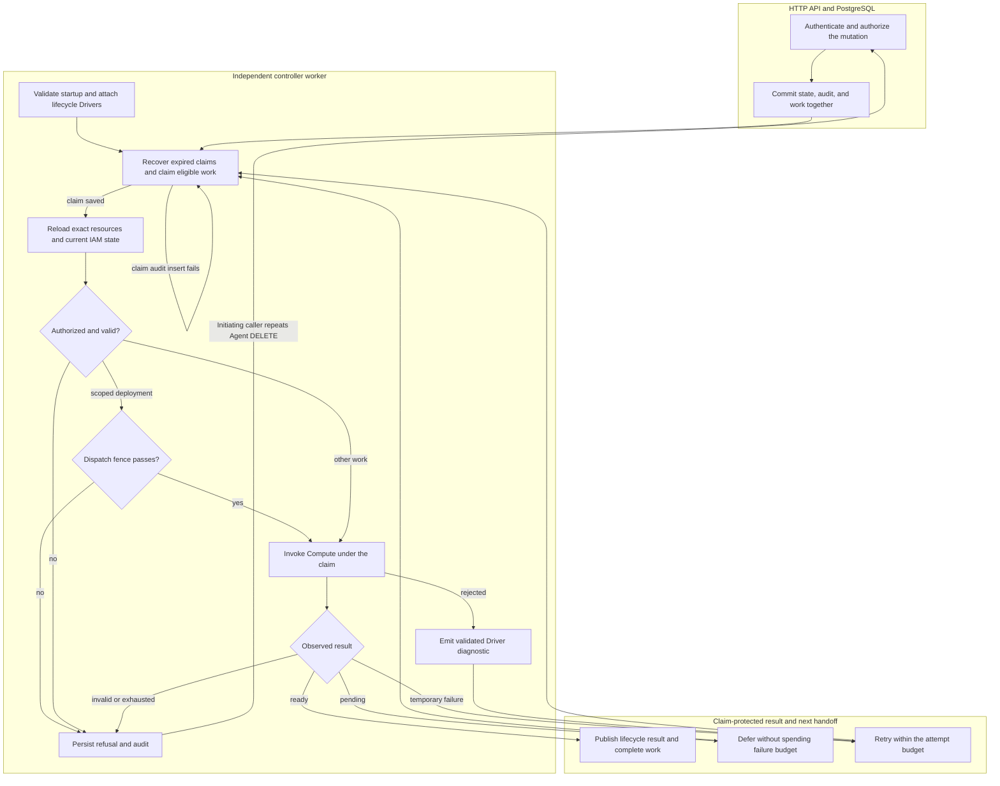

# Controller Worker Flow

## Overview

The worker claims PostgreSQL work, reauthorizes, calls Compute, and saves Namespace, Agent stop/deletion and revision results under the claim.
See the [controller reference](../reference/controller.md) and
[deployment guide](../guides/deploy.md).

## Entry Points

- Trigger: Compose or Helm starts `apps/controller/src/worker.mjs`; an
  authenticated API mutation commits Namespace, Agent lifecycle, or Agent revision work.
- Source: `apps/controller/src/worker.mjs:configuration`,
  `apps/controller/src/worker.ts:ControllerWorker.start`, and
  `packages/occ/src/state/postgres-state.ts:operations.append`.
- Assumptions: The initialized database contains the singleton Installation; the
  API and worker share its application role and selected Drivers. Production
  supplies trusted Installation YAML.

## Flow

## Execution Trace

### 1. Initialize the independent worker process

`apps/controller/src/worker.mjs:configuration`,
`apps/controller/src/worker.ts:ControllerWorker.start`

The [entrypoint](../../apps/controller/src/worker.mjs) validates configuration, clears readiness and creates `ControllerWorker` with an application-role pool. Without `OCC_CONFIG_PATH`, development preflights Docker. Production requires explicit configuration.

`start()` loads the Installation, validates IAM, attaches lifecycle hooks and preflights Compute before `worker.started`. Unsupported selections stop startup.

`packages/occ/src/state/postgres-metrics.ts:PostgresMetricsSnapshot.collect`
reads lifecycle and backlog metrics without runtime probes. The
[metrics contract](../reference/metrics.md#shared-snapshots-and-outages) defines
connection and outage handling.

### 2. Save the admission decision and queue the operation

`apps/controller/src/http/agents.ts:createAgentHandlers`,
`packages/occ/src/agent-deployment-admission.ts:admitAgentDeployment`,
`packages/occ/src/state/postgres-state.ts:operations.append`

`operations.append` checks ownership and calls `PostgresWorkQueue.enqueue`. With audit enabled, resource change, work and `controller_work.queued` commit together with request and work IDs.

Deployment saves the validated request and decision. Audit preserves Driver, principal, exact Agent target and evidence across IAM changes. Audit failure rolls back the version, desired state and work. An unknown commit is not retried.

The queue records actor, owner and target. Revision work adds Agent and revision IDs. Lifecycle work adds the Agent and `stopped` or `deleted` target. Idempotency cannot change actor, owner or target. The API returns before Compute dispatch.

For an already-deleting Agent, `packages/occ/src/agent-termination.ts:deleteAgent` leaves active work unchanged. After terminal failure, `operations.retryFailedAgentDeletion` checks delete permission and resets only that stopped, deleting Agent's work, preserving audits ([who can retry](../reference/agents.md#deletion)). A takeover becomes the actor, audited as `takeover` and reauthorized. `deleteNamespace` uses `retryFailedNamespaceDeletion` for equivalent recovery.

### 3. Recover expired claims and claim one eligible operation

`apps/controller/src/worker.ts:ControllerWorker.run`,
`packages/occ/src/state/postgres-work-queue.ts:PostgresWorkQueue.claim`

Each pass calls `recoverStale()`. Idle passes and every five claims run `withdrawHarnessExposure` on one active-at-start or failed version with five logged attempts. Interrupted claims use lease recovery.

`FOR UPDATE SKIP LOCKED` protects claims. With audit enabled, claim and `controller_work.claimed` commit together before work starts. Insert failure leaves work queued. Attempt IDs change even when counts repeat. The queue retains the lease token.

`health()` queries work and emits `worker.health`. `HEALTH_UNAVAILABLE` costs no retries. Probes track passes and renewals. See [worker settings](../reference/settings/operations.md#controller-worker-environment).

### 4. Reload ownership and reauthorize before infrastructure effects

`apps/controller/src/worker.ts:ControllerWorker.process`,
`apps/controller/src/worker.ts:ControllerWorker.processRevision`,
`apps/controller/src/worker.ts:ControllerWorker.authorizeRevision`

Namespace work completes as `SUPERSEDED_TARGET` unless the target remains `provisioning` or `deleting`. `authorizeNamespace()` rechecks the original actor. Provisioning enforces Namespace restrictions, and existing Kubernetes namespace placement requires Installation administration.

Version work reloads the Namespace, Agent, saved and selected versions. `processRevision()` rejects mismatched owners, an unready Namespace, invalid Agent Principal, changed Harness descriptor, or different Compute Driver. `authorizeRevision()` rechecks current `deploy` and, for a snapshot, `read` on that exact ServiceAccount. Before Compute effects, it rechecks each managed credential's frozen Backend binding per the [Backend-managed credential delivery flow](service-account-driver-credential-delivery.md#5-recheck-metadata-and-project-the-account-secret).

For an explicit [repository network policy](../reference/sandbox-policies.md#repository-network-policy), including `[]`, the worker rechecks the original actor’s `read` and `update` on the exact SandboxPolicy and `manage_policy` on the Agent, then validates stored execution admission through Compute. Any unscoped revision in candidate history fails recovery as `REPOSITORY_POLICY_HISTORY_INCOMPATIBLE` before new dispatch or predecessor stop. Stop and credential withdrawal retain separate paths.

Revocation and denial fail permanently. Selected versions enter maintenance or finalization. Older versions are superseded. During [exclusive replacement](../reference/drivers/compute.md#production-revision-stages), the [stop boundary](../reference/agents/planned-replacement.md) governs native access and maintenance. Redeploy after explicit Stop or a new replacement mode cannot reopen a stopped predecessor. Retargeting refunds the old claim. Superseded inactive versions stop with `SUPERSEDED_STOP_YIELDED`. Deploy again to recover.

Agent-stop work rechecks current exact-Agent `operate`; superseded desired state
completes without shutdown.

Agent deletion requires a stopped, `deleting` Agent, current exact-Agent `delete` for the original actor, and matching ownership and Compute Driver for every owned version.

### 5. Invoke Compute while renewing the live claim

`apps/controller/src/worker.ts:ControllerWorker.observeNamespace`,
`apps/controller/src/worker.ts:ControllerWorker.observeRevision`,
`apps/controller/src/worker.ts:ControllerWorker.withClaimHeartbeat`

`OpenClawController.observeNamespaceLifecycle` and `packages/occ/src/namespace-lifecycle.ts:reconcileNamespaceLifecycle` perform [ordered, claim-cancelled setup and cleanup](../reference/drivers/namespace-lifecycle.md) with claim-protected audit evidence. Version dispatch can bind the Agent before `prepareRevision` receives its snapshot. Invalid observations fail.

`ControllerWorker.withRevisionDispatch` locks IAM configuration, Namespace and Agent for scoped binding, preparation and activation. Read Committed exposes IAM changes committed during the wait. The worker rechecks authority and running state, renews the claim, starts the Driver call, and awaits it after releasing locks. Scoped renewal and new predecessor stops share the commit-time authorization fence, live claim, target identity and claim-window checks. Driver effects cannot be rolled back.

For [exclusive replacement](../reference/drivers/compute.md#production-revision-stages) (`requiresStoppedPredecessors`), `apps/controller/src/worker.ts:ControllerWorker.prepareRevision` checks scoped authority under Read Committed before recording the stop under the live claim. It closes credentials, stops earlier revisions including failed candidates, and rechecks lifecycle and deploy authority before preparation. `PREDECESSOR_STOP_YIELDED` defers stops. Failing, superseded and stopped Work must finish them. Maintenance cannot recreate stopped predecessors.

The worker validates Compute warning codes and selection keys against the immutable version under the [plugin startup warnings contract](../reference/drivers/compute.md#plugin-startup-warnings).

Agent stop validates captured versions on current Compute and stops selected version, terminal candidates and predecessors in order. An active version on another Compute fails closed. Shutdown rechecks ownership and stopped desired state. Partial failures retry idempotently with pointer and workspace retained. Before the deadline, Gateway drains yield to due work as `AGENT_STOP_YIELDED` and refund the attempt.

During an overdue Gateway drain, `ControllerWorker.renewWaitingPredecessor` claims a due [renewal](../reference/agents/planned-replacement.md#bounded-predecessor-completion). Kubernetes Compute suspends only when the Service selects the sole predecessor Gateway Pod and the connected Gateway reports its hostname. Otherwise stopping continues. The worker rechecks deploy authority and Backend binding. PostgreSQL checks claim, revisions, process identity and cutoff.

After candidate access revocation, recovery may finish only the committed stop for the exact predecessor and runtime identity. It cannot start a stop or prepare the candidate. Preparation resolves credentials again, and a newer candidate blocks activation. The drain and convergence clock exclude only that candidate’s time in the original completion window.

Shutdown and retirement, including stopped-version recovery, bind the server-owned Namespace and Agent after IAM and exact-resource checks. Preparation and maintenance recheck `desiredRuntimeState` and shut down a candidate overlapping stop.

Agent deletion binds to rebuild Driver-local ownership after restart, retires owned versions, then invokes optional credential deletion. A Driver unable to delete provisioned credentials fails permanently before binding or retirement. Compute retirement terminates workloads and cleans up Sandboxes.

`withClaimHeartbeat()` renews before effects and every third of the lease. Lease loss, heartbeat failure or shutdown aborts Compute. Stale tokens cannot publish. Unanswered renewal does not extend the lease but may complete. Health updates never delay renewal, and health failure alone is not lease loss.

The [Kubernetes implementation](../../apps/controller/src/drivers/compute/kubernetes/index.ts) and [Docker execution flow](docker-compose-development.md) own infrastructure and Sandbox dispatch. Namespace deletion checks Compute eligibility before provider hooks. Compute retains unclaimed external namespaces without those hooks.

If `prepareRevision` rejects, the worker requests an optional validated Compute failure description, emits `worker.compute-prepare-failed`, and preserves retries. Kubernetes reports stage and reviewed classifications, status codes and messages. Sandbox gateway unreachability during preparation or predecessor stop defers as `SANDBOX_GATEWAY_UNAVAILABLE`, refunding attempts until the deadline fails with that code. Other work keeps its attempt budget.

### 6. Persist the result and finish version activation

`apps/controller/src/worker.ts:ControllerWorker.finalize`,
`apps/controller/src/worker.ts:ControllerWorker.commitRevisionTransition`,
`apps/controller/src/worker.ts:ControllerWorker.finishRevisionTransition`,
`apps/controller/src/worker.ts:ControllerWorker.completeActivatedRevision`

After renewal, one transaction records Namespace readiness, failure or completed deletion, lifecycle evidence and queue completion. Deletion requires completed cleanup.

With `activationOrder: beforeCommit`, Compute activates before selection. Otherwise production deactivates the first dedicated revision before selection, then requires activation after commit. Development calls activation when implemented. Failed compare-and-set retries as `ACTIVE_REVISION_CHANGED`. The committed result selects activation, stop or reporting. Before changing `Agent.activeRevisionId`, the worker checks the serving revision's replacement record under the Agent lock. A later admitted revision defers the prepared revision’s work as `PREDECESSOR_STOP_RETARGETED`. Newer revisions needing no predecessor stop can pass older refusal records.

A v5 `online-request` or v6 `request-hook-observed` hold queues work until the selected revision is ready. The worker activates it, retires its predecessor, then `completeActivatedRevision()` separately rechecks claim and selection, appends evidence and completes work. Retries recheck selection before effects.

`finalizeAgentStop()` checks claim, owner and desired state, clearing `activeRevisionId` only when it points to the stopped version. Later deployment supersedes the stop even then. Version rows and runtime state remain. After commit, successful activations and unsuperseded stops record [operation durations](../reference/metrics.md#shared-snapshots-and-outages).

`finalizeAgentDeletion()` uses a restricted database function to validate the live claim, record success and atomically remove the Agent and [lifecycle records](../reference/controller/reconciliation.md#agent-lifecycle). The application role cannot delete them directly.

`settleAgentTeardownAttempt()` writes IAM denials and lifecycle evidence before settling Stop outcomes and Delete failures. A yielding Stop defers without an attempt record.

### 7. Defer, retry, or stop and hand off the next iteration

`apps/controller/src/worker.ts:ControllerWorker.finalizeActiveRevision`,
`packages/occ/src/state/postgres-work-queue.ts:PostgresWorkQueue.defer`,
`packages/occ/src/state/postgres-work-queue.ts:PostgresWorkQueue.retry`

Pending convergence refunds attempts. Unready versions use Compute's `pendingReason` and [progress cadence](../reference/agents/deployment.md#pending-deployment-progress), while other work backs off. `PostgresWorkQueue.defer` records outcome or code changes. Retries consume attempts. Permanent failure, exhaustion, deadline or `AUTHENTICATION_FAILED` ends work. See [outcomes](../reference/controller.md) and [timing controls](../reference/settings/operations.md#controller-worker-environment).

`ControllerWorker.readRefusalWait` marks a scoped candidate untouched only on its original first claim without prior attempt evidence or rescheduling, clearing that state before potential effects. Only explicit permanent admission refusal records `candidateNotStarted` with the matching terminal code. Deferred, recovered or dispatched claims cannot supply it.

Otherwise, `ControllerWorker.stopRefusedCandidate` stops an inactive exclusive candidate or one prepared without selection before publishing permanent refusal, except for held runtime failure, deadline or exhausted retries. Pod waits yield to due work.

Unfinished stops defer as `REFUSED_CANDIDATE_STOP_PENDING`, preserving refusal across retries, deadlines and recovery. Rechecks back off to five minutes and at least four times the stop duration. They retry unless superseded or refusal lifts. If it lifts after the deadline, the stop publishes `CONVERGENCE_DEADLINE_EXCEEDED`.

`settleRepositoryCleanup()` defers incomplete cleanup without spending retries. Closing sessions keep the Driver interval. Other stalled cleanup slows with age. Logs and metrics use committed outcomes.

Terminal rows store `reason_code` and optional `result_data` per [terminal results](../reference/controller/reconciliation.md#terminal-results) and [deployment status](../reference/agents.md#deployment-status). For `runtimeFailure`, Compute checks runtime incarnation and cached private startup results, including unready Harnesses without plugins, without repeating the model probe. Missing or invalid evidence leaves cause unspecified.

`packages/occ/src/controller-work-result.ts:validateFailureData` validates reads and writes, rejecting data for other failure reasons. PostgreSQL enforces the persisted shape. `PostgresWorkQueue.complete` and `PostgresWorkQueue.fail` publish under the live claim. [Deployment status](../reference/agents.md#deployment-status) derives `error` and `warnings` from that result. Completion needs no acknowledgment or post-commit cleanup. Maintenance cannot rewrite warnings.

`getDeploymentStatus` reads revision, Agent, work and latest exact-work attempt in one authorized State snapshot. Memory omits attempts. `packages/occ/src/deployment-work-status.ts:deploymentProgressForWork` maps `PREDECESSOR_COMPLETION_WAITING` to a fixed explanation. Cleanup checks retirement and session keys, not Git expiry or finite removal.

Legacy rows derive `reason_code` from matching activation or terminal reconcile audit evidence, otherwise `LEGACY_OUTCOME_UNKNOWN`, with `NULL` `result_data`.

Activation schedules maintenance at the shortest applicable Driver interval. Claims reauthorize actors. `ControllerWorker.runtimeSuccessor` blocks serving-predecessor repair as `SUCCESSOR_EXECUTION_ADMISSION_UNAVAILABLE` when a scoped successor could have changed execution. Only a matching terminal `candidateNotStarted` receipt permits repair before predecessor stopping. Failed, pending or ambiguous scoped successors, including empty policies, otherwise remain fenced. An eligible unscoped replacement may continue preparing its predecessor before the stop boundary under the active revision’s authority and withdrawal checks. Outages do not retire the serving version.

`worker.completed` reports target, outcome, code and, for `namespace.ensure` or `namespace.delete`, the current pass’s optional [Kubernetes access hint](../reference/drivers/kubernetes-compute.md#failure-conditions) outside the Driver observation. Results link to claim attempts. Repeated pending state can emit `controller_work.deferred` instead of `reconcile`. Scoped IAM refusals append claim-protected Agent-deploy `authorization_denial` naming denied action, exact resource and IAM reason. Lease loss emits `worker.error` `CLAIM_LOST` instead of stale lifecycle state. `SIGTERM` or `SIGINT` aborts work, awaits the loop, removes readiness, closes other parts then PostgreSQL, and emits `worker.stopped`.

`PostgresWorkQueue.recoverStale()` atomically fails exhausted Work and affected provisioning Namespaces with audit evidence. Published versions and yielded stops get one recovery attempt. Committed planned handoff remains recoverable until the exact predecessor is confirmed stopped. The candidate owns retries, followed by a deploy-permission recheck.

## Debugging and Verification

- `worker.started` names the Drivers. Ready `worker.health` confirms a work query.
- Check `worker.startup-error` and the [worker exec probe](../../scripts/production-healthcheck.ts), which checks readiness and progress markers.
- For queued work, compare API and worker database and Installation settings. Check `worker.completed`, `worker.error`, and IAM for `ACTOR_REVOKED` or `AUTHORIZATION_DENIED`. `DEPENDENCY_UNAVAILABLE` retries within `OCC_WORKER_MAX_ATTEMPTS`. `CLAIM_LOST` ends publication rights. [Dependency deferral](../reference/controller/reconciliation.md#deferred-namespace-and-agent-convergence) logs `dependency` and `cause` (`unreachable`, `timeout` or `unavailable`). Other failures log error class as `cause` and any HTTP `status`.
- `worker.compute-prepare-failed` names the Driver stage without the raw exception. Match `workId` or `revisionId` to the next `worker.completed`.
- [Version](../../tests/integration/postgres-worker-agent-revision.test.mjs),
  [revision lifecycle](../../tests/integration/postgres-worker-agent-revision-lifecycle.test.ts),
  [convergence](../../tests/integration/postgres-worker-agent-revision-convergence.test.ts),
  [credential-sources](../../tests/integration/postgres-worker-agent-revision-credential-sources.test.ts),
  [health](../../tests/integration/postgres-worker-agent-revision-health.test.mjs),
  [replacement](../../tests/integration/postgres-worker-agent-revision-replacement.test.ts),
  [refused-stop](../../tests/integration/postgres-worker-agent-revision-refused-stop.test.ts),
  [refused-wait](../../tests/integration/postgres-worker-agent-revision-refused-wait.test.ts),
  [yielded-redeploy](../../tests/integration/postgres-worker-agent-revision-yielded-redeploy.test.ts),
  [teardown](../../tests/integration/postgres-worker-agent-revision-teardown.test.ts),
  [stop](../../tests/integration/postgres-worker-agent-revision-stop.test.ts),
  [scoped dispatch](../../tests/integration/postgres-worker-agent-revision-dispatch-cases.ts),
  [claim audit](../../tests/integration/postgres-worker-audit.test.ts) and
  [stale-claim](../../tests/integration/postgres-worker-stale-claim.test.ts)
  require PostgreSQL; none proves model execution.
- [OCC API](../../tests/integration/occ-api.test.mjs) checks deploy audit attribution and append-failure rollback across IAM Driver changes.
- [Sandbox startup](../../tests/integration/sandbox-driver-startup.test.ts),
  [Installation configuration](../../tests/integration/sandbox-driver-installation-configuration.test.ts)
  and [IPv6 endpoints](../../tests/integration/sandbox-driver-ipv6-endpoints.test.ts)
  check startup. [k3d tests](../../tests/helpers/openshell-sandbox-workflows.mjs)
  check infrastructure.

## Related docs

- [Agent repository session preparation and durable cleanup](agent-repository-credentials.md)
- [Backend-managed credential delivery](service-account-driver-credential-delivery.md)
- [Controller settings](../reference/settings.md)
- [IAM authorization](../reference/authorization.md)
- [Production startup flow](production-startup.md)
- [Harness execution topology](harness-execution-topology.md)
- [Compute Driver contract](../reference/drivers/compute.md)
- [Sandbox Driver contract](../reference/drivers/sandbox.md)

## Manual Notes

[keep this for the user to add notes. do not change between edits]

## Changelog

- 2026-11-22 10:52: Trace planned replacement alongside shared Stop and Delete settlement. (authoring-run/3f2ad42e-76e0-4b80-949b-491c5b03c4b3 - 52f86d936cd221b85c4d4f19e2fb3dced697c14d)
- 2026-11-22 10:47: Trace repository cleanup settlement and metrics. (authoring-run/18e09cc2-273a-4950-b512-3648f405ac27 - f31e3395fff2f025a36a31e8b7bcca31d5d45938)
- 2026-11-22 10:35: Compose scoped dispatch and planned replacement boundaries. (authoring-run/30461211-1627-4cd1-9cd6-d736484fc7e4 - ac82af3d6e61946fc2a6874eeb39363c9ba8c3f5)
- 2026-11-22 10:32: Trace revision finalization through the committed result. (authoring-run/07ab0ce1-dc1f-41fa-99cb-21af375ac8cb - ac82af3d6e61946fc2a6874eeb39363c9ba8c3f5)
- 2026-11-22 10:30: Trace shared Agent Stop and Delete settlement. (authoring-run/e04921d4-0e64-4748-963f-ea2bdbee1215 - ac82af3d6e61946fc2a6874eeb39363c9ba8c3f5)
- 2026-11-22 09:29: Trace Read Committed for scoped deployment. (authoring-run/a23751cb-afdb-4ffa-88ca-2294ad51d576 - db0227da135c6bf5e437038ec1fdbbfcc46ba548)
- 2026-11-21 10:28: Trace scoped dispatch admission and recovery in the accompanying change. (authoring-run/3f3abf26-0aec-43e5-aa36-3aa72b38cf4a - a450dc92242a9d2e9f87da7e4fe8f8ea9dcd5e30)
- 2026-11-22 07:15: Integrate planned replacement and worker cleanup flow. (authoring-run/97e818cc-1de3-4ece-b418-7f9cebfad013 - c1286e15d8453b5d014dbe3c1b85867181b675b5)
- 2026-11-20 19:04: Refresh sources. (authoring-run/8a8bde8b-71de-4de5-80bf-e32f0e335c34 - 220f62d86ceb3dfc6f66dbee7c6f86cda50e5d05)
- 2026-11-19 14:03: Trace stopped revision cleanup in the accompanying change. (authoring-run/49c681f2-4814-4313-b061-284d2b23891c - 4bfefb4bf60b43dfb2e6fcc010be60270474e726)
- 2026-11-16 19:58: Describe renewal during an overdue Gateway drain. (authoring-run/8226412c-dab2-4991-8e9a-5ecd9677f5d2 - d23297ecc93aad925e3d64c30dd59463f851fcd6)
- 2026-11-14 12:25: Document the TypeScript worker probe. (authoring-run/1be06605-515e-4261-8b21-d0d796809916 - f0bfd8b1834a7a07fc008fa822fed9035f12ffbe)
- 2026-11-14 10:00: Hint tenant access on delete. (fix-4929)
- 2026-11-12 14:03: Save development claim evidence. (authoring-run/b3f389f0-d5ed-434d-930a-11b1f97eef2d - 8658496ea654b960bebabca40d18c7d71994db50)
- 2026-11-13 04:51: Explain the planned replacement wait in deployment progress. (authoring-run/7afadd63-f96a-4c29-bac6-c18615964316 - 8185f9274)

- 2026-11-11 01:50: Share the predecessor stop boundary. (authoring-run/01a17edc-73a7-74a3-86e5-aa8c53bfb1b9)
- 2026-11-10 16:32: Preserve safe partial Namespace teardown. (authoring-run/cc94d782-dafd-44ca-bc46-6d902f4ae4d1 - dde53dee8)

[Controller worker documentation history](controller-worker/history.md) preserves the older dated entries.
