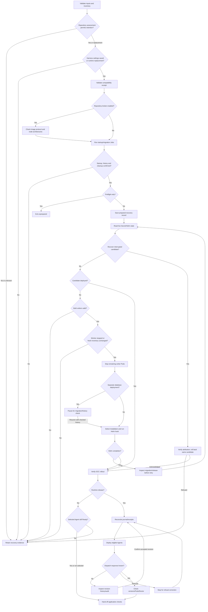

# Production image upgrade flow

## Overview

Upgrades OpenClaw Control Plane (OCC) and Agent runtimes.

## Entry Points

- Run `scripts/upgrade-production-images` with reviewed inputs.
- Required: healthy Helm release with chart-owned initializer, matching OCC/Kubernetes Installation
  IDs and complete authorized inventory without active deployments.
- Source: `scripts/upgrade-production-images`,
  `packages/occ/src/index.ts:OpenClawController.getInstallationDeploymentInventory`,
  and `packages/occ/src/index.ts:OpenClawController.deployAgent`.

## Flow

## Execution Trace

### 1. Prepare the candidate

`scripts/upgrade-production-images:prepare_upgrade`

Reject nonempty [Helm target/TLS overrides](../guides/deploy/production-upgrade.md),
mismatched `HEAD`/`--source-revision`, chart edits/symlinks and internal evidence/baseline
aliases before access. Other edits/image provenance are unchecked.

`yq -r` tests for nonempty `preprovisionedNamespace`. Continue on success
with one `false`; otherwise refuse before access (`preprovisioned-namespace.err`).

Resume locks evidence paths/devices/inodes/aliases and runtime dispatch journals.

`matches_yaml` compares [baseline](../guides/deploy/upgrade-baseline.md#record-the-release-and-its-configuration)/live mappings and validates candidates.
Invalid inputs/unwritable evidence cause `Cannot compare upgrade YAML`.
Projections/`cmp` permit Slack directory proxy, curated Codex PluginDriver selection
and array-wrapping one registration.
Removing any `agentNativeAdmin.sharedCookieDomain` affects only baseline projection;
live comparison stays exact. Immutable reference switches require string keys.
Startup validates controllers; broker checks only references.

`read_restart_inventory` validates complete authorized inventory ownership, IDs and selection states. Retained running revisions require accepted
[restart disposition](../reference/repository-credentials/worker-replacement.md).
Controller-only `occ agent revision AGENT_ID REVISION_ID` requires one owned
revision with object-valued Harness settings; retain IDs and validation outcome.
Drafts cannot substitute. Runtime upgrades record replacements; draft validation requires image
support/size compliance. Quiescence is nonatomic; repository continuity is unverified.

`OpenClawController.deploymentInventorySnapshot` uses `findRevisionForBrowsing`:
unreadable snapshots yield `unknown`; database/identity errors propagate. `getInstallationDeploymentInventory` invokes Compute outside State
transactions under one ten-second budget, then rechecks authorized fleet/Driver
selections. Changes refuse; owner failures yield `unknown`.

Refuse nonterminal deployments. Runtime upgrades require baseline versions/ready Namespaces. Exclude stopped/deleting
Agents; allow pending repository cleanup.

`prepare_upgrade` copies PostgreSQL's `run` result. Before preflight,
`validate_controller_compatibility` calls `scripts/upgrade-evidence.py:validate_compatibility`
to check runner/file consistency, data/IAM success, cleanup and both image digests.
Hashes bind resume, not authenticity or image source.
This permits neither online migration nor rollback; see [qualification limits](../guides/deploy/production-upgrade.md#upgrade-the-control-plane).

`verify_agent_continuity` requires Agent read/operate, active AgentRevision read
and runtime inspection. Agent reads bracket explicit-revision runtime reads,
freezing identity and Driver-declared roles in `agent-continuity.json`, not editable topology.

Repository-enabled releases require immutable controller/broker images and one
architecture across matching control-plane nodes, including unready/cordoned ones. `scripts/upgrade-image-identity.py:read_platform`
verifies the selected platform and blob hashes from Docker OCI exports
(2 MiB/blob, 32 MiB total metadata).
`scripts/upgrade-repository-image-probe.mjs` tests both images
for recovery and refused reservations with synthetic inputs/private receipt listener,
recording image identities, requests and responses.
Kubernetes image availability, receipt durability and disposal remain unverified; the broker hostname stays fixed. See [broker restart recovery](../guides/repository-credentials/installation.md#install-and-verify).

For immutable switches, `prepare_upgrade` validates identities, unrelated data and
candidate YAML, then hashes staged bytes; `upgrade-evidence.py` binds both snapshots.
Changed immutable data requires a successor. Mutable changes require a Kubernetes
self-review of named-Secret update access: denial stops preparation; inconclusive
review warns and continues. Replacement still requires update permission.
Rendered Certificates require server-side dry-run admission.
`scripts/upgrade-startup-preflight.mjs` copies controller images, environment,
mounts and service accounts into single-Pod Jobs: candidate Secret, no retries,
deadline. `preflight_startup` refuses changed UIDs or multiple children.
Job failure overrides child success.

`scripts/migrate-production.mjs --check` uses the initializer's migration container,
environment, mounts and Pod identity before preflight success or shutdown.
`scripts/migration-history.mjs:migrateWithHistory` checks receipts/catalog/grants under
lock without applying migrations. Pending canonical history is allowed. Helm rechecks.

API `apps/controller/src/composition/console-theme.ts:loadConsoleTheme` rejects invalid
bundles; workers skip themes. Both use `loadStartupConfigurationSnapshot` and
`loadInstallationConfiguration` without database access.
`apps/controller/src/startup-failure.ts:formatStartupConfigurationFailure` filters
typed refusals to up to 32 field diagnostics. Preflight checks Job/Pod identity around log retrieval, rejects NUL bytes and
discards unbound output. kubectl diagnostics stay separate from container logs.

Kubernetes Compute `preflight` uses startup's Pod credentials (`inCluster` service account). It refuses
[split-layout Gateway storage](../reference/drivers/kubernetes-compute.md#existing-split-layout-installations)
on single-cluster upgrades.
The image's `isName` validates `occ installation get` names
(`INSTALLATION_NAME_INVALID`); older images skip this.

Runtime preflight calls `resolveConfiguredHarnessId` then
`refuseUndeployableConfigurationValues` on recorded drafts. Refusals leave old
writers serving: correct drafts, stop affected Agents or replace incompatible
images before retrying with fresh evidence. Older images or gzipped inputs over
1 MiB warn and defer validation. Deploy checks live Harness state.

Experimental two-cluster Pods also run
`KubernetesComputeDriver.verifyExecutionTenantGrants` for their component; startup
does not. For Pod identities holding release-era execution-tenant grants,
SelfSubjectAccessReviews ask for newer `openclaw-execution` rules: API Pod and `pods/proxy` reads, plus `pods/log` and Event reads with runtime
logs; worker Pod `patch` and `batch` Job `get`, `create`,
and `delete`. Worker Job grants are required even with runtime logs disabled.
A missing rule refuses the candidate and points to
[upgrading the execution chart](../testing/kubernetes.md#upgrade-the-execution-chart).

Startup Jobs retain default-deny labels and a copy of
`openclaw-enterprise-dependency-egress`, including execution-cluster API rules.
Controller ownership addresses EKS's standalone-Pod limitation; verify enforcement.

Initial preflight failures leave writers serving.
Create errors: `preflight-<resource>-create.err`. `cleanup_preflight` requests
UID-guarded foreground deletion, waiting up to 30 seconds per Job for it and all
UID-selected/recorded children to disappear before deleting original Secret/policy UIDs.
Ambiguous creates or unconfirmed consumer cleanup retain dependencies and refuse progress;
replacements remain untouched. Reconcile `preflight-cleanup.err` before retrying.

Reference switches recheck Secrets after cleanup.
`--preflight-only` leaves writers serving with non-resumable evidence.
Preparation locks candidates, inventory and target/parameter hashes. `scripts/upgrade-production-images:interrupted_upgrade`
retains the lock and skips cleanup on `SIGHUP`, `SIGINT`, or `SIGTERM`.
Before unlocking, confirm termination and reconcile accepted operations/resources.
Freeze writers, autoscalers, Helm changes and drafts per the [production guide](../guides/deploy/production-upgrade.md).

### 2. Reconcile a prior attempt

Resume binds prepared inputs, directory, source and cluster, requalifies images,
and rejects changed eligible nodes.
Values must match baseline, candidate or the recorded predecessor and revision.
Resume checks immutable intent, Secret identity and unrelated data. `verify_installation_switch`
rechecks both immutable Secrets' UIDs/data. Pending Installation writes require a mutable Secret before scaling. Retries require
migration-history review and terminal initializer Jobs/Pods. `new_attempt` fsyncs
attempt-directory ancestors before publishing pointers.
Before further quiescence, resume rechecks migrations in `migration-preflight-resume.*`;
failure leaves stopped writers stopped. Reconcile unknown creates before same-directory
`--resume`, retaining lock/evidence/journal. The original process handles signals;
ordinary failures attempt cleanup.
Ordinary resume skips Helm only at the exact submitted deployed revision.

For [same-candidate recovery](../guides/deploy/production-helm-recovery.md),
`scripts/upgrade-helm-state.py:recover` checks Helm payload, ownership, completed
Job/Pod and exact security contexts. `pod_matches` compares requests/limits through
Compute's `resource-quantities.ts`. Reads use manifest namespaces and release
ownership. Durable exclusive intent precedes identity rechecks and hooked rollback.
`require_absent` rejects remaining predecessor-only resources before intent,
before rollback, after rollback and on resume. `verify_workload_changes` requires
retired environment entries and container placements absent before rollback; afterward all changed selections must
match. Neither check deletes resources. Changed nonnative resource specs require exact
candidate matches. Resume rechecks recorded UIDs without pinning old versions.
Supports only pre-upgrade hooks. Resume requires successor acknowledgement.
Client shutdown, exclusive ownership, resource reconciliation and database history
remain operator attestations.

### 3. Quiesce writers and run the candidate release

`scripts/upgrade-production-images:quiescence_remaining` bounds shutdown.
Validate both Deployments. While the worker runs, compare the complete inventory
with preparation before either stop, including resume; changes refuse. Restore
a stopped API’s access under exclusive maintenance ownership before retry. Skip
stopped writers; stopped workers have no prospective guarantee. Sequential JSON
patches test UID, resource version and replicas; conflicts can leave the API stopped.
Pods must disappear and original Deployments remain at zero. Operators stop other
writers/autoscalers and keep nodes reachable. With `database.upgradeMigration: separate`,
the helper records stopped Deployment UIDs and generations, then exits 3. Resume requires
those same stopped writers and checked history.

Protected files adopt candidates atomically. Mutable Secret updates preserve
unrelated data with a resource-version precondition; reference switches leave both
Secrets unchanged. Both OCC templates select successor and checksum.

`upgrade-helm-state.py:new_attempt` renders and dry-runs immutable values with a
fresh `installation.upgradeAttemptId`, copied to hooks and the initializer Pod.
`record_submission` saves intent and predecessor before publishing `helm-started`.
Identical interrupted staging can finish; staged retries cannot replace published
intent. In separate mode,
`scripts/migration-history.mjs:migrateWithHistory` verifies the completed candidate
ledger, catalog and grants under the migration lock. Pending or unsupported history
fails the hook. Hook mode applies pending SQL.

### 4. Verify control-plane recovery

`scripts/upgrade-helm-state.py:verify_installation_consumers`

Verify images, replicas and changed Installation checksums.
Reference switches verify both Secret identities and actual Installation mounts in
controllers and the owned initializer Pod. Each component needs one named container.
Broker-enabled workers permit restartable init containers; other placements fail. Authenticated OCC
access is retried and must return the same Installation ID.
Worker preparation re-renders current launch requirements.
Repository-bound Agents receive maintenance every 30 seconds until their session
deadline; other Agents are re-prepared if deployment remains unfinished.
Kubernetes Compute rolls changed Gateway and Harness Pod templates even with
unchanged runtime images. Chat waits for readiness.
OpenShell instead requires exact existing Sandbox content
(`apps/controller/src/drivers/sandbox/openshell.ts:verifyExistingSandbox`).
Generated-command changes require a fresh Agent revision; controller-only reuse
cannot adopt them. See the
[upgrade guide](../guides/deploy/production-upgrade.md#prepare-the-release).
Other Agents receive Pod configuration/[diagnostics](agent-deployment-diagnostics.md) fixes on preparation or deployment.

Repository-enabled releases verify Ready API/worker Pods, owning ReplicaSets,
node architecture and runtime image IDs against the qualified pair. The Driver
checks broker admission without a session. Pod identities must remain stable
through that check, dispatch and completion.

### 5. Deploy and verify the recorded fleet

`scripts/upgrade-production-images:confirmed_deployment_status` and
`scripts/upgrade-dispatch-state.py:transition`

Flush intent before dispatch; unresolved intents block sends.
The journal retains accepted revisions, definite refusals and superseded receipts.
Resume may retry refusals; replacements must name the current failed revision.
Unknown outcomes or stale journals require
[recovery](../guides/deploy/production-upgrade-recovery.md).

Verify authorized deployment status, version and Pod readiness on the candidate digest. Before startup, `openClawStateMigrationHelper` in
`runtime-startup.ts` runs `openclaw doctor --fix --non-interactive` for older schemas.
Current schemas and Doctor's settled result gate startup: maintenance or cleanup
refusal holds `state-migration` unready; ordinary warnings do not. A private pending
marker forces interrupted or refused maintenance to retry after restart, even with current schemas. The same step
runs before Harness native setup or native-worker connection. Embedded execution
requires one runtime container; dedicated execution requires Gateway and Agent containers.
Replacement gateways run read-only `openclaw doctor --lint --json --severity-min error`
serially, with a heap cap (`--doctor-heap-mib`, default 384 MiB). Doctor shares the gateway's memory limit;
an OOM kill can stop both. The cgroup v2 check (`gateway_free_memory`) requires
one reading with cap plus 640 MiB free or two consecutive readings with cap plus
256 MiB. This reserves no memory. Transient failures are retried.
Initially unavailable data allows warning and run.
After insufficient memory, unavailable reads reset consecutive evidence; only fresh
sufficient readings admit Doctor before its deadline.
Reports distinguish Doctor's exit status from gateway restarts since Ready.
Missing/incomparable counts or Pod identities report unknown; only a comparable
increase with last termination `OOMKilled` establishes OOM. A memory timeout
starts no further Doctor. Then, also after a failed Doctor, `revision_pod_change_since_ready`
fails the upgrade for any revision Pod the wait required (gateway or dedicated agent)
missing, replaced, restarted, or unready; the readiness wait ignores ended Pods, so
resume checks the replacement.

### 6. Hand off application verification

`docs/guides/deploy/production-upgrade.md:Verify the release`

Completion requires the expected Helm revision and OCC access; runtime upgrades
also require deployment, readiness and Doctor success.
For selected-Agent checks, `verify_agent_continuity` precedes terminal controller/Helm checks.
Each role needs one Running, Ready Pod; replacement UIDs/completed init containers are valid. Eight results hit the endpoint cap and cannot prove uniqueness.
Previously observed provider Harness status must remain running. Failure retains
observations without `completed`; resume rechecks without rerunning successful Helm.

`completed` refuses resume; its absence proves nothing. Reconcile failed writes.
Verify routing, models, channels, credentials, workspaces and restores. Check console publication with [`verifyConsoleRelease`](../release/container-promotion.md#verify-the-served-console).

### Read-only export after a split-layout refusal

[Split-layout export](../guides/deploy/split-layout-upgrade.md#export-and-re-create)
uses `scripts/split-layout-tenants.ts:createOccApi.expect` to reject malformed JSON,
empty bodies and missing envelopes. Empty collections, 204 deletes and explicitly
accepted 404s remain valid.

`importTenants` resolves unsaved targets by name, rejecting shared destinations
before mutation. Saved IDs remain reserved for skipped sources; unsaved skips
reserve nothing. Correct, rename or skip conflicting mappings. Resume preserves
prior merges. Rename keys, including `constructor` and `__proto__`, are literal.
Unsaved exact-name reuse requires no Agents or Secrets.

## Debugging and Verification

- Read `helm-attempts/<UUID>/{render-error.log,server-dry-run-error.log}` for native
  preparation failures; `server-dry-run.txt` retains successful output. Inspect
  `preflight-<api|worker|migration>.log`, `-logs.err` and `-status.json` for rejected candidates;
  use the current `migration-preflight-resume.*` directory on resume.
- Inspect `native-command-failures.tsv` for scale, Helm upgrade or rollout failures; see [upgrade recovery](../guides/deploy/production-upgrade-recovery.md).
- For runtime failures, inspect `dispatch/*.error`, `dispatch/*.rejected`,
  version history, and `status/*.json`. Doctor failures: `status/*.doctor.json` and `status/*.doctor.error`.
- Compare `before-workloads.json` and `after-workloads.json`: controller-only releases
  roll affected Agents' same-image Pod templates once. Separately check broker-affected
  repository versions.
- End-to-end proof requires credentialed production Kubernetes with distinct images;
  command fixtures prove control flow.

## Related docs

- [Production upgrade guide](../guides/deploy/production-upgrade.md)
- [Production installation](../guides/deploy/production-installation.md)
- [Production Agent verification](../guides/deploy/production-agents.md)
- [Agent deployment reference](../reference/agents/deployment.md)
- [Production startup flow](production-startup.md)
- [Controller worker flow](controller-worker.md)
- [Authoritative platform design](../design.md)

## Manual Notes

[keep this for the user to add notes. do not change between edits]

## Changelog

- 2026-11-10 12:41: Validate the preprovisioned Namespace boolean before access. (authoring-run/f66b42c3-90f1-4ca7-9805-a68727232c1e - 9c59ab71b8dfe3ea2816e3cee25182aeb4bcf172)

- 2026-11-10 12:09: Clarify resume refusal and retained diagnostics. (authoring-run/fa6778fc-83cb-4f82-8f90-4085873cf49b - d2d12783a23e1c06c27f3f932faa09ffb2f59110)

- 2026-11-10 11:26: Check candidate migration history before writer shutdown. (authoring-run/50fc84bd-0fe3-4009-ba19-6703902571c7 - 5f649b35692c1508678ce6e2bc4db1603df1654b)

- 2026-11-10 08:20: Classify unreadable snapshots. (authoring-run/f2adfad8-a3ec-4d5a-a92c-96e12e671ed8 - 6665c7f7e3c8ef13f8d7eb8962749840ff82f6c5)

- 2026-11-10 07:56: Merge restart and migration checks. (authoring-run/38bf80b2-72d7-4de5-8ae3-6f161a5a5296 - 71d4ad6cdb9587a86c46c64c661a9009d413e51f)

- 2026-11-10 05:12: Validate inventory; minimize evidence. (authoring-run/385b41d3-8e61-4539-b226-412dd1b2615d - 7230b1a2a177aa8b413cdd2d3847cd4be0ac644e)

- 2026-11-09 23:49: Separate database deployment from service replacement under writer quiescence. (authoring-run/7af6f256-ebf7-4a66-8e78-6a769781d94f - ef18e491453481577c607a4c78574cbbce594263)

- 2026-11-09 09:16: Integrate active-revision checks with immutable-Secret recovery. (authoring-run/1792e6e8-4956-4d95-a080-5a724a78db2a - 6f1ea7b9d13b8d8ecd20c6128d5d906810d94f7b)

- 2026-11-09 07:05: Check named Secret update access before quiescence. (authoring-run/f98ccc9d-c174-4103-a385-d4d24950e54d - 09fe300b1ede4b59741b527a3b45199b435d7d6c)

- 2026-11-09 05:02: Bind staged immutable Installation references through upgrade recovery. (authoring-run/cfc73629-f188-4fd0-8ff4-f3b3fbf6843f - 3b898fdc4a27c5cfcc6cbeb7196d96b02368da8b)

- 2026-11-09 03:26: Check immutable Installation Secrets before stopping writers. (authoring-run/8664c38b-fe94-43f6-8922-8aa139b809e6 - ce1d22e17a)
- 2026-11-08 17:01: Integrate saved Harness preflight with attributed Helm recovery. (authoring-run/6d8fd0f0-41d7-4b04-96e3-1b3dc7b9bd1e - 6865e4de0d11ef5ce65d0d39a34cec157e8b7e9a)

- 2026-11-08 15:25: Refuse unreconciled resources, environment entries and container placements during recovery. (authoring-run/453b61bd-c21e-4f98-a7a8-3fdfbb549103 - d4333fb16c)

- 2026-11-08 15:13: Integrate attributed recovery with current upgrade safeguards. (authoring-run/0e1589f2-ec9d-455e-bd57-8c7c7eac4f41 - 0447571733)

- 2026-11-08 12:18: Reject Helm target overrides. (authoring-run/cd7fae84-40fe-4d7a-bfe0-aff970e961db - 4566d20b8ef66a3268e27bceac946765ecd5d336)

- 2026-11-07 08:18: Require single-document responses. (authoring-run/f5d332f5-a699-45b8-82ec-07b982cab516 - 0aa6334cace7c272c3b1eb69e456292a068a2c1a)

- 2026-11-07 08:06: Assess repository worker replacement before stopping writers. (authoring-run/dc361ab2-8dc2-4ed3-872d-220eb9cce3c1 - d84756d04bec6aa6499364548cd21a07bbbc86d7)

- 2026-11-07 07:39: Check exact active Harness snapshots before controller-only upgrades. (authoring-run/dd27d6b9-6dec-4ba5-bc83-d3595d72273d - e658fa14b627fc6d55c8d67a68f5668efc27397c)

- 2026-11-07 03:01: Freeze reviewed controller compatibility evidence. (authoring-run/4adaf10b-d7e7-46e1-8f30-65993c797458 - ada47832cb112f255f6c51d34dae37acce9760cd)

- 2026-11-07 02:48: Verify selected Agent readiness before completion. (authoring-run/87bf103a-4285-4561-8ab8-6a9f1e265248 - ada47832cb112f255f6c51d34dae37acce9760cd)

- 2026-11-07 02:27: Validate both writers before stopping either. (authoring-run/a2f2f4b1-8e0e-4f19-8ce3-11d6e118a054 - 7f5489fe39ba84a34987bd22d905e942cf65a8ee)

- 2026-11-06 23:52: Check container identity, quantities and attempt durability. (authoring-run/9507f38c-1639-4152-a4ae-0de499d7ca5d - a0560795)
- 2026-11-06 23:37: Fix retry publication, resource lookup and execution checks. (authoring-run/9507f38c-1639-4152-a4ae-0de499d7ca5d - bbf4891d)
- 2026-11-06 23:24: Bind attempts and acknowledge same-candidate recovery. (authoring-run/9507f38c-1639-4152-a4ae-0de499d7ca5d - 1b6c65cc)

- 2026-11-06 19:10: Bind resume to each submitted Helm revision. (authoring-run/9ac3c663-290c-4524-94bd-7157cbd44914 - f1c0865be4c523090af0dccc29c613ad1d47d542)

[Production image upgrade flow documentation history](coordinated-production-upgrade/history.md) preserves the older dated entries.
