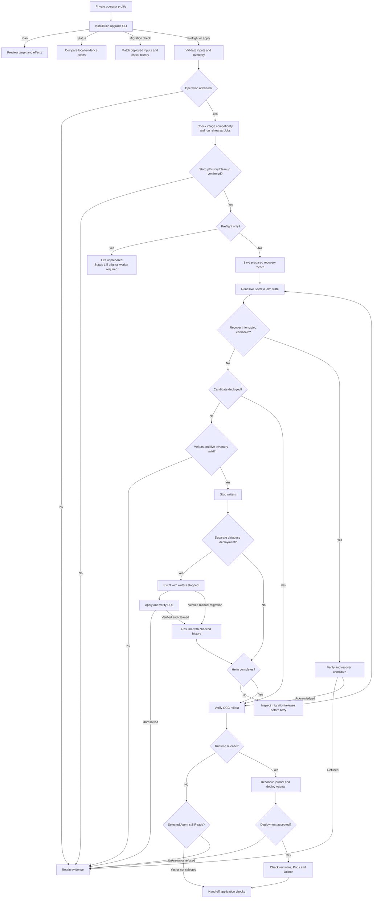

# Production image upgrade flow

## Overview

Upgrades OpenClaw Control Plane (OCC) and Agent runtimes.
See [one-off channel transitions](channel-egress.md#0-install-or-upgrade-channel-routing).

## Entry Points

- Run `scripts/upgrade-production-images` with reviewed inputs, or use `occ installation upgrade` with a private operator profile.
- Stderr phases are advisory; `--verbose` shows native output.
- Required: healthy Helm release with chart-owned initializer, matching OCC/Kubernetes Installation
  IDs and complete authorized inventory without active deployments.
- Source: `scripts/upgrade-production-images`,
  `packages/occ/src/deployment-inventory.ts:readDeploymentInventory`,
  and `packages/occ/src/agent-deployment-admission.ts:admitAgentDeployment`.

## Flow

## Execution Trace

### 1. Prepare the candidate

`internal/occcli/installation_upgrade.go:installationUpgradeCommand` runs
`scripts/upgrade-production:main`. `report_status` compares two local marker scans.
Plan validates the profile, images and checkout. The adapter uses `kubectl` to
decode the HTTPS target and previews trust with the bound CA. Apply and resume
recheck approval and bound inputs before dispatch.

Both entrypoints refuse active kubectl preferences. With preferences enabled,
the native helper snapshots kubeconfig, refuses selected exec credentials and
disables command defaults. Approved snapshots also refuse selected
`auth-provider` entries. Profiled recovery rechecks the target and CA binding.

Before `scripts/upgrade-production-images:prepare_upgrade`, the helper refuses
other Helm stores, [endpoint and TLS overrides](../guides/deploy/production-upgrade.md),
[token and impersonation overrides](../guides/deploy/production-upgrade-command.md#run-the-image-upgrade),
source mismatch, chart edits or symlinks, and evidence or baseline aliases.
`preprovisionedNamespace` must yield one `false` (`preprovisioned-namespace.err`).

`check_migration` matches the rendered and deployed migrator inputs and
checks the revision around one read-only Job. Success requires recognized
history and UID-bound cleanup. Unknown creates retain evidence and lock.

`matches_yaml` compares candidate, [baseline](../guides/deploy/upgrade-baseline.md#record-the-release-and-its-configuration)
and live mappings. Invalid inputs or unwritable evidence yield `Cannot compare upgrade YAML`.
Projections allow Slack directory proxy, curated Codex PluginDriver selection
and one registration wrapper. The baseline projection excludes
`agentNativeAdmin.sharedCookieDomain` when absent from the candidate.
Immutable switches require string keys.

`read_restart_inventory` requires a complete, authorized inventory with no
nonterminal deployments. Retained running revisions need saved Harness objects and
an accepted [restart assessment](../reference/repository-credentials/worker-replacement.md).
Standalone preflight rehearses with an explicit original-worker requirement.
Unknown assessments block rehearsal. Runtime upgrades record replacements and
check draft images and sizes, baseline versions and Namespace readiness.
Stopped or deleting Agents are excluded. Pending repository cleanup is allowed.

`deploymentInventorySnapshot` batches deployment-work reads
in one State snapshot and refuses missing or mismatched work. Credential
withdrawal is distinct from deployment work. `findRevisionForBrowsing` yields
`unknown` for unreadable snapshots and propagates database or identity errors.
`readDeploymentInventory` gives Compute ten seconds outside State
transactions, then rechecks fleet authorization and Driver selections. Drift
refuses inventory. Owner failures yield `unknown`.

`scripts/upgrade-evidence.py:validate_compatibility` checks the PostgreSQL
receipt's file binding, data, IAM, cleanup and image digests. Hashes bind
resume inputs. See [qualification limits](../guides/deploy/production-upgrade.md#upgrade-the-control-plane).

`verify_agent_continuity` brackets runtime inspection with authorized Agent
reads and records the selected revision and Driver roles in `agent-continuity.json`.

Repository credentials require immutable images and a common node architecture.
`scripts/upgrade-image-identity.py:read_platform` verifies OCI hashes (2 MiB per
blob, 32 MiB total). `scripts/upgrade-repository-image-probe.ts:main` probes
before preparation and resume. The negative control requires an absent socket
and a Docker-confirmed broker exit without OOM or daemon error.

For immutable switches, `prepare_upgrade` validates both Secret identities,
unrelated data and candidate YAML. `upgrade-evidence.py` binds both snapshots.
New attempts needing different immutable Secret data require a staged successor
via `--candidate-values`. Prepared attempts keep their recorded Secret. A denied
mutable Secret update review blocks preparation. Inconclusive reviews warn.

`preflight_startup` dry-run applies rendered Certificates before Jobs. The
45-second request allows the webhook's 30-second maximum plus response time.
Admission failure retains protected diagnostics and prevents further shutdown.

`scripts/upgrade-startup-preflight.ts` builds single-Pod Jobs with candidate
images, credentials and mounts, a deadline and zero retries. `preflight_startup`
refuses changed UIDs or multiple children. Job failure overrides child success.

`migrationJob` selects the chart initializer and preserves policy labels.
Hook mode uses `--check`. In separate mode,
`check_separate_migration_preconditions` verifies Secret access, records the
migrator and CA Secret UIDs and resource versions, and requires
`migration.checked-for-installation`. Both checks allow recognized pending
history. After cleanup, separate mode rechecks identities and
`scripts/upgrade-evidence.py` binds them to the prepared run.

`loadConsoleTheme` checks API themes. OpenShell checks `bearerTokenFile` type
and readability without reading tokens.

`connectionPlan` preserves OIDC CA mounts and database preload. Both writers
match `occ.installation` against OCC and the startup Secret via `OCC_DATABASE_URL`
in read-only transactions (5 seconds per statement or lock, 15 overall). Logs
omit connection errors and rows.

`preflight_resume` checks history and writer identities before shutdown or Helm.
Completed releases skip these Jobs. Log retrieval verifies Job and Pod identities
and rejects NUL bytes. `formatStartupConfigurationFailure` reports up to 32 fields.

Kubernetes Compute uses the Pod service account and refuses single-cluster
[split-layout Gateway storage](../reference/drivers/kubernetes-compute.md#existing-split-layout-installations).
`isName` checks Installation names. `refuseUndeployableConfigurationValues` checks
drafts. Older images or inputs over 1 MiB can defer checks.

During runtime upgrades, `checkHarnessDestinations` checks the active revision,
Configuration generation and Harness binding. Kubernetes Compute resolves OpenAI
overrides against candidate defaults. A mismatch, incomplete check or oversized
source-backed drafts block shutdown. Deployment rechecks consent.

Experimental two-cluster Jobs use `verifyExecutionTenantGrants` to check API
Pod, proxy, and optional log/Event access, plus worker Pod patch and Job get,
create and delete access. Missing grants require the
[execution chart upgrade](../testing/kubernetes.md#upgrade-the-execution-chart).
Startup Jobs retain default-deny and dependency egress policies. Verify enforcement.

Preflight leaves writers serving. `scripts/upgrade-preflight-state.py` records
create intent and acknowledged UIDs. `scripts/lib/upgrade-preflight-cleanup.sh:cleanup_preflight`
confirms Jobs and children are gone before deleting dependencies. Unknown
consumers retain dependencies. [Interrupted cleanup](coordinated-production-upgrade/preflight-cleanup.md)
uses these records.

Recheck switch Secrets after cleanup. `startup-preflight-passed` records checks
and cleanup. Standalone preflight exits without preparing a deployment. If
retained revisions require the original worker, it writes
`preflight-blocked-original-worker` and exits 1. Upgrade refreshes inventory.
Preparation locks candidates, inventory and target/parameter hashes. `scripts/upgrade-production-images:interrupted_upgrade`
retains the lock and skips cleanup on `SIGHUP`, `SIGINT`, or `SIGTERM`.
Before unlocking, confirm termination and reconcile accepted operations/resources.
Freeze writers, autoscalers, Helm changes and drafts per the [production guide](../guides/deploy/production-upgrade.md).

### 2. Reconcile a prior attempt

Resume locks evidence and dispatch journals, checks paths, identities and
prepared inputs, and requalifies images and nodes. Values must match baseline,
candidate or the recorded predecessor and revision. It can finish Installation
writes or a Secret switch. `verify_installation_switch` checks both UIDs and data.
Check migration history, settle initializer Jobs and Pods, and reconcile unknown
creates before retry. `new_attempt` fsyncs ancestors before publishing pointers.
Failed identity or history checks leave writers stopped. Resume skips Helm
submission if the deployed candidate or recorded recovery successor verifies.

If Helm intent exists and the release is still at the original revision,
a separate-mode retry calls `require_migration_writers_stopped` before preparing
a new attempt or starting preflight. Each Deployment must have the handoff UID
and generation, the expected release and component labels, zero replicas, and no
deletion timestamp. Writer Pods must be absent. The helper rechecks both
Deployments before the scale step, which skips stopped writers. Once it confirms
the Pods are absent, it rechecks Helm status, terminal initialization Jobs and
Pods, and both Deployments before protected writes.
A failed expected revision follows the usual checked retry.

For [same-candidate recovery](../guides/deploy/production-helm-recovery.md),
`scripts/upgrade-helm-state.py:recover` checks Helm payload, ownership, completed
Job/Pod and exact security contexts. `pod_matches` compares requests/limits through
Compute's `resource-quantities.ts`. Reads use manifest namespaces and release
ownership. `check-recovery` validates the original attempt before preflight Jobs;
both application identities must pass before a new rollback. `recover` repeats
admission before exclusive intent and dispatch. Accepted/uncertain recovery stays
readback-only.
`require_absent` rejects remaining predecessor-only resources before intent,
before rollback, after rollback and on resume. `verify_workload_changes` requires
retired environment entries and container placements absent before rollback; afterward all changed selections must
match. Neither check deletes resources. Changed nonnative resource specs require exact
candidate matches. Resume rechecks recorded UIDs without pinning old versions.
Supports only pre-upgrade hooks. Resume requires successor acknowledgement.
Client shutdown, exclusive ownership, resource reconciliation and database history
remain operator attestations.

### 3. Quiesce writers and run the candidate release

`scripts/upgrade-production-images:quiescence_remaining` bounds shutdown.
Validate both Deployments. Before either stop, check named patch permission for
running workers. Refuse denial and warn on inconclusive review.
While the worker runs, refuse inventory drift, including on resume. Restore stopped
API access under exclusive maintenance ownership before retry.
Skip stopped writers. Stopped workers lack prospective checks.
Sequential patches test UID, resource version and replicas. Conflicts can leave
the API stopped. Verify Pod absence and original Deployments at zero. Operators
stop other writers/autoscalers and keep nodes reachable.
Separate mode rechecks Secret identities before stopping writers and again
before recording their stopped UIDs and generations. It exits 3.
`apply_database_migration` requires approval for irreversible SQL.
Its sibling journal records Job create and delete intent. Unknown effects retain
the lock and kubeconfig snapshot. Cleanup observes prior deletes. Only a cleaned
failed verification Job permits a verification retry. Resume requires completed
verification for journaled migrations and rechecks both Secret identities.
Kubernetes Jobs reference these Secrets by name, so keep edits fenced throughout.

After quiescence and the relocated `verify_pair_nodes` re-check, a fresh
`helm status` must match the reconciliation read except for live
`.info.resources` added by Helm v4. A mismatch leaves the writers stopped.
This attempt does not write the protected files or the Installation Secret.
On resume, either can already contain candidate settings from the previous attempt.

Protected files change atomically. Resource-version checks preserve unrelated
mutable Secret data. Reference switches preserve both Secrets; both OCC templates
select the successor and checksum.

`upgrade-helm-state.py:new_attempt` renders and dry-runs immutable values. Hooks
and the initializer Pod receive the fresh `installation.upgradeAttemptId`.
Upgrade and recovery preserve `.json` format.
`record_submission` saves intent and predecessor before publishing `helm-started`.
Identical interrupted staging can finish. Published intent survives staged retries.
`scripts/migration-history.mjs:migrateWithHistory` checks Installation identity
and recognized history under lock for separate Jobs. Verification and the
separate Helm hook require completed history. Hook mode applies pending SQL.

### 4. Verify control-plane recovery

`scripts/upgrade-helm-state.py:verify_installation_consumers`

Verify images, replicas and changed Installation checksums.
Reference switches verify both Secret identities and Installation mounts in
controllers and the owned initializer Pod. Each component needs one named container.
Only broker-enabled workers permit restartable init containers. Authenticated OCC
retries must return the same Installation ID.
Worker preparation re-renders current launch requirements.
Repository-bound Agents receive maintenance every 30 seconds until their session
deadline; other Agents are re-prepared if deployment remains unfinished.
Kubernetes Compute rolls changed Gateway and Harness Pod templates even with
unchanged runtime images. Chat waits for readiness.
OpenShell instead requires exact existing Sandbox content
(`apps/controller/src/drivers/sandbox/openshell.ts:verifyExistingSandbox`).
Generated-command changes require a fresh Agent revision; controller-only reuse
cannot adopt them. See the
[upgrade guide](../guides/deploy/production-upgrade.md#prepare-the-release).
Other Agents receive Pod configuration/[diagnostics](agent-deployment-diagnostics.md) fixes on preparation or deployment.

Repository-enabled releases verify Ready API/worker Pods, owning ReplicaSets,
node architecture and runtime image IDs against the qualified pair. The Driver
checks broker admission without a session. Pod identities must remain stable
through that check, dispatch and completion.

### 5. Deploy and verify the recorded fleet

`scripts/upgrade-production-images:confirmed_deployment_status` and
`scripts/upgrade-dispatch-state.py:transition`

Flush intent before dispatch; unresolved intents block sends.
The journal retains accepted revisions, definite refusals and superseded receipts.
Resume may retry refusals; replacements must name the current failed revision.
Unknown outcomes or stale journals require
[recovery](../guides/deploy/production-upgrade-recovery.md).

Verify authorized deployment status, revisions and Pod readiness on the
candidate digest. [Gateway and Harness storage](../reference/drivers/kubernetes-compute/storage-and-credentials.md#gateway-storage)
describes how state migration and retries gate runtime startup.

Replacement gateways run read-only `openclaw doctor --lint --json --severity-min error`
serially. `gateway_free_memory` requires one cgroup v2 reading above heap cap
plus 640 MiB or two above cap plus 256 MiB. After insufficient memory, only
fresh sufficient readings admit Doctor. A memory timeout stops new checks.
`revision_pod_change_since_ready` checks all required Pods even after Doctor
failure. A missing, changed, restarting or unready Pod fails the upgrade.
See [Doctor recovery](../guides/deploy/production-upgrade-recovery.md#correct-a-doctor-failure).

### 6. Hand off application verification

`docs/guides/deploy/production-upgrade.md:Verify the release`

Confirm Helm revision and OCC access. Runtime upgrades require deployment,
readiness and Doctor success. `verify_agent_continuity` precedes terminal
controller/Helm checks. Require one Running, Ready Pod per role. Replacement
UIDs and completed init containers qualify. Eight results leave uniqueness unknown.
Previously running provider Harnesses must stay running. Failure retains
observations without `completed`. Reconcile failed writes. Resume rechecks
without repeating successful Helm. `completed` blocks resume.
Verify routing, models, channels, credentials, workspaces and restores.
The [served Console check](../release/container-promotion.md#verify-the-served-console)
accepts an optional image-bound entry digest.

### Read-only export after a split-layout refusal

[Split-layout export](../guides/deploy/split-layout-upgrade.md#export-and-re-create)
uses `scripts/split-layout-tenants.ts:createOccApi.expect` to reject malformed
responses. `importTenants` rejects shared destinations, preserves prior merges
and reserved IDs, and handles rename keys literally. Unsaved exact-name reuse
requires no Agents or Secrets.

## Debugging and Verification

- Check `helm-attempts/<UUID>/` render and dry-run output, and
  `preflight-<api|worker|migration>.log`, `-logs.err` and `-status.json`. For resume,
  use the current `upgrade-preflight-resume.*` directory.
- See [upgrade recovery](../guides/deploy/production-upgrade-recovery.md) for
  `native-command-failures.tsv`, migration journals and dispatch results.
- Compare `before-workloads.json` and `after-workloads.json` for controller-only
  rollouts. Check broker-affected repository versions separately.
- Command fixtures prove control flow. End-to-end proof requires credentialed
  production Kubernetes and distinct images.

## Related docs

- [Production upgrade guide](../guides/deploy/production-upgrade.md)
- [Production installation](../guides/deploy/production-installation.md)
- [Production Agent verification](../guides/deploy/production-agents.md)
- [Agent deployment reference](../reference/agents/deployment.md)
- [Production startup flow](production-startup.md)
- [Controller worker flow](controller-worker.md)
- [Authoritative platform design](../design.md)

## Manual Notes

[keep this for the user to add notes. do not change between edits]

## Changelog

- 2026-11-21 23:05: Trace accompanying Harness destination refusal. (authoring-run/c71fe5bf-0518-4e32-a61a-8f6a6324a728 - e9abd3462452c20c0919e8b96ae1db2f5cd79507)
- 2026-11-20 19:04: Refresh sources. (authoring-run/8a8bde8b-71de-4de5-80bf-e32f0e335c34 - 220f62d86ceb3dfc6f66dbee7c6f86cda50e5d05)
- 2026-11-20 16:29: Update source pointers for runtime observation and fleet inventory. (authoring-run/c41017eb-dc85-4c43-90e8-3040fbace6ac - c6acc7271f7753f74d3657251f23a036c08e671c)

- 2026-11-20 17:42: Refuse Helm credential overrides. (authoring-run/e16304ce-2b94-4022-a90d-9ab2e235d1d4 - aff441a5df9e3258752b034fb694e06333c0b231)

- 2026-11-20 09:47: Trace immutable Installation refusals and the Certificate admission timeout. (authoring-run/d0f76046-8ddd-44e6-a67f-29c2288c9e33 - 9092839d0c3b9598e85300451f425ac6d3084fe5)

- 2026-11-19 19:15: Trace the stopped writers check before Helm retry. (authoring-run/aed0a2bc-9691-4859-8bd6-1e7b3549c9b4 - d976da889bdeca6e9208821a5b4ea79a49033b0f)

- 2026-11-19 17:18: Keep bootstrap handling in the chart. (authoring-run/803c9489-57ed-4e31-a5ea-568f16e22161 - d14128b4a0fc1f499b914107ec6ec14eccc39fdf)

- 2026-11-19 17:08: Trace migration Secret checks from preflight through resume. (authoring-run/d22a53f0-d60f-46c9-9977-2d54227dd193 - a4e6e5e73e7f6f8699dddd6c3244af6fd71c2336)

- 2026-11-19 10:54: Compose profile approval with separate database migration. (authoring-run/abedccc5-d961-4465-afd3-012cc1e5a5a5 - 6885839d6e3d8dd2f8293552d508ad4536cbf8a6)

- 2026-11-18 14:34: Retire bootstrap outputs safely (PST). (authoring-run/fcffdcd5-85ba-4fd1-ad35-bfbbcd6953b6 - ce0bd74dcbb7bdf2fd97a6d87e9ea0f88cf0199d)

- 2026-11-18 20:23: Apply and verify separate database Jobs. (authoring-run/859166ef-2ed3-42e1-b8fd-88441bb8746f - 084874338baf51ad05d0b1a2b438e8bcd0120c1b)

- 2026-11-19 17:03: Reconcile the upgrade trace and bind admission to the selected credential method. (authoring-run/1b66f15a-ca57-49d3-97bd-6ce1593f55a2 - c833b919f687c17dcb5b2e1e5037b55ed4321ac0)

- 2026-11-19 12:44: Compare status markers. (authoring-run/b54d6eb9-13cb-4072-96e2-2e285cde2402 - a02224a7e22516f958546a249ddcbfa9bfcd6012)
- 2026-11-19 12:31: Trace standalone preflight status. (authoring-run/95ab0282-a9eb-46db-9c6b-bd4cce4ee6ea - a02224a7e22516f958546a249ddcbfa9bfcd6012)
- 2026-11-19 11:30: Trace candidate rehearsal when retained Agents require the original worker. (authoring-run/099c1a03-0e25-4504-9cf7-2f62d1cfa035 - 6679017155741810c2ae1bcbacba05a3eb59f3ec)

- 2026-11-19 10:56: Refuse active kuberc. (authoring-run/9c893cda-96dc-4a06-9e08-ad2aeca46de7 - 5f425af517e8ee120c7721e7559a846ce70120e9)

- 2026-11-19 10:26: Trace kubeconfig decoding and snapshot authentication. (authoring-run/8620ea2f-2212-49a6-b45b-0c6b44bf7fa2 - b0171d98e4470aaad0ba5b7ddb4e16a27fb9de7a)

- 2026-11-19 09:57: Trace the Helm release store guard. (authoring-run/d4ce1b5c-3a22-44f3-b1ad-40e8a771c331 - 2455e61e32e8f97a6dfb505608a665e2eca59f20)

- 2026-11-19 09:47: Trace profile TLS checks. (authoring-run/2a1d437b-87cc-4839-a06a-12b3d255450f - 2455e61e32e8f97a6dfb505608a665e2eca59f20)

- 2026-11-19 05:13: Trace upgrade approval, trust, and evidence. (authoring-run/def34421-d123-4fd1-bde1-e8d966d6bcad - 8bc5fe2fc916765024493c981308179a04a0e716)

- 2026-11-18 19:45: Tighten the upgrade trace. (authoring-run/9b947cd8-0275-4e7f-ac7f-5dce4b0f8965 - aed2f7edd530ab336bbd6cb8c7389b24cb83e397)

- 2026-11-18 19:27: Trace migration-only compatibility checks through the Helm hook and Job journal. (authoring-run/7ae70bae-f8ac-425d-abbf-7039b71997b7 - 71334bb9b104662870798a29814e7171e8905baf)

[Production image upgrade flow documentation history](coordinated-production-upgrade/history.md) preserves the older dated entries.
