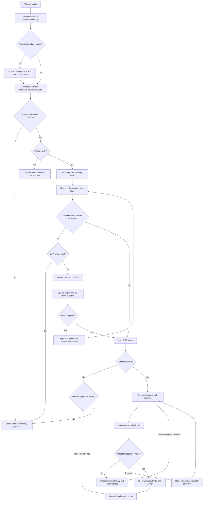

# Production image upgrade flow

## Overview

`scripts/upgrade-production-images` updates the OpenClaw Control Plane (OCC) and/or
Agent runtimes. Controller-only upgrades optionally verify one original
Agent revision. Runtime upgrades redeploy running Agents, checking ready Pods and
read-only Doctor lint.

## Entry Points

- Run `scripts/upgrade-production-images` with images, target, release, source
  revision and protected files.
- Required: healthy production Helm release, matching OCC/Kubernetes Installation
  IDs, and, for runtime upgrades, complete authorized inventory without active deployments.
- Source: `scripts/upgrade-production-images`,
  `packages/occ/src/index.ts:OpenClawController.getInstallationDeploymentInventory`,
  and `packages/occ/src/index.ts:OpenClawController.deployAgent`.

## Flow

## Execution Trace

### 1. Prepare the candidate

`scripts/upgrade-production-images:prepare_upgrade`

Before protected reads, evidence writes or cluster access, `HEAD` must match
`--source-revision`. Changed, extra, missing or symlinked chart files and baseline/evidence aliases
inside the chart are rejected. Other edits and image provenance remain unchecked.

Resume binds the evidence directory's path, device and inode; aliases share its
lock. Any `completed` entry refuses resume before live calls or evidence changes.
Runtime upgrades lock the private sibling dispatch journal, separate from restored
evidence.

`matches_yaml` compares ordered candidate YAML mappings, including images, with
the [baseline](../guides/deploy/upgrade-baseline.md#record-the-release-and-its-configuration)
before protected-setting projections. Unusable inputs or unwritable evidence cause
`Cannot compare upgrade YAML`. Only Slack directory proxy, curated Codex
PluginDriver selection and wrapping one registration in an array may change before
image selection. Baselines remain unchanged. Startup validates the candidate
controller; broker checks compare references, not ConfigMap/Secret contents.

Runtime upgrades require complete authorized inventory and baseline versions.
Nonterminal deployments, missing versions or unready Namespaces stop preparation.
Stopped/deleting Agents are excluded; pending repository cleanup is allowed.

`prepare_upgrade` copies the PostgreSQL `run` result;
`validate_controller_compatibility` calls
`scripts/upgrade-evidence.py:validate_compatibility` before preflight to check
runner/file consistency, passing selected case and cleanup, and recorded incumbent
release and selected candidate digests. Hashes freeze the copy for resume.
Runner SHA cannot verify image source. This neither authenticates execution nor
permits online migration or rollback; see [qualification limits](../guides/deploy/production-upgrade.md#upgrade-the-control-plane).

`--verify-agent`/`--verify-agent-namespace` requires Agent read/operate,
active AgentRevision read and runtime inspection. Before shutdown,
`verify_agent_continuity` brackets explicit-revision runtime reads with Agent reads,
freezing active identity and Driver-declared roles in hashed `agent-continuity.json`;
editable Agent topology is not authoritative.

Repository-enabled releases require explicit immutable controller and broker images.
All nodes matching the control plane selector, even unready or cordoned nodes,
must share one architecture. `scripts/upgrade-image-identity.py:read_platform`
verifies the selected platform and blob hashes in Docker's OCI export
(2 MiB per blob, 32 MiB total metadata).
`scripts/upgrade-repository-image-probe.mjs` tests recovery and refused reservations
through both images using synthetic inputs and a private receipt listener. It
records the digest, platform manifest, configuration, requests and responses.
This verifies the Driver and broker protocol; Kubernetes image availability,
receipt durability and disposal remain unverified. The broker hostname
stays fixed. For restart recovery, see the [broker procedure](../guides/repository-credentials/installation.md#install-and-verify).

After Helm's server dry run, `scripts/upgrade-startup-preflight.mjs` copies
API/worker images, environment, mounts and service accounts into single-completion,
single-Pod Jobs with the candidate Installation Secret, no retries and the selected
deadline. `preflight_startup` verifies Job UID and child ownership: missing children
wait; replacements or multiple children refuse preparation. Job completion is
required; Job failure overrides child success.

An API Pod with a theme first calls
`apps/controller/src/composition/console-theme.ts:loadConsoleTheme`. Invalid bundles
stop preflight; workers do not load themes. Both call
`loadStartupConfigurationSnapshot` and `loadInstallationConfiguration` to resolve
Drivers and Preset files without opening the database.
`apps/controller/src/startup-failure.ts:formatStartupConfigurationFailure` formats
typed configuration refusals with up to 32 field diagnostics through the API/worker
log filter. The helper checks Job and Pod identity before and after log retrieval,
rejects NUL bytes before parsing markers, and discards unbound output.

Bundled Kubernetes Compute Driver `preflight` uses Pod credentials (`inCluster`
service account), matching startup. It refuses
[split-layout Gateway storage](../reference/drivers/kubernetes-compute.md#existing-split-layout-installations)
on single-cluster upgrades.
The image's `isName` validates the stored name from `occ installation get`
(`INSTALLATION_NAME_INVALID`); images without this rule skip it.

For runtime upgrades, the API Pod calls `resolveConfiguredHarnessId` before
`refuseUndeployableConfigurationValues` on recorded drafts; deploy checks live
Harness state. Refusals leave old writers serving. Correct drafts, stop affected
Agents, or replace images lacking a working resolver, then use fresh evidence.
Images predating this check, or gzipped drafts plus Installation exceeding 1 MiB,
warn and defer validation to deploy.

Experimental two-cluster Pods also run
`KubernetesComputeDriver.verifyExecutionTenantGrants` for their component; startup
does not. Where each Pod's identity holds the release-era grant in an execution
tenant Namespace, SelfSubjectAccessReviews ask for newer `openclaw-execution`
rules: API Pod and `pods/proxy` reads, plus `pods/log` and Event reads with runtime
logs; worker Pod `patch` and `batch` Job `get`, `create`,
and `delete`. Worker Job grants are required even with runtime logs disabled.
A missing rule refuses the candidate and points to
[upgrading the execution chart](../testing/kubernetes.md#upgrade-the-execution-chart).

Preflight Jobs retain default-deny labels and a copy of
`openclaw-enterprise-dependency-egress`, including execution-cluster API rules.
Controller ownership addresses EKS's standalone-Pod limitation; verify enforcement.

Startup failures, timeouts and unconfirmed creates stop preparation before writers
stop. Create errors remain in `preflight-<resource>-create.err`.
`cleanup_preflight` requests UID-guarded foreground Job deletion and polls with a
30-second deadline per Job for removal of that Job, its UID-selected children and
recorded child. Only then does it delete the Secret and policy by original UID.
Ambiguous Job creates or unconfirmed consumer cleanup retain these dependencies
and refuse progress. Replacements remain untouched. Reconcile failures recorded
in `preflight-cleanup.err` before retrying.

`--preflight-only` leaves writers serving with private, non-resumable evidence.
Preparation saves candidates, inventory, target identity and parameter hashes
under the directory lock. `scripts/upgrade-production-images:interrupted_upgrade`
retains it and skips preflight cleanup on `SIGHUP`, `SIGINT`, or `SIGTERM`.
Before unlocking, confirm helper/children stopped and reconcile accepted operations
and temporary resources. Freeze other writers, autoscalers, Helm changes and runtime
drafts per the [production guide](../guides/deploy/production-upgrade.md).

### 2. Reconcile a prior attempt

`scripts/upgrade-production-images:1588`

Resume requires prepared evidence; otherwise reconcile preflight resources and
use fresh evidence per [upgrade recovery](../guides/deploy/production-upgrade-recovery.md).
It binds directory, kubeconfig, inputs, OCC URL, scripts, flow, chart and pair;
requalifies the pair; and rejects changed eligible nodes.
Ineligible Helm states stop before values/Secret reads. Values must match baseline
or candidate; Secret UID, Installation annotation and other data must match baseline.

Skip Helm only at the submission's expected deployed revision with candidate
values. Revisions outside its prior/expected pair or invalid intents refuse
resume. Retrying requires migration-history review and terminal initialization
Jobs and Pods; checks cannot undo committed migrations.

### 3. Quiesce writers and run the candidate release

`scripts/upgrade-production-images:quiescence_remaining`

Validate both Deployments before stopping either. Sequential JSON patches test
observed UID, resource version and replicas before scaling to zero; later conflicts
can leave the API stopped. Before the deadline, Pods must disappear and original
Deployments remain at zero. Operators stop other writers and autoscalers and keep
nodes reachable.

The script atomically installs saved candidates. Installation Secret updates use
a resource-version precondition, preserving other data and metadata.
An already-present candidate is not rewritten after a lost response.
Both OCC Pod templates include its checksum.

Each submission durably records prior/expected revisions in private `helm-started`
after rechecking status. The initialization hook checks Installation, then runs
candidate migration and bootstrap before rollout. Failures require release/schema
reconciliation; restarting old images cannot undo committed migrations.

### 4. Verify control-plane recovery

`scripts/upgrade-production-images:1791`

The script waits for both OCC Deployments and checks controller images,
replica counts, and changed Installation checksums. Each component needs
exactly one named container. A broker-enabled worker may instead be a restartable
init container; non-restartable or ambiguous placement fails. Authenticated OCC
access is retried and must return the same Installation ID.
Worker preparation re-renders launch requirements from the current controller.
Repository-bound Agents receive maintenance every 30 seconds until their session
deadline; other Agents are re-prepared if deployment remains unfinished.
Kubernetes Compute applies current Gateway and Harness Deployments, rolling
changed Pod templates even when runtime images are unchanged. Chat waits for readiness.
OpenShell instead requires exact existing Sandbox content
(`apps/controller/src/drivers/sandbox/openshell.ts:verifyExistingSandbox`).
Controller changes to its generated command require a fresh Agent revision;
controller-only reuse cannot adopt the changed command. See the
[upgrade guide](../guides/deploy/production-upgrade.md#prepare-the-release).
Controller fixes to Pod configuration and [diagnostics](agent-deployment-diagnostics.md)
reach other Agents on their next preparation or deployment.

Repository-enabled releases verify Ready API/worker Pods, owning ReplicaSets,
node architecture and runtime image IDs against the qualified pair. The Driver
checks broker admission without a session. Pod identities must remain stable
through that check, dispatch and completion.

### 5. Deploy and verify the recorded fleet

`scripts/upgrade-production-images:confirmed_deployment_status` and
`scripts/upgrade-dispatch-state.py:transition`

Flush intent before dispatch. Unresolved intents block
later sends. The journal records accepted revisions and definite refusals, which
resume may retry. Superseded receipts remain; replacements must name the current
failed revision. Unknown outcomes or stale journals require
[recovery](../guides/deploy/production-upgrade-recovery.md).

The script verifies authorized deployment status, version, and ready Pods on the
candidate digest. Before OpenClaw starts, `openClawStateMigrationHelper` in
`runtime-startup.ts` runs `openclaw doctor --fix --non-interactive` for older schemas.
Current schemas and Doctor's settled result gate startup: maintenance or cleanup
refusal holds `state-migration` unready; ordinary warnings do not. A private pending
marker forces interrupted or refused maintenance to retry after restart, even with current schemas. The same step
runs before Harness native setup or native-worker connection. Embedded execution
requires one runtime container; dedicated execution requires Gateway and Agent containers.
Each replacement gateway runs read-only
`openclaw doctor --lint --json --severity-min error`, one at a time, with a heap cap
(`--doctor-heap-mib`, default 384 MiB). Doctor shares the gateway's memory limit;
an OOM kill can stop both. The cgroup v2 check (`gateway_free_memory`) requires
one reading with cap plus 640 MiB free or two consecutive readings with cap plus
256 MiB. This reserves no memory. Transient failures are retried.
Initially unavailable data allows warning and run.
After insufficient memory is observed, unavailable reads reset consecutive
evidence; only fresh sufficient readings admit Doctor within its own deadline.
Failure reports separate Doctor's exit status from gateway restarts since Ready.
Missing or incomparable counts or Pod identities report unknown; only a comparable
increase with last termination `OOMKilled` names an OOM kill. A memory timeout
starts no further Doctor. Then, also after a failed Doctor, `revision_pod_change_since_ready`
fails the upgrade for any revision Pod the wait required (gateway or dedicated agent)
missing, replaced, restarted, or unready; the readiness wait ignores ended Pods, so
resume checks the replacement.

### 6. Hand off application verification

`docs/guides/deploy/production-upgrade.md:Verify the release`

Completion requires the expected Helm revision and OCC access; runtime upgrades
also require deployment, readiness and Doctor success. For selected-Agent checks,
`verify_agent_continuity` waits before terminal controller/Helm checks.
Every declared role needs one Running, Ready Pod; replaced UIDs are allowed.
Completed init containers are valid. Eight returned Pods for a role may hide
another Pod beyond the runtime endpoint's cap, so cannot prove uniqueness.
Previously observed provider Harness status must remain running. Failure retains
observations without `completed`; resume rechecks without repeating successful Helm.

The private `completed` marker refuses further resume. Failed marker writes need
reconciliation; absence proves nothing. Operators separately verify routing,
models, channels, credentials, workspaces and restores. Console publication checks
use [`verifyConsoleRelease`](../release/container-promotion.md#verify-the-served-console).

### Read-only export after a split-layout refusal

The [split-layout fallback](../guides/deploy/split-layout-upgrade.md#export-and-re-create)
uses `scripts/split-layout-tenants.mjs`. Its `createOccApi.expect` rejects
malformed JSON, empty bodies and missing data envelopes before export writes a
bundle. Empty collections, 204 deletes and explicitly accepted 404s remain valid.

`importTenants` resolves unsaved targets by live name, rejecting shared destinations
before mutations or ID-map writes. Saved destination IDs stay reserved, including
skipped sources; unsaved skipped sources reserve nothing. Correct the map, use
distinct `--rename` targets or skip a source. Validated mappings resume without
undoing prior merges. Rename keys are literal, including `constructor` and
`__proto__`. Without saved mappings, exact-name reuse requires no Agents or Secrets.

## Debugging and Verification

- Inspect stderr and `server-dry-run.txt` for preparation errors;
  `preflight-<api|worker>.log` and `-status.json` for rejected candidates.
- For scale, Helm or rollout failures, inspect `native-command-failures.tsv`;
  see [upgrade recovery](../guides/deploy/production-upgrade-recovery.md).
- Before retrying runtime failures, inspect `dispatch/*.error`, `dispatch/*.rejected`,
  version history, and `status/*.json`. Doctor failures: `status/*.doctor.json` and `status/*.doctor.error`.
- Compare `before-workloads.json` and `after-workloads.json` for unexpected
  changes. After a controller-only release, expect one same-image Pod template
  rollout per affected Agent. Separately check
  repository-bound versions affected by broker restart.
- Use credentialed production Kubernetes integration with distinct baseline
  and candidate images for end-to-end proof. Mocked commands prove only script
  control flow.

## Related docs

- [Production upgrade guide](../guides/deploy/production-upgrade.md)
- [Production installation](../guides/deploy/production-installation.md)
- [Production Agent verification](../guides/deploy/production-agents.md)
- [Agent deployment reference](../reference/agents/deployment.md)
- [Production startup flow](production-startup.md)
- [Controller worker flow](controller-worker.md)
- [Authoritative platform design](../design.md)

## Manual Notes

[keep this for the user to add notes. do not change between edits]

## Changelog

- 2026-11-07 03:01: Freeze reviewed controller compatibility evidence. (authoring-run/4adaf10b-d7e7-46e1-8f30-65993c797458 - ada47832cb112f255f6c51d34dae37acce9760cd)

- 2026-11-07 02:48: Verify selected Agent readiness before completion. (authoring-run/87bf103a-4285-4561-8ab8-6a9f1e265248 - ada47832cb112f255f6c51d34dae37acce9760cd)

- 2026-11-07 02:27: Validate both writers before stopping either. (authoring-run/a2f2f4b1-8e0e-4f19-8ce3-11d6e118a054 - 7f5489fe39ba84a34987bd22d905e942cf65a8ee)

- 2026-11-06 19:10: Bind resume to each submitted Helm revision. (authoring-run/9ac3c663-290c-4524-94bd-7157cbd44914 - f1c0865be4c523090af0dccc29c613ad1d47d542)

- 2026-11-06 18:44: Bind writer quiescence to observed Deployment identity and version. (authoring-run/4f41f7ed-7c0b-484d-b6b3-85c39a31a8c6 - 5b8901213714a5b0d99f82af8eae1d425ee7cd18)
- 2026-11-06 10:19: Bind startup results and logs to controller-owned Jobs; retain dependencies until cleanup is confirmed. (authoring-run/fd9ca628-3661-4fb1-927c-661ea85ae64d - 8e8035a0c073e2779aa7b32ece5dff449449f5b2)

- 2026-11-05 13:53: Require settled Doctor maintenance before runtime startup. (authoring-run/0f9e4fc6-9649-465a-8ab4-3fc3124417e2 - 644b3f9328e9125030e958c7b4233ac37c54b139)

- 2026-11-05 11:09: Allow an explicit canonical plugin registration candidate while preserving protected settings. (authoring-run/156a9693-7ea1-4555-a5b7-b4c840568cd5 - 717e8bf2a3ef3fa4d4fa7e53cc6927500533ddbd)

- 2026-11-04 07:28: Validate Console inputs. (authoring-run/78fd39fa-cf99-4b8c-b120-4e344700140d - 2f8d396865b850963bb928beb0399970de430761)
- 2026-11-04 07:14: Validate YAML comparisons. (authoring-run/47f197fd-9f98-4dfb-8162-36589ab6194e - e122eaced28cdaff6cbf9d78e0fab4d038f9c380)

- 2026-11-04 06:40: Diagnose unusable YAML. (authoring-run/1320ca1e-663f-449a-aab9-29102e0c482f - f150505ae48988083ddeebdaffd45978be48d588)

- 2026-11-04 00:26: Record completion after final evidence capture and refuse resuming completed upgrades. (authoring-run/a85b1fc7-d58e-4c10-b80c-6464a0aaaa4f - c8a9b55bd67175e0d1ae3fbb7fefe1a0de44f573)

- 2026-11-03 10:46: Document stock chart verification. (authoring-run/1308615d-068b-473e-8062-2baec5b66ab0 - 11099b579a5c197e0ec5c342bffb78036c321a32)

- 2026-11-03 02:34: Preserve journaled replacements when evidence is restored. (authoring-run/a4cf6a1b-e333-44d4-8e78-138caa5c190a - 19f63529413d4a530ac4eb65204980720d6d8ce9)

- 2026-11-02 23:23: Bind directory identity; preserve evidence paths. (authoring-run/1d065972-0bb5-4523-81d3-7d83a64ff8f3 - cf67413c378cce3989d28fa8178ed29a405b9ce6)

- 2026-10-29 23:05: Retain the upgrade lock after interruption until operations are reconciled. (authoring-run/729e3e30-1ab9-4e2c-bae2-42834bf535c4 - 5a61a08eec78fbae99e21b858af5c8dd5911ba03)

- 2026-10-29 12:28: Validate baseline mapping streams. (authoring-run/b9a98c72-bd73-45d4-b50d-f12d185f39b5 - 389a51336cd5)
- 2026-10-29 11:04: Document protected baseline comparison. (authoring-run/35ed2337-614f-4587-a16d-7c1973bb4819 - 51de7c164aab)
- 2026-10-29: Check Agent drafts before writers stop. (fix-2809)
- 2026-10-29: Check model providers; budget drafts by Installation. (fix-2815-2816)
- 2026-10-28 18:11: Check Helm status before reconciliation reads. (authoring-run/44ebe5a4-904f-4a6b-8796-e86c3ab7a26a - 541cc3f43bdfb09615ecee0cfb79c533e6a0b56c)
- 2026-10-28 21:01: Check API themes before writer quiescence. (authoring-run/bf262f39-fa9d-4e70-94e1-e2fc516234e9 - 304fcfb169bc8403794e8562a08b1e3ee4cc23ac)

- 2026-10-28 06:40: Check every revision Pod, not only the gateway, after Doctor. (fix-2755)
- 2026-10-28 05:40: Check gateways after failed Doctors. (bughunt-1028)
- 2026-10-28 00:40: Run Doctors serially; fail on gateways changed afterward. (fix-2736)
- 2026-10-26 23:24: Record source checkout verification before private inputs. (authoring-run/dc3e51c1-8f14-4410-9c70-e4a993ea58fe - 821bee5fe0bb446319fab40ad21055b1e942eb37)
- 2026-10-25 11:53: Record native scale, Helm upgrade, and rollout failures; preserve recovery. (authoring-run/f03f716e-ea13-48ab-ad6e-e179b342d585 - 87784a3230964bd8a7a1763f8350c1fd2b4284e0)
- 2026-10-25 09:19: Keep preflight kubectl errors in private evidence. (authoring-run/6fccb13c-5ec3-44d5-aded-c3c3e9c1da81 - aaabca1fec6b28fbbb674f48f11f015242f86b59)
- 2026-10-25 06:51: Identify temporary preflight resources by UID before cleanup. (authoring-run/d15969fb-1113-416f-9573-e045dd683b66 - dd36945fec0ec3de38cd15b971537eb10a90d0e4)
- 2026-10-23 09:50: Document preflight-only rehearsal and fresh checks at deployment. (authoring-run/3c1a4d88-d619-47e3-9eba-dbaf0988d2e9 - 4e9f5935d5fa4878a719e82db5e504ec6ae55d64)
- 2026-10-20 01:48: Preserve field diagnostics before quiescence. (authoring-run/9d1ff825-b9f4-492a-9420-1e316d820e28 - e7e5f3321cb0a8471d74964eba56ddd069a4e4c5)
- 2026-10-19 22:34: Document that pending repository cleanup does not block upgrade preparation. (authoring-run/d59b973b-1f0b-46bb-b16f-d67bd24ed6d3 - 57acafe81482a890b02ae530793246f2c2e7be79)
- 2026-10-18: The initialization hook checks the Installation before migration.

[Production image upgrade flow documentation history](coordinated-production-upgrade/history.md) preserves the older dated entries.
