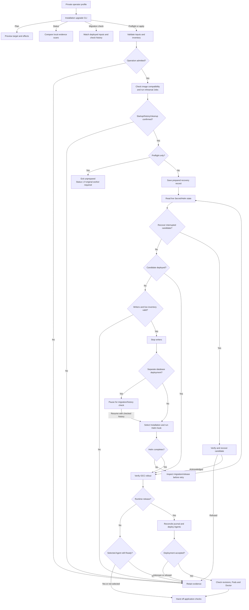

# Production image upgrade flow

## Overview

Upgrades OpenClaw Control Plane (OCC) and Agent runtimes.

## Entry Points

- Run `scripts/upgrade-production-images` with reviewed inputs, or use `occ installation upgrade` with a private operator profile.
- Stderr phases are advisory; `--verbose` shows native output.
- Required: healthy Helm release with chart-owned initializer, matching OCC/Kubernetes Installation
  IDs and complete authorized inventory without active deployments.
- Source: `scripts/upgrade-production-images`,
  `packages/occ/src/index.ts:OpenClawController.getInstallationDeploymentInventory`,
  and `packages/occ/src/index.ts:OpenClawController.deployAgent`.

## Flow

## Execution Trace

### 1. Prepare the candidate

`internal/occcli/installation_upgrade.go:installationUpgradeCommand` runs
`scripts/upgrade-production:main`. `report_status` compares two local marker scans.
Plan validates profile inputs, images and checkout commit. The adapter uses
`kubectl` to decode the selected HTTPS target, binds explicit CA bytes and previews
trust. Apply and resume require approval and recheck bound inputs before dispatch.

Both entrypoints refuse active kubectl preferences. If preferences are enabled
and no file is active, the native helper snapshots the kubeconfig and refuses
selected exec credentials before disabling command defaults for live clients.
Approved snapshots also refuse selected `auth-provider` entries. Profiled
recovery rechecks the recorded target and explicit CA binding.

Before `scripts/upgrade-production-images:prepare_upgrade`, refuse other Helm
release stores, [Helm overrides](../guides/deploy/production-upgrade.md), source
mismatch, chart edits or symlinks, and evidence or baseline aliases.
`preprovisionedNamespace` must yield one `false` (`preprovisioned-namespace.err`).

For migration check, `check_migration` matches candidate and deployed migrator
inputs and checks the Helm revision around one read-only Job. It requires
recognized history and UID-bound cleanup. An unknown create retains its lock and
journal.

`matches_yaml` compares candidate, [baseline](../guides/deploy/upgrade-baseline.md#record-the-release-and-its-configuration)
and live mappings. Invalid inputs or unwritable evidence yield `Cannot compare upgrade YAML`.
Projections allow Slack directory proxy, curated Codex PluginDriver selection
and one registration wrapper. Only the baseline projection excludes
`agentNativeAdmin.sharedCookieDomain`. Immutable switches require string keys.
Startup checks controllers and broker references.

`read_restart_inventory` requires a complete, authorized inventory with no
nonterminal deployments. Retained running revisions need saved Harness objects and
an accepted [restart assessment](../reference/repository-credentials/worker-replacement.md).
Standalone preflight rehearses with an explicit original-worker requirement.
Unknown assessments block rehearsal. Runtime upgrades record replacements and
check draft images and sizes, baseline versions and Namespace readiness.
Stopped or deleting Agents are excluded. Pending repository cleanup is allowed.

`OpenClawController.deploymentInventorySnapshot` batches deployment-work reads
in one State snapshot and refuses missing or mismatched work. Credential
withdrawal is distinct from deployment work. `findRevisionForBrowsing` yields
`unknown` for unreadable snapshots and propagates database or identity errors.
`getInstallationDeploymentInventory` gives Compute ten seconds outside State
transactions, then rechecks fleet authorization and Driver selections. Drift
refuses inventory. Owner failures yield `unknown`.

`scripts/upgrade-evidence.py:validate_compatibility` checks the PostgreSQL
receipt's file binding, data, IAM, cleanup and image digests. Hashes bind
resume inputs. See [qualification limits](../guides/deploy/production-upgrade.md#upgrade-the-control-plane).

`verify_agent_continuity` brackets runtime inspection with authorized Agent
reads and records the selected revision and Driver roles in `agent-continuity.json`.

Repository credentials require immutable images and a common node architecture.
`scripts/upgrade-image-identity.py:read_platform` verifies OCI hashes (2 MiB per
blob, 32 MiB total). `scripts/upgrade-repository-image-probe.ts:main` probes
before preparation and resume. The negative control requires an absent socket
and a Docker-confirmed broker exit without OOM or daemon error.

For immutable switches, `prepare_upgrade` verifies both Secret identities,
unrelated data and candidate YAML. `upgrade-evidence.py` binds both snapshots.
Changed immutable data requires a successor. The mutable Secret access review
blocks on denied update permission and warns if inconclusive. Certificates
require server-side dry run.

`scripts/upgrade-startup-preflight.ts` builds single-Pod Jobs with candidate
images, credentials and mounts, a deadline and zero retries. `preflight_startup`
refuses changed UIDs or multiple children. Job failure overrides child success.

`migrationJob` selects one initialization Job by release and component. It refuses
malformed labels and preserves the Job and Pod labels used by chart policies.
Before shutdown, it runs the selected image's migration entry with `--check`
and the migrator identity. `scripts/migration-history.mjs:migrateWithHistory` checks
receipts, catalog, and grants under lock. Pending canonical history is allowed.
Helm rechecks before migrating.

`apps/controller/src/composition/console-theme.ts:loadConsoleTheme` checks API
theme bundles. Both writers use `loadStartupConfigurationSnapshot` and
`loadInstallationConfiguration` without database access. For OpenShell
`bearerTokenFile`, each Job checks file type and readability without reading the token.

`connectionPlan` rejects unknown entrypoints and preserves private OIDC CA
mounts and database preload. Writer Jobs use `OCC_DATABASE_URL` for a read-only
check that one `occ.installation` ID matches OCC and the startup Secret.
Statement and lock timeouts are five seconds. Authentication through cleanup
has 15 seconds. Fixed diagnostics omit connection errors and rows.

Before shutdown or Helm, `preflight_resume` checks migration history and both
writer identities, even with both stopped. It compares the recorded ID with the
startup Secret. Completed Helm releases skip these Jobs. Migration-only records
remain valid for cleanup.

`apps/controller/src/startup-failure.ts:formatStartupConfigurationFailure` returns
up to 32 field diagnostics. Preflight verifies Job and Pod identities before and
after retrieving logs. It discards unbound output and rejects NUL bytes.

Kubernetes Compute `preflight` uses startup's Pod credentials (`inCluster` service account). It refuses
[split-layout Gateway storage](../reference/drivers/kubernetes-compute.md#existing-split-layout-installations)
on single-cluster upgrades.
The image's `isName` validates `occ installation get` names
(`INSTALLATION_NAME_INVALID`); older images skip this.

Runtime preflight calls `resolveConfiguredHarnessId` then
`refuseUndeployableConfigurationValues` on recorded drafts. Refusals leave old
writers serving: correct drafts, stop affected Agents or replace incompatible
images before retrying with fresh evidence. Older images or gzipped inputs over
1 MiB warn and defer validation. Deploy checks live Harness state.

Experimental two-cluster Jobs call `KubernetesComputeDriver.verifyExecutionTenantGrants`
using Pod identities. Required grants include API Pod and proxy reads and,
when enabled, logs and Events. Worker Pod patch and Job get, create and delete
are required even with logging disabled. Missing rules block the candidate.
See [upgrade the execution chart](../testing/kubernetes.md#upgrade-the-execution-chart).

Startup Jobs retain default-deny labels and a copy of
`openclaw-enterprise-dependency-egress`, including execution-cluster API rules.
Controller ownership addresses EKS's standalone-Pod limitation; verify enforcement.

Preflight leaves writers serving. `scripts/upgrade-preflight-state.py` records
create intent and acknowledged UIDs. `scripts/lib/upgrade-preflight-cleanup.sh:cleanup_preflight`
confirms Jobs and children are gone before deleting dependencies. Unknown
consumers retain dependencies. [Interrupted cleanup](coordinated-production-upgrade/preflight-cleanup.md)
uses these records.

Recheck switch Secrets after cleanup. `startup-preflight-passed` records checks
and cleanup. Standalone preflight exits without preparing a deployment. If
retained revisions require the original worker, it writes
`preflight-blocked-original-worker` and exits 1. Upgrade refreshes inventory.
Preparation locks candidates, inventory and target/parameter hashes. `scripts/upgrade-production-images:interrupted_upgrade`
retains the lock and skips cleanup on `SIGHUP`, `SIGINT`, or `SIGTERM`.
Before unlocking, confirm termination and reconcile accepted operations/resources.
Freeze writers, autoscalers, Helm changes and drafts per the [production guide](../guides/deploy/production-upgrade.md).

### 2. Reconcile a prior attempt

Resume locks evidence and dispatch journals, checks paths and identities, binds
prepared inputs, source and cluster, and requalifies images and eligible nodes.
Values must match baseline, candidate or the recorded predecessor and revision.
Resume can finish local Installation writes, mutable Secret replacement or an
immutable reference switch. `verify_installation_switch` checks both UIDs and data.
Check migration history and settle initializer Jobs and Pods before retry.
`new_attempt` fsyncs attempt-directory ancestors before publishing pointers.
A failed identity or history check leaves stopped writers stopped. Reconcile
unknown creates before resume. Resume skips Helm submission when the submitted
revision is deployed with the candidate values or the recorded recovery successor verifies.

For [same-candidate recovery](../guides/deploy/production-helm-recovery.md),
`scripts/upgrade-helm-state.py:recover` checks Helm payload, ownership, completed
Job/Pod and exact security contexts. `pod_matches` compares requests/limits through
Compute's `resource-quantities.ts`. Reads use manifest namespaces and release
ownership. `check-recovery` validates the original attempt before preflight Jobs;
both application identities must pass before a new rollback. `recover` repeats
admission before exclusive intent and dispatch. Accepted/uncertain recovery stays
readback-only.
`require_absent` rejects remaining predecessor-only resources before intent,
before rollback, after rollback and on resume. `verify_workload_changes` requires
retired environment entries and container placements absent before rollback; afterward all changed selections must
match. Neither check deletes resources. Changed nonnative resource specs require exact
candidate matches. Resume rechecks recorded UIDs without pinning old versions.
Supports only pre-upgrade hooks. Resume requires successor acknowledgement.
Client shutdown, exclusive ownership, resource reconciliation and database history
remain operator attestations.

### 3. Quiesce writers and run the candidate release

`scripts/upgrade-production-images:quiescence_remaining` bounds shutdown.
Validate both Deployments. Before either stop, check named patch permission for
running workers. Refuse denial and warn on inconclusive review.
While the worker runs, refuse inventory drift, including on resume. Restore stopped
API access under exclusive maintenance ownership before retry.
Skip stopped writers. Stopped workers lack prospective checks.
Sequential patches test UID, resource version and replicas. Conflicts can leave
the API stopped. Verify Pod absence and original Deployments at zero. Operators
stop other writers/autoscalers and keep nodes reachable.
`database.upgradeMigration: separate` records both stopped UIDs and generations
and exits 3. Resume requires matching writers and checked history.

After quiescence and the relocated `verify_pair_nodes` re-check, a fresh
`helm status` must match the reconciliation read except for live
`.info.resources` added by Helm v4. A mismatch leaves the writers stopped.
This attempt does not write the protected files or the Installation Secret.
On resume, either can already contain candidate settings from the previous attempt.

Protected files change atomically. Resource-version checks preserve unrelated
mutable Secret data. Reference switches preserve both Secrets; both OCC templates
select the successor and checksum.

`upgrade-helm-state.py:new_attempt` renders and dry-runs immutable values. Hooks
and the initializer Pod receive the fresh `installation.upgradeAttemptId`.
Upgrade and recovery preserve `.json` format.
`record_submission` saves intent and predecessor before publishing `helm-started`.
Identical interrupted staging can finish. Published intent survives staged retries.
In separate mode, `scripts/migration-history.mjs:migrateWithHistory` verifies the
completed candidate ledger, catalog and grants under lock. Pending or unsupported
history fails the hook. Hook mode applies pending SQL.

### 4. Verify control-plane recovery

`scripts/upgrade-helm-state.py:verify_installation_consumers`

Verify images, replicas and changed Installation checksums.
Reference switches verify both Secret identities and Installation mounts in
controllers and the owned initializer Pod. Each component needs one named container.
Only broker-enabled workers permit restartable init containers. Authenticated OCC
retries must return the same Installation ID.
Worker preparation re-renders current launch requirements.
Repository-bound Agents receive maintenance every 30 seconds until their session
deadline; other Agents are re-prepared if deployment remains unfinished.
Kubernetes Compute rolls changed Gateway and Harness Pod templates even with
unchanged runtime images. Chat waits for readiness.
OpenShell instead requires exact existing Sandbox content
(`apps/controller/src/drivers/sandbox/openshell.ts:verifyExistingSandbox`).
Generated-command changes require a fresh Agent revision; controller-only reuse
cannot adopt them. See the
[upgrade guide](../guides/deploy/production-upgrade.md#prepare-the-release).
Other Agents receive Pod configuration/[diagnostics](agent-deployment-diagnostics.md) fixes on preparation or deployment.

Repository-enabled releases verify Ready API/worker Pods, owning ReplicaSets,
node architecture and runtime image IDs against the qualified pair. The Driver
checks broker admission without a session. Pod identities must remain stable
through that check, dispatch and completion.

### 5. Deploy and verify the recorded fleet

`scripts/upgrade-production-images:confirmed_deployment_status` and
`scripts/upgrade-dispatch-state.py:transition`

Flush intent before dispatch; unresolved intents block sends.
The journal retains accepted revisions, definite refusals and superseded receipts.
Resume may retry refusals; replacements must name the current failed revision.
Unknown outcomes or stale journals require
[recovery](../guides/deploy/production-upgrade-recovery.md).

Verify authorized deployment status, revisions and Pod readiness on the
candidate digest. [Gateway and Harness storage](../reference/drivers/kubernetes-compute/storage-and-credentials.md#gateway-storage)
describes how state migration and retries gate runtime startup.

Replacement gateways run read-only `openclaw doctor --lint --json --severity-min error`
serially, with a heap cap (`--doctor-heap-mib`, default 384 MiB). Doctor shares the gateway's memory limit;
an OOM kill can stop both. The cgroup v2 check (`gateway_free_memory`) requires
one reading with cap plus 640 MiB free or two consecutive readings with cap plus
256 MiB. This reserves no memory. Transient failures are retried.
Initially unavailable data allows warning and run.
After insufficient memory, unavailable reads reset consecutive evidence; only fresh
sufficient readings admit Doctor before its deadline.
Reports distinguish Doctor's exit status from gateway restarts since Ready.
Missing/incomparable counts or Pod identities report unknown; only a comparable
increase with last termination `OOMKilled` establishes OOM. A memory timeout
starts no further Doctor. Then, also after a failed Doctor, `revision_pod_change_since_ready`
fails the upgrade for any revision Pod the wait required (gateway or dedicated agent)
missing, deleting, replaced, restarted, or unready. Resume selects the Ready
replacement even while the terminating Pod still appears in the Kubernetes API.

### 6. Hand off application verification

`docs/guides/deploy/production-upgrade.md:Verify the release`

Confirm Helm revision and OCC access. Runtime upgrades require deployment,
readiness and Doctor success. `verify_agent_continuity` precedes terminal
controller/Helm checks. Require one Running, Ready Pod per role. Replacement
UIDs and completed init containers qualify. Eight results leave uniqueness unknown.
Previously running provider Harnesses must stay running. Failure retains
observations without `completed`. Reconcile failed writes. Resume rechecks
without repeating successful Helm. `completed` blocks resume.
Verify routing, models, channels, credentials, workspaces and restores.
The [served Console check](../release/container-promotion.md#verify-the-served-console)
accepts an optional image-bound entry digest.

### Read-only export after a split-layout refusal

[Split-layout export](../guides/deploy/split-layout-upgrade.md#export-and-re-create)
uses `scripts/split-layout-tenants.ts:createOccApi.expect` to reject malformed
responses. `importTenants` rejects shared destinations, preserves prior merges
and reserved IDs, and handles rename keys literally. Unsaved exact-name reuse
requires no Agents or Secrets.

## Debugging and Verification

- Read `helm-attempts/<UUID>/{render-error.log,server-dry-run-error.log}` for native
  preparation failures; `server-dry-run.txt` retains successful output. Inspect
  `preflight-<api|worker|migration>.log`, `-logs.err` and `-status.json` for rejected candidates;
  use the current `upgrade-preflight-resume.*` directory on resume.
- Inspect `native-command-failures.tsv` for scale, Helm upgrade or rollout failures; see [upgrade recovery](../guides/deploy/production-upgrade-recovery.md).
- Inspect `dispatch/*.error`, `dispatch/*.rejected` and version history. Deployment status files in
  `status/` retain the last successful poll. Doctor writes `*.doctor.json` and `*.doctor.error` there.
- Compare `before-workloads.json` and `after-workloads.json`: controller-only releases
  roll affected Agents' same-image Pod templates once. Separately check broker-affected
  repository versions.
- End-to-end proof requires credentialed production Kubernetes with distinct images;
  command fixtures prove control flow.

## Related docs

- [Production upgrade guide](../guides/deploy/production-upgrade.md)
- [Production installation](../guides/deploy/production-installation.md)
- [Production Agent verification](../guides/deploy/production-agents.md)
- [Agent deployment reference](../reference/agents/deployment.md)
- [Production startup flow](production-startup.md)
- [Controller worker flow](controller-worker.md)
- [Authoritative platform design](../design.md)

## Manual Notes

[keep this for the user to add notes. do not change between edits]

## Changelog

- 2026-11-19 17:03: Reconcile the upgrade trace and bind admission to the selected credential method. (authoring-run/1b66f15a-ca57-49d3-97bd-6ce1593f55a2 - c833b919f687c17dcb5b2e1e5037b55ed4321ac0)

- 2026-11-19 12:44: Compare status markers. (authoring-run/b54d6eb9-13cb-4072-96e2-2e285cde2402 - a02224a7e22516f958546a249ddcbfa9bfcd6012)
- 2026-11-19 12:31: Trace standalone preflight status. (authoring-run/95ab0282-a9eb-46db-9c6b-bd4cce4ee6ea - a02224a7e22516f958546a249ddcbfa9bfcd6012)
- 2026-11-19 11:30: Trace candidate rehearsal when retained Agents require the original worker. (authoring-run/099c1a03-0e25-4504-9cf7-2f62d1cfa035 - 6679017155741810c2ae1bcbacba05a3eb59f3ec)

- 2026-11-19 10:56: Refuse active kuberc. (authoring-run/9c893cda-96dc-4a06-9e08-ad2aeca46de7 - 5f425af517e8ee120c7721e7559a846ce70120e9)

- 2026-11-19 10:26: Trace kubeconfig decoding and snapshot authentication. (authoring-run/8620ea2f-2212-49a6-b45b-0c6b44bf7fa2 - b0171d98e4470aaad0ba5b7ddb4e16a27fb9de7a)

- 2026-11-19 09:57: Trace the Helm release store guard. (authoring-run/d4ce1b5c-3a22-44f3-b1ad-40e8a771c331 - 2455e61e32e8f97a6dfb505608a665e2eca59f20)

- 2026-11-19 09:47: Trace profile TLS checks. (authoring-run/2a1d437b-87cc-4839-a06a-12b3d255450f - 2455e61e32e8f97a6dfb505608a665e2eca59f20)

- 2026-11-19 05:13: Trace upgrade approval, trust, and evidence. (authoring-run/def34421-d123-4fd1-bde1-e8d966d6bcad - 8bc5fe2fc916765024493c981308179a04a0e716)

- 2026-11-18 19:45: Tighten the upgrade trace. (authoring-run/9b947cd8-0275-4e7f-ac7f-5dce4b0f8965 - aed2f7edd530ab336bbd6cb8c7389b24cb83e397)

- 2026-11-18 19:27: Trace migration-only compatibility checks through the Helm hook and Job journal. (authoring-run/7ae70bae-f8ac-425d-abbf-7039b71997b7 - 71334bb9b104662870798a29814e7171e8905baf)

- 2026-11-18 10:52: Trace Installation CLI planning, status and handoff. (authoring-run/61f318f2-104a-4abb-9651-5eee810e8dfd - aeb385b97974a6bd729f58dd73a44d518aec1edc)

- 2026-11-18 10:33: Reconcile profile/inventory traces. (authoring-run/251425f8-895a-4c1e-ac56-e666545f89ab - 98f60a1b965aa7129256c0802b60969519bc8a86)

- 2026-11-18 10:20: Trace the private profile handoff alongside progress output. (authoring-run/f93ed972-08b6-4310-8194-a6c8c9aeef37 - 2cedf84d05b8c05d812264dffd179eb3ca537fee)

[Production image upgrade flow documentation history](coordinated-production-upgrade/history.md) preserves the older dated entries.
