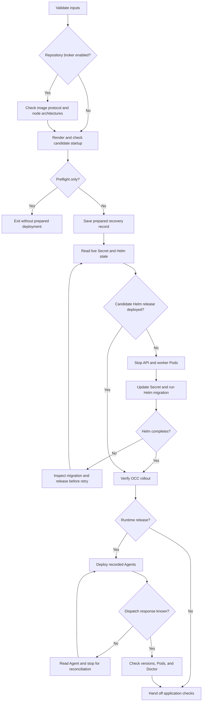

# Production image upgrade flow

## Overview

`scripts/upgrade-production-images` updates the OpenClaw Control Plane (OCC),
Agent runtimes, or both. The controller-only command ends after the OCC API and
worker recover; it does not request Agent deployments. A runtime release deploys
a new version for every Agent that was running when the command began and ends
after the selected Pods are ready and each replacement gateway passes read-only
Doctor lint. Model and external integration checks remain operator tasks.

## Entry Points

- Trigger: an operator runs `scripts/upgrade-production-images` with one or both
  image options and explicit cluster, release, source, and protected-file inputs.
- Required state: a healthy production Helm release and matching OCC and
  Kubernetes Installation identity. Runtime releases additionally require a
  complete authorized fleet inventory with no deployment in progress.
- Source: `scripts/upgrade-production-images`,
  `packages/occ/src/index.ts:OpenClawController.getInstallationDeploymentInventory`,
  and `packages/occ/src/index.ts:OpenClawController.deployAgent`.

## Flow

## Execution Trace

### 1. Prepare the candidate

`scripts/upgrade-production-images:prepare_upgrade`

The script verifies protected files, cluster, deployed Helm release, and matching
OCC and Secret Installation IDs. It compares all protected and live configuration,
including selected image fields, and captures separate reviewed candidate files. Only
the Slack directory proxy and curated Codex PluginDriver selection may change;
other Helm and Installation settings, including new fields, remain protected.
The broker guard compares references, not ConfigMap or Secret contents. Image
flags select images after comparison. Runtime releases record each running Agent's
baseline version from complete authorized inventory. Nonterminal deployments,
missing selected versions, or unready Namespaces stop preparation. Stopped and
deleting Agents are excluded; pending repository cleanup does not block preparation.

Repository-enabled releases require explicit immutable controller and broker
images. The helper inventories all nodes matching the control plane selector,
including unready and cordoned nodes; they must have one native architecture.
`scripts/upgrade-image-identity.py:read_platform` reads Docker's native OCI export,
resolves the selected manifest's configuration, retains JSON objects within
2 MiB per-blob and 32 MiB total metadata limits, checks their hashes, and verifies
the configuration's platform. Compressed filesystem layers are outside that budget.
`scripts/upgrade-repository-image-probe.mjs` runs both images with synthetic
inputs and a private receipt listener. It checks recovery and refused reservation
through the actual Driver and broker, recording the selected digest, platform
manifest, configuration, requests, and responses. This proves wire compatibility,
not Kubernetes image availability, receipt durability, or disposal. The helper
preserves the live broker hostname; broker restart recovery remains an operator
task in the [broker procedure](../guides/repository-credentials/installation.md#install-and-verify).

After rendering the chart and running a server-side Helm dry run,
[`scripts/upgrade-startup-preflight.mjs`](../../scripts/upgrade-startup-preflight.mjs)
copies rendered API and worker Pod templates (selected controller image, env,
mounts, service account) into one-shot Pods whose Installation volume uses a
temporary candidate Secret. Each runs `loadStartupConfigurationSnapshot` and
`loadInstallationConfiguration`, resolving Drivers and Preset files without the
database. On a typed configuration refusal,
`apps/controller/src/startup-failure.ts:formatStartupConfigurationFailure` prints
up to 32 field diagnostics through the API/worker log filter. The helper saves
the paths and messages in component logs before stopping writers.

With the bundled Kubernetes Compute Driver, each Pod runs
`KubernetesComputeDriver.preflight` with its Kubernetes credentials (its service
account in `inCluster` mode), as API and worker startup do. This refuses, for
example, single-cluster [split-layout Gateway storage](../reference/drivers/kubernetes-compute.md#existing-split-layout-installations).
Each Pod checks the stored Installation name from `occ installation get` with
the image's `isName`, as the controller does after reading the database
(`INSTALLATION_NAME_INVALID`); an image without the rule skips it.

Experimental two-cluster Pods also run
`KubernetesComputeDriver.verifyExecutionTenantGrants` for their component; startup
does not. Where each Pod's identity holds the release-era grant in an execution
tenant Namespace, SelfSubjectAccessReviews ask for newer `openclaw-execution`
rules: API Pod and `pods/proxy` reads, plus `pods/log` and Event reads with runtime
logs; worker Pod `patch` and `batch` Job `get`, `create`,
and `delete`. Worker Job grants are required even with runtime logs disabled.
A missing rule refuses the candidate and points to
[upgrading the execution chart](../testing/kubernetes.md#upgrade-the-execution-chart).

When the chart renders `openclaw-enterprise-dependency-egress`, the helper first
creates a temporary NetworkPolicy with its egress and execution-cluster API
rules. The chart's default-deny NetworkPolicy also selects the Pods. Only after
both Pod creates does the helper try to save their statuses and logs. A startup
failure, stuck image pull, timeout, failed create, or missing usable UID stops
preparation before writers stop. Best-effort cleanup of the temporary Secret,
Pods, and conditional NetworkPolicy asks Kubernetes to delete each only with the
unique ID (UID) returned on create, leaving same-name replacements alone. The
helper never deletes by name alone; the operator must check whether an ambiguous
create left an object behind.

With `--preflight-only`, the helper leaves writers running, retains private
evidence, and exits without marking preparation complete. The evidence cannot be
resumed; deployment repeats checks with reviewed inputs in a fresh directory.

For an upgrade, the script saves candidate inputs, inventory, target identity,
and parameter hashes, then marks preparation complete. A per-directory lock
prevents concurrent record use. The operator must freeze other writers,
autoscalers, Helm changes, and runtime draft edits as specified in the
[production guide](../guides/deploy/production-upgrade.md).

### 2. Reconcile a prior attempt

`scripts/upgrade-production-images:506`

On every attempt the script rereads Helm status and values and the Installation
Secret. Only the recorded baseline or candidate values are accepted; the
Secret's UID, Installation annotation, and other data must match the baseline.
Without the prepared record, resume stops: inspect the evidence and any remaining
preflight resources. Resume also binds the original kubeconfig contents,
inputs, OCC URL, scripts, flow, chart, and pair evidence. It requalifies the pair
and rejects a changed eligible-node set. Candidate files must still match the saved reviewed inputs; the
helper applies the saved candidate. Unexpected drift or an in-progress Helm
release stops the command.

If a previously started Helm release is deployed at a newer version with the
candidate values, the script continues without repeating Helm. Otherwise it
requires the operator's migration-history check and refuses a retry while an
initialization Job or Pod remains active. A failed or disconnected migration may have
committed; the check and Job inspection are operator-owned and are not a
rollback. The guide describes the required attestation and recovery.

### 3. Quiesce writers and run the candidate release

`scripts/upgrade-production-images:624`

Before changing the Secret or invoking Helm, the script scales the selected API
and worker Deployments to zero, waits until their Pods disappear, and confirms
both desired replica counts remain zero. Kubernetes requests in this phase share
the configured shutdown deadline. This covers the selected Helm release;
it does not detect independent database writers, autoscalers, or partitioned
nodes. The operator must stop those writers and keep nodes reachable.

The protected files are atomically replaced with the saved candidate. When the
Installation changes, including a controller-only settings release, the script
reads the Secret before updating its Installation key, preserving other data
and metadata with a resource-version precondition.
If the candidate is already present after a lost response, it does not write it
again. The candidate Installation checksum is included in both OCC Pod
templates.

A durable marker precedes `helm upgrade`. The Helm initialization hook checks
the Installation, then runs the candidate migrator and bootstrap, before API and
worker rollout. If Helm
fails, resumption reads its current status and migration state before a retry;
it does not start the old image to undo a committed schema change.

### 4. Verify control-plane recovery

`scripts/upgrade-production-images:694`

The script waits for both OCC Deployments, checks their controller image and
replica count, and checks the Installation checksum when its configuration
changed. It requires exactly one named container for each component. For a
broker-enabled worker it also accepts a restartable init container, provided
no worker exists in the ordinary container list. It rejects a non-restartable
init worker or ambiguous placement. It retries authenticated OCC access and verifies the same Installation ID. A
controller-only release then ends without requesting Agent deployments.
An existing version keeps the Pod specification of the controller that
deployed it only until the worker prepares it again. Agents with repository
credentials get a maintenance pass every 30 seconds (the repository Driver's
`maintenanceIntervalMs`) until their repository session deadline. Other Agents
are prepared again only when their deployment was still finishing as the new
worker took over (the helper checks for unfinished deployments only before a
runtime release).
Kubernetes Compute applies the Gateway and, for dedicated Harnesses, Harness
Deployments as the new controller renders them, with the Installation's current
images, so a changed Pod template (for example new entrypoint arguments or
readiness probes) rolls those Pods once on the unchanged runtime image. Chat is
unavailable until the new Pods are ready, about 17 seconds in one test.
Controller fixes to Gateway and Agent Pods, such as
[diagnostics](agent-deployment-diagnostics.md) mappings, reach an Agent then or
at its next deployment.

For a repository-enabled release, it also verifies the ready API and worker
Pods, their owning ReplicaSets, node architecture, and runtime controller and
broker image IDs against the qualified pair. The deployed Driver checks the real
broker's admission capability without opening a session. Pod identities must
remain stable across that check and before dispatch and completion.

### 5. Deploy and verify the recorded fleet

`scripts/upgrade-production-images:797`

Before sending each ordinary exact-Agent deployment request, the script records
an intent. Successful responses are saved atomically. On resume, existing
responses are reused; an intent without a response triggers an Agent readback
and stops for operator reconciliation. The helper does not infer rejection from
an unchanged selected version or replay an unknown request. An operator can
record a verified accepted response and resume.

The script polls each returned deployment through its authorized status
operation, confirms the selected version, and waits for all version Pods
to be `Running` and `Ready` on the candidate runtime digest. Before OpenClaw
starts, `GATEWAY_RUNTIME_ENTRYPOINT` runs `openclaw doctor --fix
--non-interactive` once when an agent database uses an older schema, such as a
2026-09-28 release Gateway's; a database still older holds the Gateway unready
with check `state-migration`. Embedded execution
requires one runtime container; dedicated execution requires both gateway and
Agent containers. Each replacement gateway then runs read-only
`openclaw doctor --lint --json --severity-min error`. Failures retain dispatch,
status, Pod, and Doctor evidence for inspection.

### 6. Hand off application verification

`docs/guides/deploy/production-upgrade.md:Verify the release`

Successful script completion proves the selected Helm rollout and OCC access.
For a runtime release it also proves the recorded deployments and Pods reached
the checked states and Doctor reported no error. The operator next verifies
model responses, providers, channels, credentials, workspace continuity, native
access, and required restore behavior.

### Read-only export after a split-layout refusal

The [split-layout export fallback](../guides/deploy/split-layout-upgrade.md#export-and-re-create)
begins with the read-only `scripts/split-layout-tenants.mjs export --out FILE`.
Its `createOccApi.expect` requires a data envelope for each successful resource
response before `exportTenants` assembles the bundle. Malformed JSON, an empty
body, or a missing data envelope stops export with a nonzero exit before `main`
writes the bundle; an actual empty collection remains valid. The next owner is
the operator, who retries the read after restoring the API response path and
checks the exported inventory before following the recovery procedure. Empty
204 deletes and explicitly accepted 404 responses retain their existing meaning.

## Debugging and Verification

- Inspect `server-dry-run.txt` for chart or admission failures before mutation,
  and `preflight-<api|worker>.log` and `-status.json` for a rejected candidate.
- For OCC rollout failures, inspect `helm-upgrade.txt`, initialization Job logs,
  and API and worker rollout status.
- For runtime failures, inspect `dispatch/*.error`, version history, and
  `status/*.json` before retrying anything. Doctor failures are recorded in
  `status/*.doctor.json` and `status/*.doctor.error`.
- Compare `before-workloads.json` and `after-workloads.json` for unexpected
  workload changes. The controller-only helper requests no Agent deployments;
  one same-image Pod template rollout per affected Agent is expected. Separately
  check repository-bound versions affected by broker restart.
  Runtime proof should show the intended replacements.
- Use the credentialed production Kubernetes integration with distinct baseline
  and candidate images for end-to-end proof. Mocked commands prove only script
  control flow.

## Related docs

- [Production upgrade guide](../guides/deploy/production-upgrade.md)
- [Production installation](../guides/deploy/production-installation.md)
- [Production Agent verification](../guides/deploy/production-agents.md)
- [Agent deployment reference](../reference/agents/deployment.md)
- [Production startup flow](production-startup.md)
- [Controller worker flow](controller-worker.md)
- [Authoritative platform design](../design.md)

## Manual Notes

[keep this for the user to add notes. do not change between edits]

## Changelog

- 2026-10-25 06:51: Identify temporary preflight resources by UID before cleanup. (authoring-run/d15969fb-1113-416f-9573-e045dd683b66 - dd36945fec0ec3de38cd15b971537eb10a90d0e4)

- 2026-10-23 09:50: Document preflight-only rehearsal and fresh checks at deployment. (authoring-run/3c1a4d88-d619-47e3-9eba-dbaf0988d2e9 - 4e9f5935d5fa4878a719e82db5e504ec6ae55d64)

- 2026-10-20 01:48: Preserve field diagnostics before quiescence. (authoring-run/9d1ff825-b9f4-492a-9420-1e316d820e28 - e7e5f3321cb0a8471d74964eba56ddd069a4e4c5)
- 2026-10-19 22:34: Document that pending repository cleanup does not block upgrade preparation. (authoring-run/d59b973b-1f0b-46bb-b16f-d67bd24ed6d3 - 57acafe81482a890b02ae530793246f2c2e7be79)

- 2026-10-18: The initialization hook checks the Installation before migration.
- 2026-10-12 15:14: Record bootstrap Job grants required by the two-cluster upgrade preflight alongside the fixture correction. (authoring-run/ebb1c629-97b2-4b9a-aa67-a5e750346031 - 9578f6f7aaff9b8545346f43043cbc5b9bcf674e)

- 2026-10-10 03:30: Say that the worker's next preparation of an existing version applies the new controller's Pod templates and rolls changed Pods once. (fix-990-991)

- 2026-10-10 02:10: Require complete successful API responses before publishing the split-layout export bundle. (authoring-run/35b00357-b0c6-459f-aec1-b4fb63620dff - 0886f47d05fdeb2fa4359f4840fb77378d643bac)

- 2026-10-09 21:10: Gateways migrate an older agent database with Doctor before OpenClaw starts. (fix-971)

- 2026-10-09 20:10: Point the split-layout export at the split-layout upgrade page, where in-place adoption comes first. (fix-533-adopt)
- 2026-10-07 21:20: Refuse a two-cluster upgrade before quiescence when the execution chart lacks this release's tenant grants. (fix-758)

- 2026-10-07 12:00: Say that a controller-only release leaves existing versions on their old Pod specification until the next deployment. (dogfood-r43)

- 2026-10-05 15:01: Keep filesystem layers outside the image identity metadata budget. (authoring-run/0b8bd46b-85c0-4664-8dbd-2ee77cd7b602 - 08248f8dbf227dfb7b73162056b6afd1c33cee0d)

- 2026-10-05 06:00: Save and report every preflight Pod's result before cleanup, not only the first failure.

- 2026-10-05 04:00: Load the candidate Installation with the selected controller image in one-shot Pods before quiescence.

- 2026-09-28 12:36: Qualify the selected repository image pair and verify deployed identities and capability. (01a0e6ca-95a4-7e80-aab8-38c5e92a53da - 374dfd4c58587f64d859d4aa4fdaf446b158402a)

- 2026-09-28 11:36: Restrict candidate changes to the reviewed proxy and curated catalog settings. (authoring-run/829b465b-4176-428a-a748-59968ab63b04 - e3bcdb9b3a82d16016c023a8a77d683bf0079ce7)

- 2026-09-28 08:49: Verify the named controller image across ordinary and restartable worker placement. (authoring-run/4c22438e-4a96-4125-bdbb-47a3547a1232 - dcf7c58ef3fe7f6ec6ffc33c1062fee93c9bdeb2)

- 2026-09-28 07:58: Guard repository Backend, Driver, network, and cluster trust settings during candidate preparation. (authoring-run/1d4977e8-b5e5-4b20-9909-bedc3c5b3900 - 2fd914a7273bb09e9d91543c806a4091772191f6)

- 2026-09-28 07:39: Record reviewed configuration candidates and strict live baseline checks. (authoring-run/3c681647-a494-4613-809e-11113e5ed11c - ec51e917954207b49d66f3cb28a7d4887fcd9ea1)

- 2026-09-28 07:02: Record quiesced migrations and resumable release and dispatch recovery. (authoring-run/ef0e4dd2-3f52-48b4-a742-60dfbb85864a - e06ff9625e72ff5ab3483a504a2f02a69a370cbb)

- 2026-09-26 22:28: Preserve the selected repository broker hostname before image upgrades. (authoring-run/1495f489-e298-44e9-b75d-6a49445d35e3 - 7caf53332219db12fed62180c3c6d270baa8ea63)

- 2026-09-25 13:40: Document Helm migration ordering and add post-readiness OpenClaw Doctor lint for replacement gateways. (authoring-run/d35fd05b-5bbd-4f21-a747-820c2df23b2c - 077e26ba0c0babe033569105e3a7e89abf06f40d)
- 2026-09-25 12:29: Split controller and runtime releases while retaining an optional combined path. (authoring-run/ab700e2e-1baf-400c-ab18-0aa9a351f351 - 5e747ac1722f757d7949746e9ff9982142c8536b)
- 2026-09-24 21:21: Separate operator instructions from the runtime trace; require version-read admission, HTTPS, Kubernetes reads with request timeouts, and the complete execution-mode workload set. (authoring-run/613d1e94-a661-4781-bae5-e28613aa3cf9 - c799988036f43ce1bb828373233f03cc77bb0ea9)
- 2026-09-24: Record cluster/OCC identity binding, live/protected input equivalence, the supported empty-fleet path, and runtime Pod readiness discovered by the production rehearsal.
- 2026-09-24 13:43: Trace fail-closed inventory admission, nonterminal deployment rejection, and the one-time controller-only bootstrap for older OCC versions. (authoring-run/0fc7c19b-0e15-498c-8328-e436bc702f37 - a7a609d5867398dd0dfd3bb77cfebf91b2cad116)
- 2026-09-23 12:32: Trace matched image replacement and concurrent exact-Agent deployment through durable status convergence. (authoring-run/d29bdbc5-2a6a-46fa-a8e5-6ad78ea2e486 - 78cf9fd25f08e91158617fbd0ae3e42a22e54361)
