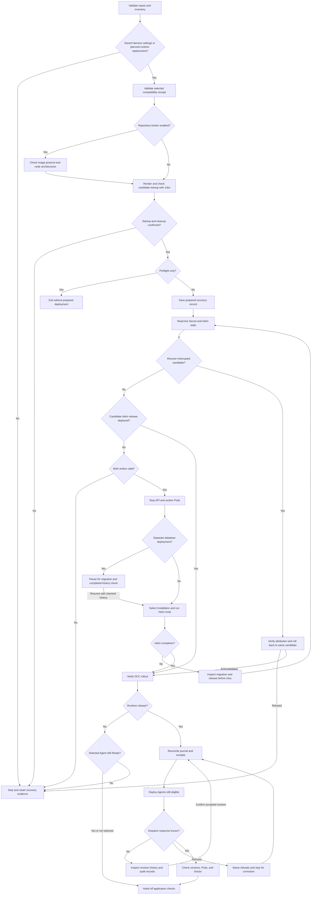

# Production image upgrade flow

## Overview

`scripts/upgrade-production-images` updates OCC and Agent runtimes. Controller-only
upgrades optionally verify an original Agent revision. Runtime upgrades redeploy
running Agents, checking readiness and read-only Doctor lint.

## Entry Points

- Run `scripts/upgrade-production-images` with images, target, release, source
  revision and protected files.
- Required: healthy production Helm release, matching OCC/Kubernetes Installation
  IDs and complete authorized inventory without active deployments.
- Source: `scripts/upgrade-production-images`,
  `packages/occ/src/index.ts:OpenClawController.getInstallationDeploymentInventory`,
  and `packages/occ/src/index.ts:OpenClawController.deployAgent`.

## Flow

## Execution Trace

### 1. Prepare the candidate

`scripts/upgrade-production-images:prepare_upgrade`

Reject nonempty [Helm target/TLS overrides](../guides/deploy/production-upgrade.md) before access.
`HEAD` must match `--source-revision`; chart changes, symlinks and internal
evidence/baseline aliases are rejected. Other edits and image provenance remain unchecked.

Resume locks evidence paths, devices and inodes, including aliases; runtime upgrades lock dispatch journals.

`matches_yaml` compares [baseline](../guides/deploy/upgrade-baseline.md#record-the-release-and-its-configuration)
and live mappings, then validates candidates. Invalid input or unwritable evidence causes `Cannot compare upgrade YAML`. Projections and `cmp` compare
protected settings, allowing Slack directory proxy, curated Codex PluginDriver selection,
and wrapping one registration in an array. Removing empty
`agentNativeAdmin.sharedCookieDomain` affects only baseline projection;
live comparison stays exact. Immutable reference switches require
string keys. Startup validates controllers; broker checks references,
not contents.

Before temporary writes, require one inventory document with valid ownership,
collections, IDs and selection states. Controller-only
`occ agent revision AGENT_ID REVISION_ID` must return one owned revision with
object-valued Harness settings. Retain IDs and validation outcome; drafts cannot
substitute. Runtime upgrades record replacements; draft validation requires image
support and size compliance. Quiescence is not atomic; repository session
continuity is unverified.

Refuse nonterminal deployments. Runtime upgrades require baseline versions and
ready Namespaces. Exclude stopped/deleting Agents; allow pending repository cleanup.

`prepare_upgrade` copies the PostgreSQL `run` result;
`validate_controller_compatibility` calls
`scripts/upgrade-evidence.py:validate_compatibility` before preflight to check
runner/file consistency, both passing data and IAM cases, cleanup, and recorded incumbent
release and selected candidate digests. Hashes freeze the copy for resume.
Runner SHA cannot verify image source. This neither authenticates execution nor
permits online migration or rollback; see [qualification limits](../guides/deploy/production-upgrade.md#upgrade-the-control-plane).

`verify_agent_continuity` requires Agent read/operate, active AgentRevision read
and runtime inspection. It brackets explicit-revision runtime reads with Agent
reads, freezing identity and Driver-declared roles in `agent-continuity.json`,
not editable topology.

Repository-enabled releases require immutable controller/broker images and one
architecture across matching control-plane nodes, including unready/cordoned ones. `scripts/upgrade-image-identity.py:read_platform`
verifies the selected platform and blob hashes from Docker OCI exports
(2 MiB/blob, 32 MiB total metadata).
`scripts/upgrade-repository-image-probe.mjs` tests both images
for recovery and refused reservations using synthetic inputs and a private receipt
listener, recording image identities, requests and responses.
Kubernetes image availability, receipt durability and disposal remain unverified. The broker hostname
stays fixed. See [broker restart recovery](../guides/repository-credentials/installation.md#install-and-verify).

For immutable reference switches, `prepare_upgrade` validates both identities,
unrelated data and candidate YAML, then hashes staged bytes; `upgrade-evidence.py` binds both snapshots.
Changed immutable data requires a successor. Mutable data changes require a Kubernetes self-review of named-Secret update access. Denial stops preparation; an inconclusive review warns and continues.
Replacement still requires update permission.
Rendered Certificates must pass server-side dry-run admission before startup Jobs.
`scripts/upgrade-startup-preflight.mjs` copies controller images, environment,
mounts and service accounts into single-Pod Jobs with the candidate Secret,
no retries and the selected deadline. `preflight_startup` verifies Job UID and
child ownership. It waits for children and refuses replacements or
multiple children. Job failure overrides child success.

The API loads themes with
`apps/controller/src/composition/console-theme.ts:loadConsoleTheme`. Invalid bundles
stop preflight; workers skip themes. Both call
`loadStartupConfigurationSnapshot` and `loadInstallationConfiguration` to resolve
Drivers and Preset files without opening the database.
`apps/controller/src/startup-failure.ts:formatStartupConfigurationFailure` formats
typed configuration refusals with up to 32 field diagnostics through the API/worker
log filter. Before and after log retrieval, it checks Job/Pod identity; it rejects NUL bytes
before parsing markers and discards unbound output.

Bundled Kubernetes Compute Driver `preflight` uses Pod credentials (`inCluster`
service account), matching startup. It refuses
[split-layout Gateway storage](../reference/drivers/kubernetes-compute.md#existing-split-layout-installations)
on single-cluster upgrades.
The image's `isName` validates `occ installation get` names
(`INSTALLATION_NAME_INVALID`); older images skip this.

For runtime upgrades, the API Pod calls `resolveConfiguredHarnessId` before
`refuseUndeployableConfigurationValues` on recorded drafts; deploy checks live
Harness state. Refusals leave old writers serving. Correct drafts, stop affected
Agents, or replace images lacking a working resolver, then use fresh evidence.
Images predating this check, or gzipped drafts plus Installation exceeding 1 MiB,
warn and defer validation to deploy.

Experimental two-cluster Pods also run
`KubernetesComputeDriver.verifyExecutionTenantGrants` for their component; startup
does not. For Pod identities holding release-era execution-tenant grants,
SelfSubjectAccessReviews ask for newer `openclaw-execution` rules: API Pod and `pods/proxy` reads, plus `pods/log` and Event reads with runtime
logs; worker Pod `patch` and `batch` Job `get`, `create`,
and `delete`. Worker Job grants are required even with runtime logs disabled.
A missing rule refuses the candidate and points to
[upgrading the execution chart](../testing/kubernetes.md#upgrade-the-execution-chart).

Preflight Jobs retain default-deny labels and a copy of
`openclaw-enterprise-dependency-egress`, including execution-cluster API rules.
Controller ownership addresses EKS's standalone-Pod limitation; verify enforcement.

Startup failures, timeouts and unconfirmed creates leave writers serving. Create errors remain in `preflight-<resource>-create.err`.
`cleanup_preflight` requests UID-guarded foreground Job deletion and polls for up to
30 seconds per Job until it, its UID-selected children and recorded child disappear. Then it deletes Secret and policy by original UID.
Ambiguous Job creates or unconfirmed consumer cleanup retain these dependencies
and refuse progress. Replacements remain untouched. Reconcile failures recorded
in `preflight-cleanup.err` before retrying.

Reference switches recheck both Secrets after cleanup.
`--preflight-only` leaves writers serving with non-resumable evidence.
Preparation saves candidates, inventory, target and parameter hashes
under lock. `scripts/upgrade-production-images:interrupted_upgrade`
retains it and skips preflight cleanup on `SIGHUP`, `SIGINT`, or `SIGTERM`.
Before unlocking, confirm helpers stopped; reconcile accepted operations/resources. Freeze other writers, autoscalers, Helm changes and runtime
drafts per the [production guide](../guides/deploy/production-upgrade.md).

### 2. Reconcile a prior attempt

`scripts/upgrade-production-images` binds resume to the prepared inputs, directory,
source and cluster, requalifies images, and rejects changed eligible nodes.
Values must match baseline, candidate or the recorded predecessor and revision.
Resume checks immutable intent, Secret identity and unrelated data. `verify_installation_switch`
rechecks both immutable Secrets' UIDs and complete data. Pending Installation
writes require a mutable Secret before scaling. Retries require migration-history review and terminal
initializer Jobs/Pods. `new_attempt` fsyncs attempt-directory ancestors before
publishing pointers.
Ordinary resume skips Helm only at the exact submitted deployed revision.

For [same-candidate recovery](../guides/deploy/production-helm-recovery.md),
`scripts/upgrade-helm-state.py:recover` checks the original Helm payload, ownership,
completed Job and owned Pod, including exact security contexts. `pod_matches`
uses Compute's `resource-quantities.ts` comparator for declared requests/limits.
Reads use manifest namespaces; ownership stays bound to the release. Durable
exclusive intent precedes identity rechecks and rollback with hooks enabled.
`require_absent` rejects remaining predecessor-only resources before intent,
before rollback, after rollback and on resume. `verify_workload_changes` requires
retired environment entries and container placements absent before rollback; afterward all changed selections must
match. Neither check deletes resources. Changed nonnative resource specs require exact
candidate matches. Resume rechecks recorded UIDs without pinning old versions.
Only pre-upgrade hooks are supported. Resume requires an acknowledged successor.
Client shutdown, exclusive ownership, resource reconciliation and database history
remain operator attestations.

### 3. Quiesce writers and run the candidate release

`scripts/upgrade-production-images:quiescence_remaining` bounds shutdown.
Validate both Deployments before stopping either. Sequential JSON patches test
UID, resource version and replicas; later conflicts can leave the API stopped.
Pods must disappear and original Deployments remain at zero. Operators stop other
writers/autoscalers and keep nodes reachable. With `database.upgradeMigration: separate`,
the helper records stopped Deployment UIDs and generations, then exits 3. Resume requires
those same stopped writers and checked history.

Protected files adopt the candidate atomically. Mutable Secret updates use a resource-version
precondition and preserve unrelated data. A reference switch retains both Secrets unchanged;
both OCC templates select the successor and its checksum.

`upgrade-helm-state.py:new_attempt` renders and dry-runs immutable values with a
fresh `installation.upgradeAttemptId`, copied to hooks and the initializer Pod.
`record_submission` saves intent and predecessor before publishing `helm-started`.
Identical interrupted staging can finish; staged retries cannot replace published
intent. In separate mode,
`scripts/migration-history.mjs:migrateWithHistory` verifies the completed candidate
ledger, catalog and grants under the migration lock. Pending or unsupported history
fails the hook. In hook mode the migrator applies pending SQL.

### 4. Verify control-plane recovery

`scripts/upgrade-helm-state.py:verify_installation_consumers`

Verify Deployment images, replicas and changed Installation checksums.
Reference switches verify both Secret identities and actual Installation mounts in
controllers and the owned initializer Pod. Each component needs one named container.
Broker-enabled workers permit restartable init containers; other placements fail. Authenticated OCC
access is retried and must return the same Installation ID.
Worker preparation re-renders current launch requirements.
Repository-bound Agents receive maintenance every 30 seconds until their session
deadline; other Agents are re-prepared if deployment remains unfinished.
Kubernetes Compute rolls changed Gateway and Harness Pod templates even with
unchanged runtime images. Chat waits for readiness.
OpenShell instead requires exact existing Sandbox content
(`apps/controller/src/drivers/sandbox/openshell.ts:verifyExistingSandbox`).
Generated-command changes require a fresh Agent revision; controller-only reuse
cannot adopt them. See the
[upgrade guide](../guides/deploy/production-upgrade.md#prepare-the-release).
Other Agents receive Pod configuration and [diagnostics](agent-deployment-diagnostics.md)
fixes on preparation or deployment.

Repository-enabled releases verify Ready API/worker Pods, owning ReplicaSets,
node architecture and runtime image IDs against the qualified pair. The Driver
checks broker admission without a session. Pod identities must remain stable
through that check, dispatch and completion.

### 5. Deploy and verify the recorded fleet

`scripts/upgrade-production-images:confirmed_deployment_status` and
`scripts/upgrade-dispatch-state.py:transition`

Flush intent before dispatch. Unresolved intents block
later sends. The journal records accepted revisions and definite refusals; resume may retry
refusals. Superseded receipts remain; replacements must name the current
failed revision. Unknown outcomes or stale journals require
[recovery](../guides/deploy/production-upgrade-recovery.md).

Verify authorized deployment status, version and ready Pods on the candidate
digest. Before startup, `openClawStateMigrationHelper` in
`runtime-startup.ts` runs `openclaw doctor --fix --non-interactive` for older schemas.
Current schemas and Doctor's settled result gate startup: maintenance or cleanup
refusal holds `state-migration` unready; ordinary warnings do not. A private pending
marker forces interrupted or refused maintenance to retry after restart, even with current schemas. The same step
runs before Harness native setup or native-worker connection. Embedded execution
requires one runtime container; dedicated execution requires Gateway and Agent containers.
Each replacement gateway runs read-only
`openclaw doctor --lint --json --severity-min error`, one at a time, with a heap cap
(`--doctor-heap-mib`, default 384 MiB). Doctor shares the gateway's memory limit;
an OOM kill can stop both. The cgroup v2 check (`gateway_free_memory`) requires
one reading with cap plus 640 MiB free or two consecutive readings with cap plus
256 MiB. This reserves no memory. Transient failures are retried.
Initially unavailable data allows warning and run.
After insufficient memory, unavailable reads reset consecutive evidence; only fresh
sufficient readings admit Doctor before its deadline.
Reports distinguish Doctor's exit status from gateway restarts since Ready.
Missing/incomparable counts or Pod identities report unknown; only a comparable
increase with last termination `OOMKilled` establishes OOM. A memory timeout
starts no further Doctor. Then, also after a failed Doctor, `revision_pod_change_since_ready`
fails the upgrade for any revision Pod the wait required (gateway or dedicated agent)
missing, replaced, restarted, or unready; the readiness wait ignores ended Pods, so
resume checks the replacement.

### 6. Hand off application verification

`docs/guides/deploy/production-upgrade.md:Verify the release`

Completion requires the expected Helm revision and OCC access; runtime upgrades
also require deployment, readiness and Doctor success. For selected-Agent checks,
`verify_agent_continuity` waits before terminal controller/Helm checks.
Each role needs one Running, Ready Pod; replacement UIDs and completed init
containers are valid. An eight-Pod result reaches the endpoint cap and cannot prove role uniqueness.
Previously observed provider Harness status must remain running. Failure retains
observations without `completed`; resume rechecks without rerunning successful Helm.

The private `completed` marker refuses resume. Reconcile failed writes; absence proves nothing. Separately verify routing,
models, channels, credentials, workspaces and restores. Check console publication with [`verifyConsoleRelease`](../release/container-promotion.md#verify-the-served-console).

### Read-only export after a split-layout refusal

The [split-layout fallback](../guides/deploy/split-layout-upgrade.md#export-and-re-create),
`scripts/split-layout-tenants.mjs:createOccApi.expect`, rejects malformed JSON,
empty bodies and missing envelopes before export. Empty collections, 204 deletes
and explicitly accepted 404s remain valid.

`importTenants` resolves unsaved targets by name and rejects shared destinations
before mutations. Saved IDs stay reserved even for skipped sources; unsaved
skipped sources reserve nothing. Correct the map, rename distinctly or skip.
Validated mappings resume without undoing prior merges. Rename keys are literal,
including `constructor` and `__proto__`. Unsaved exact-name reuse requires no
Agents or Secrets.

## Debugging and Verification

- Read `helm-attempts/<UUID>/{render-error.log,server-dry-run-error.log}` for native
  preparation failures; `server-dry-run.txt` retains successful output. Inspect
  `preflight-<api|worker>.log` and `-status.json` for rejected candidates.
- For scale, Helm upgrade, or rollout failures, inspect
  `native-command-failures.tsv`; see [upgrade recovery](../guides/deploy/production-upgrade-recovery.md).
- For runtime failures, inspect `dispatch/*.error`, `dispatch/*.rejected`,
  version history, and `status/*.json`. Doctor failures: `status/*.doctor.json` and `status/*.doctor.error`.
- Compare `before-workloads.json` and `after-workloads.json`. After a controller-only release, expect one same-image Pod template
  rollout per affected Agent. Separately check
  repository-bound versions affected by broker restart.
- End-to-end proof requires credentialed production Kubernetes integration with
  distinct images; command fixtures prove script control flow.

## Related docs

- [Production upgrade guide](../guides/deploy/production-upgrade.md)
- [Production installation](../guides/deploy/production-installation.md)
- [Production Agent verification](../guides/deploy/production-agents.md)
- [Agent deployment reference](../reference/agents/deployment.md)
- [Production startup flow](production-startup.md)
- [Controller worker flow](controller-worker.md)
- [Authoritative platform design](../design.md)

## Manual Notes

[keep this for the user to add notes. do not change between edits]

## Changelog

- 2026-11-10 05:12: Validate inventory; minimize evidence. (authoring-run/385b41d3-8e61-4539-b226-412dd1b2615d - 7230b1a2a177aa8b413cdd2d3847cd4be0ac644e)

- 2026-11-09 23:49: Separate database deployment from service replacement under writer quiescence. (authoring-run/7af6f256-ebf7-4a66-8e78-6a769781d94f - ef18e491453481577c607a4c78574cbbce594263)

- 2026-11-09 07:05: Check named Secret update access before quiescence. (authoring-run/f98ccc9d-c174-4103-a385-d4d24950e54d - 09fe300b1ede4b59741b527a3b45199b435d7d6c)

- 2026-11-09 05:02: Bind staged immutable Installation references through upgrade recovery. (authoring-run/cfc73629-f188-4fd0-8ff4-f3b3fbf6843f - 3b898fdc4a27c5cfcc6cbeb7196d96b02368da8b)

- 2026-11-09 03:26: Check immutable Installation Secrets before stopping writers. (authoring-run/8664c38b-fe94-43f6-8922-8aa139b809e6 - ce1d22e17a)
- 2026-11-08 17:01: Integrate saved Harness preflight with attributed Helm recovery. (authoring-run/6d8fd0f0-41d7-4b04-96e3-1b3dc7b9bd1e - 6865e4de0d11ef5ce65d0d39a34cec157e8b7e9a)

- 2026-11-08 15:25: Refuse unreconciled resources, environment entries and container placements during recovery. (authoring-run/453b61bd-c21e-4f98-a7a8-3fdfbb549103 - d4333fb16c)

- 2026-11-08 15:13: Integrate attributed recovery with current upgrade safeguards. (authoring-run/0e1589f2-ec9d-455e-bd57-8c7c7eac4f41 - 0447571733)

- 2026-11-08 12:18: Reject Helm target overrides. (authoring-run/cd7fae84-40fe-4d7a-bfe0-aff970e961db - 4566d20b8ef66a3268e27bceac946765ecd5d336)

- 2026-11-07 08:18: Require single-document responses. (authoring-run/f5d332f5-a699-45b8-82ec-07b982cab516 - 0aa6334cace7c272c3b1eb69e456292a068a2c1a)

- 2026-11-07 07:39: Check exact active Harness snapshots before controller-only upgrades. (authoring-run/dd27d6b9-6dec-4ba5-bc83-d3595d72273d - e658fa14b627fc6d55c8d67a68f5668efc27397c)

- 2026-11-07 03:01: Freeze reviewed controller compatibility evidence. (authoring-run/4adaf10b-d7e7-46e1-8f30-65993c797458 - ada47832cb112f255f6c51d34dae37acce9760cd)

- 2026-11-07 02:48: Verify selected Agent readiness before completion. (authoring-run/87bf103a-4285-4561-8ab8-6a9f1e265248 - ada47832cb112f255f6c51d34dae37acce9760cd)

- 2026-11-07 02:27: Validate both writers before stopping either. (authoring-run/a2f2f4b1-8e0e-4f19-8ce3-11d6e118a054 - 7f5489fe39ba84a34987bd22d905e942cf65a8ee)

- 2026-11-06 23:52: Check container identity, quantities and attempt durability. (authoring-run/9507f38c-1639-4152-a4ae-0de499d7ca5d - a0560795)
- 2026-11-06 23:37: Fix retry publication, resource lookup and execution checks. (authoring-run/9507f38c-1639-4152-a4ae-0de499d7ca5d - bbf4891d)
- 2026-11-06 23:24: Bind attempts and acknowledge same-candidate recovery. (authoring-run/9507f38c-1639-4152-a4ae-0de499d7ca5d - 1b6c65cc)

- 2026-11-06 19:10: Bind resume to each submitted Helm revision. (authoring-run/9ac3c663-290c-4524-94bd-7157cbd44914 - f1c0865be4c523090af0dccc29c613ad1d47d542)

[Production image upgrade flow documentation history](coordinated-production-upgrade/history.md) preserves the older dated entries.
