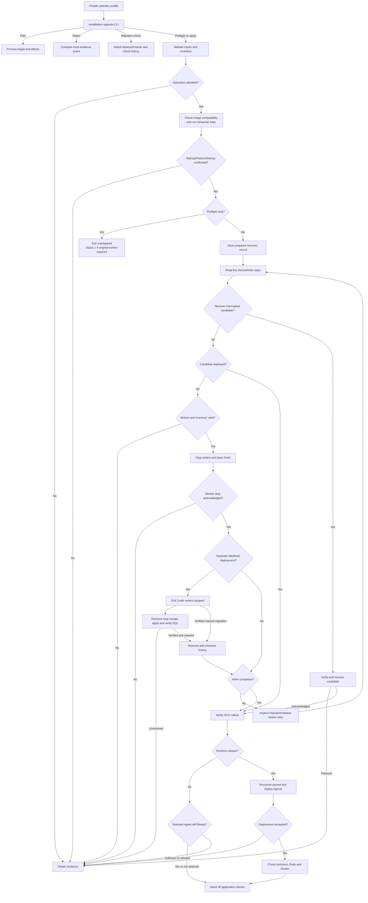

# Production image upgrade flow

## Overview

Upgrades OpenClaw Control Plane (OCC) and Agent runtimes.

## Entry Points

- Run `scripts/upgrade-production-images` with reviewed inputs, or use `occ installation upgrade` with a private operator profile.
- Stderr phases are advisory; `--verbose` shows native output.
- Required: healthy Helm release with chart-owned initializer, matching OCC/Kubernetes Installation
  IDs and complete authorized inventory without active deployments.
- Source: `scripts/upgrade-production-images`,
  `packages/occ/src/index.ts:OpenClawController.getInstallationDeploymentInventory`,
  and `packages/occ/src/index.ts:OpenClawController.deployAgent`.

## Flow

## Execution Trace

### 1. Prepare the candidate

`internal/occcli/installation_upgrade.go:installationUpgradeCommand` runs
`scripts/upgrade-production:main`. Status compares local marker scans. Plan validates
profile, images and checkout commit. The adapter decodes HTTPS with `kubectl`,
binds explicit CA bytes and previews trust. Approved apply/resume recheck bindings.

Both entrypoints refuse active kubectl preferences. With preferences enabled but
inactive, the native helper snapshots kubeconfig, refuses selected exec credentials,
and disables live-client defaults (`KUBERC=off`). Approved snapshots also refuse
selected `auth-provider` entries. Profiled recovery rechecks target and explicit CA.

Before `scripts/upgrade-production-images:prepare_upgrade`, refuse other Helm
release stores, [Helm overrides](../guides/deploy/production-upgrade.md), source
mismatch, chart edits or symlinks, and evidence or baseline aliases.
`preprovisionedNamespace` must yield one `false` (`preprovisioned-namespace.err`).

`check_migration` matches rendered/deployed migrator inputs and brackets one read-only
Job with revision checks. Success requires recognized history and UID-bound cleanup;
unknown creates retain evidence and lock.

`matches_yaml` compares candidate, [baseline](../guides/deploy/upgrade-baseline.md#record-the-release-and-its-configuration)
and live mappings. Invalid inputs or unwritable evidence yield `Cannot compare upgrade YAML`.
Projections allow Slack directory proxy, curated Codex PluginDriver selection
and one registration wrapper. The baseline projection excludes
`agentNativeAdmin.sharedCookieDomain` when absent from the candidate.
Immutable switches require string keys.

`read_restart_inventory` requires complete authorized inventory without nonterminal
deployments. Retained running revisions require saved Harness objects and an accepted
[restart assessment](../reference/repository-credentials/worker-replacement.md).
Standalone preflight rehearses explicit original-worker requirements; unknown
assessments block. Runtime upgrades record replacements and check draft images/sizes,
baseline versions and Namespace readiness. Exclude stopped/deleting Agents; allow
pending repository cleanup.

`OpenClawController.deploymentInventorySnapshot` batches deployment-work reads in
one State snapshot and refuses missing/mismatched work. Credential withdrawal is
separate. `findRevisionForBrowsing` returns `unknown` for unreadable snapshots and
propagates database/identity errors. `getInstallationDeploymentInventory` gives
Compute ten seconds outside State transactions, then rechecks fleet authorization
and Driver selections. Drift refuses inventory; owner failures return `unknown`.

`scripts/upgrade-evidence.py:validate_compatibility` checks the PostgreSQL
receipt's file binding, data, IAM, cleanup and image digests. Hashes bind
resume inputs. See [qualification limits](../guides/deploy/production-upgrade.md#upgrade-the-control-plane).

`verify_agent_continuity` brackets runtime inspection with authorized Agent
reads and records the selected revision and Driver roles in `agent-continuity.json`.

Repository credentials require immutable images and common node architecture.
`scripts/upgrade-image-identity.py:read_platform` verifies OCI hashes (2 MiB/blob,
32 MiB total). `scripts/upgrade-repository-image-probe.ts:main` probes before
preparation/resume. Its negative control requires an absent socket and Docker-confirmed
broker exit without OOM or daemon error.

For immutable switches, `prepare_upgrade` verifies both Secret identities,
unrelated data and candidate YAML; `upgrade-evidence.py` binds snapshots. Changed
immutable data requires a successor. Mutable Secret update denial blocks; an
inconclusive review warns. Certificates require server-side dry run.

`scripts/upgrade-startup-preflight.ts` builds single-Pod Jobs with candidate
images, credentials and mounts, a deadline and zero retries. `preflight_startup`
refuses changed UIDs or multiple children. Job failure overrides child success.

`migrationJob` selects the chart initializer and preserves policy labels.
Hook mode uses `--check`. In separate mode,
`check_separate_migration_preconditions` verifies Secret access, records the
migrator and CA Secret UIDs and resource versions, and requires
`migration.checked-for-installation`. Both checks allow recognized pending
history. After cleanup, separate mode rechecks identities and
`scripts/upgrade-evidence.py` binds them to the prepared run.

`apps/controller/src/composition/console-theme.ts:loadConsoleTheme` checks API
theme bundles. Both writers use `loadStartupConfigurationSnapshot` and
`loadInstallationConfiguration` without database access. For OpenShell
`bearerTokenFile`, each Job checks file type and readability without reading the token.

`connectionPlan` preserves private OIDC CA mounts and database preload. Writer Jobs
use `OCC_DATABASE_URL` for one read-only `occ.installation` result matching OCC and
the startup Secret. Statement/lock timeouts are five seconds; the full check gets 15.
Logs omit connection errors and rows.

`preflight_resume` checks history and both writer identities before shutdown or
Helm, even with both stopped. Completed Helm releases skip these Jobs.
Preflight verifies Job and Pod identities around log retrieval and rejects NUL
bytes. `formatStartupConfigurationFailure` reports up to 32 field diagnostics.

Kubernetes Compute preflight uses the Pod service account and refuses
[split-layout Gateway storage](../reference/drivers/kubernetes-compute.md#existing-split-layout-installations)
on single-cluster upgrades. Available image `isName` checks Installation names;
`refuseUndeployableConfigurationValues` checks drafts. Older images or gzipped inputs
over 1 MiB warn and defer to deployment.

Experimental two-cluster Jobs use `verifyExecutionTenantGrants` to check API
Pod and `pods/proxy` reads, optional log/Event access, worker Pod patch and Job get,
create and delete access. Missing grants require the
[execution chart upgrade](../testing/kubernetes.md#upgrade-the-execution-chart).
Startup Jobs retain default-deny and dependency egress policies. Verify enforcement.

Preflight leaves writers serving. `scripts/upgrade-preflight-state.py` records create
intent and acknowledged UIDs. `scripts/lib/upgrade-preflight-cleanup.sh:cleanup_preflight`
confirms Jobs/children gone before deleting dependencies; unknown consumers retain them.
[Interrupted cleanup](coordinated-production-upgrade/preflight-cleanup.md) uses these records.

After cleanup, recheck switch Secrets and record `startup-preflight-passed`.
Standalone preflight exits unprepared; original-worker requirements produce
`preflight-blocked-original-worker` and exit 1. Upgrade refreshes inventory and
locks candidates, inventory and target/parameter hashes.
`scripts/upgrade-production-images:interrupted_upgrade` retains the lock and skips
cleanup on `SIGHUP`, `SIGINT` or `SIGTERM`. Confirm termination and reconcile
accepted operations/resources before unlocking. Freeze writers, autoscalers, Helm
changes and drafts per the [production guide](../guides/deploy/production-upgrade.md).

### 2. Reconcile a prior attempt

Resume locks evidence and dispatch journals, verifies paths, identities, prepared
inputs, source and cluster, and requalifies images/nodes. Values must match the
baseline, candidate or recorded predecessor/revision. Resume can finish Installation
writes, mutable Secret replacement or immutable switches; `verify_installation_switch`
checks both UIDs and data. Check history and settle initializer Jobs/Pods before
retry. `new_attempt` fsyncs ancestors before publishing pointers. Failed identity or
history checks leave writers stopped. Reconcile unknown creates. Skip Helm when the
submitted candidate revision is deployed or the recorded recovery successor verifies.

With rejected Helm intent at the incumbent revision, separate-mode retry checks
handoff UIDs/generations, labels, zero replicas, deletion timestamps and writer
Pods, then validates the stop ACK against that fresh worker snapshot before new
attempt preparation or ordinary preflight. Recheck the pair before scaling and Helm,
terminal initializers and both Deployments before protected writes. A failed expected
revision uses checked retry.

For [same-candidate recovery](../guides/deploy/production-helm-recovery.md),
`scripts/upgrade-helm-state.py:recover` checks payload, ownership, terminal Job/Pod
and exact security contexts. `pod_matches` compares requests/limits through Compute's
`resource-quantities.ts`; reads use manifest namespaces and release ownership.
`check-recovery` validates the original attempt before preflight Jobs; both
application identities must pass before rollback. `recover` repeats admission before
exclusive intent/dispatch. Accepted or uncertain recovery is readback-only.
`require_absent` rejects predecessor-only resources before intent, around rollback
and on resume. `verify_workload_changes` requires retired environment entries and
container placements absent before rollback and changed selections matching afterward.
Neither deletes resources. Changed nonnative specs must match the candidate. Resume
rechecks UIDs without pinning old versions and requires successor acknowledgement.
Only pre-upgrade hooks are supported. Shutdown, exclusive ownership, resource
reconciliation and database history remain operator attestations.

### 3. Quiesce writers and run the candidate release

`scripts/upgrade-production-images:quiescence_remaining` bounds shutdown. Stop other
writers/autoscalers; keep nodes reachable. Validate both Deployments. For a
running worker, check named patch permission and refresh inventory before either
stop, including resume. Denial/drift blocks; inconclusive review warns. Sequential
patches test UID, resource version and replicas; conflict can leave the API stopped.

Fresh runs refuse a worker at zero. Resume at zero requires private
`worker-stop-confirmed.json`, bound to prepared parameters and worker UID/generation.
A successful PATCH response must confirm the same UID, next generation and zero
replicas to create it. Lost responses or invalid receipts stop progress; zero
authorizes nothing. Confirmed stops skip worker patch and inventory refresh. After drain, recheck original UIDs, zero replicas and receipt
before handoff, protected settings, Secret replacement or Helm.

Separate mode rechecks Secret identities, records stopped UIDs/generations and exits 3. Keep both writers fenced. Managed apply requires irreversible-SQL approval; a new
apply freshly checks the handoff pair, then validates the stop ACK against that
worker snapshot before journal intent or SQL-capable Job creation. Pending/completed
reconciliation and read-only verification remain intact. Unknown effects retain lock
and kubeconfig snapshot; cleanup observes prior deletes. Only cleaned failed
verification permits retry. Resume requires completed journaled verification and
rechecks Secret identities. Fence referenced Secrets throughout.

Preserve evidence after an unconfirmed stop. After handoff, reconcile the original
migration/history with both writers fenced. Otherwise reconcile the stop and verify
release, mounted Installation Secret and database compatibility before recovery.
If inventory needs a stopped API while the worker runs, restore API access only
after those checks under exclusive maintenance ownership. Destructive recovery
requires human risk review.

`upgrade-helm-state.py:new_attempt` renders and dry-runs immutable values. Hooks
and the initializer Pod receive the fresh `installation.upgradeAttemptId`.
Upgrade and recovery preserve `.json` format.
`record_submission` saves intent and predecessor before publishing `helm-started`.
Identical interrupted staging can finish. Published intent survives staged retries.
`scripts/migration-history.mjs:migrateWithHistory` checks Installation identity
and recognized history under lock for separate Jobs. Verification and the
separate Helm hook require completed history. Hook mode applies pending SQL.

### 4. Verify control-plane recovery

`scripts/upgrade-helm-state.py:verify_installation_consumers`

Verify images, replicas and changed Installation checksums. Reference switches check
both Secret identities and Installation mounts in controllers and the owned initializer
Pod. Each component needs one named container; only broker-enabled workers permit
restartable init containers. Authenticated OCC retries must return the same Installation
ID. Worker preparation re-renders launch requirements. Repository-bound Agents receive
maintenance every 30 seconds until session deadline; other unfinished deployments are
re-prepared. Kubernetes Compute rolls changed Gateway/Harness Pod templates even with
unchanged images. Chat waits for readiness. OpenShell requires exact existing Sandbox
content (`apps/controller/src/drivers/sandbox/openshell.ts:verifyExistingSandbox`).
Generated-command changes require a fresh Agent revision; controller-only reuse cannot
adopt them. See the [upgrade guide](../guides/deploy/production-upgrade.md#prepare-the-release).
Other Agents receive Pod configuration/[diagnostics](agent-deployment-diagnostics.md)
fixes on preparation or deployment.

Repository-enabled releases verify Ready API/worker Pods, owning ReplicaSets, node
architecture and runtime image IDs against the qualified pair. The Driver checks broker
admission without a session. Pod identities must stay stable through completion.

### 5. Deploy and verify the recorded fleet

`scripts/upgrade-production-images:confirmed_deployment_status` and
`scripts/upgrade-dispatch-state.py:transition`

Flush intent before dispatch; unresolved intents block sends.
The journal retains accepted revisions, definite refusals and superseded receipts.
Resume may retry refusals; replacements must name the current failed revision.
Unknown outcomes or stale journals require
[recovery](../guides/deploy/production-upgrade-recovery.md).

Verify authorized deployment status, revisions and Pod readiness on the
candidate digest. [Gateway and Harness storage](../reference/drivers/kubernetes-compute/storage-and-credentials.md#gateway-storage)
describes how state migration and retries gate runtime startup.

Replacement gateways run read-only `openclaw doctor --lint --json --severity-min error`
serially. `gateway_free_memory` requires one cgroup v2 reading above heap cap
plus 640 MiB or two above cap plus 256 MiB. After insufficient memory, only
fresh sufficient readings admit Doctor. A memory timeout stops new checks.
`revision_pod_change_since_ready` checks all required Pods even after Doctor
failure. A missing, changed, restarting or unready Pod fails the upgrade.
See [Doctor recovery](../guides/deploy/production-upgrade-recovery.md#correct-a-doctor-failure).

### 6. Hand off application verification

`docs/guides/deploy/production-upgrade.md:Verify the release`

Confirm Helm revision and OCC access. Runtime upgrades require deployment, readiness
and Doctor success. `verify_agent_continuity` precedes terminal controller/Helm checks.
Require one Running, Ready Pod per role; replacement UIDs and completed init containers
qualify. Eight results leave uniqueness unknown. Previously running provider Harnesses
must stay running. Failure retains observations without `completed`; reconcile failed
writes. Resume rechecks without repeating successful Helm; `completed` blocks resume.
Verify routing, models, channels, credentials, workspaces and restores. The
[served Console check](../release/container-promotion.md#verify-the-served-console)
accepts an optional image-bound entry digest.

### Read-only export after a split-layout refusal

[Split-layout export](../guides/deploy/split-layout-upgrade.md#export-and-re-create)
uses `scripts/split-layout-tenants.ts:createOccApi.expect` to reject malformed
responses. `importTenants` rejects shared destinations, preserves prior merges
and reserved IDs, and handles rename keys literally. Unsaved exact-name reuse
requires no Agents or Secrets.

## Debugging and Verification

- Check `helm-attempts/<UUID>/` render and dry-run output, and
  `preflight-<api|worker|migration>.log`, `-logs.err` and `-status.json`. For resume,
  use the current `upgrade-preflight-resume.*` directory.
- See [upgrade recovery](../guides/deploy/production-upgrade-recovery.md) for
  `native-command-failures.tsv`, migration journals and dispatch results.
- Compare `before-workloads.json` and `after-workloads.json` for controller-only
  rollouts. Check broker-affected repository versions separately.
- Command fixtures prove control flow. End-to-end proof requires credentialed
  production Kubernetes and distinct images.

## Related docs

- [Production upgrade guide](../guides/deploy/production-upgrade.md)
- [Production installation](../guides/deploy/production-installation.md)
- [Production Agent verification](../guides/deploy/production-agents.md)
- [Agent deployment reference](../reference/agents/deployment.md)
- [Production startup flow](production-startup.md)
- [Controller worker flow](controller-worker.md)
- [Authoritative platform design](../design.md)

## Manual Notes

[keep this for the user to add notes. do not change between edits]

## Changelog

- 2026-11-19 20:21: Require the worker stop receipt before migration and retry. (authoring-run/418defcd-00b7-4596-95cb-96610a0a2343 - 88f7c7a3b3f3430d89bcb82803c89c6dfbea2bbb)

- 2026-11-19 16:56: Distinguish fenced migration handoff from other recovery. (authoring-run/cf9ae9aa-8bb0-4bc8-af2c-326adebf9112 - abd7da2dbd99369b523fe93ec052842c77e9cd2d)
- 2026-11-19 15:27: Require an acknowledged worker stop before resume. (authoring-run/86724f58-75e9-4f02-a3a4-d285ef3a889b - 603a8d4ce1f3e47d9c8485d4dd0023c531bbd64b)

- 2026-11-19 19:15: Trace the stopped writers check before Helm retry. (authoring-run/aed0a2bc-9691-4859-8bd6-1e7b3549c9b4 - d976da889bdeca6e9208821a5b4ea79a49033b0f)

- 2026-11-19 17:18: Keep bootstrap handling in the chart. (authoring-run/803c9489-57ed-4e31-a5ea-568f16e22161 - d14128b4a0fc1f499b914107ec6ec14eccc39fdf)

- 2026-11-19 17:08: Trace migration Secret checks from preflight through resume. (authoring-run/d22a53f0-d60f-46c9-9977-2d54227dd193 - a4e6e5e73e7f6f8699dddd6c3244af6fd71c2336)

- 2026-11-19 10:54: Compose profile approval with separate database migration. (authoring-run/abedccc5-d961-4465-afd3-012cc1e5a5a5 - 6885839d6e3d8dd2f8293552d508ad4536cbf8a6)

- 2026-11-18 14:34: Retire bootstrap outputs safely (PST). (authoring-run/fcffdcd5-85ba-4fd1-ad35-bfbbcd6953b6 - ce0bd74dcbb7bdf2fd97a6d87e9ea0f88cf0199d)

- 2026-11-18 20:23: Apply and verify separate database Jobs. (authoring-run/859166ef-2ed3-42e1-b8fd-88441bb8746f - 084874338baf51ad05d0b1a2b438e8bcd0120c1b)

- 2026-11-19 17:03: Reconcile the upgrade trace and bind admission to the selected credential method. (authoring-run/1b66f15a-ca57-49d3-97bd-6ce1593f55a2 - c833b919f687c17dcb5b2e1e5037b55ed4321ac0)

- 2026-11-19 12:44: Compare status markers. (authoring-run/b54d6eb9-13cb-4072-96e2-2e285cde2402 - a02224a7e22516f958546a249ddcbfa9bfcd6012)
- 2026-11-19 12:31: Trace standalone preflight status. (authoring-run/95ab0282-a9eb-46db-9c6b-bd4cce4ee6ea - a02224a7e22516f958546a249ddcbfa9bfcd6012)
- 2026-11-19 11:30: Trace candidate rehearsal when retained Agents require the original worker. (authoring-run/099c1a03-0e25-4504-9cf7-2f62d1cfa035 - 6679017155741810c2ae1bcbacba05a3eb59f3ec)

- 2026-11-19 10:56: Refuse active kuberc. (authoring-run/9c893cda-96dc-4a06-9e08-ad2aeca46de7 - 5f425af517e8ee120c7721e7559a846ce70120e9)

- 2026-11-19 10:26: Trace kubeconfig decoding and snapshot authentication. (authoring-run/8620ea2f-2212-49a6-b45b-0c6b44bf7fa2 - b0171d98e4470aaad0ba5b7ddb4e16a27fb9de7a)

- 2026-11-19 09:57: Trace the Helm release store guard. (authoring-run/d4ce1b5c-3a22-44f3-b1ad-40e8a771c331 - 2455e61e32e8f97a6dfb505608a665e2eca59f20)

- 2026-11-19 09:47: Trace profile TLS checks. (authoring-run/2a1d437b-87cc-4839-a06a-12b3d255450f - 2455e61e32e8f97a6dfb505608a665e2eca59f20)

- 2026-11-19 05:13: Trace upgrade approval, trust, and evidence. (authoring-run/def34421-d123-4fd1-bde1-e8d966d6bcad - 8bc5fe2fc916765024493c981308179a04a0e716)

- 2026-11-18 19:45: Tighten the upgrade trace. (authoring-run/9b947cd8-0275-4e7f-ac7f-5dce4b0f8965 - aed2f7edd530ab336bbd6cb8c7389b24cb83e397)

- 2026-11-18 19:27: Trace migration-only compatibility checks through the Helm hook and Job journal. (authoring-run/7ae70bae-f8ac-425d-abbf-7039b71997b7 - 71334bb9b104662870798a29814e7171e8905baf)

- 2026-11-18 10:52: Trace Installation CLI planning, status and handoff. (authoring-run/61f318f2-104a-4abb-9651-5eee810e8dfd - aeb385b97974a6bd729f58dd73a44d518aec1edc)

- 2026-11-18 10:33: Reconcile profile/inventory traces. (authoring-run/251425f8-895a-4c1e-ac56-e666545f89ab - 98f60a1b965aa7129256c0802b60969519bc8a86)

- 2026-11-18 10:20: Trace the private profile handoff alongside progress output. (authoring-run/f93ed972-08b6-4310-8194-a6c8c9aeef37 - 2cedf84d05b8c05d812264dffd179eb3ca537fee)

- 2026-11-18 10:13: Preserve progress output and batched inventory reads. (authoring-run/583f9a7a-3375-4446-852d-2dc671c1b88c - 2fd6ef95c30345f242d260cd513c6a36ae3ba805)

- 2026-11-18 08:31: Trace the batched deployment work lookup and its refusal. (authoring-run/049ea467-b4fd-42d2-813a-b0721126ef70 - a1cdbddc6cfb49781cb0a6337aba3aa9a729e798)

- 2026-11-18 05:39: Trace progress output. (authoring-run/19a81e0c-0cb0-48eb-828d-e65e72b6c576 - 8cbb31a6893016f3aa74be9471fce69d3dbc60e7)

- 2026-11-14 07:25: Trace initialization Job selection and migration Pod label validation. (authoring-run/9b1d4770-fd45-4533-9bc4-99395d39837a - ba5b0832956ac3ad93695aab92db952f388ae7da)

[Production image upgrade flow documentation history](coordinated-production-upgrade/history.md) preserves the older dated entries.
