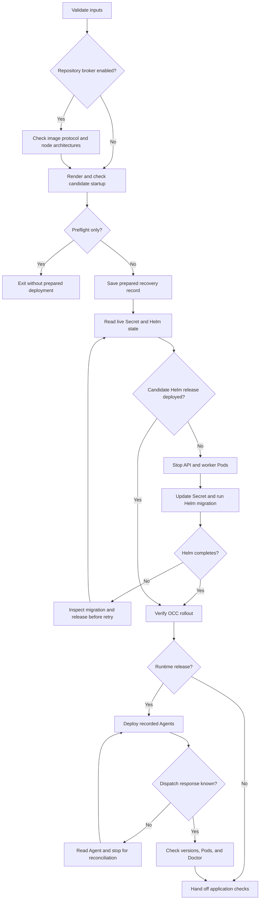

# Production image upgrade flow

## Overview

`scripts/upgrade-production-images` updates the OpenClaw Control Plane (OCC),
Agent runtimes, or both. Controller-only releases end after OCC API and worker
recovery without requesting Agent deployments. Runtime releases deploy a new
version for every initially running Agent, ending when selected Pods are ready
and replacement gateways pass read-only Doctor lint. Operators handle model and
external integration checks.

## Entry Points

- Trigger: an operator runs `scripts/upgrade-production-images` with one or both
  image options and explicit cluster, release, source, and protected-file inputs.
- Required state: a healthy production Helm release and matching OCC and
  Kubernetes Installation identity. Runtime releases additionally require a
  complete authorized fleet inventory with no deployment in progress.
- Source: `scripts/upgrade-production-images`,
  `packages/occ/src/index.ts:OpenClawController.getInstallationDeploymentInventory`,
  and `packages/occ/src/index.ts:OpenClawController.deployAgent`.

## Flow

## Execution Trace

### 1. Prepare the candidate

`scripts/upgrade-production-images:prepare_upgrade`

- **Baseline.** Verify protected files, cluster, deployed Helm release, and
  matching OCC and Secret Installation IDs. Compare live configuration including
  images. Reviewed candidates may change the Slack directory proxy and curated
  Codex PluginDriver selection. Other fields remain protected. Broker ConfigMap
  and Secret references are compared, not their contents. Image flags apply
  afterward.
- **Fleet.** Runtime releases save running Agents' baseline versions from complete
  authorized inventory. Nonterminal deployments, missing selected versions, and
  unready Namespaces stop preparation. Stopped and deleting Agents are excluded;
  pending repository cleanup does not block it.
- **Repository pair.** Immutable controller and broker images are required when
  enabled. Every node matching the control-plane selector, including unready or
  cordoned nodes, must have the same native architecture.
  `scripts/upgrade-image-identity.py:read_platform` verifies the Docker OCI
  export's selected manifest, configuration hashes, and platform. Metadata is
  limited to 2 MiB per blob and 32 MiB total, excluding compressed layers.
  `scripts/upgrade-repository-image-probe.mjs` runs both images with synthetic
  inputs and a private receipt listener to check Driver and broker recovery and
  refused reservation. It records image identities, requests, and responses.
  This is wire compatibility evidence; Kubernetes availability, receipt
  durability, and disposal require separate verification. The helper preserves
  the broker hostname. Follow the [broker procedure](../guides/repository-credentials/installation.md#install-and-verify)
  for restart recovery.
- **Startup preflight.** Render the chart and run a server-side Helm dry run.
  `scripts/upgrade-startup-preflight.mjs` creates one-shot API and worker Pods
  from rendered templates, a candidate Installation Secret, and a NetworkPolicy
  with rendered dependency and execution-cluster API egress. Each Pod uses the
  selected image, environment, mounts, and service account. It loads Drivers and
  Preset files without a database. With the bundled Kubernetes Compute Driver,
  it runs `KubernetesComputeDriver.preflight` with its Kubernetes credentials, as
  startup does. `apps/controller/src/startup-failure.ts:formatStartupConfigurationFailure`
  retains up to 32 filtered field diagnostics in component logs. Each Pod also
  checks the name read by `occ installation get` with the image's `isName` rule
  when present (`INSTALLATION_NAME_INVALID`). Compute preflight refuses
  unsupported [split-layout Gateway storage](../reference/drivers/kubernetes-compute.md#existing-split-layout-installations).
- **Two-cluster grants.** `KubernetesComputeDriver.verifyExecutionTenantGrants`
  checks more than normal startup. In execution tenant Namespaces where the
  component has a release-era grant, SelfSubjectAccessReviews check API Pod and
  `pods/proxy` reads, plus `pods/log` and Event reads with runtime logs. Worker
  checks require Pod `patch` and Job `get`, `create`, and `delete`, even when
  runtime logs are disabled. A missing rule requires an
  [execution chart upgrade](../testing/kubernetes.md#upgrade-the-execution-chart).
- **Outcome.** A failure, stuck pull, or timeout stops before quiescence. The
  helper records both Pod statuses and logs, reports failures, and attempts
  cleanup of Pods, Secret, and NetworkPolicy. `--preflight-only` leaves writers
  serving and retains private evidence without a prepared record. Deployment
  repeats checks with a fresh directory. Otherwise the helper records candidates,
  inventory, target identity, and parameter hashes before marking preparation
  complete. A per-directory lock serializes use of that record. The operator owns
  the writer, autoscaler, Helm, and draft freezes in the
  [production guide](../guides/deploy/production-upgrade.md).

### 2. Reconcile a prior attempt

`scripts/upgrade-production-images:807`

Each attempt reads Helm status and values and the Installation Secret, accepting
only recorded baseline or candidate values. Secret UID, Installation annotation,
and other data must match the baseline. Resume requires the prepared record and
binds the original kubeconfig contents, inputs, OCC URL, scripts, flow, chart,
and pair evidence. It requalifies the pair and rejects changed eligible nodes,
candidate files, unexpected drift, or an in-progress Helm release.

A newer deployed Helm release with candidate values proceeds without repeating
Helm. Otherwise the operator must check migration history. An active initialization
Job or Pod blocks retry. A failed or disconnected migration may have committed;
follow the [recovery guide](../guides/deploy/production-upgrade-recovery.md).

### 3. Quiesce writers and run the candidate release

`scripts/upgrade-production-images:880`

The helper scales the selected API and worker Deployments to zero, waits for
Pods to terminate, and checks both replica counts under a shared deadline. The
operator must stop independent database writers and autoscalers and keep nodes
reachable. The helper atomically replaces protected files with saved candidates.
For an Installation change it updates the Secret with a resource-version
precondition, preserving other data and metadata. A candidate already present
after a lost response is not written again. Both OCC Pod templates receive the
candidate checksum.

A durable marker precedes `helm upgrade`. Its initialization hook checks the
Installation, runs the candidate migrator, and bootstraps before rollout. After
failure, resume reads Helm and migration state before retry; it does not use the
old image to undo a committed schema change.

### 4. Verify control-plane recovery

`scripts/upgrade-production-images:945`

The helper checks API and worker rollout, image, replica count, changed
Installation checksum, authenticated OCC access, and Installation ID. It requires
one named container per component. A broker-enabled worker may instead be a
restartable init container, with no ordinary worker container. Ambiguous or
non-restartable placement fails. Controller-only releases request no Agent
deployments.

Existing versions retain their Pod specifications until the worker prepares them
again. Repository-bound Agents receive maintenance every 30 seconds until their
session deadline. Other Agents are prepared again only when a deployment was
unfinished at worker takeover. Kubernetes Compute applies current templates and
Installation images, rolling changed Gateway or dedicated Harness Pods once on
the unchanged runtime image. Chat can be interrupted until readiness; controller
fixes such as [diagnostic mappings](agent-deployment-diagnostics.md) reach Agents
at that preparation or their next deployment.

For repository-enabled releases, the helper verifies ready API and worker Pods,
owner ReplicaSets, node architecture, and runtime controller and broker image
IDs against the qualified pair. The deployed Driver checks the real broker's
admission capability without opening a session. Pod identities must remain stable
through the check and before dispatch and completion.

### 5. Deploy and verify the recorded fleet

`scripts/upgrade-production-images:1051`

The helper records intent before each exact-Agent deployment request and saves a
successful response atomically. Resume reuses saved responses. An intent without
a response triggers Agent readback and stops for operator reconciliation; an
unchanged selected version does not prove rejection. After verifying acceptance,
the operator can record the response and resume.

The helper polls deployment status, confirms the selected version, and checks
all Pods are `Running` and `Ready` on the requested runtime digest. Embedded
execution requires one runtime container; dedicated execution requires gateway
and Agent containers. Before OpenClaw starts, `GATEWAY_RUNTIME_ENTRYPOINT` runs
`openclaw doctor --fix --non-interactive` for an older Agent database. A still
older database holds the gateway unready with `state-migration`. Each replacement
gateway then runs read-only `openclaw doctor --lint --json --severity-min error`.
Failures retain dispatch, status, Pod, and Doctor evidence.

### 6. Hand off application verification

`docs/guides/deploy/production-upgrade.md:Verify the release`

Completion establishes the Helm rollout and OCC access. Runtime releases also
check the recorded deployments, Pods, and Doctor result. The operator verifies
model responses, providers, channels, credentials, workspace continuity, native
access, and required restore behavior. After traffic selection, the operator
[verifies the served Console](../release/container-promotion.md#verify-the-served-console)
against the routed controller's publication commit.
`scripts/verify-console-release.ts:verifyConsoleRelease` reads the selected
commit's Console files locally, constructs the expected shell with trusted
release producers, then compares the delivered shell and fixed same-origin CSS.

### Read-only export after a split-layout refusal

The [split-layout export fallback](../guides/deploy/split-layout-upgrade.md#export-and-re-create)
starts with the read-only `scripts/split-layout-tenants.mjs export --out FILE`.
`createOccApi.expect` requires a data envelope before `exportTenants` assembles
the bundle. Malformed JSON, empty bodies, or missing envelopes stop export before
`main` writes; empty collections remain valid. The operator restores the API
response path, retries, and checks the inventory before following the recovery
guide. Empty 204 deletes and explicitly accepted 404 responses are unchanged.

## Debugging and Verification

- Inspect `server-dry-run.txt` for chart or admission failures before mutation,
  and `preflight-<api|worker>.log` and `-status.json` for a rejected candidate.
- For OCC rollout failures, inspect `helm-upgrade.txt`, initialization Job logs,
  and API and worker rollout status.
- For runtime failures, inspect `dispatch/*.error`, version history, and
  `status/*.json` before retrying anything. Doctor failures are recorded in
  `status/*.doctor.json` and `status/*.doctor.error`.
- Compare `before-workloads.json` and `after-workloads.json` for unexpected
  workload changes. The controller-only helper requests no Agent deployments;
  one same-image Pod template rollout per affected Agent is expected. Separately
  check repository-bound versions affected by broker restart.
  Runtime proof should show the intended replacements.
- Use the credentialed production Kubernetes integration with distinct baseline
  and candidate images for end-to-end proof. Mocked commands prove only script
  control flow.

## Related docs

- [Production upgrade guide](../guides/deploy/production-upgrade.md)
- [Production installation](../guides/deploy/production-installation.md)
- [Production Agent verification](../guides/deploy/production-agents.md)
- [Agent deployment reference](../reference/agents/deployment.md)
- [Production startup flow](production-startup.md)
- [Controller worker flow](controller-worker.md)
- [Authoritative platform design](../design.md)

## Manual Notes

[keep this for the user to add notes. do not change between edits]

## Changelog

- 2026-10-24 01:13: Organize the upgrade flow and link the Console verification procedure. (console-release-verification - 1f49508f033091ae3af314fd4580f5d16446f563)

- 2026-10-24 00:11: Add offline source and bounded TLS verification of the routed Console, requiring explicit response lengths, compatible content types and applicable release markup. (console-release-verification - 341952eef5299ff62d358ed8b230ea5ef3dfd024)

- 2026-10-23 09:50: Document preflight-only rehearsal and fresh checks at deployment. (authoring-run/3c1a4d88-d619-47e3-9eba-dbaf0988d2e9 - 4e9f5935d5fa4878a719e82db5e504ec6ae55d64)

- 2026-10-20 01:48: Preserve field diagnostics before quiescence. (authoring-run/9d1ff825-b9f4-492a-9420-1e316d820e28 - e7e5f3321cb0a8471d74964eba56ddd069a4e4c5)
- 2026-10-19 22:34: Document that pending repository cleanup does not block upgrade preparation. (authoring-run/d59b973b-1f0b-46bb-b16f-d67bd24ed6d3 - 57acafe81482a890b02ae530793246f2c2e7be79)

- 2026-10-18: The initialization hook checks the Installation before migration.
- 2026-10-12 15:14: Record bootstrap Job grants required by the two-cluster upgrade preflight alongside the fixture correction. (authoring-run/ebb1c629-97b2-4b9a-aa67-a5e750346031 - 9578f6f7aaff9b8545346f43043cbc5b9bcf674e)

- 2026-10-10 03:30: Say that the worker's next preparation of an existing version applies the new controller's Pod templates and rolls changed Pods once. (fix-990-991)

- 2026-10-10 02:10: Require complete successful API responses before publishing the split-layout export bundle. (authoring-run/35b00357-b0c6-459f-aec1-b4fb63620dff - 0886f47d05fdeb2fa4359f4840fb77378d643bac)

- 2026-10-09 21:10: Gateways migrate an older agent database with Doctor before OpenClaw starts. (fix-971)

- 2026-10-09 20:10: Point the split-layout export at the split-layout upgrade page, where in-place adoption comes first. (fix-533-adopt)
- 2026-10-07 21:20: Refuse a two-cluster upgrade before quiescence when the execution chart lacks this release's tenant grants. (fix-758)

- 2026-10-07 12:00: Say that a controller-only release leaves existing versions on their old Pod specification until the next deployment. (dogfood-r43)

- 2026-10-05 15:01: Keep filesystem layers outside the image identity metadata budget. (authoring-run/0b8bd46b-85c0-4664-8dbd-2ee77cd7b602 - 08248f8dbf227dfb7b73162056b6afd1c33cee0d)

- 2026-10-05 06:00: Save and report every preflight Pod's result before cleanup, not only the first failure.

- 2026-10-05 04:00: Load the candidate Installation with the selected controller image in one-shot Pods before quiescence.

- 2026-09-28 12:36: Qualify the selected repository image pair and verify deployed identities and capability. (01a0e6ca-95a4-7e80-aab8-38c5e92a53da - 374dfd4c58587f64d859d4aa4fdaf446b158402a)

- 2026-09-28 11:36: Restrict candidate changes to the reviewed proxy and curated catalog settings. (authoring-run/829b465b-4176-428a-a748-59968ab63b04 - e3bcdb9b3a82d16016c023a8a77d683bf0079ce7)

- 2026-09-28 08:49: Verify the named controller image across ordinary and restartable worker placement. (authoring-run/4c22438e-4a96-4125-bdbb-47a3547a1232 - dcf7c58ef3fe7f6ec6ffc33c1062fee93c9bdeb2)

- 2026-09-28 07:58: Guard repository Backend, Driver, network, and cluster trust settings during candidate preparation. (authoring-run/1d4977e8-b5e5-4b20-9909-bedc3c5b3900 - 2fd914a7273bb09e9d91543c806a4091772191f6)

- 2026-09-28 07:39: Record reviewed configuration candidates and strict live baseline checks. (authoring-run/3c681647-a494-4613-809e-11113e5ed11c - ec51e917954207b49d66f3cb28a7d4887fcd9ea1)

- 2026-09-28 07:02: Record quiesced migrations and resumable release and dispatch recovery. (authoring-run/ef0e4dd2-3f52-48b4-a742-60dfbb85864a - e06ff9625e72ff5ab3483a504a2f02a69a370cbb)

- 2026-09-26 22:28: Preserve the selected repository broker hostname before image upgrades. (authoring-run/1495f489-e298-44e9-b75d-6a49445d35e3 - 7caf53332219db12fed62180c3c6d270baa8ea63)

- 2026-09-25 13:40: Document Helm migration ordering and add post-readiness OpenClaw Doctor lint for replacement gateways. (authoring-run/d35fd05b-5bbd-4f21-a747-820c2df23b2c - 077e26ba0c0babe033569105e3a7e89abf06f40d)
- 2026-09-25 12:29: Split controller and runtime releases while retaining an optional combined path. (authoring-run/ab700e2e-1baf-400c-ab18-0aa9a351f351 - 5e747ac1722f757d7949746e9ff9982142c8536b)
- 2026-09-24 21:21: Separate operator instructions from the runtime trace; require version-read admission, HTTPS, Kubernetes reads with request timeouts, and the complete execution-mode workload set. (authoring-run/613d1e94-a661-4781-bae5-e28613aa3cf9 - c799988036f43ce1bb828373233f03cc77bb0ea9)
- 2026-09-24: Record cluster/OCC identity binding, live/protected input equivalence, the supported empty-fleet path, and runtime Pod readiness discovered by the production rehearsal.
- 2026-09-24 13:43: Trace fail-closed inventory admission, nonterminal deployment rejection, and the one-time controller-only bootstrap for older OCC versions. (authoring-run/0fc7c19b-0e15-498c-8328-e436bc702f37 - a7a609d5867398dd0dfd3bb77cfebf91b2cad116)
- 2026-09-23 12:32: Trace matched image replacement and concurrent exact-Agent deployment through durable status convergence. (authoring-run/d29bdbc5-2a6a-46fa-a8e5-6ad78ea2e486 - 78cf9fd25f08e91158617fbd0ae3e42a22e54361)
