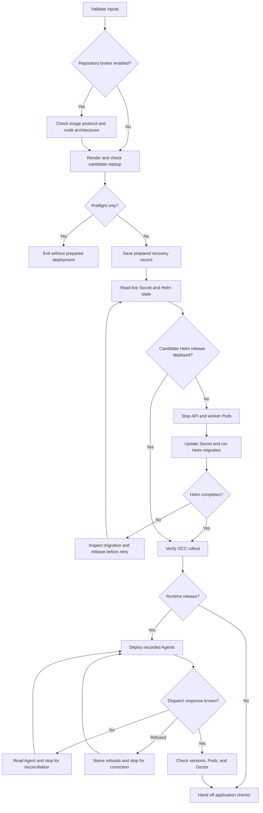

# Production image upgrade flow

## Overview

`scripts/upgrade-production-images` updates the OpenClaw Control Plane (OCC),
Agent runtimes, or both. Controller-only upgrades end after API and worker recovery,
without Agent deployments. Runtime upgrades deploy every initially running Agent,
then wait for ready Pods and read-only Doctor lint.

## Entry Points

- Trigger: an operator runs `scripts/upgrade-production-images` with one or both
  image options and explicit cluster, release, source, and protected-file inputs.
- Required state: a healthy production Helm release and matching OCC and
  Kubernetes Installation identity. Runtime releases additionally require a
  complete authorized fleet inventory with no deployment in progress.
- Source: `scripts/upgrade-production-images`,
  `packages/occ/src/index.ts:OpenClawController.getInstallationDeploymentInventory`,
  and `packages/occ/src/index.ts:OpenClawController.deployAgent`.

## Flow

## Execution Trace

### 1. Prepare the candidate

`scripts/upgrade-production-images:prepare_upgrade`

Before protected-file reads, evidence writes or cluster access, repository
`HEAD` must match `--source-revision`.
Local edits and image provenance remain unverified.

It verifies protected files, cluster, deployed Helm release and matching OCC/Secret
Installation IDs. It records reviewed candidates and compares the [configuration baseline](../guides/deploy/upgrade-baseline.md#record-the-release-and-its-configuration),
including image fields, as ordered YAML mappings. A non-mapping document stops
preparation before rendering. Only the Slack directory proxy and curated Codex
PluginDriver selection may change; image flags apply afterward. Broker checks compare references, not ConfigMap or Secret contents.

Complete authorized inventory supplies each running Agent's baseline version for
runtime upgrades. Nonterminal deployments, missing selected versions or unready
Namespaces stop preparation. Stopped and deleting Agents are excluded; pending
repository cleanup does not block preparation.

Repository-enabled releases require explicit immutable controller and broker
images. The helper inventories all nodes matching the control plane selector,
including unready and cordoned nodes; they must have one native architecture.
`scripts/upgrade-image-identity.py:read_platform` reads Docker's native OCI export
and verifies the selected configuration's platform, with hash checks and 2 MiB
per-blob and 32 MiB total metadata limits.
`scripts/upgrade-repository-image-probe.mjs` runs both images with synthetic
inputs and a private receipt listener. It checks recovery and refused reservation
through the actual Driver and broker, recording the selected digest, platform
manifest, configuration, requests, and responses. This proves wire compatibility,
not Kubernetes image availability, receipt durability, or disposal. The helper
preserves the live broker hostname; broker restart recovery remains an operator
task in the [broker procedure](../guides/repository-credentials/installation.md#install-and-verify).

After rendering and a server-side Helm dry run,
[`scripts/upgrade-startup-preflight.mjs`](../../scripts/upgrade-startup-preflight.mjs)
copies API and worker templates into one-shot Pods with the image,
environment, mounts and service account; the Installation mount uses a temporary
candidate Secret.

An API Pod with a theme first calls
`apps/controller/src/composition/console-theme.ts:loadConsoleTheme`. Invalid bundles
stop preflight; workers do not load themes. Both call
`loadStartupConfigurationSnapshot` and `loadInstallationConfiguration` to resolve
Drivers and Preset files without opening the database.
`apps/controller/src/startup-failure.ts:formatStartupConfigurationFailure` formats
typed configuration refusals with up to 32 field diagnostics through the API/worker
log filter. The helper saves logs before writers stop.

With the bundled Kubernetes Compute Driver, each Pod runs
`KubernetesComputeDriver.preflight` with its Kubernetes credentials (its service
account in `inCluster` mode), as API and worker startup do. This refuses, for
example, single-cluster [split-layout Gateway storage](../reference/drivers/kubernetes-compute.md#existing-split-layout-installations).
Each Pod checks the stored Installation name from `occ installation get` with
the image's `isName`, as the controller does after reading the database
(`INSTALLATION_NAME_INVALID`); an image without the rule skips it.

Runtime upgrades also put each recorded Agent's Configuration in the Secret when it fits beside the Installation within 1 MiB. The API Pod alone runs the
image's `refuseUndeployableConfigurationValues` on them: deploy admission's values-only
rules (model providers, workspace bootstrap, retired settings, OpenClaw sandbox). A refusal
stops preparation. Deploy alone runs rules that read live state, such as Driver, Harness,
credential, plugin and repository checks. Older images and drafts that do not fit skip the
check with a warning.

Experimental two-cluster Pods also run
`KubernetesComputeDriver.verifyExecutionTenantGrants` for their component; startup
does not. Where each Pod's identity holds the release-era grant in an execution
tenant Namespace, SelfSubjectAccessReviews ask for newer `openclaw-execution`
rules: API Pod and `pods/proxy` reads, plus `pods/log` and Event reads with runtime
logs; worker Pod `patch` and `batch` Job `get`, `create`,
and `delete`. Worker Job grants are required even with runtime logs disabled.
A missing rule refuses the candidate and points to
[upgrading the execution chart](../testing/kubernetes.md#upgrade-the-execution-chart).

When the chart renders `openclaw-enterprise-dependency-egress`, the helper first
creates a temporary NetworkPolicy with its egress and execution-cluster API
rules. The chart's default-deny NetworkPolicy also selects the Pods. It saves Pod
statuses and logs only after both creates. A startup failure, stuck image pull,
timeout, failed create, or missing usable UID stops preparation before writers
stop and keeps kubectl's error in `preflight-<resource>-create.err`. Best-effort
cleanup deletes the temporary Secret, Pods, and conditional NetworkPolicy only by
the unique ID (UID) returned on create, leaving same-name replacements alone;
`preflight-cleanup.err` records refusals. The operator checks whether an
ambiguous create left an object behind.

`--preflight-only` leaves writers running with private, non-resumable evidence.
Preparation saves candidate inputs, inventory, target identity and parameter
hashes under an exclusive directory lock.
`scripts/upgrade-production-images:interrupted_upgrade` retains it and skips
preflight cleanup on `SIGHUP`, `SIGINT`, or `SIGTERM`. Before unlocking, confirm
helper and children stopped and reconcile unfinished operations and temporary
preflight resources; interruption does not cancel accepted work. Freeze other
writers, autoscalers, Helm changes and runtime drafts per
the [production guide](../guides/deploy/production-upgrade.md).

### 2. Reconcile a prior attempt

`scripts/upgrade-production-images:1040`

Resume requires prepared evidence; otherwise reconcile preflight resources and
use a fresh private directory per
[upgrade recovery](../guides/deploy/production-upgrade-recovery.md).
Resume binds kubeconfig contents, inputs, OCC URL, scripts, flow, chart and pair
evidence; requalifies the pair; and rejects changed eligible nodes.
Reject ineligible Helm states before values or Secret reads.
Values must match the baseline or candidate; Secret UID, Installation annotation
and other data must match the baseline. Apply only saved reviewed candidates; reject drift.

Skip Helm only if this attempt started it and its newer deployed release matches
candidate values. Otherwise, require the operator's migration-history check and
no active initialization Job or Pod. Failed or disconnected migrations may have
committed; operator-owned checks do not roll them back.

### 3. Quiesce writers and run the candidate release

`scripts/upgrade-production-images:624`

Before changing the Secret or invoking Helm, the script scales the selected API
and worker Deployments to zero, waits until their Pods disappear, and confirms
both stay at zero, within the shutdown deadline. It cannot detect independent
database writers, autoscalers, or partitioned nodes; the operator stops those
writers and keeps nodes reachable.

The protected files are atomically replaced with the saved candidate. When the
Installation changes, including a controller-only settings release, the script
reads the Secret before updating its Installation key, preserving other data
and metadata with a resource-version precondition.
If the candidate is already present after a lost response, it does not write it
again. The candidate Installation checksum is included in both OCC Pod
templates.

A durable marker precedes `helm upgrade`. The Helm initialization hook checks
the Installation, then runs the candidate migrator and bootstrap, before API and
worker rollout. If Helm
fails, resumption reads its current status and migration state before a retry;
it does not start the old image to undo a committed schema change.

### 4. Verify control-plane recovery

`scripts/upgrade-production-images:694`

The script waits for both OCC Deployments and checks controller images,
replica counts, and changed Installation checksums. Each component needs
exactly one named container. A broker-enabled worker may instead be a restartable
init container; non-restartable or ambiguous placement fails. Authenticated OCC
access is retried and must return the same Installation ID.
An existing version keeps the Pod specification of the controller that
deployed it only until the worker prepares it again. Agents with repository
credentials get a maintenance pass every 30 seconds until their repository
session deadline. Other Agents
are prepared again only when their deployment was still finishing as the new
worker took over (the helper checks for unfinished deployments only before a
runtime release).
Kubernetes Compute applies the Gateway and, for dedicated Harnesses, Harness
Deployments as the new controller renders them, with the Installation's current
images, so a changed Pod template rolls those Pods once on the unchanged runtime
image. Chat is
unavailable until the new Pods are ready, about 17 seconds in one test.
Controller fixes to Gateway and Agent Pods, such as
[diagnostics](agent-deployment-diagnostics.md) mappings, reach an Agent then or
at its next deployment.

For a repository-enabled release, it also verifies the ready API and worker
Pods, their owning ReplicaSets, node architecture, and runtime controller and
broker image IDs against the qualified pair. The deployed Driver checks the real
broker's admission capability without opening a session. Pod identities must
remain stable across that check and before dispatch and completion.

### 5. Deploy and verify the recorded fleet

`scripts/upgrade-production-images:797`

Before sending each ordinary exact-Agent deployment request, the script records
an intent. Successful responses are saved atomically. On resume, existing
responses are reused; an intent without a response triggers an Agent readback
and stops for operator reconciliation. The helper does not infer rejection from
an unchanged selected version or replay an unknown request. An operator can
record a verified accepted response and resume. OCC admits a deployment in one
transaction, so `occ`'s one `Error:` line with a 4xx status and an OCC error
code, other than 408, means no version was saved (`deploy_refusal`). The script
names each refused Agent, or a refused service key, saves the message as
`dispatch/*.rejected`, removes the intent, and stops; `--resume` sends that
request again.

The script polls authorized deployment status, confirms the selected version,
and waits for its Pods to be `Running` and `Ready` on the candidate digest. Before OpenClaw
starts, `GATEWAY_RUNTIME_ENTRYPOINT` runs `openclaw doctor --fix
--non-interactive` once when its shared state or an agent database uses an older
schema, such as a 2026-09-28 release Gateway's; a database still older holds the
Gateway unready with check `state-migration`. A dedicated Harness runs the same
step on its workspace node state before native setup, and a native worker before
it connects (`openClawStateMigrationHelper` in `runtime-startup.ts`). Embedded execution
requires one runtime container; dedicated execution requires both gateway and
Agent containers. Each replacement gateway runs read-only
`openclaw doctor --lint --json --severity-min error`, one at a time, with a heap cap
(`--doctor-heap-mib`, default 384 MiB). Doctor shares the gateway's memory limit;
an OOM kill can stop both. The cgroup v2 check (`gateway_free_memory`) requires
one reading with cap plus 640 MiB free or two consecutive readings with cap plus
256 MiB. This reduces risk but reserves no memory. Transient failures are retried.
Initially unavailable data allows warning and run.
After insufficient memory is observed, unavailable reads reset consecutive
evidence; only fresh sufficient readings admit Doctor within its own deadline.
Failure reports separate Doctor's exit status from gateway restarts since Ready.
Missing or incomparable counts or Pod identities report unknown; only a comparable
increase with last termination `OOMKilled` names an OOM kill. A memory timeout
starts no further Doctor. Then, also after a failed Doctor, `revision_pod_change_since_ready`
fails the upgrade for any revision Pod the wait required (gateway or dedicated agent)
missing, replaced, restarted, or unready; the readiness wait ignores ended Pods, so
resume checks the replacement.

### 6. Hand off application verification

`docs/guides/deploy/production-upgrade.md:Verify the release`

Completion proves the selected Helm rollout and OCC access; runtime upgrades
also verify recorded deployments, ready Pods, and Doctor without errors.
Operators then verify model responses, providers, channels, credentials,
workspace continuity, native access, and required restore behavior.

### Read-only export after a split-layout refusal

The [split-layout export fallback](../guides/deploy/split-layout-upgrade.md#export-and-re-create)
begins with the read-only `scripts/split-layout-tenants.mjs export --out FILE`.
Its `createOccApi.expect` requires a data envelope for each successful resource
response before `exportTenants` assembles the bundle. Malformed JSON, an empty
body, or a missing data envelope causes export to exit nonzero before `main`
writes the bundle; an actual empty collection remains valid. Empty 204 deletes
and explicitly accepted 404 responses retain their meaning.

On re-creation, `importTenants` requires distinct target names for selected
Namespaces. Saved destination IDs stay reserved even for skipped sources; skipped
sources without saved destinations reserve nothing. The importer resolves selected
unsaved targets by live name and rejects shared destinations before any mutation or ID-map
save. Choose distinct `--rename` targets, skip a source, or correct the saved map
before retrying. Saved mappings resume after validation. Previously merged
resources stay merged.

`--rename` keys are literal: `constructor` and `__proto__` remain unchanged unless
renamed. Without a saved mapping, exact-name reuse requires a Namespace without
Agents or Secrets.

## Debugging and Verification

- For chart or admission failures before mutation, inspect `server-dry-run.txt`;
  for rejected candidates, inspect `preflight-<api|worker>.log` and `-status.json`.
- For native scale, Helm upgrade, or rollout status failures, inspect
  `native-command-failures.tsv`; see [upgrade recovery](../guides/deploy/production-upgrade-recovery.md).
- Before retrying runtime failures, inspect `dispatch/*.error`, `dispatch/*.rejected`,
  version history, and `status/*.json`. Doctor failures: `status/*.doctor.json` and `status/*.doctor.error`.
- Compare `before-workloads.json` and `after-workloads.json` for unexpected
  changes. After a controller-only release, expect one same-image Pod template
  rollout per affected Agent. Separately check
  repository-bound versions affected by broker restart.
- Use credentialed production Kubernetes integration with distinct baseline
  and candidate images for end-to-end proof. Mocked commands prove only script
  control flow.

## Related docs

- [Production upgrade guide](../guides/deploy/production-upgrade.md)
- [Production installation](../guides/deploy/production-installation.md)
- [Production Agent verification](../guides/deploy/production-agents.md)
- [Agent deployment reference](../reference/agents/deployment.md)
- [Production startup flow](production-startup.md)
- [Controller worker flow](controller-worker.md)
- [Authoritative platform design](../design.md)

## Manual Notes

[keep this for the user to add notes. do not change between edits]

## Changelog

- 2026-10-29 23:05: Retain the upgrade lock after interruption until operations are reconciled. (authoring-run/729e3e30-1ab9-4e2c-bae2-42834bf535c4 - 5a61a08eec78fbae99e21b858af5c8dd5911ba03)

- 2026-10-29 12:28: Validate baseline mapping streams. (authoring-run/b9a98c72-bd73-45d4-b50d-f12d185f39b5 - 389a51336cd5)
- 2026-10-29 11:04: Document protected baseline comparison. (authoring-run/35ed2337-614f-4587-a16d-7c1973bb4819 - 51de7c164aab)
- 2026-10-29: Check Agent drafts before writers stop. (fix-2809)
- 2026-10-29: Check model providers; budget drafts by Installation. (fix-2815-2816)
- 2026-10-28 18:11: Check Helm status before reconciliation reads. (authoring-run/44ebe5a4-904f-4a6b-8796-e86c3ab7a26a - 541cc3f43bdfb09615ecee0cfb79c533e6a0b56c)
- 2026-10-28 21:01: Check API themes before writer quiescence. (authoring-run/bf262f39-fa9d-4e70-94e1-e2fc516234e9 - 304fcfb169bc8403794e8562a08b1e3ee4cc23ac)

- 2026-10-28 06:40: Check every revision Pod, not only the gateway, after Doctor. (fix-2755)
- 2026-10-28 05:40: Check gateways after failed Doctors. (bughunt-1028)
- 2026-10-28 00:40: Run Doctors serially; fail on gateways changed afterward. (fix-2736)
- 2026-10-26 23:24: Record source checkout verification before private inputs. (authoring-run/dc3e51c1-8f14-4410-9c70-e4a993ea58fe - 821bee5fe0bb446319fab40ad21055b1e942eb37)
- 2026-10-25 11:53: Record native scale, Helm upgrade, and rollout failures; preserve recovery. (authoring-run/f03f716e-ea13-48ab-ad6e-e179b342d585 - 87784a3230964bd8a7a1763f8350c1fd2b4284e0)
- 2026-10-25 09:19: Keep preflight kubectl errors in private evidence. (authoring-run/6fccb13c-5ec3-44d5-aded-c3c3e9c1da81 - aaabca1fec6b28fbbb674f48f11f015242f86b59)
- 2026-10-25 06:51: Identify temporary preflight resources by UID before cleanup. (authoring-run/d15969fb-1113-416f-9573-e045dd683b66 - dd36945fec0ec3de38cd15b971537eb10a90d0e4)
- 2026-10-23 09:50: Document preflight-only rehearsal and fresh checks at deployment. (authoring-run/3c1a4d88-d619-47e3-9eba-dbaf0988d2e9 - 4e9f5935d5fa4878a719e82db5e504ec6ae55d64)
- 2026-10-20 01:48: Preserve field diagnostics before quiescence. (authoring-run/9d1ff825-b9f4-492a-9420-1e316d820e28 - e7e5f3321cb0a8471d74964eba56ddd069a4e4c5)
- 2026-10-19 22:34: Document that pending repository cleanup does not block upgrade preparation. (authoring-run/d59b973b-1f0b-46bb-b16f-d67bd24ed6d3 - 57acafe81482a890b02ae530793246f2c2e7be79)
- 2026-10-18: The initialization hook checks the Installation before migration.
- 2026-10-12 15:14: Record bootstrap Job grants required by the two-cluster upgrade preflight alongside the fixture correction. (authoring-run/ebb1c629-97b2-4b9a-aa67-a5e750346031 - 9578f6f7aaff9b8545346f43043cbc5b9bcf674e)
- 2026-10-10 03:30: Say that the worker's next preparation of an existing version applies the new controller's Pod templates and rolls changed Pods once. (fix-990-991)
- 2026-10-10 02:10: Require complete successful API responses before publishing the split-layout export bundle. (authoring-run/35b00357-b0c6-459f-aec1-b4fb63620dff - 0886f47d05fdeb2fa4359f4840fb77378d643bac)

[Production image upgrade flow documentation history](coordinated-production-upgrade/history.md) preserves the older dated entries.
