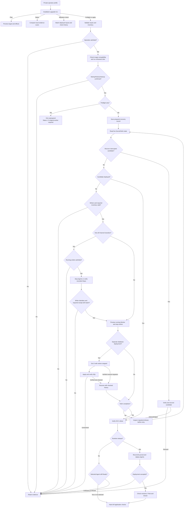

# Production image upgrade flow

## Overview

Upgrades OpenClaw Control Plane (OCC) and Agent runtimes.
See [one-off channel transitions](channel-egress.md#0-install-or-upgrade-channel-routing).

## Entry Points

- Run `scripts/upgrade-production-images` with reviewed inputs, or use `occ installation upgrade` with a private operator profile.
- Stderr phases are advisory; `--verbose` shows native output.
- Required: healthy Helm release with chart-owned initializer, matching OCC/Kubernetes Installation
  IDs and complete authorized inventory without active deployments.
- Source: `scripts/upgrade-production-images`,
  `packages/occ/src/deployment-inventory.ts:readDeploymentInventory`,
  and `packages/occ/src/agent-deployment-admission.ts:admitAgentDeployment`.

## Flow

## Execution Trace

### 1. Prepare the candidate

`installationUpgradeCommand` runs `scripts/upgrade-production:main`. Plan checks profile, images and HEAD.
`profile_input` opens profile and receipt through one directory descriptor.
`published_image_pair` checks package, digest, source, tag, run and attempt.
Operators authenticate the receipt. `original_image_pair` reads journal-bound
digests for resume and migration apply. Apply and resume recheck approval,
bound inputs and HTTPS trust.

Both entrypoints refuse active kubectl preferences. Exec plugins require an
approved environment that already disables preferences. Private snapshots
refuse built-in `auth-provider` entries. Profiled recovery rechecks the target,
CA and parameters under lock.

Before `prepare_upgrade`, refuse alternate Helm stores,
[endpoint and TLS overrides](../guides/deploy/production-upgrade.md),
[token and impersonation overrides](../guides/deploy/production-upgrade-command.md#run-the-image-upgrade),
source mismatch, chart edits or symlinks, and evidence or baseline aliases.
Preview and preparation reject `preprovisionedNamespace` bindings.

`check_migration` matches rendered and deployed migrator inputs, verifies the
release around a read-only Job and requires recognized history and UID-bound
cleanup. Unknown creates retain lock and evidence.

`matches_yaml` compares candidate, [baseline](../guides/deploy/upgrade-baseline.md#record-the-release-and-its-configuration)
and live mappings. Invalid input or unwritable evidence yields
`Cannot compare upgrade YAML`. Projections allow Slack directory proxy, curated
Codex PluginDriver selection and one registration wrapper. Omit absent
`agentNativeAdmin.sharedCookieDomain` from baseline. Immutable switches require string keys.

`read_restart_inventory` requires authorized inventory without nonterminal
deployments. Running Agents need saved Harness objects and accepted
[restart assessments](../reference/repository-credentials/worker-replacement.md).
Unknown assessments block. Runtime preparation checks draft images, sizes,
baseline versions and Namespace readiness. It excludes stopped or deleting
Agents and permits pending repository cleanup.

`deploymentInventorySnapshot` refuses missing or mismatched work.
`findRevisionForBrowsing` returns `unknown` for unreadable snapshots and
propagates database and identity errors. `readDeploymentInventory` gives Compute
ten seconds outside State transactions and rechecks authorization and Driver
selections. Drift refuses inventory. Credential withdrawal is separate.

`upgrade-evidence.py:validate_compatibility` checks file binding, PostgreSQL
receipt data, IAM, cleanup and digests. Hashes bind resume inputs.
`verify_agent_continuity` brackets runtime inspection with authorized Agent
reads and records revision and Driver roles.

Repository credentials require immutable images and common node architecture.
`upgrade-image-identity.py:read_platform` verifies OCI hashes (2 MiB per blob,
32 MiB total). The probe runs before preparation and resume. Its negative
control requires an absent socket and confirmed nonzero broker exit
without OOM or daemon error.

For immutable switches, `prepare_upgrade` checks Secrets, unrelated data
and candidate YAML. Evidence binds snapshots. Stage a successor with
`--candidate-values` for immutable data changes. Prepared attempts keep their
Secret. Denied mutable Secret update reviews block. Inconclusive reviews warn.

`preflight_startup` previews Certificates before Jobs. The 45-second request
covers the webhook's 30-second limit and response time. Admission refusal
retains diagnostics and leaves writers serving.

`upgrade-startup-preflight.ts` builds single-Pod Jobs with candidate images,
credentials, mounts, deadline and zero retries. Changed UIDs or extra children
refuse. Job failure overrides child success.

`migrationMode` reads the rendered initialization Job. `--require-current`
selects separate mode. Invalid or new-install invocations refuse. `migrationJob`
keeps policy labels and checks recognized history with `--check` or
`--check-for-installation` bound to the Installation ID. Separate mode records
migrator and CA Secret identities and requires `migration.checked-for-installation`.
After cleanup, recheck the Secrets and bind them in evidence.

The API preflight checks Console themes. Both writers load startup and
Installation configuration without database access and verify OpenShell token
file readability without reading its contents.

`connectionPlan` retains private OIDC CA mounts and database preload. A
read-only `OCC_DATABASE_URL` connection must return one Installation matching OCC
and the Secret. The statement and lock timeouts are five seconds, with 15 seconds
for the full check. Logs omit connection errors and rows.

`preflight_resume` checks history and writer identities even when writers are
stopped. Completed Helm attempts skip those Jobs. Verify Job and Pod identities
around log reads and refuse NUL bytes. Configuration failures report up to 32 fields.

Kubernetes Compute uses the Pod service account. Single-cluster upgrades refuse
[split-layout Gateway storage](../reference/drivers/kubernetes-compute.md#existing-split-layout-installations).
The image checks Installation names and recorded drafts when supported. Older
images or gzipped inputs over 1 MiB defer draft checks to deployment.

Two-cluster Jobs check API Pod, proxy and optional log/Event access and worker
Pod patch and Job get, create and delete access. Missing grants require the
[execution chart upgrade](../testing/kubernetes.md#upgrade-the-execution-chart).
Verify enforcement of the default-deny and dependency egress policies.

Writers serve during preflight. `upgrade-preflight-state.py` records create
intent and acknowledged UIDs. [Cleanup](coordinated-production-upgrade/preflight-cleanup.md)
confirms Jobs and children are gone before removing dependencies. Unknown
consumers retain them.

After cleanup, recheck switch Secrets and record `startup-preflight-passed`.
Standalone preflight prepares no deployment and exits 1 with
`preflight-blocked-original-worker` if needed. Apply refreshes inventory and
records bound candidates, inventory and target parameters. On interruption,
retain the lock and skip cleanup. Before unlocking, confirm termination and
reconcile accepted operations. Follow the [maintenance freeze](../guides/deploy/production-upgrade.md).

### 2. Reconcile a prior attempt

Resume locks evidence and dispatch journals, checks bound inputs and
requalifies images and nodes. Values must match baseline, candidate or the
recorded predecessor. Incomplete Installation writes or a Secret switch can
resume. Verify both Secret UIDs and data. Before retry, check history, settle
initializers and reconcile unknown creates. `new_attempt` synchronizes
directories before publication. Failed checks keep writers fenced. A verified
deployed candidate or recovery successor skips Helm submission.

Before preparing a retry or running preflight, verify the submitted migration
mode. At the original separate revision, verify both handoff identities,
release and component labels, zero replicas, no deletion, Pod absence and the
Worker receipt. Before retry, recheck Helm status and terminal
initializers. Failed expected revisions use checked retry.

For [same-candidate recovery](../guides/deploy/production-helm-recovery.md),
`upgrade-helm-state.py:recover` checks payload, ownership, completed Job and Pod
and security contexts. `pod_matches` compares resource quantities. Reads use
manifest namespaces. `check-recovery` verifies the original attempt before
preflight, and both application identities before rollback. Repeat admission
before exclusive intent and dispatch. Accepted or uncertain recovery permits
only readback.

`require_absent` refuses predecessor-only resources through rollback and resume.
`verify_workload_changes` checks retired entries and placements before rollback
and changed selections after it. Neither deletes resources. Require exact
candidate nonnative specs and recorded UIDs, allowing resource-version changes.
Require pre-upgrade hooks and successor acknowledgement. Operators attest
client shutdown, exclusive ownership, resource reconciliation and history.

### 3. Quiesce writers and run the candidate release

`quiescence_remaining` bounds shutdown. Stop other writers and autoscalers.
Keep nodes reachable. If the Worker runs, check named patch access and refresh
inventory before stopping either writer. Denial or drift blocks. Inconclusive
reviews warn. Live PATCHes test UID, resource version and replicas. A conflict
can leave the API stopped.

A stopped Worker requires resume and a private `worker-stop-confirmed.json`
bound to the attempt, UID and generation. The PATCH must confirm the same UID,
next generation and zero replicas. Lost responses or invalid receipts block.
A confirmed stop skips the Worker PATCH and inventory read. After drain, recheck
both UIDs, zero replicas and the Worker receipt before settings, Secret or Helm
writes. For an existing separate migration handoff, also match both generations
before the first Helm submission or retry.

For a [one-off channel transition](channel-egress.md#0-install-or-upgrade-channel-routing),
check the Worker receipt if zero and named patch access if running. Preview each
running writer's guarded PATCH before Agent Stop and require zero replicas.
Stop the selected Agents or, with both writers stopped, verify recorded Stops.
Reread both Deployments and recheck the receipt. UID, generation or replica
changes block. Resource-version changes use fresh patch preconditions. Running
Worker inventory must match preparation except for recorded Stops. Preview the
refreshed Worker stop before stopping a running API. Preview refusal details
are in `quiescence-<component>-preview.err`. Keep `channel-agent-operations.json`
and [reconcile partial quiescence](../guides/deploy/production-upgrade-recovery.md#restore-incumbent-api-access-after-partial-quiescence).

Separate mode rechecks Secret identities, records stopped UIDs and generations,
and exits 3. Keep both writers fenced. Managed apply requires irreversible SQL
approval. Recheck the handoff pair and Worker receipt before new intent or a
SQL-capable Job. Preserve read-only verification and known or pending outcomes.
Unknown effects retain lock and kubeconfig. Cleanup observes prior deletes.
Retry requires cleanup of failed verification. Resume requires completed
verification and matching Secret identities. Keep those Secrets fenced.

Rerun `verify_pair_nodes`. Fresh `helm status` must match
reconciliation except for Helm v4 live `.info.resources`. A mismatch leaves
writers stopped before protected file or Installation Secret writes. Resume can
find candidate settings from a prior attempt.

Protected files change atomically. Resource-version checks preserve unrelated
mutable Secret data. Reference switches preserve both Secrets. Both OCC templates
select the successor and checksum.

`upgrade-helm-state.py:new_attempt` renders and dry-runs immutable values. Hooks
and initializer Pod receive `installation.upgradeAttemptId`. Upgrade and recovery
preserve `.json` format.
`record_submission` saves intent and predecessor before publishing `helm-started`.
Identical interrupted staging can finish. Published intent survives staged retries.
`scripts/migration-history.mjs:migrateWithHistory` checks Installation identity
and recognized history under lock for separate Jobs. Verification and the
separate Helm hook require completed history. Hook mode applies pending SQL.

### 4. Verify control-plane recovery

`scripts/upgrade-helm-state.py:verify_installation_consumers`

Verify images, replicas and Installation checksums. For reference switches,
check both Secret identities and controller and initializer mounts. Require one
named container per component, broker-enabled workers for restartable init
containers, and the same Installation ID from OCC.

Worker preparation re-renders launch requirements and maintains repository sessions
every 30 seconds until their deadline. It re-prepares other unfinished deployments.
Kubernetes Compute rolls changed Pod templates and gates chat on readiness.
OpenShell's `verifyExistingSandbox` requires exact existing Sandbox content.
Generated commands need a new Agent revision. See the
[upgrade guide](../guides/deploy/production-upgrade.md#prepare-the-release).
Pod and [diagnostic](agent-deployment-diagnostics.md) changes apply on preparation
or deployment.

Repository-enabled releases verify Ready API/worker Pods, ReplicaSets, node
architecture and runtime image IDs against the qualified pair. The Driver checks
broker admission without a session. Pod identities must remain stable through
admission, dispatch and completion.

### 5. Deploy and verify the recorded fleet

`scripts/upgrade-production-images:confirmed_deployment_status` and
`scripts/upgrade-dispatch-state.py:transition`

Flush intent before dispatch. Unresolved intents block sends. The journal retains
accepted revisions, definite refusals and superseded receipts. Resume may retry
refusals. Replacements must name the current failed revision. Unknown outcomes
or stale journals require
[recovery](../guides/deploy/production-upgrade-recovery.md).

Verify authorized deployment status, revisions and Pod readiness on the
candidate digest. [Gateway and Harness storage](../reference/drivers/kubernetes-compute/storage-and-credentials.md#gateway-storage)
describes how state migration and retries gate runtime startup.

Replacement gateways run read-only `openclaw doctor --lint --json --severity-min error`
serially. `gateway_free_memory` requires one cgroup v2 reading above heap cap
plus 640 MiB or two above cap plus 256 MiB. After insufficient memory, Doctor requires fresh sufficient readings. A memory
timeout stops new checks. `revision_pod_change_since_ready` checks required Pods
even after Doctor failure. Missing, changed, restarting or unready Pods fail the upgrade.
See [Doctor recovery](../guides/deploy/production-upgrade-recovery.md#correct-a-doctor-failure).

### 6. Hand off application verification

Follow [release verification](../guides/deploy/production-upgrade.md#verify-the-release).
`verify_agent_continuity` precedes terminal controller and Helm checks. Require
one Running, Ready Pod per role. Replacement UIDs and completed init containers
qualify. Eight results leave uniqueness unknown. Preserve running provider
Harnesses. On failure, preserve observations and reconcile failed writes.
Resume skips successful Helm and refuses after `completed`. The
[served Console check](../release/container-promotion.md#verify-the-served-console)
accepts an image-bound digest.

### Read-only export after a split-layout refusal

[Split-layout export](../guides/deploy/split-layout-upgrade.md#export-and-re-create)
uses `scripts/split-layout-tenants.ts:createOccApi.expect` to reject malformed
responses. `importTenants` rejects shared destinations, preserves prior merges
and reserved IDs, and handles rename keys literally. Unsaved exact-name reuse
requires no Agents or Secrets.

## Debugging and Verification

- Check `helm-attempts/<UUID>/` render and dry-run output, and
  `preflight-<api|worker|migration>.log`, `-logs.err` and `-status.json`. For resume,
  use the current `upgrade-preflight-resume.*` directory.
- See [upgrade recovery](../guides/deploy/production-upgrade-recovery.md) for
  `native-command-failures.tsv`, migration journals and dispatch results.
- Compare `before-workloads.json` and `after-workloads.json` for controller-only
  rollouts. Check broker-affected repository versions separately.
- Command fixtures prove control flow. End-to-end proof requires credentialed
  production Kubernetes and distinct images.

## Related docs

- [Production upgrade guide](../guides/deploy/production-upgrade.md)
- [Production installation](../guides/deploy/production-installation.md)
- [Production Agent verification](../guides/deploy/production-agents.md)
- [Agent deployment reference](../reference/agents/deployment.md)
- [Production startup flow](production-startup.md)
- [Controller worker flow](controller-worker.md)
- [Authoritative platform design](../design.md)

## Manual Notes

[keep this for the user to add notes. do not change between edits]

## Changelog

- 2026-11-24 02:21: Recheck writer generations before Helm. (authoring-run/b49fd055-c8ec-4d10-8ba1-536c248c8f66 - 1b6b18670a33c9d51b4fc4cbc0a901a08782c963)
- 2026-11-23 04:18: Preview API. (authoring-run/80b539ac-f508-454c-a905-70939d30ec31 - b24f6ec158b861b13f2baff95bf661346de7f767)
- 2026-11-23 02:02: Preview earlier. (authoring-run/cdd15e8b-8040-4505-bb79-d9ccd1dc5682 - 96519cbee73d4ee54528626c0517ee7aaa6e1822)
- 2026-11-22 17:37: Preview Worker stop. (authoring-run/8a4cdeff-6237-46d6-ad85-7ea5bfa0c302 - 3eedffbaae63cdc1b006e51d49b88504462d2a5c)
- 2026-11-21 09:16: Trace rendered mode and retry. (authoring-run/06420637-f403-4d0d-a6b1-acf2f522dcb0 - f9fb2a1f6fed7afd4ba8e69737f611e55604f587)
- 2026-11-21 03:11: Reconcile publication selection with current upgrade admission and recovery. (authoring-run/5e8acf3b-45b0-4fbd-801d-493e4787e9dc - e67cd3cd0357e002ccc62f410454649ea4bfefd9)

- 2026-11-20 19:04: Refresh sources. (authoring-run/8a8bde8b-71de-4de5-80bf-e32f0e335c34 - 220f62d86ceb3dfc6f66dbee7c6f86cda50e5d05)
- 2026-11-20 16:29: Update source pointers for runtime observation and fleet inventory. (authoring-run/c41017eb-dc85-4c43-90e8-3040fbace6ac - c6acc7271f7753f74d3657251f23a036c08e671c)

- 2026-11-20 17:42: Refuse Helm credential overrides. (authoring-run/e16304ce-2b94-4022-a90d-9ab2e235d1d4 - aff441a5df9e3258752b034fb694e06333c0b231)

- 2026-11-20 11:52: Trace sibling receipt selection and credential rules. (authoring-run/50e3a914-60d2-4d1e-9fbd-8bb9fc214ad5 - d215c0d95c2336244519eca4968df04ec4376ae2)

- 2026-11-20 09:47: Trace immutable Installation refusals and the Certificate admission timeout. (authoring-run/d0f76046-8ddd-44e6-a67f-29c2288c9e33 - 9092839d0c3b9598e85300451f425ac6d3084fe5)

- 2026-11-20 03:27: Check writer identity across the one-off Agent Stop phase. (authoring-run/835f8811-dc27-47d1-b27d-5d20413085f7 - 0e158e5f10ed1e65be1f6d64ff0f62cffb6f3283)

- 2026-11-19 20:21: Require the worker stop receipt before migration and retry. (authoring-run/418defcd-00b7-4596-95cb-96610a0a2343 - 88f7c7a3b3f3430d89bcb82803c89c6dfbea2bbb)

- 2026-11-19 16:56: Distinguish fenced migration handoff from other recovery. (authoring-run/cf9ae9aa-8bb0-4bc8-af2c-326adebf9112 - abd7da2dbd99369b523fe93ec052842c77e9cd2d)
- 2026-11-19 15:27: Require an acknowledged worker stop before resume. (authoring-run/86724f58-75e9-4f02-a3a4-d285ef3a889b - 603a8d4ce1f3e47d9c8485d4dd0023c531bbd64b)

- 2026-11-19 19:15: Trace the stopped writers check before Helm retry. (authoring-run/aed0a2bc-9691-4859-8bd6-1e7b3549c9b4 - d976da889bdeca6e9208821a5b4ea79a49033b0f)

- 2026-11-19 17:18: Keep bootstrap handling in the chart. (authoring-run/803c9489-57ed-4e31-a5ea-568f16e22161 - d14128b4a0fc1f499b914107ec6ec14eccc39fdf)

- 2026-11-19 17:08: Trace migration Secret checks from preflight through resume. (authoring-run/d22a53f0-d60f-46c9-9977-2d54227dd193 - a4e6e5e73e7f6f8699dddd6c3244af6fd71c2336)

- 2026-11-19 10:54: Compose profile approval with separate database migration. (authoring-run/abedccc5-d961-4465-afd3-012cc1e5a5a5 - 6885839d6e3d8dd2f8293552d508ad4536cbf8a6)

- 2026-11-18 14:34: Retire bootstrap outputs safely (PST). (authoring-run/fcffdcd5-85ba-4fd1-ad35-bfbbcd6953b6 - ce0bd74dcbb7bdf2fd97a6d87e9ea0f88cf0199d)

- 2026-11-18 20:23: Apply and verify separate database Jobs. (authoring-run/859166ef-2ed3-42e1-b8fd-88441bb8746f - 084874338baf51ad05d0b1a2b438e8bcd0120c1b)

- 2026-11-19 17:03: Reconcile the upgrade trace and bind admission to the selected credential method. (authoring-run/1b66f15a-ca57-49d3-97bd-6ce1593f55a2 - c833b919f687c17dcb5b2e1e5037b55ed4321ac0)

- 2026-11-19 12:44: Compare status markers. (authoring-run/b54d6eb9-13cb-4072-96e2-2e285cde2402 - a02224a7e22516f958546a249ddcbfa9bfcd6012)
- 2026-11-19 12:31: Trace standalone preflight status. (authoring-run/95ab0282-a9eb-46db-9c6b-bd4cce4ee6ea - a02224a7e22516f958546a249ddcbfa9bfcd6012)
- 2026-11-19 11:30: Trace candidate rehearsal when retained Agents require the original worker. (authoring-run/099c1a03-0e25-4504-9cf7-2f62d1cfa035 - 6679017155741810c2ae1bcbacba05a3eb59f3ec)

- 2026-11-19 10:56: Refuse active kuberc. (authoring-run/9c893cda-96dc-4a06-9e08-ad2aeca46de7 - 5f425af517e8ee120c7721e7559a846ce70120e9)

- 2026-11-19 10:26: Trace kubeconfig decoding and snapshot authentication. (authoring-run/8620ea2f-2212-49a6-b45b-0c6b44bf7fa2 - b0171d98e4470aaad0ba5b7ddb4e16a27fb9de7a)

- 2026-11-19 09:57: Trace the Helm release store guard. (authoring-run/d4ce1b5c-3a22-44f3-b1ad-40e8a771c331 - 2455e61e32e8f97a6dfb505608a665e2eca59f20)

- 2026-11-19 09:47: Trace profile TLS checks. (authoring-run/2a1d437b-87cc-4839-a06a-12b3d255450f - 2455e61e32e8f97a6dfb505608a665e2eca59f20)

- 2026-11-19 05:13: Trace upgrade approval, trust, and evidence. (authoring-run/def34421-d123-4fd1-bde1-e8d966d6bcad - 8bc5fe2fc916765024493c981308179a04a0e716)

- 2026-11-18 19:45: Tighten the upgrade trace. (authoring-run/9b947cd8-0275-4e7f-ac7f-5dce4b0f8965 - aed2f7edd530ab336bbd6cb8c7389b24cb83e397)

- 2026-11-18 19:27: Trace migration-only compatibility checks through the Helm hook and Job journal. (authoring-run/7ae70bae-f8ac-425d-abbf-7039b71997b7 - 71334bb9b104662870798a29814e7171e8905baf)

[Production image upgrade flow documentation history](coordinated-production-upgrade/history.md) preserves the older dated entries.
