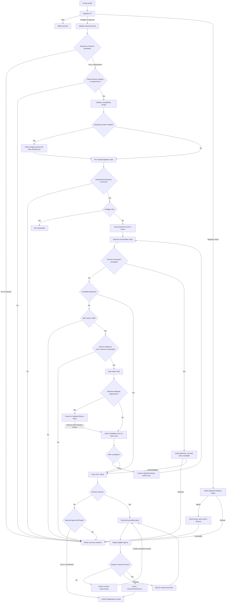

# Production image upgrade flow

## Overview

Upgrades OpenClaw Control Plane (OCC) and Agent runtimes.

## Entry Points

- Use `occ installation upgrade apply` with a private profile or `scripts/upgrade-production-images` directly.
- `--verbose` adds native output to advisory phases.
- Requires healthy Helm release, chart-owned initializer, matching Installation IDs,
  and complete authorized inventory without active deployments.
- Source: `scripts/upgrade-production-images`,
  `packages/occ/src/index.ts:OpenClawController.getInstallationDeploymentInventory`,
  and `packages/occ/src/index.ts:OpenClawController.deployAgent`.

## Flow

## Execution Trace

### 1. Prepare the candidate

`internal/occcli/installation_upgrade.go:installationUpgradeCommand` calls
`scripts/upgrade-production:main`. Plan previews effects and TLS mode.
Profiles pin kubeconfig and explicit CA bytes. New runs print status paths before dispatch.

`scripts/upgrade-production-images:prepare_upgrade`

Before access, reject [Helm overrides](../guides/deploy/production-upgrade.md), source mismatch, chart edits/symlinks and evidence/baseline aliases. Other edits/image provenance are unchecked.

`check_migration` renders the candidate and matches migrator inputs to the
deployed revision's Helm hook. It rechecks the revision around one read-only
migration Job. Success requires nonempty history and UID-bound cleanup.
An unknown create retains the lock and journal. The check exits without
prepared upgrade evidence.

`preprovisionedNamespace` must yield one `false` before access
(`preprovisioned-namespace.err`).

`resume RUN` locks evidence paths/devices/inodes/aliases and dispatch journals.

`matches_yaml` validates candidates and compares [baseline](../guides/deploy/upgrade-baseline.md#record-the-release-and-its-configuration)/live mappings.
Invalid inputs or unwritable evidence yield `Cannot compare upgrade YAML`.
Projections/`cmp` allow Slack directory proxy, curated Codex PluginDriver selection
and wrapping one registration. `agentNativeAdmin.sharedCookieDomain` is removed only
from baseline projection; live comparison stays exact. Immutable switches require string keys.
Startup validates controllers; broker checks references only.

`read_restart_inventory` validates complete authorized inventory ownership, IDs and selections. Retained revisions require accepted
[restart disposition](../reference/repository-credentials/worker-replacement.md).
Controller-only upgrades require an owned revision with object-valued Harness settings; drafts cannot substitute.
Runtime upgrades record replacements and validate draft image/size support. Quiescence is nonatomic; repository continuity is unverified.

`OpenClawController.deploymentInventorySnapshot` batches exact deployment-work reads in one State snapshot; missing/mismatched work refuses inventory. Credential withdrawal is not deployment. `findRevisionForBrowsing` yields `unknown` for unreadable snapshots; database/identity errors propagate. `getInstallationDeploymentInventory` calls Compute outside State transactions with a ten-second budget, then rechecks fleet authorization/Driver selections. Drift refuses; owner failures yield `unknown`.

Refuse nonterminal deployments. Runtime upgrades require baseline versions/ready Namespaces. Exclude stopped/deleting
Agents; allow pending repository cleanup.

`prepare_upgrade` copies PostgreSQL's `run` result.
`validate_controller_compatibility` calls `scripts/upgrade-evidence.py:validate_compatibility`
before preflight: check runner/file consistency, data/IAM success, cleanup and both image digests.
Hashes bind resume, not authenticity or image source. Online migration and rollback remain
unqualified; see [qualification limits](../guides/deploy/production-upgrade.md#upgrade-the-control-plane).

`verify_agent_continuity` requires Agent read/operate, active AgentRevision read
and runtime inspection. Agent reads bracket explicit-revision runtime reads,
freezing identity and Driver-declared roles in `agent-continuity.json`, not editable topology.

Repository credentials require immutable images and one architecture across matching nodes. `scripts/upgrade-image-identity.py:read_platform` verifies platform/OCI hashes (2 MiB per blob, 32 MiB total). `scripts/upgrade-repository-image-probe.ts:main` probes before preparation and resume; a nonzero broker exit requires an absent socket and Docker-confirmed owned-container exit without OOM or daemon error. See [broker restart recovery](../guides/repository-credentials/installation.md#install-and-verify).

For immutable switches, `prepare_upgrade` validates identities, unrelated data and
candidate YAML, then hashes staged bytes; `upgrade-evidence.py` binds both snapshots.
Changed immutable data requires a successor. Mutable changes require a Kubernetes
self-review of named-Secret update access: denial stops preparation; inconclusive
review warns and continues. Replacement still requires update permission.
Rendered Certificates require server-side dry-run admission.
`scripts/upgrade-startup-preflight.ts` builds single-Pod Jobs with the candidate
Secret, controller image, environment, mounts, and service account. Jobs have a
deadline and zero retries. `preflight_startup` refuses changed UIDs or multiple
children. Job failure overrides child success.

`migrationJob` selects one initialization Job by release and component. It refuses
malformed labels and preserves the Job and Pod labels used by chart policies.
Before shutdown, it runs the selected image's migration entry with `--check`
and the migrator identity. `scripts/migration-history.mjs:migrateWithHistory` checks
receipts, catalog, and grants under lock. Pending canonical history is allowed.
Helm rechecks before migrating.

`apps/controller/src/composition/console-theme.ts:loadConsoleTheme` checks API
theme bundles. Both writers use `loadStartupConfigurationSnapshot` and
`loadInstallationConfiguration` without database access. For OpenShell
`bearerTokenFile`, each Job checks file type and readability without reading the token.

`connectionPlan` refuses unknown chart entrypoints. Private OIDC CA trust retains database preload, CA argument and assembler mounts. Writer Jobs require `OCC_DATABASE_URL`. Candidate `createPostgresPool` reads at most two `occ.installation` IDs read-only; exactly one must match the authenticated API/startup-Secret ID. Statement/lock timeouts are five seconds; authentication through cleanup has 15 seconds. Fixed diagnostics distinguish refusal from incomplete checks without exposing connection errors or rows. Migrator identity and data continuity remain unverified.

Before quiescence or Helm, `preflight_resume` checks migration history and both
writer identities, even with both writers stopped. It verifies saved
`installation-id` against the live startup Secret without calling the API.
Completed Helm releases skip these Jobs. Cleanup accepts historical migration-only records.

`apps/controller/src/startup-failure.ts:formatStartupConfigurationFailure` caps
typed refusals at 32 field diagnostics. The last successful poll verifies the Job
and Pod before logs. Preflight rechecks identity afterward, rejects NUL bytes
and discards unbound output. kubectl diagnostics stay separate.

Kubernetes Compute `preflight` uses startup's Pod credentials (`inCluster` service account). It refuses
[split-layout Gateway storage](../reference/drivers/kubernetes-compute.md#existing-split-layout-installations)
on single-cluster upgrades.
The image's `isName` validates `occ installation get` names
(`INSTALLATION_NAME_INVALID`); older images skip this.

Runtime preflight calls `resolveConfiguredHarnessId` then
`refuseUndeployableConfigurationValues` on recorded drafts. Refusals leave old
writers serving: correct drafts, stop affected Agents or replace incompatible
images before retrying with fresh evidence. Older images or gzipped inputs over
1 MiB warn and defer validation. Deploy checks live Harness state.

Experimental two-cluster Pods also run
`KubernetesComputeDriver.verifyExecutionTenantGrants` for their component; startup
does not. For Pod identities holding release-era execution-tenant grants,
SelfSubjectAccessReviews ask for newer `openclaw-execution` rules: API Pod and `pods/proxy` reads, plus `pods/log` and Event reads with runtime
logs; worker Pod `patch` and `batch` Job `get`, `create`,
and `delete`. Worker Job grants are required even with runtime logs disabled.
A missing rule refuses the candidate and points to
[upgrading the execution chart](../testing/kubernetes.md#upgrade-the-execution-chart).

Startup Jobs retain default-deny labels and a copy of
`openclaw-enterprise-dependency-egress`, including execution-cluster API rules.
Controller ownership addresses EKS's standalone-Pod limitation; verify enforcement.

Initial preflight failures leave writers serving. `scripts/upgrade-preflight-state.py` records attempt plans and started markers before creates; acknowledgements retain UIDs. `scripts/lib/upgrade-preflight-cleanup.sh:cleanup_preflight` confirms Jobs and children disappear before dependencies; unknown consumers retain dependencies. [Interrupted preflight cleanup](coordinated-production-upgrade/preflight-cleanup.md)
uses these same records and deletion rules without resuming the upgrade.

Reference switches recheck Secrets after cleanup.
`--preflight-only` leaves writers serving with non-resumable evidence.
Preparation locks candidates, inventory and target/parameter hashes. `scripts/upgrade-production-images:interrupted_upgrade`
retains the lock and skips cleanup on `SIGHUP`, `SIGINT`, or `SIGTERM`.
Before unlocking, confirm termination and reconcile accepted operations/resources.
Freeze writers, autoscalers, Helm changes and drafts per the [production guide](../guides/deploy/production-upgrade.md).

### 2. Reconcile a prior attempt

Resume binds prepared inputs, directory, source and cluster, requalifies images,
and rejects changed eligible nodes.
Values must match baseline, candidate or the recorded predecessor and revision.
Resume can finish local Installation writes, mutable Secret replacement or an immutable
reference switch. `verify_installation_switch` rechecks both Secrets' UIDs/data.
Retries require checked migration history and terminal initializer Jobs/Pods. `new_attempt` fsyncs
attempt-directory ancestors before publishing pointers.
Failed preflight leaves stopped writers stopped. Reconcile unknown creates before
same-directory `--resume`, keeping the lock, evidence and journal. Ordinary failures
attempt cleanup.
Ordinary resume skips Helm only at the exact submitted deployed revision.

For [same-candidate recovery](../guides/deploy/production-helm-recovery.md),
`scripts/upgrade-helm-state.py:recover` checks the Helm payload, ownership,
successful Job and Pod, and exact security contexts. `pod_matches` compares
requests and limits through Compute's `resource-quantities.ts`. Reads use
manifest namespaces and release ownership. `check-recovery` checks the original
attempt before preflight. Both application identities must pass before rollback.
`recover` rechecks admission before exclusive intent and dispatch. Accepted or
uncertain recovery stays readback-only.

`require_absent` refuses predecessor-only resources before intent, around rollback
and on resume. `verify_workload_changes` checks for absent retired environment
entries and container placements before rollback and matching all changed selections afterward.
Both checks are read-only. Changed nonnative specs must match the candidate exactly.
Only pre-upgrade hooks qualify. Resume rechecks recorded UIDs without pinning old
versions and requires successor acknowledgement. Operators attest to client
shutdown, exclusive ownership, resource reconciliation and database history.

### 3. Quiesce writers and run the candidate release

`scripts/upgrade-production-images:quiescence_remaining` bounds shutdown.
Validate both Deployments. Before either stop, check named patch permission for
running workers. Refuse denial and warn on inconclusive review.
While the worker runs, refuse inventory drift, including on resume. Restore stopped
API access under exclusive maintenance ownership before retry.
Skip stopped writers. Stopped workers lack prospective checks.
Sequential patches test UID, resource version and replicas. Conflicts can leave
the API stopped. Verify Pod absence and original Deployments at zero. Operators
stop other writers/autoscalers and keep nodes reachable.
`database.upgradeMigration: separate` records both stopped UIDs and generations
and exits 3. Resume requires matching writers and checked history.

Protected files change atomically. Resource-version checks preserve unrelated
mutable Secret data. Reference switches preserve both Secrets; both OCC templates
select the successor and checksum.

`upgrade-helm-state.py:new_attempt` renders and dry-runs immutable values. Hooks
and the initializer Pod receive the fresh `installation.upgradeAttemptId`.
Upgrade and recovery preserve `.json` format.
`record_submission` saves intent and predecessor before publishing `helm-started`.
Identical interrupted staging can finish. Published intent survives staged retries.
In separate mode, `scripts/migration-history.mjs:migrateWithHistory` verifies the
completed candidate ledger, catalog and grants under lock. Pending or unsupported
history fails the hook. Hook mode applies pending SQL.

### 4. Verify control-plane recovery

`scripts/upgrade-helm-state.py:verify_installation_consumers`

Verify images, replicas and changed Installation checksums.
Reference switches verify both Secret identities and Installation mounts in
controllers and the owned initializer Pod. Each component needs one named container.
Only broker-enabled workers permit restartable init containers. Authenticated OCC
retries must return the same Installation ID.
Worker preparation re-renders current launch requirements.
Repository-bound Agents receive maintenance every 30 seconds until their session
deadline; other Agents are re-prepared if deployment remains unfinished.
Kubernetes Compute rolls changed Gateway and Harness Pod templates even with
unchanged runtime images. Chat waits for readiness.
OpenShell instead requires exact existing Sandbox content
(`apps/controller/src/drivers/sandbox/openshell.ts:verifyExistingSandbox`).
Generated-command changes require a fresh Agent revision; controller-only reuse
cannot adopt them. See the
[upgrade guide](../guides/deploy/production-upgrade.md#prepare-the-release).
Other Agents receive Pod configuration/[diagnostics](agent-deployment-diagnostics.md) fixes on preparation or deployment.

Repository-enabled releases verify Ready API/worker Pods, owning ReplicaSets,
node architecture and runtime image IDs against the qualified pair. The Driver
checks broker admission without a session. Pod identities must remain stable
through that check, dispatch and completion.

### 5. Deploy and verify the recorded fleet

`scripts/upgrade-production-images:confirmed_deployment_status` and
`scripts/upgrade-dispatch-state.py:transition`

Flush intent before dispatch; unresolved intents block sends.
The journal retains accepted revisions, definite refusals and superseded receipts.
Resume may retry refusals; replacements must name the current failed revision.
Unknown outcomes or stale journals require
[recovery](../guides/deploy/production-upgrade-recovery.md).

Verify authorized deployment status, version and Pod readiness on the candidate digest.
`runtime-startup.ts:openClawStateMigrationHelper` runs `openclaw doctor --fix --non-interactive`
for older schemas before startup, native Harness setup or native-worker connection.
Startup requires current schemas and a settled result. Refused maintenance or
cleanup holds `state-migration` unready. Ordinary warnings allow startup. A private marker
retries interrupted or refused maintenance after restart even if schemas advanced.
Embedded execution needs one container. Dedicated execution needs Gateway and
Agent containers.

Replacement gateways run read-only `openclaw doctor --lint --json --severity-min error`
serially. `gateway_free_memory` checks cgroup v2 for the heap cap plus 640 MiB free once or
cap plus 256 MiB twice consecutively. `--doctor-heap-mib` defaults to 384 MiB.
A memory timeout stops further Doctor runs. See [Doctor failure recovery](../guides/deploy/production-upgrade-recovery.md#correct-a-doctor-failure)
for missing readings, retries and OOM evidence.

`revision_pod_change_since_ready` fails the upgrade if any required Pod is missing,
deleting, replaced, restarted or unready after Doctor, including after failure.
Resume selects the Ready replacement even if the terminating Pod remains visible.

### 6. Hand off application verification

`docs/guides/deploy/production-upgrade.md:Verify the release`

Confirm Helm revision and OCC access. Runtime upgrades require deployment,
readiness and Doctor success. `verify_agent_continuity` precedes terminal
controller/Helm checks. Require one Running, Ready Pod per role. Replacement
UIDs and completed init containers qualify. Eight results leave uniqueness unknown.
Previously running provider Harnesses must stay running. Failure retains
observations without `completed`. Reconcile failed writes. Resume rechecks
without repeating successful Helm. `completed` blocks resume.
Verify routing, models, channels, credentials, workspaces and restores.
The [served Console check](../release/container-promotion.md#verify-the-served-console)
accepts an optional image-bound entry digest.

### Read-only export after a split-layout refusal

[Split-layout export](../guides/deploy/split-layout-upgrade.md#export-and-re-create)
uses `scripts/split-layout-tenants.ts:createOccApi.expect` to reject malformed JSON,
empty bodies and missing envelopes. Empty collections, 204 deletes and explicitly
accepted 404s remain valid.

`importTenants` resolves unsaved targets by name, rejecting shared destinations
before mutation. Saved IDs remain reserved for skipped sources; unsaved skips
reserve nothing. Correct, rename or skip conflicting mappings. Resume preserves
prior merges. Rename keys, including `constructor` and `__proto__`, are literal.
Unsaved exact-name reuse requires no Agents or Secrets.

## Debugging and Verification

- Read `helm-attempts/<UUID>/{render-error.log,server-dry-run-error.log}` for native
  preparation failures; `server-dry-run.txt` retains successful output. Inspect
  `preflight-<api|worker|migration>.log`, `-logs.err` and `-status.json` for rejected candidates;
  use the current `upgrade-preflight-resume.*` directory on resume.
- Inspect `native-command-failures.tsv` for scale, Helm upgrade or rollout failures; see [upgrade recovery](../guides/deploy/production-upgrade-recovery.md).
- Inspect `dispatch/*.error`, `dispatch/*.rejected` and version history. Deployment status files in
  `status/` retain the last successful poll. Doctor writes `*.doctor.json` and `*.doctor.error` there.
- Compare `before-workloads.json` and `after-workloads.json`: controller-only releases
  roll affected Agents' same-image Pod templates once. Separately check broker-affected
  repository versions.
- End-to-end proof requires credentialed production Kubernetes with distinct images;
  command fixtures prove control flow.

## Related docs

- [Production upgrade guide](../guides/deploy/production-upgrade.md)
- [Production installation](../guides/deploy/production-installation.md)
- [Production Agent verification](../guides/deploy/production-agents.md)
- [Agent deployment reference](../reference/agents/deployment.md)
- [Production startup flow](production-startup.md)
- [Controller worker flow](controller-worker.md)
- [Authoritative platform design](../design.md)

## Manual Notes

[keep this for the user to add notes. do not change between edits]

## Changelog

- 2026-11-19 05:13: Trace upgrade approval, trust, and evidence. (authoring-run/def34421-d123-4fd1-bde1-e8d966d6bcad - 8bc5fe2fc916765024493c981308179a04a0e716)

- 2026-11-18 19:45: Tighten the upgrade trace. (authoring-run/9b947cd8-0275-4e7f-ac7f-5dce4b0f8965 - aed2f7edd530ab336bbd6cb8c7389b24cb83e397)

- 2026-11-18 19:27: Trace migration-only compatibility checks through the Helm hook and Job journal. (authoring-run/7ae70bae-f8ac-425d-abbf-7039b71997b7 - 71334bb9b104662870798a29814e7171e8905baf)

- 2026-11-18 10:52: Trace Installation CLI planning, status and handoff. (authoring-run/61f318f2-104a-4abb-9651-5eee810e8dfd - aeb385b97974a6bd729f58dd73a44d518aec1edc)

- 2026-11-18 10:33: Reconcile profile/inventory traces. (authoring-run/251425f8-895a-4c1e-ac56-e666545f89ab - 98f60a1b965aa7129256c0802b60969519bc8a86)

- 2026-11-18 10:20: Trace the private profile handoff alongside progress output. (authoring-run/f93ed972-08b6-4310-8194-a6c8c9aeef37 - 2cedf84d05b8c05d812264dffd179eb3ca537fee)

- 2026-11-18 10:13: Preserve progress output and batched inventory reads. (authoring-run/583f9a7a-3375-4446-852d-2dc671c1b88c - 2fd6ef95c30345f242d260cd513c6a36ae3ba805)

- 2026-11-18 08:31: Trace the batched deployment work lookup and its refusal. (authoring-run/049ea467-b4fd-42d2-813a-b0721126ef70 - a1cdbddc6cfb49781cb0a6337aba3aa9a729e798)

- 2026-11-18 05:39: Trace progress output. (authoring-run/19a81e0c-0cb0-48eb-828d-e65e72b6c576 - 8cbb31a6893016f3aa74be9471fce69d3dbc60e7)

- 2026-11-14 07:25: Trace initialization Job selection and migration Pod label validation. (authoring-run/9b1d4770-fd45-4533-9bc4-99395d39837a - ba5b0832956ac3ad93695aab92db952f388ae7da)

[Production image upgrade flow documentation history](coordinated-production-upgrade/history.md) preserves the older dated entries.
