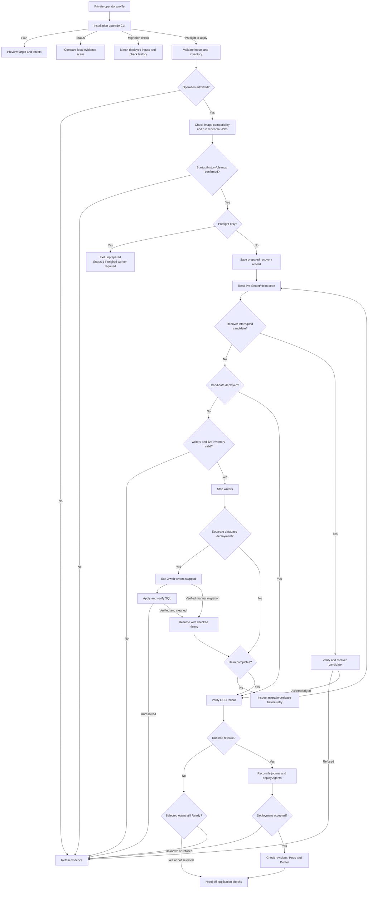

# Production image upgrade flow

## Overview

Upgrades OpenClaw Control Plane (OCC) and Agent runtimes.
See [one-off channel transitions](channel-egress.md#0-install-or-upgrade-channel-routing).

## Entry Points

- Run `scripts/upgrade-production-images` with reviewed inputs, or use `occ installation upgrade` with a private operator profile.
- Stderr phases are advisory; `--verbose` shows native output.
- Required: healthy Helm release with chart-owned initializer, matching OCC/Kubernetes Installation
  IDs and complete authorized inventory without active deployments.
- Source: `scripts/upgrade-production-images`,
  `packages/occ/src/deployment-inventory.ts:readDeploymentInventory`,
  and `packages/occ/src/agent-deployment-admission.ts:admitAgentDeployment`.

## Flow

## Execution Trace

### 1. Prepare the candidate

`internal/occcli/installation_upgrade.go:installationUpgradeCommand` runs
`scripts/upgrade-production:main`. `report_status` compares local marker scans.
Plan validates the profile, images and checkout HEAD. `profile_input` opens the
profile and receipt through one directory descriptor. `published_image_pair`
checks each GHCR package, digest format, source, tag, run and attempt. Operators
authenticate the receipt. `original_image_pair` recovers journal-bound digests
for resume and separate migration apply. The adapter decodes the HTTPS target
with `kubectl` and previews CA trust. Apply, migration apply and resume recheck approval
and bound inputs before dispatch.

Both entrypoints refuse active kubectl preferences. With preferences enabled,
the native helper snapshots kubeconfig, refuses selected exec credentials and
disables command defaults.
Approved snapshots also refuse selected `auth-provider` entries. Profiled
recovery rechecks target, CA binding and parameters under lock.

Before `scripts/upgrade-production-images:prepare_upgrade`, the helper refuses
other Helm stores, [endpoint and TLS overrides](../guides/deploy/production-upgrade.md),
[token and impersonation overrides](../guides/deploy/production-upgrade-command.md#run-the-image-upgrade),
source mismatch, chart edits or symlinks, and evidence or baseline aliases.
`preprovisionedNamespace` must yield one `false` (`preprovisioned-namespace.err`).

`check_migration` matches rendered and deployed migrator inputs and checks the
revision around a read-only Job. Success requires recognized history and
UID-bound cleanup. Unknown creates retain evidence and lock.

`matches_yaml` compares candidate, [baseline](../guides/deploy/upgrade-baseline.md#record-the-release-and-its-configuration)
and live mappings. Invalid inputs or unwritable evidence yield `Cannot compare upgrade YAML`.
Projections allow Slack directory proxy, curated Codex PluginDriver selection
and one registration wrapper. Baseline excludes absent `agentNativeAdmin.sharedCookieDomain`. Immutable
switches require string keys.

`read_restart_inventory` requires a complete, authorized inventory with no
nonterminal deployments. Running revisions require saved Harness objects and an accepted
[restart assessment](../reference/repository-credentials/worker-replacement.md).
Standalone preflight records original-worker requirements. Unknown assessments
block rehearsal. Runtime upgrades record replacements and check draft images,
sizes, baseline versions and Namespace readiness. Stopped or deleting Agents
are excluded. Pending repository cleanup is allowed.

`deploymentInventorySnapshot` reads deployment work in one State snapshot and
refuses missing or mismatched work. Credential withdrawal is separate.
`findRevisionForBrowsing` returns `unknown` for unreadable snapshots and
propagates database or identity errors. `readDeploymentInventory` gives Compute
ten seconds outside State transactions, then rechecks fleet authorization and
Driver selections. Drift refuses inventory. Owner failures return `unknown`.

`scripts/upgrade-evidence.py:validate_compatibility` checks the PostgreSQL
receipt's file binding, data, IAM, cleanup and image digests. Hashes bind
resume inputs. See [qualification limits](../guides/deploy/production-upgrade.md#upgrade-the-control-plane).

`verify_agent_continuity` brackets runtime inspection with authorized Agent
reads and records the selected revision and Driver roles in `agent-continuity.json`.

Repository credentials require immutable images and common node architecture.
`scripts/upgrade-image-identity.py:read_platform` verifies OCI hashes (2 MiB per
blob, 32 MiB total). `scripts/upgrade-repository-image-probe.ts:main` probes
before preparation and resume. Its negative control requires an absent socket
and Docker-confirmed broker exit without OOM or daemon error.

For immutable switches, `prepare_upgrade` validates both Secret identities,
unrelated data and candidate YAML. `upgrade-evidence.py` binds the snapshots.
Different immutable Secret data requires a staged successor via
`--candidate-values`. Prepared attempts keep their recorded Secret. Denied
mutable Secret update reviews block preparation. Inconclusive reviews warn.

`preflight_startup` dry-run applies rendered Certificates before Jobs. Its
45-second request covers the webhook's 30-second maximum and response time.
Admission failure retains protected diagnostics and prevents shutdown.

`scripts/upgrade-startup-preflight.ts` builds single-Pod Jobs with candidate
images, credentials, mounts, deadline and zero retries. `preflight_startup`
refuses changed UIDs or multiple children. Job failure overrides child success.

`scripts/upgrade-startup-preflight.ts:migrationMode` validates the release's rendered
initialization Job invocation. `--require-current` selects `separate`. Invalid or
new-install invocations fail. `migrationJob` preserves policy labels and uses
`--check` for hook mode or `--check-for-installation` with the Installation ID
for separate mode. Both allow recognized pending history.
`check_separate_migration_preconditions` verifies Secret access, records migrator
and CA Secret UIDs and resource versions, and requires
`migration.checked-for-installation`. After cleanup, separate mode rechecks
identities. `scripts/upgrade-evidence.py` binds them.

`apps/controller/src/composition/console-theme.ts:loadConsoleTheme` checks API
theme bundles. Both writers use `loadStartupConfigurationSnapshot` and
`loadInstallationConfiguration` without database access. For OpenShell
`bearerTokenFile`, each Job checks file type and readability without reading the token.

`connectionPlan` preserves private OIDC CA mounts and database preload. Writer
Jobs use `OCC_DATABASE_URL` to verify that one read-only `occ.installation` result
matches OCC and the startup Secret. Statement and lock timeouts are five seconds,
with 15 seconds for the full check. Logs omit connection errors and rows.

`preflight_resume` checks history and writer identities before shutdown or Helm,
even when stopped. Completed Helm releases skip these Jobs. Preflight verifies
Job and Pod identities around log retrieval and rejects NUL bytes.
`formatStartupConfigurationFailure` reports up to 32 field diagnostics.

Kubernetes Compute preflight uses the Pod service account. It refuses
[split-layout Gateway storage](../reference/drivers/kubernetes-compute.md#existing-split-layout-installations)
on single-cluster upgrades. The image's `isName` checks Installation names when
available. `refuseUndeployableConfigurationValues` checks recorded drafts.
Older images or gzipped inputs over 1 MiB warn and defer to deployment.

Experimental two-cluster Jobs use `verifyExecutionTenantGrants` to check API
Pod, proxy, and optional log/Event access, plus worker Pod patch and Job get,
create and delete access. Missing grants require the
[execution chart upgrade](../testing/kubernetes.md#upgrade-the-execution-chart).
Startup Jobs retain default-deny and dependency egress policies. Verify enforcement.

Writers keep serving during preflight. `scripts/upgrade-preflight-state.py`
records create intent and acknowledged UIDs for
[interrupted cleanup](coordinated-production-upgrade/preflight-cleanup.md).
`scripts/lib/upgrade-preflight-cleanup.sh:cleanup_preflight` confirms Jobs and
children are gone before deleting dependencies. Unknown consumers retain them.

After cleanup, recheck switch Secrets and record `startup-preflight-passed`.
Standalone preflight does not prepare deployment. Original-worker requirements
produce `preflight-blocked-original-worker` and exit 1. Upgrade refreshes
inventory. Preparation locks candidates, inventory and target/parameter hashes. `scripts/upgrade-production-images:interrupted_upgrade`
retains the lock and skips cleanup on `SIGHUP`, `SIGINT`, or `SIGTERM`.
Before unlocking, confirm termination and reconcile accepted operations/resources.
Freeze writers, autoscalers, Helm changes and drafts per the [production guide](../guides/deploy/production-upgrade.md).

### 2. Reconcile a prior attempt

Resume locks evidence and dispatch journals, checks paths, identities and
prepared inputs, and requalifies images and nodes. Values must match baseline,
candidate or recorded predecessor and revision. Resume can finish Installation
writes or a Secret switch. `verify_installation_switch` checks both UIDs and data.
Before retry, check history, settle initializer Jobs and Pods, and reconcile
unknown creates. `new_attempt` fsyncs ancestors before publishing pointers.
Failed identity or history checks leave writers stopped. A verified deployed
candidate or recovery successor skips Helm submission.

Retry refuses mode drift from the submitted render before creating preflight
resources. At the original Helm revision, separate mode calls
`require_migration_writers_stopped` before another attempt or preflight. Each Deployment needs its handoff UID
and generation, expected release/component labels, zero replicas and no deletion
timestamp. Writer Pods must be absent. Before scaling, recheck both Deployments
and skip stopped writers. Before protected writes, recheck Pod absence, Helm
status, terminal initializer Jobs/Pods and both Deployments. Failed expected
revisions use checked retry.

For [same-candidate recovery](../guides/deploy/production-helm-recovery.md),
`scripts/upgrade-helm-state.py:recover` checks Helm payload, ownership, completed
Job/Pod and exact security contexts. `pod_matches` compares requests/limits through
Compute's `resource-quantities.ts`. Reads use manifest namespaces and release
ownership. `check-recovery` validates the original attempt before preflight Jobs;
both application identities must pass before a new rollback. `recover` repeats
admission before exclusive intent and dispatch. Accepted/uncertain recovery stays
readback-only.
`require_absent` rejects remaining predecessor-only resources before intent,
before rollback, after rollback and on resume. `verify_workload_changes` requires
retired environment entries and container placements absent before rollback; afterward all changed selections must
match. Neither check deletes resources. Changed nonnative resource specs require exact
candidate matches. Resume rechecks recorded UIDs without pinning old versions.
Supports only pre-upgrade hooks. Resume requires successor acknowledgement.
Client shutdown, exclusive ownership, resource reconciliation and database history
remain operator attestations.

### 3. Quiesce writers and run the candidate release

`scripts/upgrade-production-images:quiescence_remaining` bounds shutdown.
Validate Deployments. Running Workers require stable inventory through resume.
Named patch denial blocks. Inconclusive reviews warn.
`preview_writer_stop` requires server-side dry runs confirming zero replicas for running writers before channel Agent Stop and the Worker before API shutdown. Inspect `quiescence-<component>-preview.err`.
Skip stopped writers. Patches test UID, resource version and replicas.
If conflicts stop the API, restore access under exclusive maintenance.
Verify original Deployments at zero and Pods absent.
Keep nodes reachable, other writers/autoscalers stopped.
Separate mode rechecks Secret identities before shutdown and before recording
stopped UIDs and generations, then exits 3. `apply_database_migration`
requires irreversible SQL approval, a verified separate render and no Helm
submission. Its journal records Job create/delete intent. Unknown effects retain
the lock and kubeconfig snapshot. Cleanup observes prior deletes.
Verification retries require a cleaned failed Job. Resume requires completed
journaled verification and rechecks both Secret identities. Fence Secret edits
because Jobs reference them by name.

Rerun `verify_pair_nodes`. Fresh `helm status` must match
reconciliation except for Helm v4 live `.info.resources`. A mismatch leaves
writers stopped before protected file or Installation Secret writes. Resume can
find candidate settings from a prior attempt.

Protected files change atomically. Resource-version checks preserve unrelated
mutable Secret data. Reference switches preserve both Secrets. Both OCC templates
select the successor and checksum.

`upgrade-helm-state.py:new_attempt` renders and dry-runs immutable values. Hooks
and initializer Pod receive `installation.upgradeAttemptId`. Upgrade and recovery
preserve `.json` format.
`record_submission` saves intent and predecessor before publishing `helm-started`.
Identical interrupted staging can finish. Published intent survives staged retries.
`scripts/migration-history.mjs:migrateWithHistory` checks Installation identity
and recognized history under lock for separate Jobs. Verification and the
separate Helm hook require completed history. Hook mode applies pending SQL.

### 4. Verify control-plane recovery

`scripts/upgrade-helm-state.py:verify_installation_consumers`

Verify images, replicas and changed Installation checksums. Reference switches
verify both Secret identities and Installation mounts in controllers and the
owned initializer Pod. Each component needs one named container. Restartable init
containers require broker-enabled workers. Authenticated OCC retries must return
the same Installation ID.
Worker preparation re-renders current launch requirements.
Repository-bound Agents receive maintenance every 30 seconds until their session
deadline; other Agents are re-prepared if deployment remains unfinished.
Kubernetes Compute rolls changed Gateway and Harness Pod templates even with
unchanged runtime images. Chat waits for readiness.
OpenShell instead requires exact existing Sandbox content
(`apps/controller/src/drivers/sandbox/openshell.ts:verifyExistingSandbox`).
Generated-command changes require a fresh Agent revision; controller-only reuse
cannot adopt them. See the
[upgrade guide](../guides/deploy/production-upgrade.md#prepare-the-release).
Other Agents receive Pod configuration/[diagnostics](agent-deployment-diagnostics.md) fixes on preparation or deployment.

Repository-enabled releases verify Ready API/worker Pods, ReplicaSets, node
architecture and runtime image IDs against the qualified pair. The Driver checks
broker admission without a session. Pod identities must remain stable through
admission, dispatch and completion.

### 5. Deploy and verify the recorded fleet

`scripts/upgrade-production-images:confirmed_deployment_status` and
`scripts/upgrade-dispatch-state.py:transition`

Flush intent before dispatch. Unresolved intents block sends. The journal retains
accepted revisions, definite refusals and superseded receipts. Resume may retry
refusals. Replacements must name the current failed revision. Unknown outcomes
or stale journals require
[recovery](../guides/deploy/production-upgrade-recovery.md).

Verify authorized deployment status, revisions and Pod readiness on the
candidate digest. [Gateway and Harness storage](../reference/drivers/kubernetes-compute/storage-and-credentials.md#gateway-storage)
describes how state migration and retries gate runtime startup.

Replacement gateways run read-only `openclaw doctor --lint --json --severity-min error`
serially. `gateway_free_memory` requires one cgroup v2 reading above heap cap
plus 640 MiB or two above cap plus 256 MiB. After insufficient memory, Doctor requires fresh sufficient readings. A memory
timeout stops new checks. `revision_pod_change_since_ready` checks required Pods
even after Doctor failure. Missing, changed, restarting or unready Pods fail the upgrade.
See [Doctor recovery](../guides/deploy/production-upgrade-recovery.md#correct-a-doctor-failure).

### 6. Hand off application verification

`docs/guides/deploy/production-upgrade.md:Verify the release`

Confirm Helm revision, OCC access and, for runtime upgrades, deployment,
readiness and Doctor success. `verify_agent_continuity` precedes terminal
controller/Helm checks. Require one Running, Ready Pod per role. Replacement
UIDs and completed init containers qualify. Eight results leave uniqueness unknown.
Previously running provider Harnesses must stay running. Failure retains
observations without `completed`. Reconcile failed writes. Resume rechecks
without repeating successful Helm. `completed` blocks resume.
Verify routing, models, channels, credentials, workspaces and restores.
The [served Console check](../release/container-promotion.md#verify-the-served-console)
accepts an optional image-bound entry digest.

### Read-only export after a split-layout refusal

[Split-layout export](../guides/deploy/split-layout-upgrade.md#export-and-re-create)
uses `scripts/split-layout-tenants.ts:createOccApi.expect` to reject malformed
responses. `importTenants` rejects shared destinations, preserves prior merges
and reserved IDs, and handles rename keys literally. Unsaved exact-name reuse
requires no Agents or Secrets.

## Debugging and Verification

- Check `helm-attempts/<UUID>/` render and dry-run output, and
  `preflight-<api|worker|migration>.log`, `-logs.err` and `-status.json`. For resume,
  use the current `upgrade-preflight-resume.*` directory.
- See [upgrade recovery](../guides/deploy/production-upgrade-recovery.md) for
  `native-command-failures.tsv`, migration journals and dispatch results.
- Compare `before-workloads.json` and `after-workloads.json` for controller-only
  rollouts. Check broker-affected repository versions separately.
- Command fixtures prove control flow. End-to-end proof requires credentialed
  production Kubernetes and distinct images.

## Related docs

- [Production upgrade guide](../guides/deploy/production-upgrade.md)
- [Production installation](../guides/deploy/production-installation.md)
- [Production Agent verification](../guides/deploy/production-agents.md)
- [Agent deployment reference](../reference/agents/deployment.md)
- [Production startup flow](production-startup.md)
- [Controller worker flow](controller-worker.md)
- [Authoritative platform design](../design.md)

## Manual Notes

[keep this for the user to add notes. do not change between edits]

## Changelog

- 2026-11-23 04:18: Preview API. (authoring-run/80b539ac-f508-454c-a905-70939d30ec31 - b24f6ec158b861b13f2baff95bf661346de7f767)
- 2026-11-23 02:02: Preview earlier. (authoring-run/cdd15e8b-8040-4505-bb79-d9ccd1dc5682 - 96519cbee73d4ee54528626c0517ee7aaa6e1822)
- 2026-11-22 17:37: Preview Worker stop. (authoring-run/8a4cdeff-6237-46d6-ad85-7ea5bfa0c302 - 3eedffbaae63cdc1b006e51d49b88504462d2a5c)
- 2026-11-21 09:16: Trace rendered mode and retry. (authoring-run/06420637-f403-4d0d-a6b1-acf2f522dcb0 - f9fb2a1f6fed7afd4ba8e69737f611e55604f587)
- 2026-11-21 03:11: Reconcile publication selection with current upgrade admission and recovery. (authoring-run/5e8acf3b-45b0-4fbd-801d-493e4787e9dc - e67cd3cd0357e002ccc62f410454649ea4bfefd9)

- 2026-11-20 19:04: Refresh sources. (authoring-run/8a8bde8b-71de-4de5-80bf-e32f0e335c34 - 220f62d86ceb3dfc6f66dbee7c6f86cda50e5d05)
- 2026-11-20 16:29: Update source pointers for runtime observation and fleet inventory. (authoring-run/c41017eb-dc85-4c43-90e8-3040fbace6ac - c6acc7271f7753f74d3657251f23a036c08e671c)

- 2026-11-20 17:42: Refuse Helm credential overrides. (authoring-run/e16304ce-2b94-4022-a90d-9ab2e235d1d4 - aff441a5df9e3258752b034fb694e06333c0b231)

- 2026-11-20 11:52: Trace sibling receipt selection and credential rules. (authoring-run/50e3a914-60d2-4d1e-9fbd-8bb9fc214ad5 - d215c0d95c2336244519eca4968df04ec4376ae2)

- 2026-11-20 09:47: Trace immutable Installation refusals and the Certificate admission timeout. (authoring-run/d0f76046-8ddd-44e6-a67f-29c2288c9e33 - 9092839d0c3b9598e85300451f425ac6d3084fe5)

- 2026-11-19 19:15: Trace the stopped writers check before Helm retry. (authoring-run/aed0a2bc-9691-4859-8bd6-1e7b3549c9b4 - d976da889bdeca6e9208821a5b4ea79a49033b0f)

- 2026-11-19 17:18: Keep bootstrap handling in the chart. (authoring-run/803c9489-57ed-4e31-a5ea-568f16e22161 - d14128b4a0fc1f499b914107ec6ec14eccc39fdf)

- 2026-11-19 17:08: Trace migration Secret checks from preflight through resume. (authoring-run/d22a53f0-d60f-46c9-9977-2d54227dd193 - a4e6e5e73e7f6f8699dddd6c3244af6fd71c2336)

- 2026-11-19 10:54: Compose profile approval with separate database migration. (authoring-run/abedccc5-d961-4465-afd3-012cc1e5a5a5 - 6885839d6e3d8dd2f8293552d508ad4536cbf8a6)

- 2026-11-18 14:34: Retire bootstrap outputs safely (PST). (authoring-run/fcffdcd5-85ba-4fd1-ad35-bfbbcd6953b6 - ce0bd74dcbb7bdf2fd97a6d87e9ea0f88cf0199d)

- 2026-11-18 20:23: Apply and verify separate database Jobs. (authoring-run/859166ef-2ed3-42e1-b8fd-88441bb8746f - 084874338baf51ad05d0b1a2b438e8bcd0120c1b)

- 2026-11-19 17:03: Reconcile the upgrade trace and bind admission to the selected credential method. (authoring-run/1b66f15a-ca57-49d3-97bd-6ce1593f55a2 - c833b919f687c17dcb5b2e1e5037b55ed4321ac0)

- 2026-11-19 12:44: Compare status markers. (authoring-run/b54d6eb9-13cb-4072-96e2-2e285cde2402 - a02224a7e22516f958546a249ddcbfa9bfcd6012)
- 2026-11-19 12:31: Trace standalone preflight status. (authoring-run/95ab0282-a9eb-46db-9c6b-bd4cce4ee6ea - a02224a7e22516f958546a249ddcbfa9bfcd6012)
- 2026-11-19 11:30: Trace candidate rehearsal when retained Agents require the original worker. (authoring-run/099c1a03-0e25-4504-9cf7-2f62d1cfa035 - 6679017155741810c2ae1bcbacba05a3eb59f3ec)

- 2026-11-19 10:56: Refuse active kuberc. (authoring-run/9c893cda-96dc-4a06-9e08-ad2aeca46de7 - 5f425af517e8ee120c7721e7559a846ce70120e9)

- 2026-11-19 10:26: Trace kubeconfig decoding and snapshot authentication. (authoring-run/8620ea2f-2212-49a6-b45b-0c6b44bf7fa2 - b0171d98e4470aaad0ba5b7ddb4e16a27fb9de7a)

- 2026-11-19 09:57: Trace the Helm release store guard. (authoring-run/d4ce1b5c-3a22-44f3-b1ad-40e8a771c331 - 2455e61e32e8f97a6dfb505608a665e2eca59f20)

- 2026-11-19 09:47: Trace profile TLS checks. (authoring-run/2a1d437b-87cc-4839-a06a-12b3d255450f - 2455e61e32e8f97a6dfb505608a665e2eca59f20)

- 2026-11-19 05:13: Trace upgrade approval, trust, and evidence. (authoring-run/def34421-d123-4fd1-bde1-e8d966d6bcad - 8bc5fe2fc916765024493c981308179a04a0e716)

- 2026-11-18 19:45: Tighten the upgrade trace. (authoring-run/9b947cd8-0275-4e7f-ac7f-5dce4b0f8965 - aed2f7edd530ab336bbd6cb8c7389b24cb83e397)

- 2026-11-18 19:27: Trace migration-only compatibility checks through the Helm hook and Job journal. (authoring-run/7ae70bae-f8ac-425d-abbf-7039b71997b7 - 71334bb9b104662870798a29814e7171e8905baf)

[Production image upgrade flow documentation history](coordinated-production-upgrade/history.md) preserves the older dated entries.
