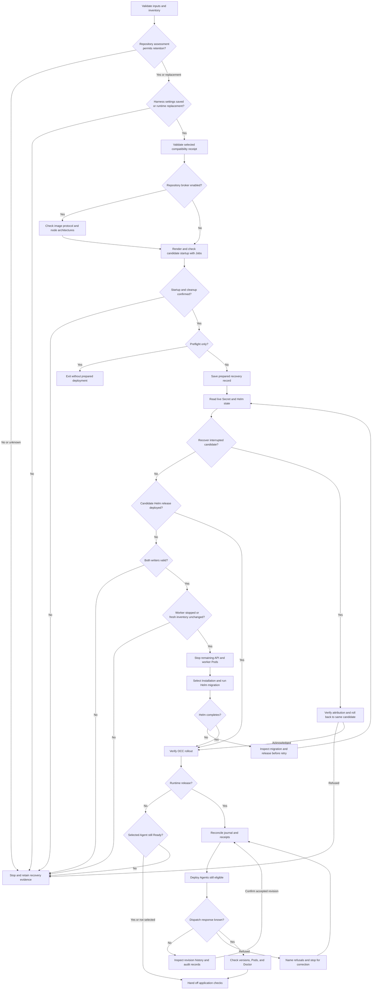

# Production image upgrade flow

## Overview

`scripts/upgrade-production-images` upgrades OpenClaw Control Plane (OCC) or
Agent runtimes, with revision readiness and Doctor checks.

## Entry Points

- Run `scripts/upgrade-production-images` with the reviewed release inputs.
- Required: healthy production Helm release, matching OCC/Kubernetes Installation
  IDs and complete authorized inventory without active deployments.
- Source: `scripts/upgrade-production-images`,
  `packages/occ/src/index.ts:OpenClawController.getInstallationDeploymentInventory`,
  and `packages/occ/src/index.ts:OpenClawController.deployAgent`.

## Flow

## Execution Trace

### 1. Prepare the candidate

`scripts/upgrade-production-images:prepare_upgrade`

Reject nonempty [Helm target/TLS overrides](../guides/deploy/production-upgrade.md) before access.
`HEAD` must match `--source-revision`; chart changes, symlinks and internal
evidence/baseline aliases are rejected. Other edits and image provenance remain unchecked.

Resume binds evidence path/device/inode; aliases share its lock. Runtime upgrades separately lock the sibling dispatch journal.

`matches_yaml` compares candidate YAML order and values with the
[baseline](../guides/deploy/upgrade-baseline.md#record-the-release-and-its-configuration)
before protected-setting projection. Invalid inputs or unwritable evidence cause
`Cannot compare upgrade YAML`. Only Slack directory proxy, curated Codex
PluginDriver selection and wrapping one registration in an array may change before
image selection. Immutable reference switches require string mapping keys. Startup validates the candidate controller; broker checks compare references, not referenced contents.

`read_restart_inventory` requires one complete authorized inventory without active
deployments. Retained running revisions need a positive
[restart disposition](../reference/repository-credentials/worker-replacement.md).
`occ agent revision` must return one correctly owned snapshot with object-valued
Harness settings; otherwise preparation refuses. Drafts cannot substitute.
Runtime upgrades validate drafts and record replacements; continuity remains unverified.

`OpenClawController.getInstallationDeploymentInventory` invokes Compute outside
State transactions with a shared ten-second budget, then rechecks authorized
fleet/Driver selections. Changes refuse; failures yield `unknown`. No fleet lock is acquired.

Runtime upgrades require baseline versions and ready Namespaces.
Stopped/deleting Agents are excluded; pending repository cleanup is allowed.

`prepare_upgrade` copies PostgreSQL's `run` result;
`scripts/upgrade-evidence.py:validate_compatibility` checks runner/file consistency,
case/cleanup success and both digests before preflight. Hashes bind resume, not
execution authenticity or online/rollback safety; see
[qualification limits](../guides/deploy/production-upgrade.md#upgrade-the-control-plane).

`verify_agent_continuity` requires Agent read/operate, active AgentRevision read
and runtime inspection. Agent reads bracket explicit-revision runtime reads,
freezing identity and Driver-declared roles in `agent-continuity.json`.

Repository-enabled releases require explicit immutable controller and broker images.
Matching control-plane nodes, including unready/cordoned nodes, must share one architecture. `scripts/upgrade-image-identity.py:read_platform`
verifies the selected platform and blob hashes in Docker's OCI export
(2 MiB per blob, 32 MiB total metadata).
`scripts/upgrade-repository-image-probe.mjs` tests both images
with synthetic recovery/refusal requests and a private receipt listener, recording
image identities and exchanges. Kubernetes image availability, receipt durability
and disposal remain unverified. The broker hostname stays fixed; see
[restart recovery](../guides/repository-credentials/installation.md#install-and-verify).

For immutable switches, `prepare_upgrade` validates identities, unrelated data and
candidate YAML, then hashes staged bytes; `upgrade-evidence.py` binds both snapshots.
Changed immutable data requires a successor. For mutable changes, Kubernetes
self-review checks named Secret update access: denial stops preparation; an
inconclusive review warns and continues. Replacement requires update permission.
After Helm's server dry run, `scripts/upgrade-startup-preflight.mjs` copies
API/worker images, environment, mounts and service accounts into single-Pod Jobs
with the candidate Secret, no retries and the selected deadline.
`preflight_startup` checks Job UID and child ownership: missing children wait;
replaced/multiple children refuse. Job completion is required; failure overrides child success.

API Pods validate configured themes with
`apps/controller/src/composition/console-theme.ts:loadConsoleTheme`; invalid bundles
stop preflight. Workers skip themes. Both resolve Drivers/Presets without database
access through `loadStartupConfigurationSnapshot` and `loadInstallationConfiguration`.
`apps/controller/src/startup-failure.ts:formatStartupConfigurationFailure` formats
typed configuration refusals with up to 32 field diagnostics through the API/worker
log filter. The helper checks Job and Pod identity before and after log retrieval,
rejects NUL bytes before parsing markers, and discards unbound output.

Bundled Kubernetes Compute Driver `preflight` uses Pod credentials (`inCluster`
service account), matching startup. It refuses
[split-layout Gateway storage](../reference/drivers/kubernetes-compute.md#existing-split-layout-installations)
on single-cluster upgrades.
The image's `isName` validates the stored name from `occ installation get`
(`INSTALLATION_NAME_INVALID`); images without this rule skip it.

Runtime preflight calls `resolveConfiguredHarnessId` then
`refuseUndeployableConfigurationValues` on recorded drafts. Refusals leave old
writers serving: correct drafts, stop affected Agents or replace incompatible
images before retrying with fresh evidence. Older images or gzipped inputs over
1 MiB warn and defer validation. Deploy checks live Harness state.

Experimental two-cluster Pods also run
`KubernetesComputeDriver.verifyExecutionTenantGrants` for their component; startup
does not. Where each Pod's identity holds the release-era grant in an execution
tenant Namespace, SelfSubjectAccessReviews ask for newer `openclaw-execution`
rules: API Pod and `pods/proxy` reads, plus `pods/log` and Event reads with runtime
logs; worker Pod `patch` and `batch` Job `get`, `create`,
and `delete`. Worker Job grants are required even with runtime logs disabled.
A missing rule refuses the candidate and points to
[upgrading the execution chart](../testing/kubernetes.md#upgrade-the-execution-chart).

Preflight Jobs retain default-deny labels and a copy of
`openclaw-enterprise-dependency-egress`, including execution-cluster API rules.
Controller ownership addresses EKS's standalone-Pod limitation; verify enforcement.

Startup failures, timeouts and unconfirmed creates leave writers serving. Create errors remain in `preflight-<resource>-create.err`.
`cleanup_preflight` requests UID-guarded foreground Job deletion, waiting up to
30 seconds per Job for it, its UID-selected children and recorded child to disappear.
Only then are the original Secret/policy UIDs deleted. Ambiguous creates or
unconfirmed consumer cleanup retain dependencies and refuse progress; replacements
remain untouched. Reconcile `preflight-cleanup.err` before retrying.

Reference switches recheck both Secrets after cleanup.
`--preflight-only` leaves writers serving with non-resumable evidence.
Preparation saves candidates, inventory, target and parameter hashes
under lock. `scripts/upgrade-production-images:interrupted_upgrade`
retains it and skips preflight cleanup on `SIGHUP`, `SIGINT`, or `SIGTERM`.
Before unlocking, confirm helpers stopped; reconcile accepted operations/resources. Freeze other writers, autoscalers, Helm changes and runtime
drafts per the [production guide](../guides/deploy/production-upgrade.md).

### 2. Reconcile a prior attempt

`scripts/upgrade-production-images` binds resume to the prepared inputs, directory,
source and cluster, requalifies images, and rejects changed eligible nodes.
Values must match baseline, candidate or the recorded predecessor and revision.
Resume checks immutable intent, Secret identity and unrelated data. `verify_installation_switch`
rechecks both immutable Secrets' UIDs and complete data. Pending Installation
writes require a mutable Secret before scaling. Retries require migration-history review and terminal
initializer Jobs/Pods. `new_attempt` fsyncs attempt-directory ancestors before
publishing pointers.
Ordinary resume skips Helm only at the exact submitted deployed revision.

For [same-candidate recovery](../guides/deploy/production-helm-recovery.md),
`scripts/upgrade-helm-state.py:recover` checks Helm payload, ownership, completed
Job/Pod and exact security contexts. `pod_matches` compares requests/limits through
Compute's `resource-quantities.ts`. Reads use manifest namespaces and release
ownership. Durable exclusive intent precedes identity rechecks and hooked rollback.
`require_absent` rejects remaining predecessor-only resources before intent,
before rollback, after rollback and on resume. `verify_workload_changes` requires
retired environment entries and container placements absent before rollback; afterward all changed selections must
match. Neither check deletes resources. Changed nonnative resource specs require exact
candidate matches. Resume rechecks recorded UIDs without pinning old versions.
Supports only pre-upgrade hooks. Resume requires successor acknowledgement.
Client shutdown, exclusive ownership, resource reconciliation and database history
remain operator attestations.

### 3. Quiesce writers and run the candidate release

`scripts/upgrade-production-images:quiescence_remaining` bounds shutdown.
Validate both Deployments. While the worker runs, compare complete inventory
with preparation before either stop, including resume; changes refuse.
Restore a stopped API's access under exclusive maintenance ownership before retry.
Skip stopped writers; stopped workers have no prospective guarantee.
Sequential patches test UID, resource version and replicas; conflicts can leave the API stopped.
Pods must disappear and original Deployments remain at zero. Stop other
writers/autoscalers; keep nodes reachable.

Protected files adopt candidates atomically. Mutable Secret updates preserve
unrelated data with a resource-version precondition; reference switches leave both
Secrets unchanged. Both OCC templates select successor and checksum.

`upgrade-helm-state.py:new_attempt` renders and dry-runs immutable values with a
fresh `installation.upgradeAttemptId`, copied to hooks and the initializer Pod.
`record_submission` saves intent and predecessor before publishing `helm-started`.
Identical interrupted staging can finish; staged retries cannot replace published
intent. Initialization checks Installation, migrates and bootstraps before rollout.

### 4. Verify control-plane recovery

`scripts/upgrade-helm-state.py:verify_installation_consumers`

Verify images, replicas and changed Installation checksums.
Reference switches verify both Secret identities and actual Installation mounts in
controllers and the owned initializer Pod. Each component needs one named container.
A broker-enabled worker may use a restartable init container; other placements fail. Authenticated OCC
access is retried and must return the same Installation ID.
Worker preparation re-renders current launch requirements.
Repository-bound Agents receive maintenance every 30 seconds until their session
deadline; other Agents are re-prepared if deployment remains unfinished.
Kubernetes Compute applies current Gateway and Harness Deployments, rolling
changed Pod templates even when runtime images are unchanged. Chat waits for readiness.
OpenShell instead requires exact existing Sandbox content
(`apps/controller/src/drivers/sandbox/openshell.ts:verifyExistingSandbox`).
Controller changes to its generated command require a fresh Agent revision;
controller-only reuse cannot adopt the changed command. See the
[upgrade guide](../guides/deploy/production-upgrade.md#prepare-the-release).
Controller fixes to Pod configuration and [diagnostics](agent-deployment-diagnostics.md)
reach other Agents on their next preparation or deployment.

Repository-enabled releases verify Ready API/worker Pods, owning ReplicaSets,
node architecture and runtime image IDs against the qualified pair. The Driver
checks broker admission without a session. Pod identities must remain stable
through that check, dispatch and completion.

### 5. Deploy and verify the recorded fleet

`scripts/upgrade-production-images:confirmed_deployment_status` and
`scripts/upgrade-dispatch-state.py:transition`

Flush intent before dispatch. Unresolved intents block
later sends. The journal records accepted revisions and definite refusals, which
resume may retry. Superseded receipts remain; replacements must name the current
failed revision. Unknown outcomes or stale journals require
[recovery](../guides/deploy/production-upgrade-recovery.md).

The script verifies authorized deployment status, version, and ready Pods on the
candidate digest. Before startup, `openClawStateMigrationHelper` in
`runtime-startup.ts` runs `openclaw doctor --fix --non-interactive` for older schemas.
Current schemas and Doctor's settled result gate startup: maintenance or cleanup
refusal holds `state-migration` unready; ordinary warnings do not. A private pending
marker forces interrupted or refused maintenance to retry after restart, even with current schemas. The same step
runs before Harness native setup or native-worker connection. Embedded execution
requires one runtime container; dedicated execution requires Gateway and Agent containers.
Each replacement gateway runs read-only
`openclaw doctor --lint --json --severity-min error`, one at a time, with a heap cap
(`--doctor-heap-mib`, default 384 MiB). Doctor shares the gateway's memory limit;
an OOM kill can stop both. The cgroup v2 check (`gateway_free_memory`) requires
one reading with cap plus 640 MiB free or two consecutive readings with cap plus
256 MiB. This reserves no memory. Transient failures are retried.
Initially unavailable data allows warning and run.
After insufficient memory, unavailable reads reset consecutive evidence; only fresh
sufficient readings admit Doctor before its deadline.
Failure reports separate Doctor's exit status from gateway restarts since Ready.
Missing or incomparable counts or Pod identities report unknown; only a comparable
increase with last termination `OOMKilled` names an OOM kill. A memory timeout
starts no further Doctor. Then, also after a failed Doctor, `revision_pod_change_since_ready`
fails the upgrade for any revision Pod the wait required (gateway or dedicated agent)
missing, replaced, restarted, or unready; the readiness wait ignores ended Pods, so
resume checks the replacement.

### 6. Hand off application verification

`docs/guides/deploy/production-upgrade.md:Verify the release`

Completion requires expected Helm revision and OCC access, plus deployment,
readiness and Doctor success for runtime upgrades. For selected-Agent checks,
`verify_agent_continuity` waits before terminal controller/Helm checks.
Each role needs one Running, Ready Pod; allow replacement UIDs and completed init containers. Eight returned Pods for a role may hide
another Pod beyond the runtime endpoint's cap, so cannot prove uniqueness.
Observed Harness status must remain running. Failure preserves observations;
resume rechecks without repeating successful Helm.

`completed` refuses resume. Failed writes require reconciliation; absence proves nothing. Operators verify routing,
models, channels, credentials, workspaces and restores. Console publication checks
use [`verifyConsoleRelease`](../release/container-promotion.md#verify-the-served-console).

### Read-only export after a split-layout refusal

The [split-layout fallback](../guides/deploy/split-layout-upgrade.md#export-and-re-create),
`scripts/split-layout-tenants.mjs:createOccApi.expect`, rejects malformed JSON,
empty bodies and missing envelopes before export. Empty collections, 204 deletes
and explicitly accepted 404s remain valid.

`importTenants` resolves unsaved targets by name and rejects shared destinations
before mutations. Saved IDs stay reserved even for skipped sources; unsaved
skipped sources reserve nothing. Correct the map, rename distinctly or skip.
Validated mappings resume without undoing prior merges. Rename keys are literal,
including `constructor` and `__proto__`. Unsaved exact-name reuse requires no
Agents or Secrets.

## Debugging and Verification

- Read `helm-attempts/<UUID>/{render-error.log,server-dry-run-error.log}` for native
  preparation failures; `server-dry-run.txt` retains successful output. Inspect
  `preflight-<api|worker>.log` and `-status.json` for rejected candidates.
- For scale/Helm/rollout failures, inspect `native-command-failures.tsv` and
  [upgrade recovery](../guides/deploy/production-upgrade-recovery.md).
- Before runtime retries, inspect `dispatch/*.error`, `dispatch/*.rejected`, version
  history and `status/*.json`; for Doctor, `status/*.doctor.json` and `status/*.doctor.error`.
- Compare `before-workloads.json` and `after-workloads.json`. Expect one same-image
  rollout per affected Agent after controller-only upgrades; separately check
  broker-restarted repository versions.
- End-to-end proof requires credentialed production Kubernetes integration with
  distinct images. Mocked commands prove script control flow.

## Related docs

- [Production upgrade guide](../guides/deploy/production-upgrade.md)
- [Production installation](../guides/deploy/production-installation.md)
- [Production Agent verification](../guides/deploy/production-agents.md)
- [Agent deployment reference](../reference/agents/deployment.md)
- [Production startup flow](production-startup.md)
- [Controller worker flow](controller-worker.md)
- [Authoritative platform design](../design.md)

## Manual Notes

[keep this for the user to add notes. do not change between edits]

## Changelog

- 2026-11-09 09:16: Integrate active-revision checks with immutable-Secret recovery. (authoring-run/1792e6e8-4956-4d95-a080-5a724a78db2a - 6f1ea7b9d13b8d8ecd20c6128d5d906810d94f7b)

- 2026-11-09 07:05: Check named Secret update access before quiescence. (authoring-run/f98ccc9d-c174-4103-a385-d4d24950e54d - 09fe300b1ede4b59741b527a3b45199b435d7d6c)

- 2026-11-09 05:02: Bind staged immutable Installation references through upgrade recovery. (authoring-run/cfc73629-f188-4fd0-8ff4-f3b3fbf6843f - 3b898fdc4a27c5cfcc6cbeb7196d96b02368da8b)

- 2026-11-09 03:26: Check immutable Installation Secrets before stopping writers. (authoring-run/8664c38b-fe94-43f6-8922-8aa139b809e6 - ce1d22e17a)

- 2026-11-08 17:01: Integrate saved Harness preflight with attributed Helm recovery. (authoring-run/6d8fd0f0-41d7-4b04-96e3-1b3dc7b9bd1e - 6865e4de0d11ef5ce65d0d39a34cec157e8b7e9a)

- 2026-11-08 15:25: Refuse unreconciled resources, environment entries and container placements during recovery. (authoring-run/453b61bd-c21e-4f98-a7a8-3fdfbb549103 - d4333fb16c)

- 2026-11-08 15:13: Integrate attributed recovery with current upgrade safeguards. (authoring-run/0e1589f2-ec9d-455e-bd57-8c7c7eac4f41 - 0447571733)

- 2026-11-08 12:18: Reject Helm target overrides. (authoring-run/cd7fae84-40fe-4d7a-bfe0-aff970e961db - 4566d20b8ef66a3268e27bceac946765ecd5d336)

- 2026-11-07 08:18: Require single-document responses. (authoring-run/f5d332f5-a699-45b8-82ec-07b982cab516 - 0aa6334cace7c272c3b1eb69e456292a068a2c1a)

- 2026-11-07 08:06: Assess repository worker replacement before stopping writers. (authoring-run/dc361ab2-8dc2-4ed3-872d-220eb9cce3c1 - d84756d04bec6aa6499364548cd21a07bbbc86d7)

- 2026-11-07 07:39: Check exact active Harness snapshots before controller-only upgrades. (authoring-run/dd27d6b9-6dec-4ba5-bc83-d3595d72273d - e658fa14b627fc6d55c8d67a68f5668efc27397c)

- 2026-11-07 03:01: Freeze reviewed controller compatibility evidence. (authoring-run/4adaf10b-d7e7-46e1-8f30-65993c797458 - ada47832cb112f255f6c51d34dae37acce9760cd)

- 2026-11-07 02:48: Verify selected Agent readiness before completion. (authoring-run/87bf103a-4285-4561-8ab8-6a9f1e265248 - ada47832cb112f255f6c51d34dae37acce9760cd)

- 2026-11-07 02:27: Validate both writers before stopping either. (authoring-run/a2f2f4b1-8e0e-4f19-8ce3-11d6e118a054 - 7f5489fe39ba84a34987bd22d905e942cf65a8ee)

- 2026-11-06 23:52: Check container identity, quantities and attempt durability. (authoring-run/9507f38c-1639-4152-a4ae-0de499d7ca5d - a0560795)
- 2026-11-06 23:37: Fix retry publication, resource lookup and execution checks. (authoring-run/9507f38c-1639-4152-a4ae-0de499d7ca5d - bbf4891d)
- 2026-11-06 23:24: Bind attempts and acknowledge same-candidate recovery. (authoring-run/9507f38c-1639-4152-a4ae-0de499d7ca5d - 1b6c65cc)

- 2026-11-06 19:10: Bind resume to each submitted Helm revision. (authoring-run/9ac3c663-290c-4524-94bd-7157cbd44914 - f1c0865be4c523090af0dccc29c613ad1d47d542)

- 2026-11-06 18:44: Bind writer quiescence to observed Deployment identity and version. (authoring-run/4f41f7ed-7c0b-484d-b6b3-85c39a31a8c6 - 5b8901213714a5b0d99f82af8eae1d425ee7cd18)
- 2026-11-06 10:19: Bind startup results and logs to controller-owned Jobs; retain dependencies until cleanup is confirmed. (authoring-run/fd9ca628-3661-4fb1-927c-661ea85ae64d - 8e8035a0c073e2779aa7b32ece5dff449449f5b2)

- 2026-11-05 13:53: Require settled Doctor maintenance before runtime startup. (authoring-run/0f9e4fc6-9649-465a-8ab4-3fc3124417e2 - 644b3f9328e9125030e958c7b4233ac37c54b139)

- 2026-11-05 11:09: Allow an explicit canonical plugin registration candidate while preserving protected settings. (authoring-run/156a9693-7ea1-4555-a5b7-b4c840568cd5 - 717e8bf2a3ef3fa4d4fa7e53cc6927500533ddbd)

- 2026-11-04 07:28: Validate Console inputs. (authoring-run/78fd39fa-cf99-4b8c-b120-4e344700140d - 2f8d396865b850963bb928beb0399970de430761)
- 2026-11-04 07:14: Validate YAML comparisons. (authoring-run/47f197fd-9f98-4dfb-8162-36589ab6194e - e122eaced28cdaff6cbf9d78e0fab4d038f9c380)

- 2026-11-04 06:40: Diagnose unusable YAML. (authoring-run/1320ca1e-663f-449a-aab9-29102e0c482f - f150505ae48988083ddeebdaffd45978be48d588)

[Production image upgrade flow documentation history](coordinated-production-upgrade/history.md) preserves the older dated entries.
