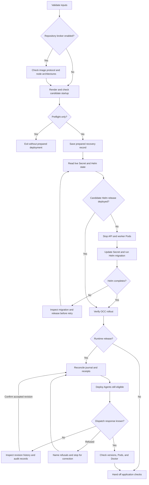

# Production image upgrade flow

## Overview

`scripts/upgrade-production-images` updates the OpenClaw Control Plane (OCC),
Agent runtimes, or both. Controller-only upgrades stop after API/worker recovery.
Runtime upgrades redeploy initially running Agents, then check ready Pods and
read-only Doctor lint.

## Entry Points

- Trigger: run `scripts/upgrade-production-images` with selected images, target,
  release, source revision and protected files.
- Required: a healthy production Helm release and matching OCC and Kubernetes
  Installation IDs. Runtime upgrades require complete authorized inventory and no deployment in progress.
- Source: `scripts/upgrade-production-images`,
  `packages/occ/src/index.ts:OpenClawController.getInstallationDeploymentInventory`,
  and `packages/occ/src/index.ts:OpenClawController.deployAgent`.

## Flow

## Execution Trace

### 1. Prepare the candidate

`scripts/upgrade-production-images:prepare_upgrade`

Before protected reads, evidence writes or cluster access, the helper matches
`HEAD` to `--source-revision`. It rejects changed, extra or missing stock chart files, symlinks,
and baseline/evidence paths or aliases inside the chart. Keep the checkout
unchanged; other local edits and image provenance remain unchecked.

Resume binds the evidence directory's canonical path, device and inode; aliases
share its lock. Any `completed` entry refuses resume before Kubernetes/OCC calls
or evidence changes. Runtime upgrades also lock the private sibling dispatch
journal for the frozen fleet. Restoring evidence leaves that journal intact.

Candidates match the [baseline](../guides/deploy/upgrade-baseline.md#record-the-release-and-its-configuration)
as ordered YAML mappings, including images. Validate both candidates before
protected-setting projections. `scripts/upgrade-production-images:matches_yaml`
compares checked conversions and exits on unusable inputs or unwritable
evidence with `Cannot compare upgrade YAML`. Only the Slack directory proxy and
curated Codex PluginDriver selection may change before image selection. Broker
checks compare references, not ConfigMap or Secret contents.

Runtime upgrades require a complete authorized inventory and baseline versions.
Nonterminal deployments, missing versions or unready Namespaces stop preparation.
Stopped or deleting Agents are excluded; pending repository cleanup does not block.

Repository-enabled releases require explicit immutable controller and broker images.
All nodes matching the control plane selector, even unready or cordoned nodes,
must share one architecture. `scripts/upgrade-image-identity.py:read_platform`
verifies the selected platform and blob hashes in Docker's OCI export
(2 MiB per blob, 32 MiB total metadata).
`scripts/upgrade-repository-image-probe.mjs` tests recovery and refused reservations
through both images using synthetic inputs and a private receipt listener. It
records the digest, platform manifest, configuration, requests and responses.
This verifies the Driver and broker protocol; Kubernetes image availability,
receipt durability and disposal remain unverified. The live broker hostname
stays fixed. For restart recovery, follow the [broker procedure](../guides/repository-credentials/installation.md#install-and-verify).

After rendering and a server-side Helm dry run,
[`scripts/upgrade-startup-preflight.mjs`](../../scripts/upgrade-startup-preflight.mjs)
copies API and worker templates into one-shot Pods with the image,
environment, mounts and service account; the Installation mount uses a temporary
candidate Secret.

An API Pod with a theme first calls
`apps/controller/src/composition/console-theme.ts:loadConsoleTheme`. Invalid bundles
stop preflight; workers do not load themes. Both call
`loadStartupConfigurationSnapshot` and `loadInstallationConfiguration` to resolve
Drivers and Preset files without opening the database.
`apps/controller/src/startup-failure.ts:formatStartupConfigurationFailure` formats
typed configuration refusals with up to 32 field diagnostics through the API/worker
log filter. The helper saves logs before writers stop.

With the bundled Kubernetes Compute Driver, each Pod runs
`KubernetesComputeDriver.preflight` with its Kubernetes credentials (its service
account in `inCluster` mode), as API and worker startup do. This refuses, for
example, single-cluster [split-layout Gateway storage](../reference/drivers/kubernetes-compute.md#existing-split-layout-installations).
Each Pod checks the stored Installation name from `occ installation get` with
the image's `isName`, as the controller does after reading the database
(`INSTALLATION_NAME_INVALID`); an image without the rule skips it.

During runtime upgrades the candidate API Pod resolves each recorded draft's Harness
(`resolveConfiguredHarnessId`) before `refuseUndeployableConfigurationValues`. Deploy checks
live Harness state. Refusals stop preparation while the old API and worker serve. Correct
refused drafts or stop their Agents. For images providing values checks without a working resolver,
select a corrected controller image. Retry with a new evidence directory. Preflight warns and defers
to deploy when images predate the check or gzipped drafts plus the Installation exceed 1 MiB.

Experimental two-cluster Pods also run
`KubernetesComputeDriver.verifyExecutionTenantGrants` for their component; startup
does not. Where each Pod's identity holds the release-era grant in an execution
tenant Namespace, SelfSubjectAccessReviews ask for newer `openclaw-execution`
rules: API Pod and `pods/proxy` reads, plus `pods/log` and Event reads with runtime
logs; worker Pod `patch` and `batch` Job `get`, `create`,
and `delete`. Worker Job grants are required even with runtime logs disabled.
A missing rule refuses the candidate and points to
[upgrading the execution chart](../testing/kubernetes.md#upgrade-the-execution-chart).

When the chart renders `openclaw-enterprise-dependency-egress`, the helper first
creates a temporary NetworkPolicy with its egress and execution-cluster API
rules. The chart's default-deny NetworkPolicy also selects the Pods. It saves Pod
statuses and logs only after both creates. A startup failure, stuck image pull,
timeout, failed create, or missing usable UID stops preparation before writers
stop and keeps kubectl's error in `preflight-<resource>-create.err`. Best-effort
cleanup deletes the temporary Secret, Pods, and conditional NetworkPolicy only by
the unique ID (UID) returned on create, leaving same-name replacements alone;
`preflight-cleanup.err` records refusals. The operator checks whether an
ambiguous create left an object behind.

`--preflight-only` leaves writers serving with private, non-resumable evidence.
Preparation saves candidates, inventory, target identity and parameter hashes
under the directory lock. `scripts/upgrade-production-images:interrupted_upgrade`
retains it and skips preflight cleanup on `SIGHUP`, `SIGINT`, or `SIGTERM`.
Before unlocking, confirm helper/children stopped and reconcile accepted operations
and temporary resources. Freeze other writers, autoscalers, Helm changes and runtime
drafts per the [production guide](../guides/deploy/production-upgrade.md).

### 2. Reconcile a prior attempt

`scripts/upgrade-production-images:1040`

Resume requires prepared evidence; otherwise reconcile preflight resources and
use fresh evidence per [upgrade recovery](../guides/deploy/production-upgrade-recovery.md).
It binds directory identity, kubeconfig contents, inputs, OCC URL, scripts, flow,
chart and pair evidence; requalifies the pair; and rejects changed eligible nodes.
Ineligible Helm states stop before values/Secret reads. Values must match baseline
or candidate; Secret UID, Installation annotation and other data must match baseline.
Only saved reviewed candidates apply.

Skip Helm only if this attempt started it and its newer deployed release matches
candidate values. Otherwise, require the operator's migration-history check and
no active initialization Job or Pod. Failed or disconnected migrations may have
committed; operator-owned checks do not roll them back.

### 3. Quiesce writers and run the candidate release

`scripts/upgrade-production-images:624`

Before changing the Secret or invoking Helm, the script scales the selected API
and worker Deployments to zero, waits until their Pods disappear, and confirms
both stay at zero, within the shutdown deadline. It cannot detect independent
database writers, autoscalers, or partitioned nodes; the operator stops those
writers and keeps nodes reachable.

The protected files are atomically replaced with the saved candidate. When the
Installation changes, including a controller-only settings release, the script
reads the Secret before updating its Installation key, preserving other data
and metadata with a resource-version precondition.
If the candidate is already present after a lost response, it does not write it
again. The candidate Installation checksum is included in both OCC Pod
templates.

A durable marker precedes `helm upgrade`. The Helm initialization hook checks
the Installation, then runs the candidate migrator and bootstrap, before API and
worker rollout. If Helm
fails, resumption reads its current status and migration state before a retry;
it does not start the old image to undo a committed schema change.

### 4. Verify control-plane recovery

`scripts/upgrade-production-images:694`

The script waits for both OCC Deployments and checks controller images,
replica counts, and changed Installation checksums. Each component needs
exactly one named container. A broker-enabled worker may instead be a restartable
init container; non-restartable or ambiguous placement fails. Authenticated OCC
access is retried and must return the same Installation ID.
Versions retain their deploying controller's Pod specification until worker preparation. Repository-bound Agents get maintenance every 30 seconds until their session deadline. Other Agents
are prepared again only when their deployment was still finishing as the new
worker took over (the helper checks for unfinished deployments only before a
runtime release).
Kubernetes Compute applies the Gateway and, for dedicated Harnesses, Harness
Deployments as the new controller renders them, with the Installation's current
images, so a changed Pod template rolls those Pods once on the unchanged runtime
image. Chat remains unavailable until the new Pods are ready.
Controller fixes to Gateway and Agent Pods, such as
[diagnostics](agent-deployment-diagnostics.md) mappings, reach an Agent then or
at its next deployment.

For a repository-enabled release, it also verifies the ready API and worker
Pods, their owning ReplicaSets, node architecture, and runtime controller and
broker image IDs against the qualified pair. The deployed Driver checks the real
broker's admission capability without opening a session. Pod identities must
remain stable across that check and before dispatch and completion.

### 5. Deploy and verify the recorded fleet

`scripts/upgrade-production-images:confirmed_deployment_status` and
`scripts/upgrade-dispatch-state.py:transition`

The helper flushes intent before each deploy and starts the eligible batch
before collecting replies. An unresolved intent blocks later sends on resume.
The journal records accepted revisions and definite refusals. Resume can retry
a refusal. It keeps superseded receipts and uses the journal's current revision.
A new replacement receipt must name the current failed revision. If an outcome
is unknown or the journal may be stale, use the
[recovery guide](../guides/deploy/production-upgrade-recovery.md).

The script polls authorized deployment status, confirms the selected version,
and waits for its Pods to be `Running` and `Ready` on the candidate digest. Before OpenClaw
starts, `GATEWAY_RUNTIME_ENTRYPOINT` runs `openclaw doctor --fix
--non-interactive` once when its shared state or an agent database uses an older
schema, such as a 2026-09-28 release Gateway's; a database still older holds the
Gateway unready with check `state-migration`. A dedicated Harness runs the same
step on its workspace node state before native setup, and a native worker before
it connects (`openClawStateMigrationHelper` in `runtime-startup.ts`). Embedded execution
requires one runtime container; dedicated execution requires both gateway and
Agent containers. Each replacement gateway runs read-only
`openclaw doctor --lint --json --severity-min error`, one at a time, with a heap cap
(`--doctor-heap-mib`, default 384 MiB). Doctor shares the gateway's memory limit;
an OOM kill can stop both. The cgroup v2 check (`gateway_free_memory`) requires
one reading with cap plus 640 MiB free or two consecutive readings with cap plus
256 MiB. This reduces risk but reserves no memory. Transient failures are retried.
Initially unavailable data allows warning and run.
After insufficient memory is observed, unavailable reads reset consecutive
evidence; only fresh sufficient readings admit Doctor within its own deadline.
Failure reports separate Doctor's exit status from gateway restarts since Ready.
Missing or incomparable counts or Pod identities report unknown; only a comparable
increase with last termination `OOMKilled` names an OOM kill. A memory timeout
starts no further Doctor. Then, also after a failed Doctor, `revision_pod_change_since_ready`
fails the upgrade for any revision Pod the wait required (gateway or dedicated agent)
missing, replaced, restarted, or unready; the readiness wait ignores ended Pods, so
resume checks the replacement.

### 6. Hand off application verification

`docs/guides/deploy/production-upgrade.md:Verify the release`

Completion proves the selected Helm rollout and OCC access; runtime upgrades
also verify recorded deployments, ready Pods, and Doctor without errors.
After the final evidence capture, `scripts/upgrade-production-images` creates a
private `completed` marker. A new upgrade requires a new evidence directory.
If writing the marker fails, reconcile the retained evidence and live state:
an absent marker does not prove that the operation is unfinished.
Operators then verify model responses, providers, channels, credentials,
workspace continuity, native access, and required restore behavior.

### Read-only export after a split-layout refusal

The [split-layout fallback](../guides/deploy/split-layout-upgrade.md#export-and-re-create)
uses `scripts/split-layout-tenants.mjs`. Its `createOccApi.expect` rejects
malformed JSON, empty bodies and missing data envelopes before export writes a
bundle. Empty collections, 204 deletes and explicitly accepted 404s remain valid.

`importTenants` resolves unsaved targets by live name and rejects shared
destinations before mutation or ID-map writes. Saved destination IDs remain
reserved for skipped sources; unsaved skipped sources reserve nothing. Use
distinct `--rename` targets, skip a source or correct the map before retrying.
Validated saved mappings resume; previously merged resources stay merged.
Rename keys, including `constructor` and `__proto__`, are literal. Without a
saved mapping, exact-name reuse requires a Namespace without Agents or Secrets.

## Debugging and Verification

- Read stderr for chart, output path or Helm dry-run errors. `server-dry-run.txt`
  contains Helm's standard output. For rejected candidates, inspect `preflight-<api|worker>.log` and `-status.json`.
- For native scale, Helm upgrade, or rollout status failures, inspect
  `native-command-failures.tsv`; see [upgrade recovery](../guides/deploy/production-upgrade-recovery.md).
- Before retrying runtime failures, inspect `dispatch/*.error`, `dispatch/*.rejected`,
  version history, and `status/*.json`. Doctor failures: `status/*.doctor.json` and `status/*.doctor.error`.
- Compare `before-workloads.json` and `after-workloads.json` for unexpected
  changes. After a controller-only release, expect one same-image Pod template
  rollout per affected Agent. Separately check
  repository-bound versions affected by broker restart.
- Use credentialed production Kubernetes integration with distinct baseline
  and candidate images for end-to-end proof. Mocked commands prove only script
  control flow.

## Related docs

- [Production upgrade guide](../guides/deploy/production-upgrade.md)
- [Production installation](../guides/deploy/production-installation.md)
- [Production Agent verification](../guides/deploy/production-agents.md)
- [Agent deployment reference](../reference/agents/deployment.md)
- [Production startup flow](production-startup.md)
- [Controller worker flow](controller-worker.md)
- [Authoritative platform design](../design.md)

## Manual Notes

[keep this for the user to add notes. do not change between edits]

## Changelog

- 2026-11-04 07:14: Validate YAML comparisons. (authoring-run/47f197fd-9f98-4dfb-8162-36589ab6194e - e122eaced28cdaff6cbf9d78e0fab4d038f9c380)

- 2026-11-04 06:40: Diagnose unusable YAML. (authoring-run/1320ca1e-663f-449a-aab9-29102e0c482f - f150505ae48988083ddeebdaffd45978be48d588)

- 2026-11-04 00:26: Record completion after final evidence capture and refuse resuming completed upgrades. (authoring-run/a85b1fc7-d58e-4c10-b80c-6464a0aaaa4f - c8a9b55bd67175e0d1ae3fbb7fefe1a0de44f573)

- 2026-11-03 10:46: Document stock chart verification. (authoring-run/1308615d-068b-473e-8062-2baec5b66ab0 - 11099b579a5c197e0ec5c342bffb78036c321a32)

- 2026-11-03 02:34: Preserve journaled replacements when evidence is restored. (authoring-run/a4cf6a1b-e333-44d4-8e78-138caa5c190a - 19f63529413d4a530ac4eb65204980720d6d8ce9)

- 2026-11-02 23:23: Bind directory identity; preserve evidence paths. (authoring-run/1d065972-0bb5-4523-81d3-7d83a64ff8f3 - cf67413c378cce3989d28fa8178ed29a405b9ce6)

- 2026-10-29 23:05: Retain the upgrade lock after interruption until operations are reconciled. (authoring-run/729e3e30-1ab9-4e2c-bae2-42834bf535c4 - 5a61a08eec78fbae99e21b858af5c8dd5911ba03)

- 2026-10-29 12:28: Validate baseline mapping streams. (authoring-run/b9a98c72-bd73-45d4-b50d-f12d185f39b5 - 389a51336cd5)
- 2026-10-29 11:04: Document protected baseline comparison. (authoring-run/35ed2337-614f-4587-a16d-7c1973bb4819 - 51de7c164aab)
- 2026-10-29: Check Agent drafts before writers stop. (fix-2809)
- 2026-10-29: Check model providers; budget drafts by Installation. (fix-2815-2816)
- 2026-10-28 18:11: Check Helm status before reconciliation reads. (authoring-run/44ebe5a4-904f-4a6b-8796-e86c3ab7a26a - 541cc3f43bdfb09615ecee0cfb79c533e6a0b56c)
- 2026-10-28 21:01: Check API themes before writer quiescence. (authoring-run/bf262f39-fa9d-4e70-94e1-e2fc516234e9 - 304fcfb169bc8403794e8562a08b1e3ee4cc23ac)

- 2026-10-28 06:40: Check every revision Pod, not only the gateway, after Doctor. (fix-2755)
- 2026-10-28 05:40: Check gateways after failed Doctors. (bughunt-1028)
- 2026-10-28 00:40: Run Doctors serially; fail on gateways changed afterward. (fix-2736)
- 2026-10-26 23:24: Record source checkout verification before private inputs. (authoring-run/dc3e51c1-8f14-4410-9c70-e4a993ea58fe - 821bee5fe0bb446319fab40ad21055b1e942eb37)
- 2026-10-25 11:53: Record native scale, Helm upgrade, and rollout failures; preserve recovery. (authoring-run/f03f716e-ea13-48ab-ad6e-e179b342d585 - 87784a3230964bd8a7a1763f8350c1fd2b4284e0)
- 2026-10-25 09:19: Keep preflight kubectl errors in private evidence. (authoring-run/6fccb13c-5ec3-44d5-aded-c3c3e9c1da81 - aaabca1fec6b28fbbb674f48f11f015242f86b59)
- 2026-10-25 06:51: Identify temporary preflight resources by UID before cleanup. (authoring-run/d15969fb-1113-416f-9573-e045dd683b66 - dd36945fec0ec3de38cd15b971537eb10a90d0e4)
- 2026-10-23 09:50: Document preflight-only rehearsal and fresh checks at deployment. (authoring-run/3c1a4d88-d619-47e3-9eba-dbaf0988d2e9 - 4e9f5935d5fa4878a719e82db5e504ec6ae55d64)
- 2026-10-20 01:48: Preserve field diagnostics before quiescence. (authoring-run/9d1ff825-b9f4-492a-9420-1e316d820e28 - e7e5f3321cb0a8471d74964eba56ddd069a4e4c5)
- 2026-10-19 22:34: Document that pending repository cleanup does not block upgrade preparation. (authoring-run/d59b973b-1f0b-46bb-b16f-d67bd24ed6d3 - 57acafe81482a890b02ae530793246f2c2e7be79)
- 2026-10-18: The initialization hook checks the Installation before migration.
- 2026-10-12 15:14: Record bootstrap Job grants required by the two-cluster upgrade preflight alongside the fixture correction. (authoring-run/ebb1c629-97b2-4b9a-aa67-a5e750346031 - 9578f6f7aaff9b8545346f43043cbc5b9bcf674e)
- 2026-10-10 03:30: Say that the worker's next preparation of an existing version applies the new controller's Pod templates and rolls changed Pods once. (fix-990-991)
- 2026-10-10 02:10: Require complete successful API responses before publishing the split-layout export bundle. (authoring-run/35b00357-b0c6-459f-aec1-b4fb63620dff - 0886f47d05fdeb2fa4359f4840fb77378d643bac)

[Production image upgrade flow documentation history](coordinated-production-upgrade/history.md) preserves the older dated entries.
