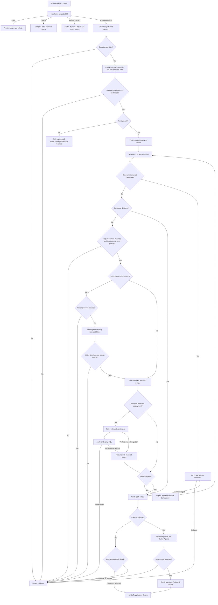

# Production image upgrade flow

## Overview

Upgrade OpenClaw Control Plane (OCC) and Agent runtimes. See
[channel transitions](channel-egress.md#0-install-or-upgrade-channel-routing).

## Entry Points

- Use reviewed `scripts/upgrade-production-images` inputs or a private `occ installation upgrade` profile.
- Stderr reports progress. `--verbose` adds native output.
- Require healthy Helm with chart-owned initializer, matching Installation IDs
  and authorized inventory without active deployments.
- Source: `scripts/upgrade-production-images`,
  `packages/occ/src/deployment-inventory.ts:readDeploymentInventory`,
  and `packages/occ/src/agent-deployment-admission.ts:admitAgentDeployment`.

## Flow

## Execution Trace

### 1. Prepare the candidate

`internal/occcli/installation_upgrade.go:installationUpgradeCommand` calls
`scripts/upgrade-production:main`. `report_status` compares local evidence.
Plan checks profile, images and HEAD. `profile_input` opens profile and receipt
through one directory descriptor. Operators authenticate receipts.
`published_image_pair` checks GHCR packages, digests, source, tags and run
attempts. Resume and migration apply use journal-bound digests. The adapter
previews target and CA. Apply and resume recheck approval and bound inputs.

Both entrypoints reject active kubectl preferences. Exec plugins require an
approved environment with preferences disabled. Snapshots reject `auth-provider`.
Profiled recovery rechecks target, CA and parameters under lock.

Before `scripts/upgrade-production-images:prepare_upgrade`, reject alternate Helm
stores, [endpoint and TLS](../guides/deploy/production-upgrade.md)
or [token and impersonation overrides](../guides/deploy/production-upgrade-command.md#run-the-image-upgrade),
source mismatch, chart edits or symlinks, and evidence or baseline aliases.
Preview rejects `preprovisionedNamespace`. Preparation rechecks baseline
(`preprovisioned-namespace.err`).

`check_migration` matches rendered and deployed migrator inputs and checks revision
around a read-only Job. Require recognized history and UID-bound cleanup.
Unknown creates retain evidence and lock.

`matches_yaml` compares candidate, [baseline](../guides/deploy/upgrade-baseline.md#record-the-release-and-its-configuration)
and live mappings. Invalid input or unwritable evidence yields `Cannot compare upgrade YAML`.
Projections allow Slack directory proxy, curated Codex PluginDriver selection
and one registration wrapper. Omit absent `agentNativeAdmin.sharedCookieDomain`
from baseline. Immutable switches require string keys.

`read_restart_inventory` requires complete authorized inventory without nonterminal
deployments. Running revisions need saved Harness objects and an accepted
[restart assessment](../reference/repository-credentials/worker-replacement.md).
Standalone preflight records original-worker requirements. Unknown assessments
block rehearsal. Runtime upgrades record replacements and check draft images,
sizes, baseline versions and Namespace readiness. They exclude stopped or
deleting Agents and permit pending repository cleanup.

`deploymentInventorySnapshot` rejects missing or mismatched work in one State
snapshot. Credential withdrawal is separate. `findRevisionForBrowsing` returns
`unknown` for unreadable snapshots and propagates database or identity errors.
`readDeploymentInventory` allows Compute ten seconds outside State transactions,
then rejects authorization or Driver drift. Owner failures return `unknown`.

`scripts/upgrade-evidence.py:validate_compatibility` checks PostgreSQL
receipt binding, data, IAM, cleanup and image digests. Hashes bind resume
inputs. See [qualification limits](../guides/deploy/production-upgrade.md#upgrade-the-control-plane).

`verify_agent_continuity` brackets runtime inspection with authorized Agent
reads. `agent-continuity.json` records selected revision and Driver roles.

Repository credentials require immutable images and common node architecture.
`scripts/upgrade-image-identity.py:read_platform` verifies OCI hashes (2 MiB/blob,
32 MiB total). `scripts/upgrade-repository-image-probe.ts:main` probes before
preparation and resume. Its negative control requires an absent socket and
Docker-confirmed nonzero broker exit without OOM or daemon error.

Immutable switches require a staged successor (`--candidate-values`) for changed
Secret data. `prepare_upgrade` checks both Secret identities, unrelated data and
candidate YAML. `upgrade-evidence.py` binds snapshots. Prepared attempts keep
their Secret. Denied mutable Secret update reviews block. Inconclusive reviews warn.

`preflight_startup` dry-runs Certificates before Jobs (45 seconds for a
30-second webhook). Refusal retains protected diagnostics and prevents shutdown.
`scripts/upgrade-startup-preflight.ts` builds single-Pod Jobs with candidate
images, credentials, mounts, deadline and zero retries. Changed UIDs, extra
children or Job failure block even on child success.

`migrationMode` rejects invalid and new-install invocations.
`--require-current` in the rendered initializer selects separate mode.
`migrationJob` preserves policy labels and checks history with `--check` or
`--check-for-installation` and the Installation ID. Separate mode requires
`migration.checked-for-installation`. Record migrator and CA Secret identities,
then recheck and bind them after cleanup.

The API Job checks Console themes. Both Jobs load startup and Installation
configuration without database access and check token readability without reading tokens. `connectionPlan` retains private OIDC CA mounts and database
preload. Each read-only `OCC_DATABASE_URL` transaction must find one Installation
matching OCC and the Secret (five-second statement and lock timeouts, 15 seconds
overall). Logs omit connection errors and rows. Log reads verify Job/Pod
identities and reject NUL. `formatStartupConfigurationFailure` reports up to 32 fields.

Kubernetes Compute uses the Pod service account and refuses single-cluster
[split-layout Gateway storage](../reference/drivers/kubernetes-compute.md#existing-split-layout-installations).
Images check Installation names and drafts when supported.

For runtime replacements whose Harness uses a Credential Source, the API Job
runs `checkHarnessDestinations`. With Kubernetes Compute, its read-only transaction
matches revision, Configuration generation and Harness source. Compute resolves
the draft with the selected revision's overrides. Every OpenAI source
attached to the draft must authorize the destination.

A failed or incomplete destination check blocks shutdown. This includes
exceeding 1 MiB (Installation plus gzipped drafts) when the check is required.
Otherwise oversized drafts and unsupported draft checks defer to deployment
with a warning. Deployment rechecks authorization.

Two-cluster Jobs check API Pod, proxy and optional log/Event access, and Worker
Pod patch and Job get, create and delete access. Missing grants require the
[execution chart upgrade](../testing/kubernetes.md#upgrade-the-execution-chart).
Verify enforcement of default-deny and dependency egress policies.

Writers serve during initial preflight. `scripts/upgrade-preflight-state.py`
records create intent and acknowledged UIDs. [Cleanup](coordinated-production-upgrade/preflight-cleanup.md)
confirms Job and child removal before deleting dependencies. Unknown consumers
retain them. Recheck switch Secrets and record `startup-preflight-passed`.

Standalone preflight prepares no deployment. Original-worker requirements
produce `preflight-blocked-original-worker` (exit 1). Apply refreshes inventory
and binds it to candidates and target parameters. Interruption retains the lock
and skips cleanup. Confirm termination and reconcile accepted operations before
unlocking. Maintain the [freeze](../guides/deploy/production-upgrade.md).

### 2. Reconcile a prior attempt

Resume locks evidence and dispatch journals, checks prepared identities and
inputs, and requalifies images and nodes. Match values and revision to baseline,
candidate or recorded predecessor. Verify both Secret UIDs and data before
finishing Installation writes. `new_attempt` synchronizes evidence before
publishing pointers. Verified deployments skip Helm submission and preflight Jobs.

Verify submitted migration mode before retry preparation or preflight.
At the original separate revision, check both handoff identities, ownership
labels, zero replicas, no deletion, Pod absence and the Worker receipt.
Recheck Helm status and terminal initializers before submission.

`preflight_resume` checks migration history and writer identities. Before handoff
or Helm submission, runtime resume rereads drafts and repeats startup and
destination checks while both writers run. A stopped API alone blocks resume.
After Worker shutdown, identity Jobs replace startup Jobs. Failure leaves
stopped writers fenced.

For [same-candidate recovery](../guides/deploy/production-helm-recovery.md),
`scripts/upgrade-helm-state.py:recover` checks Helm payload, ownership, completed
Job and Pod, and security contexts. `pod_matches` compares resource quantities.
Reads use manifest namespaces and release ownership. `check-recovery` checks the
original attempt before preflight and both application identities before rollback.
Repeat admission before exclusive intent and dispatch. Accepted or uncertain
recovery permits readback only.

`require_absent` rejects predecessor-only resources through rollback and resume.
`verify_workload_changes` checks retired entries and placements before rollback
and changed selections afterward, without mutation. Match changed nonnative
specs and recorded UIDs despite resource-version changes. Require pre-upgrade
hooks and successor acknowledgement. Operators attest client shutdown,
exclusive ownership, resource reconciliation and database history.

### 3. Quiesce writers and run the candidate release

Stop other writers and autoscalers. Keep nodes reachable.
`observe_quiescence_writers` saves live Deployments separately from PATCH inputs.

At zero Worker replicas, resume requires private `worker-stop-confirmed.json`
matching attempt, UID and generation. Missing or invalid receipts block before
Agent Stop and preserve PATCH inputs. Valid receipts skip Worker PATCH and inventory.

For a [one-off channel transition](channel-egress.md#0-install-or-upgrade-channel-routing),
check running Worker patch access. Preview each running writer's PATCH before
Agent Stop. With both writers stopped, verify recorded Stops instead.
Reread Deployments and recheck the receipt. UID, generation or replica changes
block. Use fresh resource versions.

With the Worker running, check named patch access and refresh inventory.
Denials block. Inconclusive reviews warn. Only recorded channel Stops may
change inventory. With both writers running, `preview_writer_stop` checks Worker
PATCH before API shutdown. Server dry runs must return zero replicas.

Live PATCHes test UID, resource version and replicas. Conflicts can leave the
API stopped. The Worker response must confirm UID, next generation and zero
replicas. After drain, recheck UIDs, zero replicas and receipt. Separate
handoff also requires both generations before Helm.

Separate mode rechecks Secret identities, records writer UIDs and generations,
and exits 3. Keep writers stopped. Managed apply requires irreversible SQL
approval. Recheck both writers and the Worker receipt before new intent or a
SQL-capable Job. Unknown effects retain the lock and kubeconfig. Retry requires
cleanup of failed verification. Resume requires completed verification and
matching Secret identities. Keep referenced Secrets unchanged.

Preserve evidence and [reconcile partial quiescence](../guides/deploy/production-upgrade-recovery.md#restore-incumbent-api-access-after-partial-quiescence).
Destructive recovery requires human risk review.

After quiescence, `verify_pair_nodes` rechecks nodes. Helm status must match
the reconciled state except live `.info.resources` on Helm v4. Drift blocks writes.

Replace settings atomically. Resource-version checks preserve unrelated Secret
data. Reference switches preserve both Secrets and select the successor and
checksum in both writer templates.

`upgrade-helm-state.py:new_attempt` renders and dry-runs immutable values.
Hooks and initializer Pods receive `installation.upgradeAttemptId`.
`record_submission` saves intent and predecessor before `helm-started`.
Resume matching interrupted staging. Published intent survives retries.
`scripts/migration-history.mjs:migrateWithHistory` checks Installation identity
and recognized history under lock for separate Jobs. Verification and the
separate Helm hook require completed history. Hook mode applies pending SQL.

### 4. Verify control-plane recovery

`scripts/upgrade-helm-state.py:verify_installation_consumers`

Verify images, replicas and Installation checksums. For reference switches,
check both Secret identities and controller and initializer mounts. Require one
named container per component, broker-enabled workers for restartable init
containers, and the same Installation ID from OCC.

Worker preparation re-renders launch requirements and maintains repository sessions
every 30 seconds until their deadline. It re-prepares other unfinished deployments.
Kubernetes Compute rolls changed Pod templates even with unchanged runtime
images and gates chat on readiness.
OpenShell's `verifyExistingSandbox` requires exact existing Sandbox content.
Generated commands need a new Agent revision. See the
[upgrade guide](../guides/deploy/production-upgrade.md#prepare-the-release).
Pod and [diagnostic](agent-deployment-diagnostics.md) changes apply on preparation
or deployment.

Repository-enabled releases verify Ready API/worker Pods, ReplicaSets, node
architecture and runtime image IDs against the qualified pair. The Driver checks
broker admission without a session. Pod identities must remain stable through
admission, dispatch and completion.

### 5. Deploy and verify the recorded fleet

`scripts/upgrade-production-images:confirmed_deployment_status` and
`scripts/upgrade-dispatch-state.py:transition`

Flush intent before dispatch. Unresolved intents block sends. The journal retains
accepted revisions, definite refusals and superseded receipts. Resume may retry
refusals. Replacements must name the current failed revision. Unknown outcomes
or stale journals require
[recovery](../guides/deploy/production-upgrade-recovery.md).

Verify deployment status, revisions and Pod readiness on the candidate digest
with authorized reads. [Storage migration and retries](../reference/drivers/kubernetes-compute/storage-and-credentials.md#gateway-storage)
gate startup.

Replacement gateways run read-only `openclaw doctor --lint --json --severity-min error`
serially. `gateway_free_memory` requires one cgroup v2 reading above heap cap
plus 640 MiB or two above cap plus 256 MiB. After insufficient memory, require fresh sufficient readings.
Memory timeout stops new checks. `revision_pod_change_since_ready` checks Pods even
after Doctor failure. Missing, changed, restarting or unready Pods fail the upgrade.
See [Doctor recovery](../guides/deploy/production-upgrade-recovery.md#correct-a-doctor-failure).

### 6. Hand off application verification

Follow [release verification](../guides/deploy/production-upgrade.md#verify-the-release).
`verify_agent_continuity` precedes final controller and Helm checks. Require
one Running, Ready Pod per role. Replacement UIDs and completed init containers
qualify. Eight results leave uniqueness unknown. Preserve running provider
Harnesses. Retain failure observations and reconcile failed writes.
`completed` blocks resume. The
[served Console check](../release/container-promotion.md#verify-the-served-console)
accepts an image-bound digest.

### Read-only export after a split-layout refusal

[Split-layout export](../guides/deploy/split-layout-upgrade.md#export-and-re-create)
rejects malformed responses in `scripts/split-layout-tenants.ts:createOccApi.expect`.
`importTenants` rejects shared destinations, preserves prior merges and reserved
IDs, and treats rename keys literally. Unsaved exact-name reuse requires no Agents or Secrets.

## Debugging and Verification

- Inspect `helm-attempts/<UUID>/` render and dry-run output and
  `preflight-<api|worker|migration>.log`, `-logs.err` and `-status.json`.
  Resume logs use `upgrade-preflight-resume.*`.
- [Upgrade recovery](../guides/deploy/production-upgrade-recovery.md) covers
  `native-command-failures.tsv`, migration journals and dispatch results.
- For controller-only rollouts, compare `before-workloads.json` and `after-workloads.json`.
  Check broker-affected repository versions separately.
- Fixtures verify command flow. End-to-end proof requires credentialed
  production Kubernetes and distinct images.

## Related docs

- [Production upgrade guide](../guides/deploy/production-upgrade.md)
- [Production installation](../guides/deploy/production-installation.md)
- [Production Agent verification](../guides/deploy/production-agents.md)
- [Agent deployment reference](../reference/agents/deployment.md)
- [Production startup flow](production-startup.md)
- [Controller worker flow](controller-worker.md)
- [Authoritative platform design](../design.md)

## Manual Notes

[keep this for the user to add notes. do not change between edits]

## Changelog

- 2026-11-24 20:04: Trace retained model destination checks. (authoring-run/68864121-1934-4d2e-9b4e-a78f2edc790b - 81560a5b7d8da3383c8088fef29bef0a4c8565ef)

- 2026-11-24 19:54: Clarify writer previews. (authoring-run/46f01900-6b22-479c-9e19-3ea5a6e7eaaa - 071f8b1ec12648ce2d755e86323cb958a3c005f5)

- 2026-11-24 03:54: Preserve writer stop evidence. (authoring-run/1c3ad59b-d58f-4d86-bdd9-767c3a9547d4 - 1d72f0a2f7ede08bd108be30e4a113ad5e611c5c)

- 2026-11-24 03:54: Preserve writer stop evidence. (authoring-run/1c3ad59b-d58f-4d86-bdd9-767c3a9547d4 - 7f069277c2659c8f2fc5f46b702e6062a852c3b0)

- 2026-11-24 02:21: Recheck writer generations before Helm. (authoring-run/b49fd055-c8ec-4d10-8ba1-536c248c8f66 - 1b6b18670a33c9d51b4fc4cbc0a901a08782c963)
- 2026-11-23 04:18: Preview API. (authoring-run/80b539ac-f508-454c-a905-70939d30ec31 - b24f6ec158b861b13f2baff95bf661346de7f767)
- 2026-11-23 02:02: Preview earlier. (authoring-run/cdd15e8b-8040-4505-bb79-d9ccd1dc5682 - 96519cbee73d4ee54528626c0517ee7aaa6e1822)
- 2026-11-22 17:37: Preview Worker stop. (authoring-run/8a4cdeff-6237-46d6-ad85-7ea5bfa0c302 - 3eedffbaae63cdc1b006e51d49b88504462d2a5c)
- 2026-11-21 09:16: Trace rendered mode and retry. (authoring-run/06420637-f403-4d0d-a6b1-acf2f522dcb0 - f9fb2a1f6fed7afd4ba8e69737f611e55604f587)
- 2026-11-21 03:11: Reconcile publication selection with current upgrade admission and recovery. (authoring-run/5e8acf3b-45b0-4fbd-801d-493e4787e9dc - e67cd3cd0357e002ccc62f410454649ea4bfefd9)

- 2026-11-20 19:04: Refresh sources. (authoring-run/8a8bde8b-71de-4de5-80bf-e32f0e335c34 - 220f62d86ceb3dfc6f66dbee7c6f86cda50e5d05)
- 2026-11-20 16:29: Update source pointers for runtime observation and fleet inventory. (authoring-run/c41017eb-dc85-4c43-90e8-3040fbace6ac - c6acc7271f7753f74d3657251f23a036c08e671c)

- 2026-11-20 17:42: Refuse Helm credential overrides. (authoring-run/e16304ce-2b94-4022-a90d-9ab2e235d1d4 - aff441a5df9e3258752b034fb694e06333c0b231)

- 2026-11-20 11:52: Trace sibling receipt selection and credential rules. (authoring-run/50e3a914-60d2-4d1e-9fbd-8bb9fc214ad5 - d215c0d95c2336244519eca4968df04ec4376ae2)

- 2026-11-20 09:47: Trace immutable Installation refusals and the Certificate admission timeout. (authoring-run/d0f76046-8ddd-44e6-a67f-29c2288c9e33 - 9092839d0c3b9598e85300451f425ac6d3084fe5)

- 2026-11-20 03:27: Check writer identity across the one-off Agent Stop phase. (authoring-run/835f8811-dc27-47d1-b27d-5d20413085f7 - 0e158e5f10ed1e65be1f6d64ff0f62cffb6f3283)

- 2026-11-19 20:21: Require the worker stop receipt before migration and retry. (authoring-run/418defcd-00b7-4596-95cb-96610a0a2343 - 88f7c7a3b3f3430d89bcb82803c89c6dfbea2bbb)

- 2026-11-19 16:56: Distinguish fenced migration handoff from other recovery. (authoring-run/cf9ae9aa-8bb0-4bc8-af2c-326adebf9112 - abd7da2dbd99369b523fe93ec052842c77e9cd2d)
- 2026-11-19 15:27: Require an acknowledged worker stop before resume. (authoring-run/86724f58-75e9-4f02-a3a4-d285ef3a889b - 603a8d4ce1f3e47d9c8485d4dd0023c531bbd64b)

- 2026-11-19 19:15: Trace the stopped writers check before Helm retry. (authoring-run/aed0a2bc-9691-4859-8bd6-1e7b3549c9b4 - d976da889bdeca6e9208821a5b4ea79a49033b0f)

- 2026-11-19 17:18: Keep bootstrap handling in the chart. (authoring-run/803c9489-57ed-4e31-a5ea-568f16e22161 - d14128b4a0fc1f499b914107ec6ec14eccc39fdf)

- 2026-11-19 17:08: Trace migration Secret checks from preflight through resume. (authoring-run/d22a53f0-d60f-46c9-9977-2d54227dd193 - a4e6e5e73e7f6f8699dddd6c3244af6fd71c2336)

- 2026-11-19 10:54: Compose profile approval with separate database migration. (authoring-run/abedccc5-d961-4465-afd3-012cc1e5a5a5 - 6885839d6e3d8dd2f8293552d508ad4536cbf8a6)

- 2026-11-18 14:34: Retire bootstrap outputs safely (PST). (authoring-run/fcffdcd5-85ba-4fd1-ad35-bfbbcd6953b6 - ce0bd74dcbb7bdf2fd97a6d87e9ea0f88cf0199d)

- 2026-11-18 20:23: Apply and verify separate database Jobs. (authoring-run/859166ef-2ed3-42e1-b8fd-88441bb8746f - 084874338baf51ad05d0b1a2b438e8bcd0120c1b)

- 2026-11-19 17:03: Reconcile the upgrade trace and bind admission to the selected credential method. (authoring-run/1b66f15a-ca57-49d3-97bd-6ce1593f55a2 - c833b919f687c17dcb5b2e1e5037b55ed4321ac0)

- 2026-11-19 12:44: Compare status markers. (authoring-run/b54d6eb9-13cb-4072-96e2-2e285cde2402 - a02224a7e22516f958546a249ddcbfa9bfcd6012)
- 2026-11-19 12:31: Trace standalone preflight status. (authoring-run/95ab0282-a9eb-46db-9c6b-bd4cce4ee6ea - a02224a7e22516f958546a249ddcbfa9bfcd6012)
- 2026-11-19 11:30: Trace candidate rehearsal when retained Agents require the original worker. (authoring-run/099c1a03-0e25-4504-9cf7-2f62d1cfa035 - 6679017155741810c2ae1bcbacba05a3eb59f3ec)

- 2026-11-19 10:56: Refuse active kuberc. (authoring-run/9c893cda-96dc-4a06-9e08-ad2aeca46de7 - 5f425af517e8ee120c7721e7559a846ce70120e9)

- 2026-11-19 10:26: Trace kubeconfig decoding and snapshot authentication. (authoring-run/8620ea2f-2212-49a6-b45b-0c6b44bf7fa2 - b0171d98e4470aaad0ba5b7ddb4e16a27fb9de7a)

- 2026-11-19 09:57: Trace the Helm release store guard. (authoring-run/d4ce1b5c-3a22-44f3-b1ad-40e8a771c331 - 2455e61e32e8f97a6dfb505608a665e2eca59f20)

- 2026-11-19 09:47: Trace profile TLS checks. (authoring-run/2a1d437b-87cc-4839-a06a-12b3d255450f - 2455e61e32e8f97a6dfb505608a665e2eca59f20)

- 2026-11-19 05:13: Trace upgrade approval, trust, and evidence. (authoring-run/def34421-d123-4fd1-bde1-e8d966d6bcad - 8bc5fe2fc916765024493c981308179a04a0e716)

- 2026-11-18 19:45: Tighten the upgrade trace. (authoring-run/9b947cd8-0275-4e7f-ac7f-5dce4b0f8965 - aed2f7edd530ab336bbd6cb8c7389b24cb83e397)

- 2026-11-18 19:27: Trace migration-only compatibility checks through the Helm hook and Job journal. (authoring-run/7ae70bae-f8ac-425d-abbf-7039b71997b7 - 71334bb9b104662870798a29814e7171e8905baf)

[Production image upgrade flow documentation history](coordinated-production-upgrade/history.md) preserves the older dated entries.
