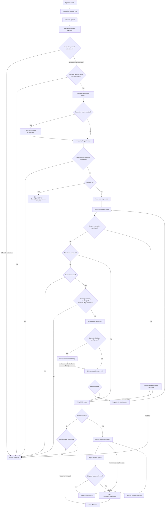

# Production image upgrade flow

## Overview

Upgrades OpenClaw Control Plane (OCC) and Agent runtimes.

## Entry Points

- Run `scripts/upgrade-production-images` with reviewed inputs, or `occ installation upgrade` with a private operator profile.
- Phases on stderr are advisory; `--verbose` shows native output.
- Required: healthy Helm release, chart-owned initializer, matching OCC/Kubernetes Installation
  IDs and complete authorized inventory without active deployments.
- Source: `scripts/upgrade-production-images`,
  `packages/occ/src/index.ts:OpenClawController.getInstallationDeploymentInventory`,
  and `packages/occ/src/index.ts:OpenClawController.deployAgent`.

## Flow

## Execution Trace

### 1. Prepare the candidate

`internal/occcli/installation_upgrade.go:installationUpgradeCommand` runs `scripts/upgrade-production:main`. Plan validates profile/images/HEAD. `report_status` compares marker scans. Writes exec `scripts/upgrade-production-images`.

`scripts/upgrade-production-images:prepare_upgrade`

Reject before access: [Helm overrides](../guides/deploy/production-upgrade.md), source mismatch, chart edits/symlinks and evidence/baseline aliases. Other edits/image provenance are unchecked. `preprovisionedNamespace` must yield one `false` (`preprovisioned-namespace.err`).

`matches_yaml` validates candidates and compares [baseline](../guides/deploy/upgrade-baseline.md#record-the-release-and-its-configuration)/live mappings.
Invalid inputs/unwritable evidence yield `Cannot compare upgrade YAML`. Projections/`cmp` allow Slack directory proxy, curated Codex PluginDriver selection
and wrapping one registration. `agentNativeAdmin.sharedCookieDomain` is removed only
from baseline projection; live comparison stays exact. Immutable switches require string keys.
Startup validates controllers; broker checks references only.

`read_restart_inventory` requires complete authorized inventory without nonterminal deployments. Retained running revisions need saved Harness objects and an accepted [restart assessment](../reference/repository-credentials/worker-replacement.md). Standalone preflight admits explicit original-worker requirements, refusing unknowns. Runtime upgrades record replacements; check draft image/size, baseline versions and Namespace readiness. Exclude stopped/deleting Agents. Allow pending repository cleanup.

`OpenClawController.deploymentInventorySnapshot` batches deployment-work reads in one State snapshot and refuses missing/mismatched work. `findRevisionForBrowsing` returns `unknown` for unreadable snapshots; database/identity errors propagate. `getInstallationDeploymentInventory` gives Compute ten seconds outside State transactions, then rechecks fleet authorization/Driver selections. Drift refuses; owner failures yield `unknown`.

`prepare_upgrade` copies PostgreSQL's `run` result.
`validate_controller_compatibility` calls `scripts/upgrade-evidence.py:validate_compatibility`
before preflight: check runner/file consistency, data/IAM success, cleanup and both image digests.
Hashes bind resume, not authenticity or image provenance. Online migration and rollback remain
unqualified; see [qualification limits](../guides/deploy/production-upgrade.md#upgrade-the-control-plane).

`verify_agent_continuity` requires Agent read/operate, active AgentRevision read
and runtime inspection. Agent reads bracket explicit-revision runtime reads; freeze identity and Driver-declared roles in `agent-continuity.json`, not editable topology.

Repository credentials require immutable images and one architecture on matching nodes. `scripts/upgrade-image-identity.py:read_platform` verifies platform/OCI hashes (2 MiB per blob, 32 MiB total). `scripts/upgrade-repository-image-probe.ts:main` probes before preparation and resume; a nonzero broker exit requires an absent socket and Docker-confirmed owned-container exit without OOM or daemon error. See [broker restart recovery](../guides/repository-credentials/installation.md#install-and-verify).

For immutable switches, `prepare_upgrade` validates identities, unrelated data and
candidate YAML, hashes staged bytes, and binds both snapshots through `upgrade-evidence.py`.
Changed immutable data requires a successor. For mutable data, Kubernetes self-review checks named-Secret update access: denial stops preparation; inconclusive review warns and continues. Replacement requires update permission.
Rendered Certificates require server-side dry-run admission.
`scripts/upgrade-startup-preflight.ts` builds single-Pod Jobs with the candidate
Secret, controller image, environment, mounts, and service account. Jobs have a deadline and zero retries. `preflight_startup` refuses changed UIDs or multiple
children. Job failure overrides child success.

`migrationJob` selects one initialization Job by release and component. It refuses malformed labels and preserves Job/Pod labels used by chart policies.
Before shutdown, run the selected image's migration `--check` as migrator. `scripts/migration-history.mjs:migrateWithHistory` checks
receipts, catalog, and grants under lock. Pending canonical history is allowed.
Helm rechecks before migrating.

`apps/controller/src/composition/console-theme.ts:loadConsoleTheme` checks API
theme bundles. Both writers use `loadStartupConfigurationSnapshot` and
`loadInstallationConfiguration` without database access. For OpenShell `bearerTokenFile`, Jobs check type/readability without reading the token.

`connectionPlan` refuses unknown chart entrypoints. Private OIDC CA trust retains database preload, CA argument and assembler mounts; writer Jobs require `OCC_DATABASE_URL`. Candidate `createPostgresPool` reads at most two `occ.installation` IDs read-only; exactly one must match the authenticated API/startup-Secret ID. Statement/lock timeouts are five seconds; authentication through cleanup has 15 seconds. Fixed diagnostics distinguish refusal from incomplete checks without exposing connection errors or rows. Migrator identity and data continuity remain unverified.

Before quiescence/Helm, `preflight_resume` checks migration history and API/worker identities together, including both-stopped recovery; it compares frozen `installation-id` with the live startup Secret without API access. Completed Helm releases skip these Jobs. Historical migration-only records remain valid for cleanup.
`apps/controller/src/startup-failure.ts:formatStartupConfigurationFailure` filters
typed refusals to up to 32 field diagnostics. The final successful preflight poll checks Job/Pod identity immediately before log retrieval.
Preflight rechecks afterward, rejects NUL bytes and discards unbound output.
kubectl diagnostics stay separate from container logs.

Kubernetes Compute `preflight` uses startup's Pod credentials (`inCluster` service account). It refuses
[split-layout Gateway storage](../reference/drivers/kubernetes-compute.md#existing-split-layout-installations)
on single-cluster upgrades.
The image's `isName` validates `occ installation get` names
(`INSTALLATION_NAME_INVALID`); older images skip this.

Runtime preflight calls `resolveConfiguredHarnessId` then
`refuseUndeployableConfigurationValues` on recorded drafts. Refusals leave old
writers serving: Correct drafts, stop affected Agents or replace incompatible images; retry with fresh evidence. Older images or gzipped inputs over
1 MiB warn and defer validation. Deploy checks live Harness state.

Experimental two-cluster Pods also run
`KubernetesComputeDriver.verifyExecutionTenantGrants` for their component; startup
does not. For release-era execution-tenant grants, SelfSubjectAccessReviews check newer
`openclaw-execution` rules: API Pod and `pods/proxy` reads, plus `pods/log` and Event reads with runtime
logs; worker Pod `patch` and `batch` Job `get`, `create`,
and `delete`. Worker Job grants are required even with runtime logs disabled.
A missing rule refuses the candidate and points to
[upgrading the execution chart](../testing/kubernetes.md#upgrade-the-execution-chart).

Startup Jobs retain default-deny labels and a copy of
`openclaw-enterprise-dependency-egress`, including execution-cluster API rules.
Controller ownership addresses EKS's standalone-Pod limitation; verify enforcement.

Writers keep serving; `scripts/upgrade-preflight-state.py` records create intent and acknowledged UIDs. `scripts/lib/upgrade-preflight-cleanup.sh:cleanup_preflight` confirms Jobs and children are gone before deleting dependencies. [Interrupted cleanup](coordinated-production-upgrade/preflight-cleanup.md) uses these records.

Recheck switch Secrets after cleanup. Preflight exits unprepared. An original-worker blocker writes `preflight-blocked-original-worker`
and exits 1. `startup-preflight-passed` records checks and cleanup.
Upgrade refreshes inventory.
Preparation locks candidates, inventory and target/parameter hashes. `scripts/upgrade-production-images:interrupted_upgrade`
retains the lock and skips cleanup on `SIGHUP`, `SIGINT`, or `SIGTERM`.
Before unlocking, confirm termination; reconcile operations/resources.
Freeze writers, autoscalers, Helm changes and drafts per the [production guide](../guides/deploy/production-upgrade.md).

### 2. Reconcile a prior attempt

Resume locks evidence paths/devices/inodes/aliases and journals; binds prepared inputs, directory, source and cluster; requalifies images; and rejects changed eligible nodes.
Values must match baseline, candidate or recorded predecessor/revision.
Resume checks immutable intent, Secret identity and unrelated data. `verify_installation_switch`
rechecks both immutable Secrets' UIDs/data. Pending Installation writes require a mutable Secret before scaling. Retries require
migration-history review and terminal initializer Jobs/Pods. `new_attempt` fsyncs
attempt-directory ancestors before publishing pointers.
Before quiescence/Helm, resume rechecks migrations and application identities;
failure leaves stopped writers stopped. Reconcile unknown creates before same-directory
`--resume`; retain lock/evidence/journal. The original process handles signals;
ordinary failures attempt cleanup.
Ordinary resume skips Helm only at the exact submitted deployed revision.

For [same-candidate recovery](../guides/deploy/production-helm-recovery.md),
`scripts/upgrade-helm-state.py:recover` checks Helm payload, ownership, completed
Job/Pod and exact security contexts. `pod_matches` compares requests/limits through
Compute's `resource-quantities.ts`. Reads use manifest namespaces and release
ownership. `check-recovery` validates the original attempt before preflight Jobs; both application identities must pass before rollback. `recover` repeats
admission before exclusive intent and dispatch. Accepted/uncertain recovery stays readback-only.
`require_absent` rejects remaining predecessor-only resources before intent,
before rollback, after rollback and on resume. `verify_workload_changes` requires
retired environment entries and container placements absent before rollback; afterward all changed selections must
match. Neither check deletes resources. Changed nonnative resource specs require exact
candidate matches. Resume rechecks recorded UIDs without pinning old versions.
Only pre-upgrade hooks are supported; resume requires successor acknowledgement.
Client shutdown, exclusive ownership, resource reconciliation and database history
remain operator attestations.

### 3. Quiesce writers and run the candidate release

`scripts/upgrade-production-images:quiescence_remaining` bounds shutdown. Validate both Deployments before stopping. For running workers, check named patch permission and refresh inventory on each attempt. Refuse denial/drift; warn on inconclusive review. Sequential patches test UID/resourceVersion/replicas; conflicts can leave API stopped.

Fresh attempts refuse workers at zero. Resume requires durable `worker-stop-confirmed.json` bound to prepared inputs and Deployment UID/generation. Record only a successful patch confirming UID, next generation and zero replicas. Confirm Pod absence and both original Deployments at zero; recheck the receipt before Secret replacement, migration handoff or Helm. Confirmed stops skip worker patch/inventory reread. Missing/lost/failed/stale acknowledgements refuse; zero alone authorizes nothing. Never fabricate receipts; receiptless older attempts refuse.

`database.upgradeMigration: separate` records stopped UIDs/generations and exits 3. If the worker receipt is missing or invalid after handoff, keep both writers fenced, preserve evidence, and reconcile the external migration and database migration history. Otherwise, preserve evidence, reconcile the worker stop, and verify that the selected release, mounted Installation Secret and database migration history are compatible before recovery. Refusal does not automatically replay, roll back or restart anything, or guarantee `--resume`. Destructive recovery requires human risk review. Stop other writers/autoscalers; keep nodes reachable. Before the first Helm intent, handoff resume checks both recorded writer UIDs/generations and migration history. After Helm rejection, re-entering drain requires the worker receipt.

Protected files change atomically; resource-version checks preserve unrelated Secret data. Reference switches preserve both Secrets; OCC templates select successor/checksum.

`upgrade-helm-state.py:new_attempt` renders/dry-runs immutable values. Hooks/initializer Pod receive fresh `installation.upgradeAttemptId`; upgrade/recovery preserve `.json`. `record_submission` saves intent/predecessor before `helm-started`; identical interrupted staging can finish, while published intent survives retries. In separate mode, `scripts/migration-history.mjs:migrateWithHistory` checks completed candidate ledger/catalog/grants under lock; pending/unsupported history fails the hook. Hook mode applies pending SQL.

### 4. Verify control-plane recovery

`scripts/upgrade-helm-state.py:verify_installation_consumers`

Verify images, replicas and changed Installation checksums.
Reference switches verify both Secret identities and Installation mounts in
controllers and the owned initializer Pod. Components need one named container.
Only broker-enabled workers permit restartable init containers; authenticated OCC retries must return the same Installation ID.
Worker preparation re-renders current launch requirements.
Repository-bound Agents receive maintenance every 30 seconds until their session deadline; re-prepare other Agents while deployment remains unfinished.
Kubernetes Compute rolls changed Gateway and Harness Pod templates even with
unchanged runtime images. Chat waits for readiness.
OpenShell instead requires exact existing Sandbox content
(`apps/controller/src/drivers/sandbox/openshell.ts:verifyExistingSandbox`).
Generated-command changes require a fresh Agent revision; controller-only reuse cannot adopt them. See the
[upgrade guide](../guides/deploy/production-upgrade.md#prepare-the-release).
Other Agents receive Pod configuration/[diagnostics](agent-deployment-diagnostics.md) fixes during preparation/deployment.

Repository-enabled releases verify Ready API/worker Pods, owning ReplicaSets,
node architecture and runtime image IDs against the qualified pair. The Driver
checks broker admission without a session. Pod identities must remain stable
through that check, dispatch and completion.

### 5. Deploy and verify the recorded fleet

`scripts/upgrade-production-images:confirmed_deployment_status` and
`scripts/upgrade-dispatch-state.py:transition`

Flush intent before dispatch; unresolved intents block sends.
The journal retains accepted revisions, definite refusals and superseded receipts. Resume may retry refusals; replacements must name the current failed revision.
Unknown outcomes or stale journals require
[recovery](../guides/deploy/production-upgrade-recovery.md).

Verify authorized deployment status, version and Pod readiness on the candidate digest. Before startup, `runtime-startup.ts:openClawStateMigrationHelper` runs `openclaw doctor --fix --non-interactive` for older schemas.
Current schemas and settled Doctor results gate startup: maintenance or cleanup
refusal holds `state-migration` unready; ordinary warnings do not. A private pending marker retries interrupted/refused maintenance after restart, even with current schemas. This precedes Harness native setup or native-worker connection. Embedded execution
requires one runtime container; dedicated execution requires Gateway and Agent containers.
Replacement gateways run read-only `openclaw doctor --lint --json --severity-min error` serially (`--doctor-heap-mib`, default 384 MiB). Doctor shares gateway memory; OOM can stop both. `gateway_free_memory` requires cgroup v2 free memory of heap cap plus 640 MiB once, or cap plus 256 MiB twice consecutively; it reserves nothing. Retry transient failures. Initially unavailable data warns and permits Doctor; after insufficient memory, unavailable reads reset consecutive evidence. Only fresh sufficient reads admit Doctor before deadline. Memory timeout starts no further Doctor.

Reports separate Doctor exit from gateway restarts since Ready. Missing/incomparable counts or Pod identities mean unknown; OOM requires a comparable increase and last termination `OOMKilled`. Memory timeout aborts. After Doctor, `revision_pod_change_since_ready` fails for a required gateway/dedicated-agent Pod missing, deleting, replaced, restarted or unready. Resume selects the Ready replacement while Kubernetes still lists the terminating Pod.

### 6. Hand off application verification

`docs/guides/deploy/production-upgrade.md:Verify the release`

Confirm Helm revision and OCC access. Runtime upgrades require deployment,
readiness and Doctor success. `verify_agent_continuity` precedes terminal
controller/Helm checks. Require one Running, Ready Pod per role. Replacement
UIDs and completed init containers qualify. Eight results leave uniqueness unknown.
Previously running provider Harnesses must stay running. Failure retains
observations without `completed`. Reconcile failed writes. Resume rechecks
without repeating successful Helm. `completed` blocks resume.
Verify routing, models, channels, credentials, workspaces and restores.
The [served Console check](../release/container-promotion.md#verify-the-served-console)
accepts an optional image-bound entry digest.

### Read-only export after a split-layout refusal

[Split-layout export](../guides/deploy/split-layout-upgrade.md#export-and-re-create)
uses `scripts/split-layout-tenants.ts:createOccApi.expect` to reject malformed JSON,
empty bodies and missing envelopes. Empty collections, 204 deletes and explicitly
accepted 404s remain valid.

`importTenants` resolves unsaved targets by name, rejecting shared destinations
before mutation. Saved IDs remain reserved for skipped sources; unsaved skips
reserve nothing. Correct, rename or skip conflicting mappings. Resume preserves
prior merges. Rename keys, including `constructor` and `__proto__`, are literal.
Unsaved exact-name reuse requires neither Agents nor Secrets.

## Debugging and Verification

- Read `helm-attempts/<UUID>/{render-error.log,server-dry-run-error.log}` for native
  preparation failures; `server-dry-run.txt` retains successful output. Inspect
  `preflight-<api|worker|migration>.log`, `-logs.err` and `-status.json` for rejected candidates;
  use `upgrade-preflight-resume.*` on resume.
- Inspect `native-command-failures.tsv` for scale, Helm upgrade or rollout failures; see [upgrade recovery](../guides/deploy/production-upgrade-recovery.md).
- Inspect `dispatch/*.error`, `dispatch/*.rejected` and version history. `status/` files retain the last successful poll. Doctor writes `*.doctor.json` and `*.doctor.error` there.
- Compare `before-workloads.json`/`after-workloads.json`: controller-only releases roll affected Agents' same-image Pod templates once. Check broker-affected repository versions separately.
- Production proof requires credentialed production Kubernetes and distinct images; fixtures prove control flow.

## Related docs

- [Production upgrade guide](../guides/deploy/production-upgrade.md)
- [Production installation](../guides/deploy/production-installation.md)
- [Production Agent verification](../guides/deploy/production-agents.md)
- [Agent deployment reference](../reference/agents/deployment.md)
- [Production startup flow](production-startup.md)
- [Controller worker flow](controller-worker.md)
- [Authoritative platform design](../design.md)

## Manual Notes

[keep this for the user to add notes. do not change between edits]

## Changelog

- 2026-11-19 16:56: Distinguish fenced migration handoff from other recovery. (authoring-run/cf9ae9aa-8bb0-4bc8-af2c-326adebf9112 - abd7da2dbd99369b523fe93ec052842c77e9cd2d)
- 2026-11-19 15:27: Require an acknowledged worker stop before resume. (authoring-run/86724f58-75e9-4f02-a3a4-d285ef3a889b - 603a8d4ce1f3e47d9c8485d4dd0023c531bbd64b)
- 2026-11-19 12:44: Compare status markers. (authoring-run/b54d6eb9-13cb-4072-96e2-2e285cde2402 - a02224a7e22516f958546a249ddcbfa9bfcd6012)
- 2026-11-19 12:31: Trace standalone preflight status. (authoring-run/95ab0282-a9eb-46db-9c6b-bd4cce4ee6ea - a02224a7e22516f958546a249ddcbfa9bfcd6012)
- 2026-11-19 11:30: Trace candidate rehearsal when retained Agents require the original worker. (authoring-run/099c1a03-0e25-4504-9cf7-2f62d1cfa035 - 6679017155741810c2ae1bcbacba05a3eb59f3ec)

- 2026-11-18 10:52: Trace Installation CLI planning, status and handoff. (authoring-run/61f318f2-104a-4abb-9651-5eee810e8dfd - aeb385b97974a6bd729f58dd73a44d518aec1edc)

- 2026-11-18 10:33: Reconcile profile/inventory traces. (authoring-run/251425f8-895a-4c1e-ac56-e666545f89ab - 98f60a1b965aa7129256c0802b60969519bc8a86)

- 2026-11-18 10:20: Trace the private profile handoff alongside progress output. (authoring-run/f93ed972-08b6-4310-8194-a6c8c9aeef37 - 2cedf84d05b8c05d812264dffd179eb3ca537fee)

- 2026-11-18 10:13: Preserve progress output and batched inventory reads. (authoring-run/583f9a7a-3375-4446-852d-2dc671c1b88c - 2fd6ef95c30345f242d260cd513c6a36ae3ba805)

- 2026-11-18 08:31: Trace the batched deployment work lookup and its refusal. (authoring-run/049ea467-b4fd-42d2-813a-b0721126ef70 - a1cdbddc6cfb49781cb0a6337aba3aa9a729e798)

- 2026-11-18 05:39: Trace progress output. (authoring-run/19a81e0c-0cb0-48eb-828d-e65e72b6c576 - 8cbb31a6893016f3aa74be9471fce69d3dbc60e7)

- 2026-11-14 07:25: Trace initialization Job selection and migration Pod label validation. (authoring-run/9b1d4770-fd45-4533-9bc4-99395d39837a - ba5b0832956ac3ad93695aab92db952f388ae7da)

[Production image upgrade flow documentation history](coordinated-production-upgrade/history.md) preserves the older dated entries.
