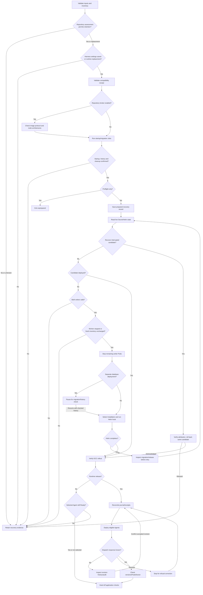

# Production image upgrade flow

## Overview

Upgrades OpenClaw Control Plane (OCC) and Agent runtimes.

## Entry Points

- Run `scripts/upgrade-production-images` with reviewed inputs.
- Required: healthy Helm release with chart-owned initializer, matching OCC/Kubernetes Installation
  IDs and complete authorized inventory without active deployments.
- Source: `scripts/upgrade-production-images`,
  `packages/occ/src/index.ts:OpenClawController.getInstallationDeploymentInventory`,
  and `packages/occ/src/index.ts:OpenClawController.deployAgent`.

## Flow

## Execution Trace

### 1. Prepare the candidate

`scripts/upgrade-production-images:prepare_upgrade`

Reject nonempty [Helm target/TLS overrides](../guides/deploy/production-upgrade.md),
mismatched `HEAD`/`--source-revision`, chart edits/symlinks and internal evidence/baseline
aliases before access. Other edits/image provenance are unchecked.

`yq -r` tests for nonempty `preprovisionedNamespace`. Continue on success
with one `false`; otherwise refuse before access (`preprovisioned-namespace.err`).

Resume locks evidence paths/devices/inodes/aliases and runtime dispatch journals.

`matches_yaml` compares [baseline](../guides/deploy/upgrade-baseline.md#record-the-release-and-its-configuration)/live mappings and validates candidates.
Invalid inputs/unwritable evidence cause `Cannot compare upgrade YAML`.
Projections/`cmp` permit Slack directory proxy, curated Codex PluginDriver selection
and array-wrapping one registration.
Removing any `agentNativeAdmin.sharedCookieDomain` affects only baseline projection;
live comparison stays exact. Immutable reference switches require string keys.
Startup validates controllers; broker checks only references.

`read_restart_inventory` validates complete authorized inventory ownership, IDs and selection states. Retained running revisions require accepted
[restart disposition](../reference/repository-credentials/worker-replacement.md).
Controller-only `occ agent revision AGENT_ID REVISION_ID` requires one owned
revision with object-valued Harness settings; retain IDs and validation outcome.
Drafts cannot substitute. Runtime upgrades record replacements; draft validation requires image
support/size compliance. Quiescence is nonatomic; repository continuity is unverified.

`OpenClawController.deploymentInventorySnapshot` uses `findRevisionForBrowsing`:
unreadable snapshots yield `unknown`; database/identity errors propagate. `getInstallationDeploymentInventory` invokes Compute outside State
transactions under one ten-second budget, then rechecks authorized fleet/Driver
selections. Changes refuse; owner failures yield `unknown`.

Refuse nonterminal deployments. Runtime upgrades require baseline versions/ready Namespaces. Exclude stopped/deleting
Agents; allow pending repository cleanup.

`prepare_upgrade` copies PostgreSQL's `run` result. Before preflight,
`validate_controller_compatibility` calls `scripts/upgrade-evidence.py:validate_compatibility`
to check runner/file consistency, data/IAM success, cleanup and both image digests.
Hashes bind resume, not authenticity or image source.
This permits neither online migration nor rollback; see [qualification limits](../guides/deploy/production-upgrade.md#upgrade-the-control-plane).

`verify_agent_continuity` requires Agent read/operate, active AgentRevision read
and runtime inspection. Agent reads bracket explicit-revision runtime reads,
freezing identity and Driver-declared roles in `agent-continuity.json`, not editable topology.

Repository credentials require immutable images and one architecture across all
matching control-plane nodes. `scripts/upgrade-image-identity.py:read_platform`
verifies the platform and OCI metadata hashes (2 MiB per blob, 32 MiB total).
`scripts/upgrade-repository-image-probe.ts:main` qualifies admission with synthetic
requests before preparation and again on resume. It reports a nonzero broker exit
only if the socket stayed absent and Docker confirms the owned container exited
without an OOM kill or daemon error. See [broker restart recovery](../guides/repository-credentials/installation.md#install-and-verify).

For immutable switches, `prepare_upgrade` validates identities, unrelated data and
candidate YAML, then hashes staged bytes; `upgrade-evidence.py` binds both snapshots.
Changed immutable data requires a successor. Mutable changes require a Kubernetes
self-review of named-Secret update access: denial stops preparation; inconclusive
review warns and continues. Replacement still requires update permission.
Rendered Certificates require server-side dry-run admission.
`scripts/upgrade-startup-preflight.ts` builds single-Pod Jobs with the candidate
Secret, controller image, environment, mounts, and service account. Jobs have a
deadline and zero retries. `preflight_startup` refuses changed UIDs or multiple
children. Job failure overrides child success.

`migrationJob` selects one initialization Job by release and component. It refuses
malformed labels and preserves the Job and Pod labels used by chart policies.
`scripts/migrate-production.mjs --check` runs with the initializer's migration
identity before shutdown. `scripts/migration-history.mjs:migrateWithHistory` checks
receipts, catalog, and grants under lock. Pending canonical history is allowed.
Helm rechecks before migrating.

`apps/controller/src/composition/console-theme.ts:loadConsoleTheme` checks API
theme bundles. Both writers use `loadStartupConfigurationSnapshot` and
`loadInstallationConfiguration` without database access. For OpenShell
`bearerTokenFile`, each Job checks file type and readability without reading the token.

`connectionPlan` refuses unknown chart entrypoints. Private OIDC CA trust retains
the chart's database preload, CA argument, and assembler mounts. Both writer Jobs
require `OCC_DATABASE_URL`. The candidate's `createPostgresPool` reads up to two
`occ.installation` IDs in a read-only transaction. Exactly one must match the
authenticated API/startup-Secret ID. Statement and lock timeouts are five seconds.
Authentication through cleanup has a 15-second deadline. Fixed diagnostics
distinguish refusal from an incomplete check without exposing connection errors
or rows. The Jobs check writer connections. Migrator identity and data continuity
remain unverified.

Before further quiescence or Helm submission, `preflight_resume` runs all three
Jobs in one `upgrade-preflight-resume.*` attempt: migration history plus API/worker
identity-only checks, including both-stopped recovery. The frozen
`installation-id` is revalidated against the live startup Secret; these checks
need no API call. Completed Helm releases skip
these Jobs. Historical migration-only attempt records remain valid for cleanup.
`apps/controller/src/startup-failure.ts:formatStartupConfigurationFailure` filters
typed refusals to up to 32 field diagnostics. The final successful preflight poll
supplies the Job/Pod identity check immediately before log retrieval. Preflight
rechecks identity after the request, rejects NUL bytes and discards unbound output.
kubectl diagnostics stay separate from container logs.

Kubernetes Compute `preflight` uses startup's Pod credentials (`inCluster` service account). It refuses
[split-layout Gateway storage](../reference/drivers/kubernetes-compute.md#existing-split-layout-installations)
on single-cluster upgrades.
The image's `isName` validates `occ installation get` names
(`INSTALLATION_NAME_INVALID`); older images skip this.

Runtime preflight calls `resolveConfiguredHarnessId` then
`refuseUndeployableConfigurationValues` on recorded drafts. Refusals leave old
writers serving: correct drafts, stop affected Agents or replace incompatible
images before retrying with fresh evidence. Older images or gzipped inputs over
1 MiB warn and defer validation. Deploy checks live Harness state.

Experimental two-cluster Pods also run
`KubernetesComputeDriver.verifyExecutionTenantGrants` for their component; startup
does not. For Pod identities holding release-era execution-tenant grants,
SelfSubjectAccessReviews ask for newer `openclaw-execution` rules: API Pod and `pods/proxy` reads, plus `pods/log` and Event reads with runtime
logs; worker Pod `patch` and `batch` Job `get`, `create`,
and `delete`. Worker Job grants are required even with runtime logs disabled.
A missing rule refuses the candidate and points to
[upgrading the execution chart](../testing/kubernetes.md#upgrade-the-execution-chart).

Startup Jobs retain default-deny labels and a copy of
`openclaw-enterprise-dependency-egress`, including execution-cluster API rules.
Controller ownership addresses EKS's standalone-Pod limitation; verify enforcement.

Initial preflight failures leave writers serving. Before creates,
`scripts/upgrade-preflight-state.py` registers complete attempt plans and started
markers; acknowledgements retain original UIDs. Shared
`scripts/lib/upgrade-preflight-cleanup.sh:cleanup_preflight` removes Jobs and
children before dependencies, confirming disappearance. Unknown consumers retain
dependencies. [Interrupted preflight cleanup](coordinated-production-upgrade/preflight-cleanup.md)
uses these same records and deletion rules without resuming the upgrade.

Reference switches recheck Secrets after cleanup.
`--preflight-only` leaves writers serving with non-resumable evidence.
Preparation locks candidates, inventory and target/parameter hashes. `scripts/upgrade-production-images:interrupted_upgrade`
retains the lock and skips cleanup on `SIGHUP`, `SIGINT`, or `SIGTERM`.
Before unlocking, confirm termination and reconcile accepted operations/resources.
Freeze writers, autoscalers, Helm changes and drafts per the [production guide](../guides/deploy/production-upgrade.md).

### 2. Reconcile a prior attempt

Resume binds prepared inputs, directory, source and cluster, requalifies images,
and rejects changed eligible nodes.
Values must match baseline, candidate or the recorded predecessor and revision.
Resume checks immutable intent, Secret identity and unrelated data. `verify_installation_switch`
rechecks both immutable Secrets' UIDs/data. Pending Installation writes require a mutable Secret before scaling. Retries require
migration-history review and terminal initializer Jobs/Pods. `new_attempt` fsyncs
attempt-directory ancestors before publishing pointers.
Before quiescence or Helm, resume rechecks migrations and application identities;
failure leaves stopped writers stopped. Reconcile unknown creates before same-directory
`--resume`, retaining lock/evidence/journal. The original process handles signals;
ordinary failures attempt cleanup.
Ordinary resume skips Helm only at the exact submitted deployed revision.

For [same-candidate recovery](../guides/deploy/production-helm-recovery.md),
`scripts/upgrade-helm-state.py:recover` checks Helm payload, ownership, completed
Job/Pod and exact security contexts. `pod_matches` compares requests/limits through
Compute's `resource-quantities.ts`. Reads use manifest namespaces and release
ownership. `check-recovery` validates the original attempt before preflight Jobs;
both application identities must pass before a new rollback. `recover` repeats
admission before exclusive intent and dispatch. Accepted/uncertain recovery stays
readback-only.
`require_absent` rejects remaining predecessor-only resources before intent,
before rollback, after rollback and on resume. `verify_workload_changes` requires
retired environment entries and container placements absent before rollback; afterward all changed selections must
match. Neither check deletes resources. Changed nonnative resource specs require exact
candidate matches. Resume rechecks recorded UIDs without pinning old versions.
Supports only pre-upgrade hooks. Resume requires successor acknowledgement.
Client shutdown, exclusive ownership, resource reconciliation and database history
remain operator attestations.

### 3. Quiesce writers and run the candidate release

`scripts/upgrade-production-images:quiescence_remaining` bounds shutdown.
Validate both Deployments. Before either stop, check named patch permission for
running workers. Refuse denial and warn on inconclusive review.
While the worker runs, refuse inventory drift, including on resume. Restore stopped
API access under exclusive maintenance ownership before retry.
Skip stopped writers. Stopped workers lack prospective checks.
Sequential patches test UID, resource version and replicas. Conflicts can leave
the API stopped. Verify Pod absence and original Deployments at zero. Operators
stop other writers/autoscalers and keep nodes reachable.
`database.upgradeMigration: separate` records both stopped UIDs and generations
and exits 3. Resume requires matching writers and checked history.

Protected files change atomically. Resource-version checks preserve unrelated
mutable Secret data. Reference switches preserve both Secrets; both OCC templates
select the successor and checksum.

`upgrade-helm-state.py:new_attempt` renders and dry-runs immutable values. Hooks
and the initializer Pod receive the fresh `installation.upgradeAttemptId`.
Upgrade and recovery preserve `.json` format.
`record_submission` saves intent and predecessor before publishing `helm-started`.
Identical interrupted staging can finish. Published intent survives staged retries.
In separate mode, `scripts/migration-history.mjs:migrateWithHistory` verifies the
completed candidate ledger, catalog and grants under lock. Pending or unsupported
history fails the hook. Hook mode applies pending SQL.

### 4. Verify control-plane recovery

`scripts/upgrade-helm-state.py:verify_installation_consumers`

Verify images, replicas and changed Installation checksums.
Reference switches verify both Secret identities and Installation mounts in
controllers and the owned initializer Pod. Each component needs one named container.
Only broker-enabled workers permit restartable init containers. Authenticated OCC
retries must return the same Installation ID.
Worker preparation re-renders current launch requirements.
Repository-bound Agents receive maintenance every 30 seconds until their session
deadline; other Agents are re-prepared if deployment remains unfinished.
Kubernetes Compute rolls changed Gateway and Harness Pod templates even with
unchanged runtime images. Chat waits for readiness.
OpenShell instead requires exact existing Sandbox content
(`apps/controller/src/drivers/sandbox/openshell.ts:verifyExistingSandbox`).
Generated-command changes require a fresh Agent revision; controller-only reuse
cannot adopt them. See the
[upgrade guide](../guides/deploy/production-upgrade.md#prepare-the-release).
Other Agents receive Pod configuration/[diagnostics](agent-deployment-diagnostics.md) fixes on preparation or deployment.

Repository-enabled releases verify Ready API/worker Pods, owning ReplicaSets,
node architecture and runtime image IDs against the qualified pair. The Driver
checks broker admission without a session. Pod identities must remain stable
through that check, dispatch and completion.

### 5. Deploy and verify the recorded fleet

`scripts/upgrade-production-images:confirmed_deployment_status` and
`scripts/upgrade-dispatch-state.py:transition`

Flush intent before dispatch; unresolved intents block sends.
The journal retains accepted revisions, definite refusals and superseded receipts.
Resume may retry refusals; replacements must name the current failed revision.
Unknown outcomes or stale journals require
[recovery](../guides/deploy/production-upgrade-recovery.md).

Verify authorized deployment status, version and Pod readiness on the candidate digest. Before startup, `openClawStateMigrationHelper` in
`runtime-startup.ts` runs `openclaw doctor --fix --non-interactive` for older schemas.
Current schemas and Doctor's settled result gate startup: maintenance or cleanup
refusal holds `state-migration` unready; ordinary warnings do not. A private pending
marker forces interrupted or refused maintenance to retry after restart, even with current schemas. The same step
runs before Harness native setup or native-worker connection. Embedded execution
requires one runtime container; dedicated execution requires Gateway and Agent containers.
Replacement gateways run read-only `openclaw doctor --lint --json --severity-min error`
serially, with a heap cap (`--doctor-heap-mib`, default 384 MiB). Doctor shares the gateway's memory limit;
an OOM kill can stop both. The cgroup v2 check (`gateway_free_memory`) requires
one reading with cap plus 640 MiB free or two consecutive readings with cap plus
256 MiB. This reserves no memory. Transient failures are retried.
Initially unavailable data allows warning and run.
After insufficient memory, unavailable reads reset consecutive evidence; only fresh
sufficient readings admit Doctor before its deadline.
Reports distinguish Doctor's exit status from gateway restarts since Ready.
Missing/incomparable counts or Pod identities report unknown; only a comparable
increase with last termination `OOMKilled` establishes OOM. A memory timeout
starts no further Doctor. Then, also after a failed Doctor, `revision_pod_change_since_ready`
fails the upgrade for any revision Pod the wait required (gateway or dedicated agent)
missing, deleting, replaced, restarted, or unready. Resume selects the Ready
replacement even while the terminating Pod still appears in the Kubernetes API.

### 6. Hand off application verification

`docs/guides/deploy/production-upgrade.md:Verify the release`

Confirm Helm revision and OCC access. Runtime upgrades require deployment,
readiness and Doctor success. `verify_agent_continuity` precedes terminal
controller/Helm checks. Require one Running, Ready Pod per role. Replacement
UIDs and completed init containers qualify. Eight results leave uniqueness unknown.
Previously running provider Harnesses must stay running. Failure retains
observations without `completed`. Reconcile failed writes. Resume rechecks
without repeating successful Helm. `completed` blocks resume.
Verify routing, models, channels, credentials, workspaces and restores.
The [served Console check](../release/container-promotion.md#verify-the-served-console)
accepts an optional image-bound entry digest.

### Read-only export after a split-layout refusal

[Split-layout export](../guides/deploy/split-layout-upgrade.md#export-and-re-create)
uses `scripts/split-layout-tenants.ts:createOccApi.expect` to reject malformed JSON,
empty bodies and missing envelopes. Empty collections, 204 deletes and explicitly
accepted 404s remain valid.

`importTenants` resolves unsaved targets by name, rejecting shared destinations
before mutation. Saved IDs remain reserved for skipped sources; unsaved skips
reserve nothing. Correct, rename or skip conflicting mappings. Resume preserves
prior merges. Rename keys, including `constructor` and `__proto__`, are literal.
Unsaved exact-name reuse requires no Agents or Secrets.

## Debugging and Verification

- Read `helm-attempts/<UUID>/{render-error.log,server-dry-run-error.log}` for native
  preparation failures; `server-dry-run.txt` retains successful output. Inspect
  `preflight-<api|worker|migration>.log`, `-logs.err` and `-status.json` for rejected candidates;
  use the current `upgrade-preflight-resume.*` directory on resume.
- Inspect `native-command-failures.tsv` for scale, Helm upgrade or rollout failures; see [upgrade recovery](../guides/deploy/production-upgrade-recovery.md).
- Inspect `dispatch/*.error`, `dispatch/*.rejected` and version history. Deployment status files in
  `status/` retain the last successful poll. Doctor writes `*.doctor.json` and `*.doctor.error` there.
- Compare `before-workloads.json` and `after-workloads.json`: controller-only releases
  roll affected Agents' same-image Pod templates once. Separately check broker-affected
  repository versions.
- End-to-end proof requires credentialed production Kubernetes with distinct images;
  command fixtures prove control flow.

## Related docs

- [Production upgrade guide](../guides/deploy/production-upgrade.md)
- [Production installation](../guides/deploy/production-installation.md)
- [Production Agent verification](../guides/deploy/production-agents.md)
- [Agent deployment reference](../reference/agents/deployment.md)
- [Production startup flow](production-startup.md)
- [Controller worker flow](controller-worker.md)
- [Authoritative platform design](../design.md)

## Manual Notes

[keep this for the user to add notes. do not change between edits]

## Changelog

- 2026-11-14 07:25: Trace initialization Job selection and migration Pod label validation. (authoring-run/9b1d4770-fd45-4533-9bc4-99395d39837a - ba5b0832956ac3ad93695aab92db952f388ae7da)

- 2026-11-14 06:52: Trace the broker exit before socket readiness. (authoring-run/837cd51d-17ce-4c24-ad13-20197e634e9c - ba5b0832956ac3ad93695aab92db952f388ae7da)

- 2026-11-13 17:42: Trace the OpenShell bearer token file check in each writer Job. (authoring-run/01a1d5fb-c244-7162-a7e2-17b48732f5c4 - 1f0bf5cd0a208f362971accbb1850db193f9d4d9)

- 2026-11-13 14:29: Document optional Console entry verification. (authoring-run/a7f1373b-e0ab-4c0e-a622-91d8d3169950 - ef69b58a9e60e68af17f54bb2750fffe28804b9b)

- 2026-11-13 05:08: Exclude terminating Pods when selecting Doctor targets. (authoring-run/01a117f8-113d-7610-83db-37431b054e44 - ca6bfc2f0376ee3fd9c5a9a255f7e5f37a454131)

[Production image upgrade flow documentation history](coordinated-production-upgrade/history.md) preserves the older dated entries.
