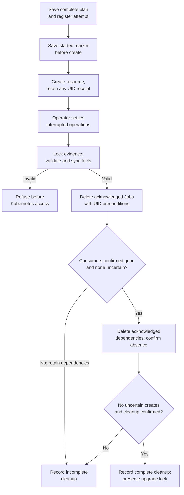

# Interrupted preflight cleanup flow

## Overview

The production image upgrade helper records temporary Kubernetes resources
before creating them. A separate `--cleanup-preflight` invocation consumes those
records after the operator settles an interrupted process. It removes confirmed
resources, preserves uncertain outcomes and stops before upgrade recovery.

The [operator guide](../../guides/deploy/production-preflight-cleanup.md) owns
commands, prerequisites and result interpretation. This flow covers durable
creation boundaries and cleanup decisions, not image qualification, Helm or
migration recovery.

## Entry Points

- `scripts/upgrade-production-images:preflight_startup` and
  `scripts/upgrade-production-images:preflight_migration` register creation plans
  during the normal upgrade workflow.
- `scripts/upgrade-production-images` selects cleanup mode after argument parsing.
- `scripts/upgrade-preflight-state.py:inspect` validates original evidence and
  target bindings. The caller requires explicit process-settlement and
  unrestored-evidence attestations plus Kubernetes read/delete permissions.

## Flow

## Execution Trace

### 1. Record complete creation plans before side effects

`scripts/upgrade-preflight-state.py:main` initializes `preflight-journal.json`
with format `upgrade-preflight-v1` and a hash of the stable original parameters.
The normal helper holds an exclusive process lock on the original evidence
directory. The existing `.upgrade-lock` retains its separate role in upgrade
recovery.

`preflight_startup` renders resources and registers a complete
`preflight-plan.json`: API, worker and migration Jobs, a Secret and an optional
NetworkPolicy. `preflight_migration` registers a separate plan under each
`migration-preflight-resume.*` directory. Each registry entry binds the physical
attempt directory and plan hash. The plan is synced before the updated root
registry is published and synced.

`scripts/upgrade-production-images:create_preflight` publishes a durable
`preflight-<slot>-started.json` before invoking `kubectl create`.
`acknowledge_preflight` publishes the returned kind, name and UID under a fixed
`preflight-<slot>-identity.json` name. Observed child Pods have separate receipts.
An absent started marker proves that this protocol did not launch that create;
a started marker without an acknowledgement leaves its outcome unknown.

### 2. Validate and freeze evidence for a cleanup invocation

`scripts/upgrade-production-images` accepts only target/evidence arguments and
the two attestations in cleanup mode. It opens the original directory and uses
`scripts/upgrade-preflight-state.py:main` to acquire the exclusive process lock.
Neither lock acquisition nor the attestations settle remote operations; that
remains the operator's prerequisite.

`scripts/upgrade-preflight-state.py:inspect` binds the original physical evidence
directory, kubeconfig path/bytes, context, namespace, release and cleanup source
hashes. It validates every registered attempt, its complete plan, started markers
and acknowledgements. Visible create records outside the attempt index also
refuse cleanup; an unregistered plan alone can precede a create. Files must be
private regular files owned by the operator;
symlinks, conflicting records, changed plans and unsupported journals refuse.
It syncs validated facts and directories before returning any cleanup identities.

A complete final acknowledgement can be used even if its publisher failed after
publication. A retained hardlink is accepted only when it is the publisher's
exact staging link. An absent acknowledgement is not replaced by discovering a
live UID. This contract applies to the versioned protocol, not older evidence.

The inspector flattens registered attempts into acknowledged resources and child
identities, plus uncertain slots. An uncertain Job marks consumers unknown.
Malformed evidence refuses the entire invocation before remote access; valid
but uncertain creation history permits only the cleanup described below.

### 3. Remove consumers before dependencies

`scripts/lib/upgrade-preflight-cleanup.sh:cleanup_preflight` runs with a new
`preflight-cleanup.XXXXXXXX` evidence directory. It sends foreground Job deletes
with original UID preconditions, then checks the Job, namespace Pod ownership and
any recorded child. `scripts/upgrade-startup-preflight.mjs:remaining` checks
whether original consumers remain. Pod labels are not the ownership authority.

A failed DELETE requires a successful absence read before cleanup can proceed.
Consumers must disappear within the polling deadline. An unknown Job create,
failed read, remaining consumer or identity conflict retains all dependencies,
even when other acknowledged Jobs were removed successfully.

After confirmed consumer cleanup, the same function deletes acknowledged
Secrets and NetworkPolicies using their original UID preconditions. Accepted
deletes are polled to confirmed absence; same-name replacements are left alone.
Readbacks retain resource identity rather than Secret or Job contents.

### 4. Report cleanup without resuming an upgrade

`scripts/upgrade-production-images:553` writes a version `1`
`preflight-cleanup-result.json` containing `complete` and `unknown` in the new
invocation directory. Any uncertain create or unconfirmed deletion makes
`complete` false and exits `1`; confirmed cleanup exits `0`. Invalid evidence
exits `2` before this directory or Kubernetes operations are created. Interruption
before a result does not establish completion.

The command preserves `.upgrade-lock`, original acknowledgements and prior
cleanup results. Repeated authorized cleanup verifies already-absent resources
again; it does not replay creates. The release owner then follows
[upgrade recovery](../../guides/deploy/production-upgrade-recovery.md), independently
reconciling database, release and workload state. Cleanup never authorizes resume.

## Debugging and Verification

- Inspect the printed result path and `preflight-cleanup.err` beside it. An
  `unknown` entry identifies the attempt and slot that lack an acknowledgement.
- Compare original parameters and registered plans without editing them. Missing
  or conflicting facts require operator reconciliation, not a regenerated UID.
- Command fixtures can verify argument restrictions, durable ordering and refusal
  behavior. Real Kubernetes checks are needed to establish foreground deletion
  and child convergence; neither kind of test proves a production upgrade or
  database rollback.

## Related docs

- [Production image upgrade flow](../coordinated-production-upgrade.md)
- [Preflight cleanup guide](../../guides/deploy/production-preflight-cleanup.md)
- [Production upgrade recovery](../../guides/deploy/production-upgrade-recovery.md)
- [Kubernetes testing](../../testing/kubernetes.md)

## Manual Notes

[keep this for the user to add notes. do not change between edits]

## Changelog

- 2026-11-11 12:30: Document durable preflight plans and explicit cleanup after interruption. (authoring-run/9239da57-dcad-427a-82aa-c7d64376fdc5 - e961361d56537b17f361347b097d075f5e608fb1)
