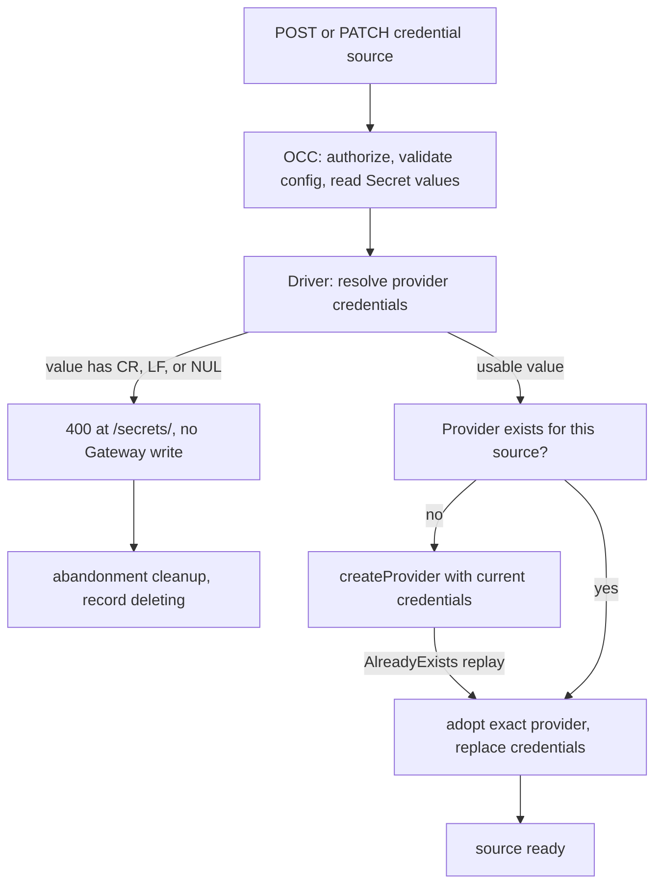

# Credential Gateway Static Registration Flow

## Overview

An operator registers or updates a static Credential Source (an OpenAI or Codex
model key, or a Bearer token) through the OpenShell Credential Gateway. OCC
admits the request, reads the referenced Secret values, and the Gateway Driver
copies them into an OpenShell Provider. Values that OpenShell cannot store as
credentials are refused before any Gateway write. This flow stops when the
source reaches `ready` (or a refusal response); Agent binding and attachment are
owned by the [harness execution topology](harness-execution-topology.md).

## Entry Points

- Trigger: `POST /namespaces/:namespaceId/credential-sources` with a static
  Gateway type, or `PATCH …/credential-sources/:credentialSourceId` replacing
  its Secrets.
- Source: `packages/occ/src/credential-source-operations.ts:createCredentialSource`
- Source: `packages/occ/src/credential-source-operations.ts:updateCredentialSource`
- Assumptions: a ready Namespace, `credential_source:create` (or `update`) plus
  `secret:operate` on each referenced Secret, and a selected Credential Gateway.

## Flow

## Execution Trace

### 1. OCC admission and Secret reads

`packages/occ/src/credential-source-operations.ts:createCredentialSource`

OCC authorizes the create, validates `config` against the selected type's
catalog, and verifies each `secrets` reference is same-Namespace and readable.
It reads the current value of every referenced Secret through the Secret
Driver, then commits the source record as `registering` before any external
operation. PATCH takes the same path for a `ready` source: it merges the
replacement Secret references, re-reads their values, and keeps the recorded
references only after the Gateway update succeeds.

### 2. Credential resolution and the value refusal

`apps/controller/src/drivers/credential-gateway/openshell.ts:providerCredentials`

The Driver maps each catalog field to the Provider credential key OpenShell
expects. A missing value is refused with `400`. A value containing CR, LF, or
NUL is refused the same way, at `/secrets/<field>` with fixed text naming the
prohibited characters, because OpenShell denies such values only when a binding
uses them, which surfaces later as a runtime probe failure. The refusal
precedes every Gateway write, on both registration and update. Generic Secret
storage keeps accepting multiline values, such as PEM private keys; only
values that become OpenShell credentials are restricted.

### 3. Provider creation or credential replacement

`apps/controller/src/drivers/credential-gateway/openshell.ts:registerSource`

The Driver validates placement-dependent config, rejects profile collisions,
and writes the per-source profile. When no Provider exists for this exact
source, it creates one with the current credentials. When one exists (a prior
registration whose cleanup did not complete, or an `AlreadyExists` replay after
an uncertain create), it adopts only the source-owned Provider and replaces its
stored credentials with the current values: OpenShell keeps a Provider's values
until they are replaced, so adopting without writing would keep a stale copy.
Refresh-type sources have no static credentials and are skipped. Registration
and update both end `ready`; OCC commits the state with audit.

### 4. Refusal and abandonment

`packages/occ/src/credential-source-operations.ts:abandonCredentialRegistration`

Any registration-time throw runs the Gateway's `removeSource` (deleting the
Provider and profile this source owns) and leaves the record `deleting`, since
an uncertain external write may still have produced a copy. A caller that
receives the field-specific `400` can correct the Secret value and register
again; DELETE finishes cleanup of a leftover record.

## Debugging and Verification

- A create or update refused for a prohibited character answers
  `400 INVALID_REQUEST` with `details[0].path` `/secrets/<field>`; the message
  names CR, LF, or NUL. `tests/integration/credential-source-api.test.mjs`
  exercises both paths through the real API, OCC, and Driver.
- A stored Provider that did not receive the current value after
  re-registration shows in `occ credential-source get` status and the
  `updateProvider` Gateway mutation; the integration suite asserts the
  replacement and the `AlreadyExists` replay.
- Multiline Secret storage stays valid:
  `tests/conformance/kubernetes-secret-driver.test.ts` round-trips a PEM value.

## Related docs

- [Credential sources reference](../reference/credential-sources.md)
- [Other delivery modes](../reference/credential-sources/other-delivery-modes.md)
- [Secret storage and delivery flow](secret-storage-and-delivery.md)
- [Credential source refresh flow](credential-source-refresh.md)

## Manual Notes

[keep this for the user to add notes. do not change between edits]

## Changelog

- 2026-11-24 14:06: Trace static Credential Gateway registration and update, the prohibited-character refusal before Gateway writes, and credential replacement for an adopted Provider. (authoring-run/4c55ed77-96ae-4892-9850-396d03aa9763 - 82b7eacec)
