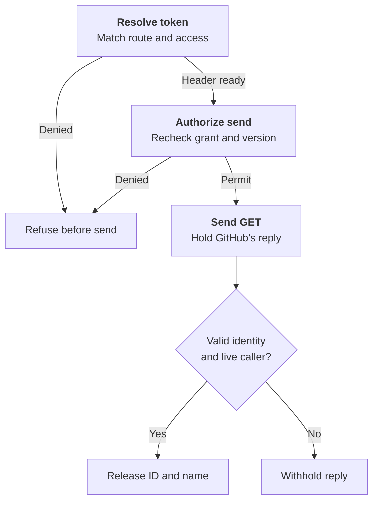

# Protected credential request flow

## Overview

A process in a dedicated Agent asks GitHub for a repository's identity. The
supervisor sends the authorized request and holds the reply until OpenClaw
Control Plane (OCC) approves what the process may receive. This flow describes
the exchange required of the supervisor. The bundled legacy supervisor lacks
it. See the [release cutoff](../reference/credential-sources/protected-inference.md#execution-admission-cutoff)
and [threat model](../reference/security/credential-proxy.md).

## Entry Points

- A [source binding](../reference/credential-sources.md#bind-a-source-to-an-agent)
  and deployment establish the route. The installation must have current
  evidence of loaded enforcement.
- The authenticated supervisor opens one TLS stream,
  `HttpInstallationExchange.Exchange`, for credential resolution, send
  authorization and response release
  (`apps/controller/src/drivers/egress-proxy/openshell-authority.ts:createOpenShellEgressAuthority`).

## Flow

### Follow the metadata GET

Suppose the revision admits `github-app-metadata` for repository ID `12345`,
`acme/widgets`, at `https://api.github.com`.

1. **Match the request.** The supervisor captures the process's bodyless
   `GET /repos/acme/widgets` and binds the reply to that exchange. The GitHub
   adapter checks the method, URL, headers and body against the installed route.
2. **Resolve the token.** OCC checks the installation, binding, withdrawal
   state and the Agent's current `credential_source:operate`. The resolver
   selects a usable installation token that the worker already prepared.
   OCC returns the resulting `Authorization: Bearer …` header to the supervisor.
3. **Permit one send.** On the same stream, OCC rechecks authority and the
   token version. If the Agent lost its source grant after resolution, OCC
   refuses the send. Otherwise, the supervisor can start the request by the
   deadline in the permit. Issuing a permit does not confirm receipt by GitHub.
4. **Release the identity.** The supervisor submits GitHub's complete reply.
   The adapter checks for a `200` JSON response of at most 64 KiB with the
   admitted ID and name (ASCII letter case may differ). For example, even if
   GitHub returns `"full_name":"Acme/Widgets"` and a description, the caller
   can receive a `200` with `Content-Type: application/json`,
   `Cache-Control: no-store` and this body.

```json
{ "id": 12345, "full_name": "acme/widgets" }
```

If GitHub returns ID `67890` under the same name, the supervisor withholds the
response. GitHub has already received the request. With the credential-free
profile the same filters apply, but resolution records `no_material_required`
and the supervisor sends no credential header.
[GitHub metadata adapter](https://github.com/openclaw/openclaw-enterprise/blob/0418ef3a2c116b73f025281395d92477daf665d2/apps/controller/src/drivers/egress-proxy/github-metadata.ts)



## Execution Trace

### 1. Admit source and install the revision plan

OCC checks source and Secret permissions at admission. Existing sources need
explicit opt-in. Version 3 binds Sandbox and Credential Proxy to one registered
Driver. The plan identifies the Driver, configuration digest, execution, source
generation, grant and routes. Empty routes deny all. The API checks registration.
The worker compares the stored reference.

For credential-free metadata, `packages/occ/src/index.ts:admitProxyPlan` rejects
a Driver grant that differs from the source. Equivalent grants have the same
digest across property orders. Unprotected revisions remain v2. Only the bundled
Driver recognizes historical protected plans by original capability IDs for stored
release or custody settlement.

Compute rechecks admission with the worker before launch. PostgreSQL rejects
unknown decisions and mixed v2/v3 fields. Older workers refuse v3. Upgrade
all writers before admitting it.

For each prepared route, `apps/controller/src/drivers/compute/kubernetes/index.ts:preparedEgressReady`
selects the current issuer, projects the admitted source and checks readiness. Compute retains
only these observation methods, without token-read or lifecycle authority. A missing or mismatched
owner refuses release; a cold source remains pending.

Deploy returns `409` for missing Git delivery profiles
(`REPOSITORY_GIT_PROFILE_UNSUPPORTED`), bundled `git-write`
(`REPOSITORY_GIT_SENDER_UNQUALIFIED`), unadmitted bindings, Agents without Git on
a Git-only Proxy, and Installation limits. Preparation repeats both Git refusals.
[Protected repository Git](../reference/drivers/selection.md#select-a-protected-sender)
uses a separate worker binding and requires proof of the recipient before release.

Compute passes Credential Proxy wiring to Sandbox provisioning. Protected sources
require admission, API-key login, an exact plan source-key match and no Gateway
attachment; they receive no Gateway authentication environment. Gateway-owned sources
require their exact attachment. The egress Driver compares the Sandbox's complete
prepared source policy and protected routes with the plan. Authenticated
`LoadedPolicyObservationV1` binds source and effective policies to the Sandbox,
instance, policy version, configuration/environment revisions and capabilities.
Installation and revalidation enforce the
[V1 contract](../reference/credential-sources/protected-inference.md#loaded-enforcement),
including its exact name-only rule exception. Missing evidence, widening or a changed
fence refuses; legacy observations cannot substitute. The gateway compares unknown
fields too. The local fingerprint covers both hashes and full policies, but is neither
a canonical supplier hash nor supervisor attestation.

Compute adds `OPENCLAW_EGRESS_ENROLLMENT_REVISION_ID` from the immutable admitted
revision only to protected provider Harness requirements. Before opening its authenticated
listener on the existing service port, the generated helper requires the literal to equal
the manifest's enrollment execution revision; missing or mismatched values refuse.
Compute suppresses its private status revision, port, container name and Pod UID; the
provider receives the transport verifier, not the raw transport token.

Before the first model probe, the Harness waits on this listener. Compute awaits the
installation commit, requeries current evidence and calls the selected Sandbox Driver,
which checks the exact Sandbox and service and reads the execution/plan challenge.
Compute signs its fresh process nonce and current installation with a control-plane-only
key. The listener closes before Codex starts. Restart creates a new challenge; stale
release cannot unlock the replacement. After 180 seconds, startup fails closed and remains held.
Reconciliation may repeat readiness exchanges, but enrollment neither
resolves material nor retries business requests. The worker's active-revision branch can
repeat this sequence when work is queued. Default Kubernetes has no periodic maintenance
interval, so Harness-only restart recovery is not automatic;
see the [supported recovery boundary](../reference/credential-sources/protected-inference.md#installation-configuration).

### 2. Capture identity, operation and first authority decision

Each TLS stream carries one `HttpInstallationExchange.Exchange`. After bearer authentication,
the adapter issues a random 32-byte challenge. Up to 1,024 openings, 256 per Sandbox, await
proof until signed acceptance, closure or a 30-second deadline. The owner rechecks the bearer
and verifies both the gateway-signed `exchange_key` and the supervisor’s Ed25519 signature over
`openshell-exchange-v1`, a zero byte, the challenge and the binary opening request.
Request JSON cannot supply a key; bearer-only RPCs refuse. Online authorization
(`apps/controller/src/drivers/egress-proxy/openshell-online-authority.ts:createAuthority`)
likewise holds at most 1,024 decisions in flight, 256 per Sandbox.

Before awaiting work, the adapter copies the request and binds a private capability to the stream.
Credential Proxy bounds body size, reserves an authentication slot and snapshots headers and body.
The stream owns the response. OCC copies each authenticated peer descriptor before
awaiting more work. Send and response require the captured sender, Sandbox,
instance, exchange, installation and optional peer key. Adding, changing or removing the key
refuses; peer expiry must be valid and future at resolution, send and response lookup. A bearer
or handle cannot transfer custody. Closing the stream cancels it. Cancellation or expiry
releases material; pending policy or receipt work keeps its slot. No pipelining.

`packages/occ/src/credential-proxy.ts:resolve` moves the slot to the verified Sandbox's share,
maps the peer to persisted installation state and pins eligible providers and methods before
classification. Ambiguity blocks classification. OCC rechecks pins before and after provider
use and at material access, send authorization and response release. Changes restored between checks
escape detection. Secret Driver network access and supervisor response writes remain downstream.
After one exact route matches, OCC reserves a UUIDv7 request ID before capture or policy I/O.
Creation fixes the 30-second replay horizon. [Slots and IDs are bounded](../reference/drivers/credential-proxy.md#request-time-capacity);
unsupported or ambiguous operations refuse before reservation.

Supplier enrollment starts at its authenticated current supervisor hello, not the first
exchange. The supplier must keep the corresponding private key outside the Agent and
pin its actual downstream reply sink before queueing. The complete path is not yet
qualified. The Driver requires
`openshell.supervisor-middleware.installation-exchange.v1`; old counterparts
cannot acquire this profile through an existing executable-restricted grant.

Each check requires a fresh platform transaction; enclosing transactions refuse to
prevent IAM snapshot reuse. It verifies current Namespace/Agent state, admitted revision,
installation, source generation, withdrawal and exact Agent source permission.
`credentialNamespace` supplies Compute's runtime placement to the Driver; IAM and audit
retain logical Namespace identity. The Driver requeries policy-status evidence against
the stored fence. Replacement, missing evidence or changed configuration refuses even
if the saved installation was valid. Denials record phase and internal request attribution
without material.

### 3. Resolve versioned material and authorize its sole send

The selected Secret Driver verifies ownership and reads UID/resourceVersion from the authoritative
API. Static and prepared GitHub read ports share one `{ signal, deadlineAt }` lifetime.
The Kubernetes Secret reader carries it through namespace verification, GET and retries;
child scopes inherit cancellation and the earliest deadline. Each HTTP dispatch checks
expiry independently of timers. Invalid deadlines fail closed; per-attempt timeouts cannot
extend the lifetime.
GitHub acquisition validation, transport and metadata injection share a wire check:
1–16,384 bytes of nonspace printable ASCII, not authentication.

`apps/controller/src/drivers/repo/github/credentials/prepared-lifecycle.ts:readWarm`
pins the committed attempt ID, material version and earlier of material expiry or signed
deadline. The store projects ciphertext only for that eligible row and issuer, checks
`clock_timestamp()` at projection and rechecks expiry and cancellation immediately before
decryption. The outer reader verifies identity and expiry. Expired or replaced selections
return `not_ready` unless the signed deadline has elapsed; projected bytes cannot be recalled.
Separate background custody permits rotation and cleanup of material ineligible for requests.
The registry returns credential headers, an opaque handle and nonsecret evidence to the
authenticated supervisor; material remains request-scoped.

Before send, `packages/occ/src/state/prepared-github-state.ts:postgresPreparedGitHubProof`
queries current material metadata in the active platform transaction, without another
checkout. Lifecycle issuer/trust identity, shared metadata predicates and exact evidence
fence stale selections. The port exposes neither ciphertext nor caller-supplied SQL.
Statement and lock timeouts respect tighter caller limits. Successful SQL restores the
original settings in the same unit before rechecking cancellation and absolute expiry;
SQL errors leave rollback to the transaction owner. OCC checks withdrawal, rejection
and binding in that unit.

The same-stream authorization frame must echo the original deadline, evidence and
injection digest. The registry reserves the handle, then
`packages/occ/src/egress-send-receipts.ts:EgressSendReceipts.begin` commits possible
dispatch before permission. Its key includes authenticated sender Ref, instance,
stable request/use ID and attempt ID; its binding includes exact store-qualified
material and original deadline. An existing attempt, failed write or unknown commit
refuses permission, including after an authority restart.

The sender and OCC bind the same Sandbox, instance, configuration, peer key, policy hash,
authority scope and plan to the exchange. The Git recipient has its own delivery evidence.

After reservation, OCC’s `authorizeSend` port verifies the current runtime before opening
the send transaction. The selected `IAMDriver.authorize` method makes the fresh decision for
the exact service principal, `operate` action and Credential Source. For native IAM, the
Namespace lock orders that decision and receipt commit against supported Namespace binding
changes. An external IAM decision occurs before the transaction and cannot share that ordering.
OCC rechecks the selected route, installation, material and rejection fence, then mints the
permit and calls `EgressSendReceipts.authorizeIn` in the same transaction. The receipt binds
the execution, installation fence, exchange, response custody, request and injection digests,
authorization time and send-start deadline. The deadline is at most one second away and cannot
outlive the request, material or identity.

Before returning permission, the registry rechecks cancellation, ownership and the persisted
deadline. A lost acknowledgment, handle or deadline yields no permit. Restart cannot
reauthorize the attempt. Revocation may race an authorized send; an origin write with a
lost reply remains a possible effect and must not be retried.

### 4. Protect response and finish

`packages/occ/src/credential-proxy.ts:protectResponse` binds the complete response to its peer,
request and exchange, removes unlisted headers and withholds bytes until approval. The request
deadline bounds the first byte. On progress, `renewResponse` checks policy at most once every
15 seconds, including during outages. Unavailability preserves the deadline; denial cuts the
stream. Recovery can renew before expiry. A shorter authenticated peer lifetime caps leases
and held responses despite later progress.
Limits: five minutes idle, fifteen minutes total, 4 MiB and 16,384 events.

For Responses, check client-assembled SDK output-part snapshots, assistant text across
parts, items or deltas, and Codex's completed and streamed Plan views. Reject ambiguous
order or indexes. Inspect function arguments as bounded JSON without recursively
decoding strings. The
[supported profile](../reference/credential-sources/protected-inference.md#static-source-and-response-policy)
preserves safe response bytes. The origin has already received the credential.

Only this exchange can claim the response. `EgressSendReceipts.observe` atomically records
the decision and any exact rejection fence without bodies, headers, credentials or handles.
Failure withholds bytes; success still requires checking cancellation and deadline.

Structured OpenAI `invalid_api_key` can establish rejection; a bare 401 cannot. At
its next scheduled check, the prepared owner excludes a positively rejected version.
Concurrent owners coalesce replacement; uncertain issuance blocks it; late feedback
cannot invalidate its successor. GitHub metadata has no positive rejection classifier.

Erase material after response handling or at deadline. Only a refusal before
permission can settle as undispatched. After possible permission, inspect the
exact attempt without retrying; returning bytes does not prove delivery.

### 5. Configure the regular Harness caller

Before credential access, the provider normalizes the nonsecret endpoint and classifies
the actual request. `apps/controller/src/drivers/compute/plugin-runtime.ts:codexToml` keeps local tools and ordinary Harness components,
disables provider tools, and uses HTTP Responses without WebSockets or automatic retries.
The runtime manifest preserves this profile. Its `--ignore-user-config` probe sets request
and stream retries to zero and never repeats a timed-out protected probe.

### 6. Reduce the live credential policy

OCC commits withdrawal before provider action. Under the Agent lock,
`packages/occ/src/credential-policy-reduction.ts:reduceCredentialPolicy` records an
exact compare-and-reduce request in `credential_delivery_reductions` for a source or
repository binding. Concurrent reductions wait; recovery observes the recorded operation
without another capability probe or mutation. The reductions owner manages these and
material-delivery reduction receipts; their evidence shapes are separately constrained
in the same store.

Admission selects reduction v2 only for exact-dispatch Git. Online and observed-hook
Git keep their v5 and v6 semantics. Ordinary v3 uses reduction v1 only when the Driver
explicitly declares it; v2 alone does not authorize v1 or multiple static sources.

Independent observation of the exact operation, stable recipient and retained plan
supplies the current policy view; the original installation receipt remains unchanged.
Missing identity, stale operation, incomplete configuration or wrong policy evidence
keeps withdrawal pending; a positively identified replacement recipient can require
retirement. Remaining grants stay unchanged, and the last route leaves deny-all. Receipt
settlement cannot reopen withdrawn authorization, and the Driver prevents stale
installation from restoring routes. Reference-peer proof does not qualify released
Sandboxes or continued model execution.

### 7. Retain installation custody

`packages/occ/src/state/credential-deliveries.ts:CredentialDeliveries` fixes the
settlement policy: independent confirmation for registered recipients; the original
reserving worker for snapshots, including bootstrap. Reservations advance the
operation fence. Confirmation grants no request authority.

`apps/controller/src/drivers/egress-proxy/openshell-git-runtime.ts:reconcile`
cancels only definitely unsent writes. Uncertain writes stay pending and blocked.
`release` drops closed routes whose Sandbox is gone; refusal stays.
See [restart behavior](../reference/repository-credentials/protected-openshell-git.md#route-state-restarts-and-recovery).

Creation requires the exact live owner. Deletion retains custody but prevents live
use. `apps/controller/src/drivers/egress-proxy/openshell-git-route-store.ts:confirmDetached`
checks the retained fence, recipient, material, policy and request without another apply.

## Debugging and Verification

Follow the [testing guide](../testing/static-egress.md). Qualify model execution,
response custody and NetworkPolicy with the selected chart and image. Observe
the origin and caller independently.

## Related docs

- [Credential Proxy overview](../design/credential-proxy.md)
- [Credential sources and bindings](../reference/credential-sources.md#bind-a-source-to-an-agent)
- [Credential source lifecycle](credential-source-lifecycle.md)
- [Protected static inference](../reference/credential-sources/protected-inference.md)
- [OpenShell Sandbox provisioning](openshell-sandbox-provisioning.md)
- [RFC 0023 proposal](../../specs/rfcs/0023-egress-proxy-credential-lifecycle/index.md)

## Manual Notes

None.

## Changelog

- 2026-10-30 10:12: Retain guarded OpenShell 0.1.6 preview. (authoring-run/9d2efbc4-c4d4-4678-a191-7b23d350a008 - 319e24a88facddd38a883bdfd5b226652d2a6e26)

- 2026-10-27 16:00: Document provider pinning. (authoring-run/53dd6d74-5181-417f-934c-dd6c8ef6db2d - e2dfabf042852adea8ed797b48aae122927d6226)

- 2026-10-27 10:54: Trace send authorization and response release for a repository metadata read. (authoring-run/2c5a77ee-7b17-4553-b360-486daa794f9a - 0418ef3a2c116b73f025281395d92477daf665d2)

[Protected credential request documentation history](credential-source-egress/history.md) preserves the older dated entries.
