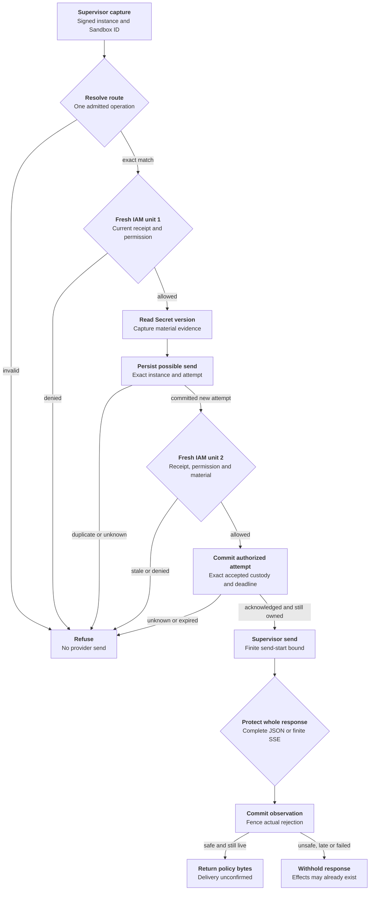

# Protected credential request flow

## Overview

OCC maps identity, checks current IAM policy, selects the
Secret version and sets response policy. Outside the Agent, the trusted OpenShell
supervisor resolves the static credential, obtains fresh permission to send, injects it
and submits the complete provider response for protection.

Kubernetes Compute releases a fresh execution after signing its exact installation's
startup challenge. Credential Proxy owns response acceptance on that exchange. See
the [profile and release cutoff](../reference/credential-sources/protected-inference.md#execution-admission-cutoff)
and [supported configuration](../reference/credential-sources/protected-inference.md).
The bundled legacy supervisor is incompatible.

Before serving requests, the API binds the selected Driver's authenticated exchange
to OCC resolve, send and response operations. Requests cannot choose that owner.

[Protected repository Git](../reference/drivers/selection.md#select-a-protected-sender)
uses a separate worker binding. The worker gives the same selected Driver
recipient observation, a read of committed material for that installation, and
authorization of the actual Git request. The Token Service retains issuance,
renewal and retirement. A Driver that cannot prove the installed recipient
cannot release a protected revision.

## Entry Points

- Trigger: an installed supervisor sends `HttpCredentialAccess.Resolve`, followed
  by `AuthorizeSend` and `HttpResponsePreReturn.Evaluate` over authenticated TLS.
- Source: `apps/controller/src/drivers/egress-proxy/openshell-authority.ts:createOpenShellEgressAuthority`
- Source: `packages/occ/src/index.ts:createCredentialProxy`
- Assumptions: source admission and Agent deployment produced an exact plan;
  a current verified loaded-enforcement receipt permits installation; the Agent is
  running; its service principal holds exact source `operate` permission.

## Flow

Wire fixtures exercise the required supervisor contract. Qualify the deployed
supervisor and no-bypass networking separately.

## Execution Trace

### 1. Admit source and install the revision plan

`packages/occ/src/index.ts:admitStaticEgressSource`,
`packages/occ/src/index.ts:admitProxyPlan`

Source and Secret authorization precede live/static admission; existing sources require
explicit opt-in.

Version 3 binds Sandbox and Credential Proxy to one registered Driver. The plan records
its ID, implementation and configuration digest. The API checks the registration object.
Workers compare its durable reference.
Sandbox enforcement needs separate evidence. The plan fixes execution, source generation,
grant and routes. Empty routes deny all.

Unprotected revisions retain version 2. Only the bundled Driver recognizes historical
protected plans by their original capability IDs, for stored release or custody settlement.

`packages/contracts/src/credential-proxy.ts:assertExecutionReleaseAllowed`,
`apps/controller/src/worker.ts:resolveRevisionSecretContext`

Compute validates admission for OCC, then rechecks it with the worker before launch.
PostgreSQL rejects unknown decisions and mixed v2/v3 fields. Upgrade all writers before
admitting v3, which older workers refuse. Qualify both release and installed deny-all behavior.

`apps/controller/src/drivers/compute/kubernetes/index.ts:prepareRevision`,
`apps/controller/src/drivers/egress-proxy/openshell.ts:attachmentStatus`

Compute passes Credential Proxy wiring to Sandbox provisioning.
`apps/controller/src/drivers/compute/kubernetes/index.ts:credentialSourceEnvironment`
requires protected admission, API-key login, an exact source-key match in the plan,
and no Gateway attachment. Protected sources receive no Gateway authentication
environment; Gateway-owned sources still require their exact attachment. The
Sandbox returns its complete prepared source policy from
`apps/controller/src/drivers/sandbox/openshell.ts:provisionHarness`.
`apps/controller/src/drivers/egress-proxy/openshell.ts:enforcementEvidence`
compares the complete prepared policy and protected routes with the plan. The
authenticated `LoadedPolicyObservationV1` binds source and effective policies to
the Sandbox, instance, policy version, configuration/environment revisions and
capabilities. Installation and revalidation enforce the
[V1 contract](../reference/credential-sources/protected-inference.md#loaded-enforcement),
including its exact name-only rule exception. Missing evidence, widening or a
changed fence refuses; legacy observations cannot substitute. The gateway must
compare unknown fields too. The local fingerprint covers both hashes and full
policies; it is not a canonical supplier hash or supervisor attestation.

`apps/controller/src/drivers/compute/harness-egress-enrollment.ts:HARNESS_EGRESS_ENROLLMENT_HELPER`,
`apps/controller/src/drivers/sandbox/openshell.ts:enrollHarness`

Compute adds `OPENCLAW_EGRESS_ENROLLMENT_REVISION_ID` from the immutable admitted
revision only to protected provider Harness requirements. The generated helper
requires exact equality between this literal and the manifest's enrollment
execution revision before opening its authenticated listener on the existing
service port. Missing or mismatched values refuse. Compute's private status
revision, port, container name and Pod UID remain suppressed; the provider
receives the transport verifier, not the raw transport token.

The generated Harness waits on this listener before running the first model probe. Compute awaits the
installation commit, requeries current evidence and calls the selected Sandbox
Driver. The Driver checks the exact Sandbox and service, reads the execution/plan
challenge. Compute signs its fresh process nonce and current installation with a control-plane-only key.
The Harness closes that listener before starting Codex. Restart creates a new
challenge; a stale release cannot unlock the replacement. The 180-second wait
fails closed with a held startup failure. Reconciliation can repeat readiness
exchanges, but enrollment neither resolves material nor retries business requests.
The active-revision branch in `apps/controller/src/worker.ts:prepareRevision` can
repeat this sequence when work is queued. The default Kubernetes selection has no
periodic maintenance interval, so Harness-only restart recovery is not automatic;
see the [supported recovery boundary](../reference/credential-sources/protected-inference.md#installation-configuration).

### 2. Capture identity, operation and first authority decision

`apps/controller/src/drivers/egress-proxy/openshell-identity.ts:verify`,
`packages/occ/src/credential-proxy.ts:resolve`

The TLS adapter accepts one operation on `HttpInstallationExchange.Exchange`.
It authenticates the supervisor bearer before issuing a random 32-byte challenge
on that stream. Each authority allows at most 1,024 openings awaiting proof.
Accepting the signed opening, closing the stream, or reaching the 30-second
opening deadline releases that slot. `OpenShellEgressIdentity.acceptExchange`
rechecks the bearer, then verifies the gateway-signed `exchange_key` binding
and the supervisor's Ed25519 signature over the domain
`openshell-exchange-v1` plus a zero byte, challenge, and exact binary opening
request. Request JSON cannot introduce a key. Bearer-only legacy RPCs refuse.

The adapter binds a private capability to this stream and copies the decoded
request before asynchronous work. One owner verifies identity, captures origin
and holds the response. Before its first await, Credential Proxy checks body size
and capacity, reserves a slot and snapshots headers and body. Authorization and
response claims must match the captured peer, exchange and installation. Reusing
the bearer, key, request ID or handle on another stream cannot transfer custody.

Closing invalidates the capability and signals cancellation. Canceled or expired
handles drop their material reference immediately; pending policy or receipt work retains its
slot until settled. Closing an idle handle frees its slot. Pipelining is refused.

The Forwarder maps the captured peer to persisted installation state and
classifies one exact route through its registered provider. It reserves the
UUIDv7 request ID before asynchronous authorization. Its creation time fixes
the 30-second replay horizon; pending resolution and replay state are bounded.
Unsupported or ambiguous operations refuse before Secret access.

The required supplier enrollment starts at its authenticated current supervisor
hello, not at the first exchange. The supplier must keep the corresponding
private key outside the Agent and pin its actual downstream reply sink before
queueing. That complete supplier path is not yet qualified. The Driver requires
`openshell.supervisor-middleware.installation-exchange.v1`; old counterparts
cannot acquire this profile through an existing executable-restricted grant.

`packages/occ/src/index.ts:checkEgressUse`

Each check opens a fresh platform transaction. An enclosing controller transaction
is refused, so native IAM cannot reuse one policy snapshot for both checks. The
check verifies current Namespace/Agent state, admitted revision, installation,
source generation, withdrawal and exact Agent source permission. The existing
`credentialNamespace` mapping supplies Compute's runtime placement to the Driver;
IAM and audit retain logical Namespace identity. The Driver requeries current
policy-status evidence during each check and compares it with the stored fence.
Replacement, missing evidence or changed configuration refuses even when the saved
installation was once valid. Denials record phase and internal request attribution
without material.

### 3. Resolve versioned material and authorize its sole send

`apps/controller/src/drivers/secret/kubernetes/index.ts:readCredentialInput`,
`packages/occ/src/credential-proxy.ts:authorizeSend`

The selected Secret Driver verifies ownership and reads UID/resourceVersion from
the authoritative API. Static and prepared GitHub read ports receive one lifetime,
`{ signal, deadlineAt }`. The Kubernetes Secret reader carries that lifetime through
namespace verification, Secret GET and retries in one operation context. Within
that bounded read, child scopes inherit cancellation and the earliest absolute deadline.
Each HTTP dispatch rechecks that deadline even when the timer has not fired;
invalid deadlines fail closed. Per-attempt timeouts cannot extend the read lifetime.
GitHub acquisition validation, provider transport and metadata injection share
`apps/controller/src/drivers/repo/github/credentials/wire-credential.ts:isGitHubWireCredential`:
1–16,384 bytes of nonspace printable ASCII. This is a wire-format check, not authentication.

The registry retains material only for this bounded request. It returns credential
headers, an opaque handle and nonsecret material evidence to the authenticated supervisor.

`apps/controller/src/drivers/repo/github/credentials/prepared-lifecycle.ts:readWarm`
pins the committed attempt ID, material version and earlier of material expiry or
signed deadline. `apps/controller/src/drivers/repo/github/credentials/prepared-postgres.ts:store`
projects ciphertext only for that eligible row and issuer, checking `clock_timestamp()`
at projection. It rechecks expiry and cancellation immediately before decryption;
the outer reader still verifies identity and expiry. An expired or replaced selection
returns `not_ready` unless the signed deadline has elapsed. Bytes already projected
cannot be recalled. Background preparation has separate custody,
so rotation and cleanup can still handle material ineligible for requests.

Before send, `packages/occ/src/state/prepared-github-state.ts:postgresPreparedGitHubProof`
queries current material metadata on the active platform transaction, without another
checkout. The lifecycle supplies issuer/trust identity; shared metadata predicates and
exact evidence checks fence stale selections. The port exposes neither ciphertext
nor caller-supplied SQL. Statement and lock timeouts bound waits without relaxing
tighter caller limits. Successful SQL restores the original settings in the same
unit before cancellation and absolute expiry are rechecked; SQL errors leave rollback
to the transaction owner. OCC retains withdrawal, rejection and binding
checks in the same unit.

The authorization frame on that same stream must echo the original deadline, evidence and injection digest.
The registry reserves the handle, then uses
`packages/occ/src/egress-send-receipts.ts:EgressSendReceipts.begin` to commit
possible dispatch before permission. The key includes authenticated sender Ref,
instance, stable request/use ID and attempt ID; the binding includes exact
store-qualified material and original deadline. An existing attempt, failed write
or unknown commit refuses permission, including after an authority restart.

A separate fresh identity and policy check follows persistence and additionally
validates material identity and the durable rejection fence. The registry checks
cancellation, live handle ownership and deadline again after that check. The allowed permit
expires at the earliest request/material/identity bound and within one second.
`EgressSendReceipts.authorize` then atomically records the exact accepted execution,
installation fence, exchange, response and custody association, request and injection
digests, authorization time and bounded send-start time. This is a separate commit
from reservation. A receipt alone never grants permission. The trusted acceptance
owner must still own the same operation after commit; cancellation, lost handles,
expired bounds and unknown acknowledgments release no permit. The bound is never
recomputed after persistence. Restart cannot authorize the reserved attempt again.

Revocation can still race the subsequent send; the permit authorizes no retry.
An origin write followed by a lost reply remains a possible effect, never a reason
to repeat the business request.

### 4. Protect response and finish

`packages/occ/src/credential-proxy.ts:protectResponse`,
`apps/controller/src/drivers/egress-proxy/openai-provider.ts:protectedResponse`,
`apps/controller/src/drivers/egress-proxy/openai-responses-stream.ts:protectedResponsesStream`

The registry binds the complete response to its peer, request and exchange. It
removes unlisted headers and releases no bytes before the decision. The request
deadline bounds the first byte. On progress, `renewResponse` rechecks policy at
most every 15 seconds. Withdrawal cuts the stream within that window; an
unavailable authority cannot extend the lease. Limits are five minutes idle,
fifteen minutes total, 4 MiB and 16,384 events.

For Responses, check what the client assembles: SDK output-part snapshots,
assistant text across parts, items or deltas, and Codex's completed and streamed
Plan views. Reject ambiguous order or indexes. Inspect function arguments as
bounded JSON, without recursively decoding strings. The
[supported profile](../reference/credential-sources/protected-inference.md#static-source-and-response-policy)
preserves safe response bytes. The origin has already received the credential.

Only this exchange can claim the response. `EgressSendReceipts.observe` atomically records the
decision and any exact rejection fence, without bodies, headers, credentials or handles. Failure
withholds bytes; success still requires checking cancellation and deadline.

A structured OpenAI `invalid_api_key` can establish rejection; a bare 401 cannot. The prepared
owner excludes a positively rejected version at its next scheduled check. Concurrent owners
coalesce replacement; uncertain issuance blocks it; late feedback cannot invalidate its
successor. GitHub metadata currently supplies no positive rejection classifier.

Erase material after response handling or at deadline. Only a refusal before
permission can settle as undispatched. After possible permission, inspect the
exact attempt without retrying; returning bytes does not prove delivery.

### 5. Configure the regular Harness caller

`apps/controller/src/worker.ts:resolveRevisionSecretContext`,
`apps/controller/src/drivers/compute/plugin-runtime.ts:codexToml`

The provider normalizes the nonsecret endpoint and classifies the actual request
before credential access. Protected Codex keeps local tools and ordinary Harness
components, disables provider tools, and uses HTTP Responses with no WebSockets
or automatic retries. The runtime manifest preserves this profile. Its
`--ignore-user-config` probe explicitly sets request and stream retries to zero
and never repeats a timed-out protected probe.

### 6. Reduce the live credential policy

`packages/occ/src/credential-policy-reduction.ts:reduceCredentialPolicy`,
`apps/controller/src/drivers/compute/kubernetes/index.ts:withdrawSandboxCredentialSource`

OCC commits source withdrawal before provider action. Multiple sources require
`policyReduction` version 1; stock OpenShell still requires runtime retirement.
Under the Agent lock, OCC records the exact installation, retained routes and
operation on the withdrawal. Concurrent reductions wait for observation. Restart
inspects that operation without replaying apply.

OCC advances the installation only after independent observation of the exact
operation, recipient and retained plan. Remaining grants stay unchanged; the last
route leaves observed deny-all. The Driver must prevent stale installation from
restoring routes. The reference-peer test does not qualify released Sandboxes.

## Debugging and Verification

The [testing guide](../testing/static-egress.md) covers API, IAM, TLS,
PostgreSQL currentness and rejection, and enrollment through the generated
entrypoint with the manifest and environment from `prepareRevision`. Verify a
real model turn, response custody, NetworkPolicy, chart and image together on the
selected installation. Observe the origin and caller independently.

## Related docs

- [Credential source lifecycle](credential-source-lifecycle.md)
- [Protected static inference](../reference/credential-sources/protected-inference.md)
- [OpenShell Sandbox provisioning](openshell-sandbox-provisioning.md)
- [RFC 0023 proposal](../../specs/rfcs/0023-egress-proxy-credential-lifecycle/index.md)

## Manual Notes

None.

## Changelog

- 2026-10-21 23:40: Describe versioned policy reduction, durable operation recovery and the reference-peer proof boundary in the accompanying change. (authoring-run/3e4e8e77-728c-435a-90e9-fe6c9758551c - d8a5a9c77963836fbe54f1dc28f2f8a0c01c5622)

- 2026-10-21 22:39: Explain conditional recovery of rejected prepared material and its classification limit in the accompanying change. (authoring-run/8ffbb140-b3c1-48de-ac47-8e2450bae002 - df297cd59e8de130e9eb0599e67f47fa6d85079e)

- 2026-10-16 22:49: Preserve Credential Proxy ownership when deriving Harness authentication environment. (authoring-run/bf50675b-2b74-4724-aeaf-8daecd2a5a29 - 6e302a4851b20191990bcb83d20b045a1462257a)

- 2026-10-16 02:06: Protect independent assistant items and bounded seeded runs, including citation and plan-mode projections. (authoring-run/68ecede6-d2bc-4d49-ae2c-c04150ccb307 - 3ed0e1cbd553b753e3f7d97b720cb7a43b6b5109)

- 2026-10-16 02:04: Bind prepared currentness proof to the active platform transaction in the accompanying implementation. (authoring-run/61a459b9-beed-4357-a96a-8483ab7cc2b9 - 3ed0e1cbd553b753e3f7d97b720cb7a43b6b5109)

- 2026-10-16 01:00: Protect incremental Responses SDK text snapshots and reject ambiguous appended indexes. (authoring-run/92d1c2e7-e68d-4684-b8d1-8bfa0ed99a09 - ed532ec5496e87da37c086cf71949f12a17250c9)

- 2026-10-16 00:27: Bound openings before proof and keep canceled operations charged until pending work settles. (authoring-run/3c418cc2-68fe-4c9a-a34e-9ecb83372b88 - 8df404d0635fa00e8d452cd0b846be3c68d3c4b0)

- 2026-10-15 20:14: Pin request ciphertext access to selected material and its expiry in the accompanying implementation. (authoring-run/a87e5b92-3e56-47e2-8112-82aa89ca28c4 - ab675985805a9d4a855f441a3ba91e836d42a532)

- 2026-10-15 19:23: Unify the read lifetime and exchange owner; detach one request snapshot before verification in the accompanying implementation. (authoring-run/b34da698-7e69-4c1d-a28c-238ed9c7d1d4 - adddcf2c0ce2429fb8fc7b9e503b01a74affdec8)

- 2026-10-15 04:08: Add acknowledged exact dispatch and the pending trusted acceptance integration gate. (authoring-run/77dbaecc-5f2b-4d7c-bd72-178b481d4feb - 0647e70303cd583ed64286f0ae11c1fa1896ac6a)
- 2026-10-15 04:09: Bind capture and response to a possession-authenticated exchange; refuse legacy peers and record the remaining supplier gate. (authoring-run/4ac4c430-12aa-4529-a02a-e1f26041eab4 - 0647e70303cd583ed64286f0ae11c1fa1896ac6a)
- 2026-10-15 04:06: Record the accompanying v2 admission cutoff and refusal before Compute release. (authoring-run/f0b2d2f6-37a8-4c41-b2e8-6c0c61ed8d5a - 0647e70303cd583ed64286f0ae11c1fa1896ac6a)

- 2026-10-14 21:54: Join durable sender receipts to the authority, separate response observations from supplier proof, and fence positive rejection atomically. (authoring-run/c11e8dcb-9e87-4682-b47e-e8640a65706d - fc20eb0174eaf8ae9d4ccb327ec65236c49ef4fb)

- 2026-10-14 21:15: Bind protected provider enrollment to a dedicated admitted-revision literal in the accompanying source fix. (authoring-run/a26c0140-0882-40ec-949d-c5fc6eecd0da - 765f1ef22aeba3e98c58a739700c9a0ffba14af4)

- 2026-10-14 14:11: Consume current instance-fenced evidence, finite replay identity and selected Responses HTTP/SSE profile. (01a13a97-c578-77a2-81a7-7366f1380110 - e42cb1674fadaf14ba3d61a4164d1ad3fde9935c)

- 2026-10-14 12:34: Document accompanying static egress implementation and its qualification limits. (authoring-run/fe204745-17c9-4662-82e0-e194d7c187cb - dc5648b67d2618cc43ef07562298e986a94674e7)
