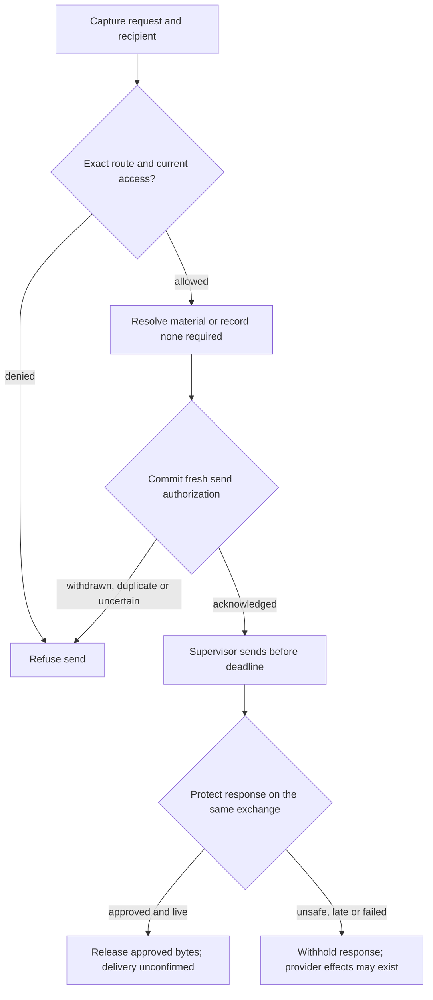

# Protected credential request flow

## Overview

An Agent process requests repository metadata; its authenticated supervisor captures
the request and response connection. OpenClaw Control Plane (OCC) decides credential
access, request sending and response release. The bundled legacy supervisor
cannot enforce this exchange. See the [release cutoff](../reference/credential-sources/protected-inference.md)
and [Credential Proxy threat model](../reference/security/credential-proxy.md).

## Entry Points

- Trigger: the supervisor opens `HttpInstallationExchange.Exchange` over authenticated TLS for one request
  (`apps/controller/src/drivers/egress-proxy/openshell-authority.ts:createOpenShellEgressAuthority`).
- Assumptions: an admitted revision plan, a current verified loaded-enforcement receipt,
  and source `operate` permission for the running Agent's service principal.

## Flow

A dedicated Agent's prepared `github-app-metadata` source targets
repository ID `12345`, name `acme/widgets`. Its process requests
`GET /repos/acme/widgets` at the admitted origin with an empty body.

1. **Classify the request.** The GitHub adapter checks method, origin, path, headers
   and body against the route; a second repository or `POST /repos/acme/widgets/pulls`
   fails before credential access.
2. **Authorize access.** OCC checks installation, execution, binding, withdrawal and
   the Agent's current `credential_source:operate`. The resolver selects a committed,
   usable token; only the trusted sender receives its injection header.
3. **Authorize send.** OCC rechecks authority and material on the same exchange.
   Withdrawal after resolution gives no permit; an acknowledged permit authorizes
   this exact request within its deadline.
4. **Release repository identity.** The sender holds GitHub's complete response.
   The adapter requires `200` JSON up to 64 KiB, the admitted numeric ID
   and matching repository name (ASCII case may differ). It returns
   `{"id":12345,"full_name":"acme/widgets"}` in admitted spelling with
   `Content-Type: application/json` and `Cache-Control: no-store`. Mismatches
   withhold responses; other upstream fields and headers stay outside the workload.

Credential-free metadata follows these rules, records `no_material_required`
and adds no credential header.
[GitHub metadata adapter](https://github.com/openclaw/openclaw-enterprise/blob/e573b7de03bafa2e84ea072d8c10cef7320575d4/apps/controller/src/drivers/egress-proxy/github-metadata.ts)

Installed enforcement requires transport, provider and workload observation.

## Execution Trace

### Workspace PAT qualification boundary

`apps/controller/src/composition/driver-packages.ts:createExternalProtectedDriver` and
bundled registration share the PAT verifier. `openShellEgressConfiguration`
checks five routes for both. Each caller or ancestor must match the packaged Codex
executable and open its own authorized response channel. The workspace-only profile
refuses altered routes, missing registration and repository bindings.

`packages/occ/src/index.ts:admitStaticEgressSource` authorizes Secret UID/version access.
`apps/controller/src/drivers/egress-proxy/codex-workspace-identity.ts:verifySource`
uses operator trust for HTTPS whoami; invalid TLS, redirects, ambiguous JSON and FedRAMP
identities refuse. `egress.verifiedIdentity` records bearer-free identity and material
evidence. Admission and release require current evidence; unbound updates reverify;
bound replacements need separate proof.

`packages/occ/src/index.ts:checkEgressUseIn` verifies the workspace grant before lookup
and send. Identity and discovery bind workspace/backend; ChatGPT requests bind account
headers; catalogs retain the admitted model. Bodyless, queryless policy GET
requires both lists; two empty lists mean no policy. The client enforces unchanged
fragments. Responses over 64 KiB, ambiguous JSON/TOML or reflected credentials in decoded
keys/strings refuse (32 levels, 4,096 nodes). Generation permits generic and managed developer
instructions, empty MCP attribution and bounded reasoning efforts.

`packages/occ/src/index.ts:credentialSourceHarnessAuthSnapshot` records either
`credentialProxyId` with Namespace, source, provider generation, sender and resolver, or
`credentialGatewayId`. Save checks model and workspace authority;
`packages/occ/src/state/platform-state.ts:validHarnessAuthSnapshot` and SQL
`harness_auth_is_valid` enforce exclusive ownership. The worker reloads the ready source;
Compute checks `packages/contracts/src/harness-auth.ts:proxyHarnessAuthProvider` against
the paired Proxy before using its nonsecret marker. Changed, absent or ambiguous ownership
blocks restoration and dispatch.

### 1. Admit source and install the revision plan

OCC checks source and Secret permissions at admission; existing sources need opt-in.
Version 3 binds Sandbox and Credential Proxy to one registered Driver. Its plan identifies
the Driver, configuration digest, execution, source generation, grant and routes.
Empty routes deny all. The API checks registration; the worker compares the stored reference.

For credential-free metadata, `packages/occ/src/index.ts:admitProxyPlan` rejects a
Driver grant differing from the source; property order does not change the digest.
Unprotected revisions remain v2. Only the bundled Driver recognizes historical protected plans by original capability
IDs for stored release or custody settlement.

[Joint admission](joint-model-git-admission.md) requires reduction v3, one workspace
model source, one GitHub installation grant and both authenticated middleware
registrations. `apps/controller/src/drivers/compute/protected-execution-driver.ts` rechecks capabilities
and the installed recipient. The
[admission cutoff](../reference/credential-sources/protected-inference.md#execution-admission-cutoff)
distinguishes independent online Git v8 and v5/v7.

Compute and the worker recheck admission. PostgreSQL rejects unknown decisions and
mixed v2/v3 fields. Older workers refuse v3; upgrade all writers before v3 admission.

For each prepared route, `apps/controller/src/drivers/compute/kubernetes/index.ts:preparedEgressReady`
selects the current issuer, projects the admitted source and checks readiness. Compute retains
only these observation methods, without token-read or lifecycle authority. Missing or mismatched
owners block release; cold sources remain pending.

Deploy returns `409` for missing Git profiles (`REPOSITORY_GIT_PROFILE_UNSUPPORTED`),
bundled `git-write` (`REPOSITORY_GIT_SENDER_UNQUALIFIED`), unadmitted sources or
bindings, and Installation limits (`CredentialProxyAdmissionError`). The Agent's ready Gateway
Harness source may accompany Git. A Git-only Proxy refuses Proxy-owned sources
and Agents without Git at deploy and preparation.
[Protected repository Git](../reference/drivers/selection.md#select-a-protected-sender)
needs a separate worker binding and recipient proof before release.

Compute passes Proxy wiring to Sandbox provisioning. Protected sources require
admission and an exact plan source-key match. Protected workspace-token and API-key
logins use nonsecret markers without Gateway attachments or authentication environment.
Gateway-owned sources require their exact attachment.
The egress Driver compares the complete Sandbox source policy and routes with the plan.
Authenticated `LoadedPolicyObservationV1` binds source and effective policies to the
Sandbox, instance, policy version, configuration/environment revisions and capabilities.
Installation and revalidation enforce the
[V1 contract](../reference/credential-sources/protected-inference.md#loaded-enforcement),
including its exact name-only exception. Missing evidence, widening, changed fences or
legacy observations refuse. The gateway compares unknown fields; its local fingerprint
covers both hashes and full policies and is neither a supplier hash nor attestation.

Compute adds `OPENCLAW_EGRESS_ENROLLMENT_REVISION_ID` from the immutable admitted revision
only to protected provider Harness requirements. The helper checks it against the manifest
before opening its authenticated listener. Compute withholds private status revision, port,
container name and Pod UID; the provider receives the verifier, not the raw token.

The Harness awaits enrollment before its first model probe. After installation commit,
Compute requeries evidence; the Sandbox Driver checks the exact Sandbox and service and
reads the execution/plan challenge. Compute signs its fresh nonce and installation with
a control-plane-only key. The listener closes before Codex starts; restart invalidates
stale release. After 180 seconds, startup fails closed and remains held. Reconciliation
can repeat readiness exchanges, including queued active-revision work. Enrollment resolves
no material and retries no business requests. Without default Kubernetes periodic maintenance,
Harness-only restart recovery is [not automatic](../reference/credential-sources/protected-inference.md#installation-configuration).

### 2. Capture identity, operation and first authority decision

Each authenticated TLS stream carries one `HttpInstallationExchange.Exchange`. The adapter
authenticates the bearer and issues a random 32-byte challenge. Up to 1,024 openings await
signed acceptance, closure or 30 seconds. The owner rechecks the bearer and verifies the
gateway-signed `exchange_key` and supervisor's Ed25519 signature over `openshell-exchange-v1`,
a zero byte, challenge and binary opening. Request JSON cannot supply a key; bearer-only
RPCs refuse.

The adapter binds stream custody, snapshots the request before awaiting and joins signed
path and raw query verbatim. Misplaced delimiters, fragments and malformed escapes refuse.
Workspace catalog discovery requires exactly
`GET https://chatgpt.com/backend-api/codex/models?client_version=0.163.0`. Proxy bounds
bodies and headers and reserves authentication slots; OCC copies peer descriptors.
Resolution, send and response lookup require an unexpired peer; send and response also require
captured sender, Sandbox, instance, exchange, installation and optional peer key.
Changed keys refuse; bearers and handles cannot transfer custody. Closure cancels;
cancellation or expiry releases material while pending policy or receipt work retains its slot.
No pipelining.

`packages/occ/src/credential-proxy.ts:resolve` assigns the verified Sandbox's slot share,
maps installation state and classifies one route. Before capture or policy I/O it reserves
a UUIDv7 request ID with a 30-second creation-based replay horizon.
[Slots and IDs are bounded](../reference/drivers/credential-proxy.md#request-time-capacity);
unsupported or ambiguous operations refuse before reservation.

At the authenticated supervisor hello, supplier enrollment starts. The supplier keeps its
private key outside the Agent and pins the downstream reply channel before queueing; the
complete path remains unqualified. `openshell.supervisor-middleware.installation-exchange.v1`
is required; older executable-restricted grants cannot acquire this profile.

Each check uses a fresh platform transaction, refusing enclosing transactions to avoid
IAM snapshot reuse, and verifies Namespace/Agent state, admitted revision, installation,
source generation, withdrawal and exact Agent source permission. `credentialNamespace`
supplies runtime placement; IAM and audit retain logical Namespace identity. The Driver
rechecks policy-status evidence against the fence; replacement, missing evidence or
changed configuration refuses. Denials record phase/request attribution without material.

### 3. Resolve versioned material and authorize its sole send

The Secret Driver verifies ownership and authoritative UID/resourceVersion. Static and
prepared GitHub reads carry `{ signal, deadlineAt }` through namespace checks, GET, retries
and children. Dispatch checks the earliest deadline; invalid deadlines refuse and timeouts
cannot extend them. GitHub acquisition, transport and injection require 1–16,384 nonspace
printable ASCII bytes; this does not authenticate them.

`apps/controller/src/drivers/repo/github/credentials/prepared-lifecycle.ts:readWarm`
pins the committed attempt, material version and earliest material expiry or signed
deadline. After `clock_timestamp()` checks, the store projects only eligible ciphertext and
rechecks cancellation and expiry before decryption; the outer reader rechecks identity
and expiry. Replaced or expired selections return `not_ready` unless the signed deadline
elapsed. Projected bytes cannot be recalled; background custody permits rotation and
cleanup. The supervisor receives request-scoped headers, an opaque handle and nonsecret evidence.

`packages/occ/src/state/prepared-github-state.ts:postgresPreparedGitHubProof` checks
current metadata, issuer/trust and exact evidence in the platform transaction without
another checkout, ciphertext or caller SQL. Timeouts honor tighter caller limits. Success
restores settings before cancellation/expiry checks; errors require owner rollback. OCC
checks withdrawal, rejection and binding there.

Same-stream authorization echoes deadline, evidence and injection digest. Handle reservation
precedes `packages/occ/src/egress-send-receipts.ts:EgressSendReceipts.begin`: possible
dispatch commits before permission, keyed by sender Ref, instance, request/use and attempt,
bound to store-qualified material and deadline. Duplicate, failed or unknown commits refuse,
including after restart.

Sender and OCC bind Sandbox, instance, configuration, peer key, policy hash, authority and
plan; Git has separate recipient evidence. After fresh identity/policy/material/rejection
checks, `EgressSendReceipts.authorize` commits execution, installation fence, exchange,
custody, request/injection digests, authorization time and send deadline: at most one second,
capped by request/material/identity expiry.

Before permission, the registry rechecks cancellation, ownership and persisted
deadline. Lost acknowledgment, handle or deadline yields no permit; restart cannot
reauthorize. Revocation can race an authorized send. An origin write with a lost reply
may have taken effect and must not be retried.

### 4. Protect response and finish

`packages/occ/src/credential-proxy.ts:protectResponse` binds the complete response to its peer,
request and exchange, removes unlisted headers and withholds bytes until approval. The request
deadline bounds the first byte. On progress, `renewResponse` checks policy at most once every
15 seconds, including outages. Unavailability preserves the deadline; denial cuts the
stream. Recovery can renew before expiry. A shorter authenticated peer lifetime caps leases
and held responses despite later progress.
The [response policy](../reference/credential-sources/protected-inference.md#static-source-and-response-policy)
limits: five minutes idle, fifteen minutes total, 4 MiB and 16,384 events.

For Responses, check SDK output-part snapshots, joined assistant text and Codex's
completed and streamed Plan views. Reject ambiguous order or indexes. Inspect function
arguments as bounded JSON without recursively decoding strings. The
[supported profile](../reference/credential-sources/protected-inference.md#static-source-and-response-policy)
preserves safe bytes; the origin already received the credential.

Only this exchange can claim the response. `EgressSendReceipts.observe` atomically records
the decision and any exact rejection fence without bodies, headers, credentials or
handles. Failure withholds bytes; success rechecks cancellation and deadline.

Structured OpenAI `invalid_api_key`, unlike a bare 401, can establish rejection. At its
next check, the prepared owner excludes that version. Concurrent owners coalesce replacement;
uncertain issuance blocks it; late feedback cannot invalidate the successor. GitHub metadata
has no positive rejection classifier.

Erase material after response handling or at deadline. Only refusals before permission
can settle as undispatched. After possible permission, inspect the exact attempt without
retrying; returned bytes do not prove delivery.

### 5. Configure the regular Harness caller

Before credential access, the provider normalizes the nonsecret endpoint and classifies
requests. `apps/controller/src/drivers/compute/plugin-runtime.ts:codexToml` keeps
local tools and ordinary Harness components, disables provider tools, and uses HTTP
Responses without WebSockets or automatic retries. The manifest preserves this profile.
The `--ignore-user-config` probe sets request and stream retries to zero and never
repeats a timed-out protected probe.

### 6. Reduce the live credential policy

OCC commits withdrawal before provider action. Under the Agent lock,
`packages/occ/src/credential-policy-reduction.ts:reduceCredentialPolicy` records an
exact source or repository compare-and-reduce in `credential_delivery_reductions`.
Concurrent reductions wait; recovery observes the original operation without another
capability probe or mutation. Material-delivery receipts have separate evidence shapes
in the same store.

[Joint reduction v3](joint-model-git-admission.md#4-withdraw-one-grant) retains the
other grant and observes each reserved effect before settlement or use.

Independent observation supplies current policy without changing the installation receipt.
For model-source withdrawal,
`apps/controller/src/drivers/repo/github/credentials/prepared-repository-git.ts:recipients`
checks the exact confirmed installation and preserves the Git delivery fence; the
[joint flow](joint-model-git-admission.md#4-withdraw-one-grant) specifies recipient checks
and settlement. Fresh Git requests require current Token Service
approval, session, deadline and material-version checks.

Missing identity, stale operations, incomplete configuration or wrong evidence keep
withdrawal pending; an identified replacement recipient can require retirement. Remaining
grants stay unchanged; the last route's removal leaves deny-all. Settlement cannot reopen
withdrawn authorization; the Driver blocks stale installation from restoring routes.
Reference-peer proof does not qualify released Sandboxes or continued model execution.

### 7. Retain installation custody

`packages/occ/src/state/credential-deliveries.ts:CredentialDeliveries` requires independent
confirmation for registered recipients and the original reserving worker for snapshots,
including bootstrap. Reservation advances the operation fence; confirmation grants no
request authority. PostgreSQL rejects a second binding for the same revision and target.
Its hash index rechecks JSONB equality even when policy exceeds a B-tree entry.

`apps/controller/src/drivers/egress-proxy/openshell-git-runtime.ts:reconcile`
cancels only definitely unsent writes. Uncertain writes stay pending and blocked.
`release` drops closed routes whose Sandbox is gone; refusal stays.
See [restart behavior](../reference/repository-credentials/protected-openshell-git.md#route-state-restarts-and-recovery).

Creation requires the exact live owner; deletion retains custody but prevents live use.
`apps/controller/src/drivers/egress-proxy/openshell-git-route-store.ts:confirmDetached`
checks the retained fence, recipient, material, policy and request without another apply.

## Debugging and Verification

Use the [testing guide](../testing/static-egress.md) to qualify model execution,
response custody and NetworkPolicy with the selected chart and image; observe
origin and caller independently.

## Related docs

- [Credential Proxy overview](../design/credential-proxy.md)
- [Credential sources and bindings](../reference/credential-sources.md#bind-a-source-to-an-agent)
- [Joint model and Git admission](joint-model-git-admission.md)
- [Credential source lifecycle](credential-source-lifecycle.md)
- [Protected static inference](../reference/credential-sources/protected-inference.md)
- [OpenShell Sandbox provisioning](openshell-sandbox-provisioning.md)
- [RFC 0023 proposal](../../specs/rfcs/0023-egress-proxy-credential-lifecycle/index.md)

## Manual Notes

None.

## Changelog

- 2026-10-27 13:15: Document Compute readiness capability boundary. (authoring-run/a9e60d49-8da5-441f-b0f3-25d6ce5681de - f6396abd5698efacabfeb150ef6cd38cdef6e814)

- 2026-10-27 10:59: Document stream renewal retry cadence. (authoring-run/1655d259-04e8-4e20-a37d-072ccfcaf037 - 0418ef3a2c116b73f025281395d92477daf665d2)

- 2026-10-26 21:57: Trace protected repository metadata access, dispatch and response checks. (authoring-run/8a58b4b6-9e85-4789-b9e8-8e820a7c6d7c - e573b7de03bafa2e84ea072d8c10cef7320575d4)

- 2026-10-25 03:08: Distinguish Git-only refusal from joint model/Git admission. (authoring-run/14e1a79b-96d6-4e9a-ab22-44a783a1ad50 - 66b50c98b72bd23eeba9e007e8c3d2cdaec81446)

- 2026-10-24 19:46: Trace bundled workspace registration and per-request custody. (authoring-run/1303a689-0f82-440b-a43f-1b2869851779 - 96dfb6a485b6632a1feeffc2bd53f10c74152cd1)

- 2026-10-24 12:54: Document large registered delivery policies' exact target matching. (authoring-run/ded21924-0d2a-4f83-9299-1926d35ceb01 - 692c5e6e8afeebf831a1c9feb1917f0f2aafc3b9)

- 2026-10-24 11:09: Preserve signed catalog queries. (authoring-run/adac7683-9281-441d-a539-a422c7b66bce - b9ff83995cc1b2dc03a6de4c8172cc20167c51c9)

- 2026-10-24 07:10: Bind workspace credentials to admitted sender; retain Git access after confirmed model withdrawal. (authoring-run/f0f87daa-3c51-4559-b105-23c8c3d6084b - 5ad11ff5e27b16d83e0560d8ca35f1233d48d2af)

- 2026-10-24: Name Git-only Proxy refusals. (fix-2360)

- 2026-10-23 20:14: Preserve exact Proxy ownership through Harness admission, persistence and dispatch. (authoring-run/e93bd191-284b-4701-929c-85a5d446c694 - ef61a85efa8f9a819986a072efb50ca91deca607)

- 2026-10-23 19:40: Record workspace PAT policy and remaining qualification gates. (authoring-run/46d0701b-da16-43b1-8c7e-2510a4dd1475 - c250d521a59cb7d1e8be85bf02a112062e5ab259)

- 2026-10-22 23:30: Refuse unqualified OpenShell Git senders early. (fix-2199 - b4a8157be)

- 2026-10-22 05:35: Pin peer identity and original authentication expiry throughout exchanges. (authoring-run/009b70d4-eb48-4ea6-97f0-25b0395d1e1a - d87db85f74052e9ff819920acd820880e7a6a8af)

- 2026-10-22 05:21: Preserve metadata grant digest for equivalent Driver output. (authoring-run/aabacbf5-998a-479d-8903-9f891cd69066 - 1435acf226b887a2cd85b7515b302914605beaef)

- 2026-10-22 05:16: Bind exchange identity independently of Git delivery evidence. (authoring-run/601b0e1c-ade5-431c-aa48-1c6775df430a - d5c0a95fc970e8a63f40746ad2e55ac5216580e0)

- 2026-10-22: Streamline flow; preserve authority and recovery boundaries.

[Protected credential request documentation history](credential-source-egress/history.md) preserves the older dated entries.
