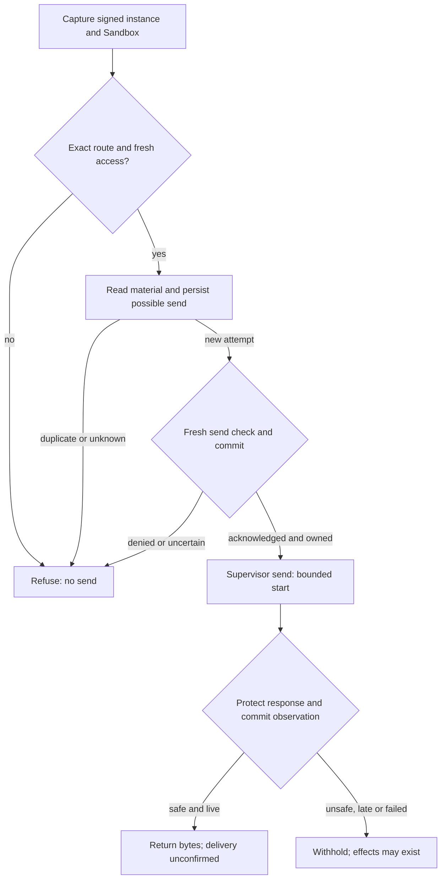

# Protected credential request flow

## Overview

OCC checks current identity and IAM policy, selects a Secret version and protects responses.
The selected Driver's authenticated OpenShell supervisor obtains send permission and
injects credentials outside the Agent. Requests cannot choose another Driver.

Kubernetes Compute signs a fresh installation challenge before release. The
[release cutoff and supported configuration](../reference/credential-sources/protected-inference.md)
exclude the bundled legacy supervisor.

[Protected repository Git](../reference/drivers/selection.md#select-a-protected-sender)
uses a separate worker binding for recipient observation, committed material and
request authorization; release requires recipient proof. The Token Service owns
issuance, renewal and retirement.

## Entry Points

- Trigger: an installed supervisor sends `HttpCredentialAccess.Resolve`, followed
  by `AuthorizeSend` and `HttpResponsePreReturn.Evaluate` over authenticated TLS
  (`apps/controller/src/drivers/egress-proxy/openshell-authority.ts:createOpenShellEgressAuthority`).
- Assumptions: source admission and Agent deployment produced an exact plan; a current
  verified loaded-enforcement receipt permits installation; the running Agent's service
  principal holds exact source `operate` permission.

## Flow

Wire fixtures do not qualify deployed supervisors or no-bypass networking.

## Execution Trace

### 1. Admit source and install the revision plan

Source and Secret authorization precede live/static admission; existing sources require opt-in.

Version 3 binds Sandbox and Credential Proxy to one registered Driver. The plan records
its ID, implementation, configuration digest, execution, source generation, grant and
routes; empty routes deny all. The API checks registration and workers compare its
durable reference. Sandbox enforcement needs separate evidence.

For credential-free metadata, `packages/occ/src/index.ts:admitProxyPlan` rejects a Driver grant that differs from the source.
Equivalent grants produce the same digest regardless of property order.

Unprotected revisions remain v2. Only the bundled Driver recognizes historical protected
plans by original capability IDs for stored release or custody settlement.

Compute validates admission for OCC and rechecks it with the worker before launch.
PostgreSQL rejects unknown decisions and mixed v2/v3 fields. Older workers refuse v3;
upgrade all writers before admitting it. Qualify release and installed deny-all behavior.

Compute passes Credential Proxy wiring to Sandbox provisioning. Protected sources
require admission, API-key login, an exact plan source-key match and no Gateway
attachment; they receive no Gateway authentication environment. Gateway-owned sources
require their exact attachment. The egress Driver compares the Sandbox's complete
prepared source policy and protected routes with the plan. Authenticated
`LoadedPolicyObservationV1` binds source and effective policies to the Sandbox,
instance, policy version, configuration/environment revisions and capabilities.
Installation and revalidation enforce the
[V1 contract](../reference/credential-sources/protected-inference.md#loaded-enforcement),
including its exact name-only rule exception. Missing evidence, widening or a changed
fence refuses; legacy observations cannot substitute. The gateway compares unknown
fields too. The local fingerprint covers both hashes and full policies, but is neither
a canonical supplier hash nor supervisor attestation.

Compute adds `OPENCLAW_EGRESS_ENROLLMENT_REVISION_ID` from the immutable admitted
revision only to protected provider Harness requirements. Before opening its authenticated
listener on the existing service port, the generated helper requires the literal to equal
the manifest's enrollment execution revision; missing or mismatched values refuse.
Compute suppresses its private status revision, port, container name and Pod UID; the
provider receives the transport verifier, not the raw transport token.

Before the first model probe, the Harness waits on this listener. Compute awaits the
installation commit, requeries current evidence and calls the selected Sandbox Driver,
which checks the exact Sandbox and service and reads the execution/plan challenge.
Compute signs its fresh process nonce and current installation with a control-plane-only
key. The listener closes before Codex starts. Restart creates a new challenge; stale
release cannot unlock the replacement. After 180 seconds, startup fails closed and remains held.
Reconciliation may repeat readiness exchanges, but enrollment neither
resolves material nor retries business requests. The worker's active-revision branch can
repeat this sequence when work is queued. Default Kubernetes has no periodic maintenance
interval, so Harness-only restart recovery is not automatic;
see the [supported recovery boundary](../reference/credential-sources/protected-inference.md#installation-configuration).

### 2. Capture identity, operation and first authority decision

Each TLS stream carries one `HttpInstallationExchange.Exchange`. After bearer authentication,
the adapter issues a random 32-byte challenge. Up to 1,024 openings await proof until signed
acceptance, closure or a 30-second deadline. The owner rechecks the bearer and verifies both
the gateway-signed `exchange_key` and the supervisor’s Ed25519 signature over
`openshell-exchange-v1`, a zero byte, the challenge and the binary opening request.
Request JSON cannot supply a key; bearer-only RPCs refuse.

Before awaiting work, the adapter copies the request and binds a private capability to the stream.
Credential Proxy bounds body size and capacity, reserves a slot and snapshots headers and body.
The stream owns the response. OCC copies each authenticated peer descriptor before
awaiting more work. Send and response require the captured sender, Sandbox,
instance, exchange, installation and optional peer key. Adding, changing or removing the key
refuses; peer expiry must be valid and future at resolution, send and response lookup. A bearer
or handle cannot transfer custody. Closing the stream cancels it. Cancellation or expiry
releases material; pending policy or receipt work retains its slot until settled. No pipelining.

`packages/occ/src/credential-proxy.ts:resolve` maps the peer to persisted installation state and classifies one exact
route through its registered provider. Before asynchronous authorization, it reserves
the UUIDv7 request ID; its creation time fixes the 30-second replay horizon. Pending
resolution and replay state are bounded; unsupported or ambiguous operations refuse
before Secret access.

Supplier enrollment starts at its authenticated current supervisor hello, not the first
exchange. The supplier must keep the corresponding private key outside the Agent and
pin its actual downstream reply sink before queueing. The complete path is not yet
qualified. The Driver requires
`openshell.supervisor-middleware.installation-exchange.v1`; old counterparts
cannot acquire this profile through an existing executable-restricted grant.

Each check requires a fresh platform transaction; enclosing transactions refuse to
prevent IAM snapshot reuse. It verifies current Namespace/Agent state, admitted revision,
installation, source generation, withdrawal and exact Agent source permission.
`credentialNamespace` supplies Compute's runtime placement to the Driver; IAM and audit
retain logical Namespace identity. The Driver requeries policy-status evidence against
the stored fence. Replacement, missing evidence or changed configuration refuses even
if the saved installation was valid. Denials record phase and internal request attribution
without material.

### 3. Resolve versioned material and authorize its sole send

The selected Secret Driver verifies ownership and reads UID/resourceVersion from the authoritative
API. Static and prepared GitHub read ports share one `{ signal, deadlineAt }` lifetime.
The Kubernetes Secret reader carries it through namespace verification, GET and retries;
child scopes inherit cancellation and the earliest deadline. Each HTTP dispatch checks
expiry independently of timers. Invalid deadlines fail closed; per-attempt timeouts cannot
extend the lifetime.
GitHub acquisition validation, transport and metadata injection share a wire check:
1–16,384 bytes of nonspace printable ASCII, not authentication.

`apps/controller/src/drivers/repo/github/credentials/prepared-lifecycle.ts:readWarm`
pins the committed attempt ID, material version and earlier of material expiry or signed
deadline. The store projects ciphertext only for that eligible row and issuer, checks
`clock_timestamp()` at projection and rechecks expiry and cancellation immediately before
decryption. The outer reader verifies identity and expiry. Expired or replaced selections
return `not_ready` unless the signed deadline has elapsed; projected bytes cannot be recalled.
Separate background custody permits rotation and cleanup of material ineligible for requests.
The registry returns credential headers, an opaque handle and nonsecret evidence to the
authenticated supervisor; material remains request-scoped.

Before send, `packages/occ/src/state/prepared-github-state.ts:postgresPreparedGitHubProof`
queries current material metadata in the active platform transaction, without another
checkout. Lifecycle issuer/trust identity, shared metadata predicates and exact evidence
fence stale selections. The port exposes neither ciphertext nor caller-supplied SQL.
Statement and lock timeouts respect tighter caller limits. Successful SQL restores the
original settings in the same unit before rechecking cancellation and absolute expiry;
SQL errors leave rollback to the transaction owner. OCC checks withdrawal, rejection
and binding in that unit.

The same-stream authorization frame must echo the original deadline, evidence and
injection digest. The registry reserves the handle, then
`packages/occ/src/egress-send-receipts.ts:EgressSendReceipts.begin` commits possible
dispatch before permission. Its key includes authenticated sender Ref, instance,
stable request/use ID and attempt ID; its binding includes exact store-qualified
material and original deadline. An existing attempt, failed write or unknown commit
refuses permission, including after an authority restart.

The sender and OCC bind the same Sandbox, instance, configuration, peer key, policy hash,
authority scope and plan to the exchange. The Git recipient has its own delivery evidence.

After reservation, OCC rechecks identity, policy, material and the rejection fence.
`EgressSendReceipts.authorize` commits the execution, installation fence, exchange,
response custody, request and injection digests, authorization time and send-start deadline.
The deadline is at most one second away and cannot outlive the request, material or identity.

Before returning permission, the registry rechecks cancellation, ownership and the persisted
deadline. A lost acknowledgment, handle or deadline yields no permit. Restart cannot
reauthorize the attempt. Revocation may race an authorized send; an origin write with a
lost reply remains a possible effect and must not be retried.

### 4. Protect response and finish

`packages/occ/src/credential-proxy.ts:protectResponse` binds the complete response to its peer, request and exchange, removes
unlisted headers and releases no bytes before the decision. The request deadline bounds
the first byte. On progress, `renewResponse` rechecks policy at most every 15 seconds;
withdrawal cuts the stream within that window, and an unavailable authority cannot extend
the lease. A shorter authenticated peer lifetime caps cached leases and held responses. Later progress
cannot extend that bound.
Limits: five minutes idle, fifteen minutes total, 4 MiB and 16,384 events.

For Responses, check client-assembled SDK output-part snapshots, assistant text across
parts, items or deltas, and Codex's completed and streamed Plan views. Reject ambiguous
order or indexes. Inspect function arguments as bounded JSON without recursively
decoding strings. The
[supported profile](../reference/credential-sources/protected-inference.md#static-source-and-response-policy)
preserves safe response bytes. The origin has already received the credential.

Only this exchange can claim the response. `EgressSendReceipts.observe` atomically records
the decision and any exact rejection fence without bodies, headers, credentials or handles.
Failure withholds bytes; success still requires checking cancellation and deadline.

Structured OpenAI `invalid_api_key` can establish rejection; a bare 401 cannot. At
its next scheduled check, the prepared owner excludes a positively rejected version.
Concurrent owners coalesce replacement; uncertain issuance blocks it; late feedback
cannot invalidate its successor. GitHub metadata has no positive rejection classifier.

Erase material after response handling or at deadline. Only a refusal before
permission can settle as undispatched. After possible permission, inspect the
exact attempt without retrying; returning bytes does not prove delivery.

### 5. Configure the regular Harness caller

Before credential access, the provider normalizes the nonsecret endpoint and classifies
the actual request. `apps/controller/src/drivers/compute/plugin-runtime.ts:codexToml` keeps local tools and ordinary Harness components,
disables provider tools, and uses HTTP Responses without WebSockets or automatic retries.
The runtime manifest preserves this profile. Its `--ignore-user-config` probe sets request
and stream retries to zero and never repeats a timed-out protected probe.

### 6. Reduce the live credential policy

OCC commits withdrawal before provider action. Under the Agent lock,
`packages/occ/src/credential-policy-reduction.ts:reduceCredentialPolicy` records an
exact compare-and-reduce request in `credential_delivery_reductions` for a source or
repository binding. Concurrent reductions wait; recovery observes the recorded operation
without another capability probe or mutation. The reductions owner manages these and
material-delivery reduction receipts; their evidence shapes are separately constrained
in the same store.

Admission selects reduction v2 only for exact-dispatch Git. Online and observed-hook
Git keep their v5 and v6 semantics. Ordinary v3 uses reduction v1 only when the Driver
explicitly declares it; v2 alone does not authorize v1 or multiple static sources.

Independent observation of the exact operation, stable recipient and retained plan
supplies the current policy view; the original installation receipt remains unchanged.
Missing identity, stale operation, incomplete configuration or wrong policy evidence
keeps withdrawal pending; a positively identified replacement recipient can require
retirement. Remaining grants stay unchanged, and the last route leaves deny-all. Receipt
settlement cannot reopen withdrawn authorization, and the Driver prevents stale
installation from restoring routes. Reference-peer proof does not qualify released
Sandboxes or continued model execution.

### 7. Retain installation custody

`packages/occ/src/state/credential-deliveries.ts:CredentialDeliveries` fixes the
settlement policy: independent confirmation for registered recipients; the original
reserving worker for snapshots, including bootstrap. Reservations advance the
operation fence. Confirmation grants no request authority.

`apps/controller/src/drivers/egress-proxy/openshell-git-runtime.ts:reconcile`
cancels only definitely unsent writes. Uncertain writes stay pending and blocked.
See [restart behavior](../reference/repository-credentials/protected-openshell-git.md#route-state-restarts-and-recovery).

Creation requires the exact live owner. Deletion retains custody but prevents live
use. `apps/controller/src/drivers/egress-proxy/openshell-git-route-store.ts:confirmDetached`
checks the retained fence, recipient, material, policy and request without another apply.

## Debugging and Verification

Follow the [testing guide](../testing/static-egress.md). Qualify model execution,
response custody and NetworkPolicy with the selected chart and image. Observe
the origin and caller independently.

## Related docs

- [Credential source lifecycle](credential-source-lifecycle.md)
- [Protected static inference](../reference/credential-sources/protected-inference.md)
- [OpenShell Sandbox provisioning](openshell-sandbox-provisioning.md)
- [RFC 0023 proposal](../../specs/rfcs/0023-egress-proxy-credential-lifecycle/index.md)

## Manual Notes

None.

## Changelog

- 2026-10-22 05:35: Pin peer identity and original authentication expiry throughout the exchange in the accompanying correction. (authoring-run/009b70d4-eb48-4ea6-97f0-25b0395d1e1a - d87db85f74052e9ff819920acd820880e7a6a8af)

- 2026-10-22 05:21: Preserve the metadata grant digest for equivalent Driver output. (authoring-run/aabacbf5-998a-479d-8903-9f891cd69066 - 1435acf226b887a2cd85b7515b302914605beaef)

- 2026-10-22 05:16: Bind exchange identity independently of Git delivery evidence. (authoring-run/601b0e1c-ade5-431c-aa48-1c6775df430a - d5c0a95fc970e8a63f40746ad2e55ac5216580e0)

- 2026-10-22: Streamline flow; preserve authority and recovery boundaries.

- 2026-10-22 04:16: Enforce delivery settlement policy, operation fences and retained detach confirmation in the accompanying changes. (authoring-run/bcd1284f-0d04-4fc7-92e1-b4d5ac1eeb7f - 1544403a30a747898deaf3cf0935094b7812390d)

- 2026-10-22 01:51: Describe final withdrawal and delivery custody in the accompanying schema consolidation. (authoring-run/c692ffd7-9ade-4cb3-80b7-cd02340e0537 - fe6b0002a5bf41e6e418df9848337b285ce53199)

- 2026-10-21 23:40: Describe versioned policy reduction, durable operation recovery and the reference-peer proof boundary in the accompanying change. (authoring-run/3e4e8e77-728c-435a-90e9-fe6c9758551c - d8a5a9c77963836fbe54f1dc28f2f8a0c01c5622)

- 2026-10-21 22:39: Explain conditional recovery of rejected prepared material and its classification limit in the accompanying change. (authoring-run/8ffbb140-b3c1-48de-ac47-8e2450bae002 - df297cd59e8de130e9eb0599e67f47fa6d85079e)

- 2026-10-16 22:49: Preserve Credential Proxy ownership when deriving Harness authentication environment. (authoring-run/bf50675b-2b74-4724-aeaf-8daecd2a5a29 - 6e302a4851b20191990bcb83d20b045a1462257a)

- 2026-10-16 02:06: Protect independent assistant items and bounded seeded runs, including citation and plan-mode projections. (authoring-run/68ecede6-d2bc-4d49-ae2c-c04150ccb307 - 3ed0e1cbd553b753e3f7d97b720cb7a43b6b5109)

- 2026-10-16 02:04: Bind prepared currentness proof to the active platform transaction in the accompanying implementation. (authoring-run/61a459b9-beed-4357-a96a-8483ab7cc2b9 - 3ed0e1cbd553b753e3f7d97b720cb7a43b6b5109)

- 2026-10-16 01:00: Protect incremental Responses SDK text snapshots and reject ambiguous appended indexes. (authoring-run/92d1c2e7-e68d-4684-b8d1-8bfa0ed99a09 - ed532ec5496e87da37c086cf71949f12a17250c9)

- 2026-10-16 00:27: Bound openings before proof and keep canceled operations charged until pending work settles. (authoring-run/3c418cc2-68fe-4c9a-a34e-9ecb83372b88 - 8df404d0635fa00e8d452cd0b846be3c68d3c4b0)

- 2026-10-15 20:14: Pin request ciphertext access to selected material and its expiry in the accompanying implementation. (authoring-run/a87e5b92-3e56-47e2-8112-82aa89ca28c4 - ab675985805a9d4a855f441a3ba91e836d42a532)

- 2026-10-15 19:23: Unify the read lifetime and exchange owner; detach one request snapshot before verification in the accompanying implementation. (authoring-run/b34da698-7e69-4c1d-a28c-238ed9c7d1d4 - adddcf2c0ce2429fb8fc7b9e503b01a74affdec8)

- 2026-10-15 04:08: Add acknowledged exact dispatch and the pending trusted acceptance integration gate. (authoring-run/77dbaecc-5f2b-4d7c-bd72-178b481d4feb - 0647e70303cd583ed64286f0ae11c1fa1896ac6a)
- 2026-10-15 04:09: Bind capture and response to a possession-authenticated exchange; refuse legacy peers and record the remaining supplier gate. (authoring-run/4ac4c430-12aa-4529-a02a-e1f26041eab4 - 0647e70303cd583ed64286f0ae11c1fa1896ac6a)
- 2026-10-15 04:06: Record the accompanying v2 admission cutoff and refusal before Compute release. (authoring-run/f0b2d2f6-37a8-4c41-b2e8-6c0c61ed8d5a - 0647e70303cd583ed64286f0ae11c1fa1896ac6a)

- 2026-10-14 21:54: Join durable sender receipts to the authority, separate response observations from supplier proof, and fence positive rejection atomically. (authoring-run/c11e8dcb-9e87-4682-b47e-e8640a65706d - fc20eb0174eaf8ae9d4ccb327ec65236c49ef4fb)

- 2026-10-14 21:15: Bind protected provider enrollment to a dedicated admitted-revision literal in the accompanying source fix. (authoring-run/a26c0140-0882-40ec-949d-c5fc6eecd0da - 765f1ef22aeba3e98c58a739700c9a0ffba14af4)

- 2026-10-14 14:11: Consume current instance-fenced evidence, finite replay identity and selected Responses HTTP/SSE profile. (01a13a97-c578-77a2-81a7-7366f1380110 - e42cb1674fadaf14ba3d61a4164d1ad3fde9935c)

- 2026-10-14 12:34: Document accompanying static egress implementation and its qualification limits. (authoring-run/fe204745-17c9-4662-82e0-e194d7c187cb - dc5648b67d2618cc43ef07562298e986a94674e7)
