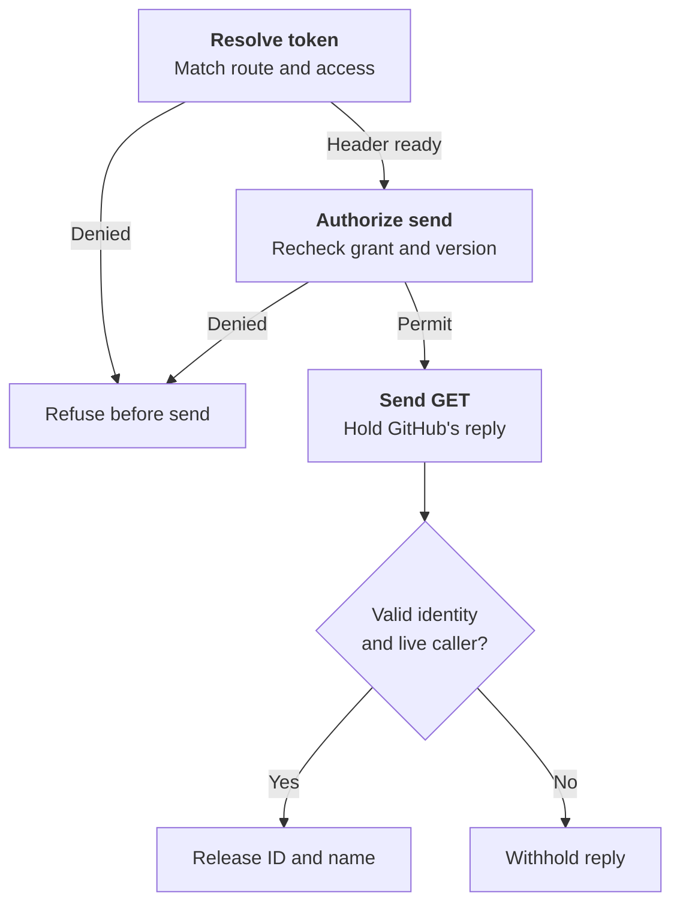

# Protected credential request flow

## Overview

OpenClaw Control Plane (OCC) authorizes the supervisor to release GitHub identity replies. See the [legacy supervisor cutoff](../reference/credential-sources/protected-inference.md#execution-admission-cutoff)
and [threat model](../reference/security/credential-proxy.md).

## Entry Points

- Deployment establishes a [source route](../reference/credential-sources.md#bind-a-source-to-an-agent);
  current enforcement evidence is required.
- The supervisor opens
  `HttpInstallationExchange.Exchange`, for credential resolution, send
  authorization and response release
  (`apps/controller/src/drivers/egress-proxy/openshell-authority.ts:createOpenShellEgressAuthority`).

## Flow

### Follow the metadata GET

For an admitted `github-app-metadata` route to repository `12345`,
`acme/widgets`, at `https://api.github.com`:

1. **Match.** The supervisor binds the bodyless `GET /repos/acme/widgets` reply
   to its exchange. The adapter checks method, URL, headers and body against the route.
2. **Resolve.** OCC authorizes the Agent and registered grant. The Token Service
   starts or joins issuance; OCC rechecks authority and token version before returning the header.
3. **Permit.** OCC rechecks the same-stream binding. Sending must start by the permit deadline.
4. **Release.** The adapter requires complete `200` JSON, at most 64 KiB, matching
   the admitted ID and name (ASCII case may differ). The caller receives `200`,
   `Content-Type: application/json`, `Cache-Control: no-store` and only this body.

```json
{ "id": 12345, "full_name": "acme/widgets" }
```

ID `67890` under the same name is withheld after GitHub receives the request.
The credential-free profile applies the same filters, records
`no_material_required` and sends no credential header.
[GitHub metadata adapter](https://github.com/openclaw/openclaw-enterprise/blob/0418ef3a2c116b73f025281395d92477daf665d2/apps/controller/src/drivers/egress-proxy/github-metadata.ts)



## Execution Trace

### 1. Admit source and install the revision plan

Bundled OpenShell rejects new static OpenAI use via
`InstalledDriver.assertNewStaticProviderUse`: source refusal precedes material
reads; deployment refusal precedes counterpart probes. Retained revisions keep
their provider, authorization, withdrawal and cleanup under the
[current Sandbox contract](../reference/credential-sources/protected-inference.md#bundled-openshell-admission).

OCC checks source and Secret permissions; existing sources need opt-in. Version 3
binds Sandbox and Proxy to one registered Driver.
The plan records digest, execution, source generation, grant, and routes;
empty routes deny all. `admitProxyPlan` derives routes from saved Harness settings
and source consent. `checkEgressUseIn` rechecks before delivery and send authorization.
`apps/controller/src/console/agents/detail.mts:requestedHarnessOverrides` captures
settings at submission. OCC normalizes them and checks caller and Agent grants.

For credential-free metadata, `packages/occ/src/index.ts:admitProxyPlan` rejects
a Driver grant that differs from the source. Equivalent grants have the same
digest across property orders. Unprotected revisions remain v2. Only the bundled
Driver recognizes historical protected plans by original capability IDs for stored
release or custody settlement.

Compute's `validateExecutionAdmission` requires pairing only for protected
revisions. Workers recheck before launch. PostgreSQL rejects unknown decisions
and mixed v2/v3 fields. Upgrade all writers before admitting v3.

For each route, `apps/controller/src/drivers/compute/kubernetes/index.ts:preparedEgressReady`
selects the issuer, projects the admitted source and checks readiness. Compute has
observation methods, without token-read or lifecycle authority. Missing or mismatched
owners refuse release; cold sources remain pending.

Deploy returns `409` for missing Git delivery profiles
(`REPOSITORY_GIT_PROFILE_UNSUPPORTED`), bundled `git-write`
(`REPOSITORY_GIT_SENDER_UNQUALIFIED`), unadmitted bindings, and Installation limits.
Agents with ordinary Gateway sources and no protected sources or Git bindings
need no Proxy plan. Agents with no sources retain selected Proxy admission.
`packages/occ/src/index.ts:admitProxyPlan` checks availability before saving an
empty protected plan; Kubernetes uses it for runtime-authenticated Dedicated
Codex without inference access. Preparation repeats both Git refusals.
[Protected repository Git](../reference/drivers/selection.md#select-a-protected-sender)
uses a separate worker binding and requires proof of the recipient before release.

Compute passes Credential Proxy wiring to Sandbox. Protected sources require
admission, API-key login and an exact source-key match. Only Gateway-owned sources
receive their exact Gateway attachment and authentication environment.
`apps/controller/src/drivers/egress-proxy/openshell.ts:openShellEgressConfiguration`
emits `/**` on inference routes so any verified executable in the admitted
execution can reach the model endpoint through credential middleware.
The egress Driver compares the full prepared policy against the plan, including
the explicit matcher.

Authenticated [V1 evidence](../reference/credential-sources/protected-inference.md#loaded-enforcement)
binds both policies to the Sandbox, instance, policy version, configuration and
environment revisions, and capabilities. The gateway compares unknown fields.
Installation and revalidation accept only the exact name-only rule exception.
Missing, legacy, widened or changed evidence refuses. The local comparison
fingerprint covers both policies and hashes.

Compute sets `OPENCLAW_EGRESS_ENROLLMENT_REVISION_ID` from protected Harness admission.
The helper matches the manifest before opening the authenticated listener.
The provider receives only the verifier; Compute withholds the private status
revision, port, container name and Pod UID.

The Harness waits before its first model probe. Compute awaits installation commit, rechecks evidence
and calls the Sandbox Driver. The Driver verifies the Sandbox and service and reads
the execution/plan challenge. Compute signs the fresh process nonce and current
installation with its control-plane key. The listener closes before Codex starts.
Restart invalidates the old release. After 180 seconds startup fails closed and remains held.
Reconciliation can repeat readiness checks without resolving material or retrying
business requests. Active revisions require queued work; default Kubernetes has
no periodic maintenance for [Harness-only restarts](../reference/credential-sources/protected-inference.md#installation-configuration).

During held Git enrollment, `openshell-git-runtime.ts:observeHeldPreview` logs
[curl and response failures](../reference/repository-credentials/protected-openshell-git.md#worker-log).
An unconfirmed one-shot probe blocks the route with `bootstrap_failed` before credential delivery or release.

`openshell-git-installation.ts:observeOpenShellGitInstallation` completes a model
OBSERVE per active environment for observed Git routes, including rotations.
`ObservedHookPreview.completedModelReceipt` caches completion per environment revision.
Stale or incomplete model receipts keep the route pending without changing the
original launch witness or startup acknowledgment.

### 2. Capture identity, operation and first authority decision

Each TLS `HttpInstallationExchange.Exchange` authenticates a bearer, then challenges
its supervisor with 32 random bytes. Up to 1,024 openings, 256 per Sandbox, wait
for acceptance, closure or a 30-second deadline. The owner rechecks the bearer,
gateway-signed `exchange_key` and supervisor Ed25519 signature over
`openshell-exchange-v1`, zero byte, challenge and binary opening. Request JSON
cannot supply a key; bearer-only calls refuse. Online authorization
(`apps/controller/src/drivers/egress-proxy/openshell-online-authority.ts:createAuthority`)
has the same capacity limits.

Before awaiting work, the adapter copies the request and binds a private capability
to the stream. Credential Proxy bounds body size, reserves capacity and copies
headers, body and authenticated peer. Send and response require the same sender,
Sandbox, instance, exchange, installation and optional peer key. Any key change
refuses. Peer expiry must remain valid at resolution, send and response lookup.
Bearers and handles cannot transfer custody. Closure cancels the stream; cancellation
or expiry releases material. Pending policy or receipt work retains its slot. No pipelining.

`packages/occ/src/credential-proxy.ts:resolve` assigns the verified Sandbox's share,
loads its persisted installation and pins eligible providers before classification.
Ambiguity refuses. OCC rechecks pins around provider calls and at material access,
send and response release; changes restored between checks escape detection.
Only one exact route match reserves a UUIDv7 ID before capture or policy I/O.
Creation fixes its 30-second replay horizon; [capacity is bounded](../reference/drivers/credential-proxy.md#request-time-capacity).
Unsupported or ambiguous operations refuse before reservation. `createCredentialProxy`
audits only when exactly one refused route reports, exactly once with a valid rule.
It records execution and exact request ID before capture or credential access.
Persistence failure refuses as authority-unavailable.

Enrollment must start at the authenticated supervisor hello. The supplier must keep
its private key outside the Agent and pin its actual reply sink before queueing. This path remains
unqualified. Required capability `openshell.supervisor-middleware.installation-exchange.v1`
cannot be substituted by an old executable-restricted grant.

Each check requires a fresh platform transaction; enclosing transactions refuse to
prevent IAM snapshot reuse. It verifies current Namespace/Agent state, admitted revision,
installation, source generation, withdrawal and exact Agent source permission.
`credentialNamespace` supplies Compute's runtime placement to the Driver; IAM and audit
retain logical Namespace identity. The Driver requeries policy-status evidence against
the stored fence. Replacement, missing evidence or changed configuration refuses even
if the saved installation was valid. Denials record phase and internal request attribution
without material.

### 3. Resolve versioned material and authorize its sole send

The Secret Driver verifies ownership and reads authoritative UID/resourceVersion.
Static and prepared GitHub reads share one `{ signal, deadlineAt }` lifetime through
namespace verification, GET and retries. Child scopes inherit cancellation and the earliest
deadline. Each HTTP dispatch checks expiry independently of timers. Invalid deadlines
fail closed; per-attempt timeouts cannot extend the lifetime.
GitHub acquisition validation, transport and metadata injection share a wire check:
1–16,384 bytes of nonspace printable ASCII, not authentication.

`apps/controller/src/drivers/repo/github/access/prepared-lifecycle.ts:resolve` checks source registration and token lifetime, reading ciphertext only for the selected issuer, attempt and version. Decryption rechecks deadline and cancellation. Without a timely eligible token, OCC withholds the header. Background cleanup can access retired material.

Before send, `packages/occ/src/state/prepared-github-state.ts:postgresPreparedGitHubProof`
queries current material metadata in the active platform transaction, without another
checkout. Lifecycle issuer/trust identity, shared metadata predicates and exact evidence
fence stale selections. The port exposes neither ciphertext nor caller-supplied SQL.
Statement and lock timeouts respect tighter caller limits. Successful SQL restores the
original settings in the same unit before rechecking cancellation and absolute expiry;
SQL errors leave rollback to the transaction owner. OCC checks withdrawal, rejection
and binding in that unit.

Same-stream authorization echoes the original deadline, evidence and injection digest.
The registry reserves the handle; `packages/occ/src/egress-send-receipts.ts:EgressSendReceipts.begin`
commits possible dispatch before permission. The key includes authenticated sender Ref,
instance, stable request/use ID and attempt ID; the binding includes exact store-qualified
material and original deadline. Existing attempts, failed writes or unknown commits
refuse permission, even after authority restart.

The sender and OCC bind the same Sandbox, instance, configuration, peer key, policy hash,
authority scope and plan to the exchange. The Git recipient has its own delivery evidence.

After reservation, OCC’s `authorizeSend` port verifies the current runtime before opening
the send transaction. The selected `IAMDriver.authorize` method makes the fresh decision for
the exact service principal, `operate` action and Credential Source. For native IAM, the
Namespace lock orders that decision and receipt commit against supported Namespace binding
changes. An external IAM decision occurs before the transaction and cannot share that ordering.
OCC rechecks the selected route, installation, material and rejection fence, then mints the
permit and calls `EgressSendReceipts.authorizeIn` in the same transaction. The receipt binds
the execution, installation fence, exchange, response custody, request and injection digests,
authorization time and send-start deadline. The deadline is at most one second away and cannot
outlive the request, material or identity.

Before returning permission, the registry rechecks cancellation, ownership and the persisted
deadline. A lost acknowledgment, handle or deadline yields no permit. Restart cannot
reauthorize the attempt. Revocation may race an authorized send; an origin write with a
lost reply remains a possible effect and must not be retried.

### 4. Protect response and finish

`packages/occ/src/credential-proxy.ts:protectResponse` binds the complete response to its peer,
request and exchange, removes unlisted headers and withholds bytes until approval. The request
deadline bounds the first byte. On progress, `renewResponse` checks policy at most once every
15 seconds, including during outages. Unavailability preserves the deadline; denial cuts the
stream. Recovery can renew before expiry. A shorter authenticated peer lifetime caps leases
and held responses despite later progress.
Limits: five minutes idle, fifteen minutes total, 4 MiB and 16,384 events.

`openai-responses.ts:isResponsesEvent` validates Responses envelopes, including
response-only null local-tool metadata and the optional effective image policy.
Invalid or unknown fields withhold all bytes. Protection scans SDK snapshots,
joined assistant text and completed/streamed Codex Plans; ambiguous order or indexes
refuse. Function arguments parse once as bounded JSON. The
[supported profile](../reference/credential-sources/protected-inference.md#static-source-and-response-policy)
preserves safe bytes. The origin already received the credential.

Only this exchange can claim the response. `EgressSendReceipts.observe` atomically records
the decision and any exact rejection fence without bodies, headers, credentials or handles.
Failure withholds bytes; success still requires checking cancellation and deadline.

Structured OpenAI `invalid_api_key` can establish rejection; a bare 401 cannot. At
its next scheduled check, the prepared owner excludes a positively rejected version.
Concurrent owners coalesce replacement; uncertain issuance blocks it; late feedback
cannot invalidate its successor. GitHub metadata has no positive rejection classifier.

Erase material after response handling or at deadline. Only a refusal before
permission can settle as undispatched. After possible permission, inspect the
exact attempt without retrying; returning bytes does not prove delivery.

### 5. Configure the regular Harness caller

`apps/controller/src/drivers/compute/plugin-runtime.ts:codexToml` selects HTTP
Responses with local tools. It disables provider tools, WebSockets, and retries.
Startup probes also disable retries.

`apps/controller/src/drivers/egress-proxy/openai-provider.ts:createOpenAiStaticProvider`
applies the [request policy](../reference/credential-sources/protected-inference.md#static-source-and-response-policy)
through `openai-responses.ts:responsesRequestFailure` before Secret resolution. The
grant selects model and destination. Resumed reasoning input can carry
`content: null`.

### 6. Reduce the live credential policy

OCC commits withdrawal before provider action. Under the Agent lock,
`packages/occ/src/credential-policy-reduction.ts:reduceCredentialPolicy` records the
source or repository compare-and-reduce request in `credential_delivery_reductions`.
Concurrent reductions wait; recovery observes without another capability probe or
mutation. The store separately constrains policy and material reduction receipts.

Only exact-dispatch Git uses reduction v2. Online and observed-hook Git retain v5/v6. Ordinary v3 uses reduction v1 only when the Driver
explicitly declares it; v2 alone does not authorize v1 or multiple static sources.

Policy requires the exact observed operation, stable recipient and retained plan;
the original receipt stays unchanged. Missing identity, stale operations or invalid
configuration/policy evidence keeps withdrawal pending. A confirmed replacement
recipient can require retirement. Remaining grants stay unchanged; the last route leaves deny-all. Settlement and stale
installation cannot restore withdrawn routes. Reference-peer proof does not qualify released
Sandboxes or continued model execution.

### 7. Retain installation custody

`packages/occ/src/state/credential-deliveries.ts:CredentialDeliveries` requires
independent confirmation for registered recipients; snapshots require their reserving
worker, including bootstrap. Neither grants request authority.

`apps/controller/src/drivers/egress-proxy/openshell-git-runtime.ts:reconcile`
cancels definitely unsent writes. Uncertain writes remain blocked.
`release` drops closed routes after Sandbox deletion, preserving refusal.
`prepare` requires a held launch or explicit installation preview and closes
another worker's persisted route before credential access. `verifyExecution`
refuses historical installation-wide renewal. `retireExpiredRepositoryAccess`
settles the original fenced detach.

Before transport startup, `openshell-repository-git-evidence.ts:openShellGitRecipientEvidence`
checks discovered sessions. Issuance requires selected online delivery or explicit
observed-hook preview. Historical v4 and installation-wide v5 cannot issue.
See [restart behavior](../reference/repository-credentials/protected-openshell-git.md#route-state-restarts-and-recovery).

Deletion retains custody but stops use.
`apps/controller/src/drivers/egress-proxy/openshell-git-route-store.ts:confirmDetached`
verifies the original fence, recipient, material, policy and request without reapplying.

## Debugging and Verification

Follow the [testing guide](../testing/static-egress.md) to qualify model execution,
response custody and NetworkPolicy; observe origin and caller separately.
`openclaw.egress.authorize` rows describe attempts. Pre-reservation refusals
can reuse `requestId`; correlate actor, source, revision and time.
Responses `classificationRule` maps to
`apps/controller/src/drivers/egress-proxy/openai-responses.ts:responsesRequestFailure`
after route and model eligibility checks. Numbers identify root slots; audit rule 1
hides unknown names. Values are excluded; absent rules identify no slot.
Caller refusals stay generic.

## Related docs

- [Credential Proxy overview](../design/credential-proxy.md)
- [Credential sources and bindings](../reference/credential-sources.md#bind-a-source-to-an-agent)
- [Credential source lifecycle](credential-source-lifecycle.md)
- [Protected static inference](../reference/credential-sources/protected-inference.md)
- [OpenShell Sandbox provisioning](openshell-sandbox-provisioning.md)
- [RFC 0023 proposal](../../specs/rfcs/0023-egress-proxy-credential-lifecycle/index.md)

## Manual Notes

None.

## Changelog

- 2026-11-12 19:08: Preserve source-free Proxy admission while bypassing it for ordinary Gateway sources. (authoring-run/9928fd4c-05a8-4ce6-b0d6-5322a30b0fe8 - 988124f27)

- 2026-11-12 10:58: Separate Gateway delivery and unprotected admission from Git. (authoring-run/1e8e6ab1-7c1b-4d49-a362-2dc060e32bbb - aea0cb511)

- 2026-11-11 18:22: Shorten the flow without changing its boundaries. (authoring-run/789515e7-d00d-4e5c-bf44-04a1275c340d - 81097025d513c9faac0b0c75c7fda61835369ad6)

- 2026-11-11 11:51: Qualify audit-only diagnostics and model eligibility. (authoring-run/bae8dfee-ecba-461e-ac6d-fe124241f6aa - 6ffb2a4f4b5b4018af06247e6aba5c5061a7066a)

- 2026-11-11 11:04: Admit null content on replayed reasoning input. (authoring-run/64fa6d5d-af12-40d5-8bf3-b3d4af980236 - 81803134a1cc408ef727528e47f00ea36563f092)
- 2026-11-11 09:40: Record bounded provider rules with pinned request attribution. (authoring-run/2a39c130-861a-4051-b73e-56c1a20b8fee - d3482937ffe662b48e36afafe044c96b5a4474e3)
- 2026-11-11 09:39: Validate compaction metadata. (authoring-run/919c1d90-32b8-4d2c-8a66-238508a3c061 - 6905a20332abd7ffcfe2fd431c5ae6888a17dff5)
- 2026-11-11 08:40: Distinguish native telemetry effort from Responses request effort. (authoring-run/89ba83c7-7553-45e6-a3b5-a8e067da1d65 - 6b4e85174966c1a172f2ecd25a3ea1238fe6f0d7)

- 2026-11-11 06:02: Admit native agent messages. (authoring-run/4a7d8e1a-0c95-4f57-8628-ea2d59fbe9b2 - 82078dad5edc334f21d3feaed447db6601fa5d31)
- 2026-11-10 14:47: Encode whole-execution inference in managed OpenShell policy. (authoring-run/50874573-f481-4b68-a77f-07f75f066719 - 98a139592e6808a64aa886d240153ff403608a70)

- 2026-11-10 08:22: Accept empty metadata on replayed assistant output text. (authoring-run/098bcc8c-9e1b-4318-aff3-06c464edb33e - 33c820f6daf4ba6a1559680911ab2d509ee4a131)

- 2026-11-10 07:15: Admit bounded Codex Git workspace metadata and passive MCP attribution on Responses requests. (authoring-run/13d2e44f-b996-453e-8cbc-db80b8f8e3e2 - f06bf60299ad29444685d70fb2708f3f0558a5ad)

- 2026-11-06 02:38: Refuse historical Git issuance and session renewal while preserving original detach recovery. (authoring-run/96255fab-cb34-45d9-b940-d3055029e29f - 37b81d16bbbb3f0c864fc652060075c06eb4dc52)

- 2026-11-06 02:36: Preserve request-time token resolution and held-probe diagnostics when merging the current flow. (authoring-run/c13df234-5a0d-4e3c-b254-cc806ee046e7 - 585e7ac2c6673611ec29a3c76ca507e61308fa6f)

- 2026-11-06 01:25: Pin credential destinations. (authoring-run/7315b76f-e581-43e4-a73a-06f924640ea0 - 37144f62101a9e99b066f1abbbf75ede787d26dd)

- 2026-11-05 23:21: Trace request-time token resolution and the permission check before releasing a credential header. (codex/01a19e60-87d0-71d0-8c9a-e3e3b33b1676 - 614169814)

[Protected credential request documentation history](credential-source-egress/history.md) preserves the older dated entries.
